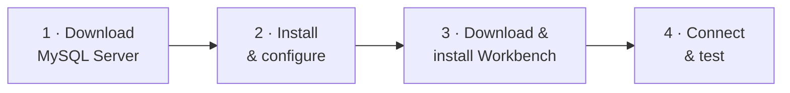

# 🐬 Installing MySQL on Windows & Mac

A step-by-step guide to downloading and installing **MySQL Server** and **MySQL Workbench** on Windows and macOS, then checking that everything works.

> Part of my learning journey in **Data Engineering, Data Science & AI**.

## 🧩 What you install

| Component | What it is | Needed for |
| --- | --- | --- |
| **MySQL Server** | The database engine that stores data and runs queries | Everything |
| **MySQL Workbench** | Desktop app to write SQL, import/export data and manage the server | Writing and running queries |

**Which version?** Choose **MySQL 8.4 LTS** (Long-Term Support): stable, with support until 2032. MySQL 8.0 reached end of life in April 2026. The 9.x "Innovation" releases add new features but have a short support life.

## 🗺️ The process



---

## 🪟 Windows

**Before you start:** 64-bit Windows (Windows 11 recommended), an administrator account, and the [Microsoft Visual C++ Redistributable](https://learn.microsoft.com/cpp/windows/latest-supported-vc-redist) (x64) installed.

### Step 1 · Download MySQL Server

1. Go to **[dev.mysql.com/downloads/mysql](https://dev.mysql.com/downloads/mysql/)**.
2. Select version **8.4.x LTS** and operating system **Microsoft Windows**.
3. Download **Windows (x86, 64-bit), MSI Installer** (`mysql-8.4.x-winx64.msi`).
4. On the next page, click **No thanks, just start my download** (no account needed).

> ⚠️ Don't use the old **MySQL Installer** (`mysql-installer-community-…`). It only installs MySQL 8.0, which is no longer supported.

### Step 2 · Install MySQL Server

1. Double-click the `.msi` → **Next** → accept the licence → choose **Typical** → **Install**.
2. On the last screen keep **Run MySQL Configurator** ticked → **Finish**.

### Step 3 · Configure the server (MySQL Configurator)

| Screen | What to choose |
| --- | --- |
| **Type and Networking** | Config type **Development Computer**; keep **TCP/IP**, port **3306**, **Open Windows Firewall port** ticked |
| **Accounts and Roles** | Set a strong **root password** and **write it down** |
| **Windows Service** | Keep **Configure MySQL Server as a Windows Service** (name `MySQL84`) and **Start at System Startup** ticked |
| **Server File Permissions** | Keep the default (full access for the service account and Administrators only) |
| **Sample Databases** | Optional: tick `sakila` and `world` for practice data |
| **Apply Configuration** | Click **Execute**, wait for all green ticks → **Next** → **Finish** |

MySQL is installed in `C:\Program Files\MySQL\MySQL Server 8.4\`; databases live in `C:\ProgramData\MySQL\MySQL Server 8.4\Data\`.

### Step 4 · Install MySQL Workbench

1. Go to **[dev.mysql.com/downloads/workbench](https://dev.mysql.com/downloads/workbench/)**.
2. Choose **Microsoft Windows** → download the **MSI Installer** → **No thanks, just start my download**.
3. Run the `.msi` → **Next** → **Complete** → **Install** → **Finish**.

### Step 5 (optional) · Use `mysql` from the command line

1. Start menu → search **Edit the system environment variables** → **Environment Variables**.
2. Under **System variables**, select **Path** → **Edit** → **New** → add `C:\Program Files\MySQL\MySQL Server 8.4\bin` → **OK**.
3. Open a new Command Prompt and run `mysql -u root -p`.

---

## 🍎 macOS

**Before you start:** an administrator account, and know your Mac's chip: **Apple menu → About This Mac** (Apple M1/M2/M3/M4 = **ARM**; Intel = **x86**).

### Step 1 · Download MySQL Server

1. Go to **[dev.mysql.com/downloads/mysql](https://dev.mysql.com/downloads/mysql/)**.
2. Select version **8.4.x LTS** and operating system **macOS**.
3. Download the **DMG Archive** that matches your chip:
   - Apple Silicon → **macOS (ARM, 64-bit), DMG Archive**
   - Intel → **macOS (x86, 64-bit), DMG Archive**
4. Click **No thanks, just start my download**.

### Step 2 · Install MySQL Server

1. Double-click the `.dmg`, then double-click the `.pkg` inside.
2. **Continue** → **Agree** to the licence → **Install** (enter your Mac password).
3. **Configuration** screen: set the **root password** (write it down) and keep the option to **start MySQL Server** after configuration ticked → **Finish**.
4. **Close** the installer and eject the disk image.

MySQL is installed in `/usr/local/mysql/`.

### Step 3 · Check the server is running

**System Settings** → scroll to the bottom → **MySQL**:

- A green dot and **Stop MySQL Server** button mean it's running.
- Tick **Start MySQL when your computer starts up** if you want it always available.

### Step 4 · Install MySQL Workbench

1. Go to **[dev.mysql.com/downloads/workbench](https://dev.mysql.com/downloads/workbench/)**.
2. Choose **macOS** → download the DMG for your chip (**ARM** or **x86**) → **No thanks, just start my download**.
3. Open the `.dmg` and drag **MySQLWorkbench** into **Applications**.
4. First launch: if macOS blocks it, go to **System Settings → Privacy & Security** → **Open Anyway**.

### Step 5 (optional) · Use `mysql` from the Terminal

```bash
echo 'export PATH="/usr/local/mysql/bin:$PATH"' >> ~/.zshrc
source ~/.zshrc
mysql -u root -p
```

> 💡 **Alternative for Homebrew users:** `brew install mysql@8.4` then `brew services start mysql@8.4`. Don't install both the DMG and Homebrew versions: they clash on port 3306.

---

## ✅ Connect and test (Windows & Mac)

1. Open **MySQL Workbench**.
2. Under **MySQL Connections**, click **Local instance 3306**.
   (Not listed? Click **+**, keep host `127.0.0.1`, port `3306`, user `root` → **OK**.)
3. Enter the **root password** → tick **Save password in vault / keychain** → **OK**.
4. In the query tab, run:

```sql
SELECT VERSION();                      -- e.g. 8.4.x
SHOW DATABASES;                        -- information_schema, mysql, performance_schema, sys

CREATE DATABASE audit_fy2026;          -- the database used in my lessons
SHOW DATABASES;                        -- audit_fy2026 now listed
```

Click the ⚡ (**Execute**) button, or press **Ctrl + Enter** (Windows) / **Cmd + Enter** (Mac) to run the current statement.

## ⚠️ Troubleshooting

| Problem | Likely cause | Fix |
| --- | --- | --- |
| Install fails: missing `VCRUNTIME140.dll` (Windows) | Visual C++ Redistributable not installed | Install it (x64), then rerun the MSI |
| Port 3306 already in use | Another MySQL is running | Stop or uninstall the other MySQL, or pick another port (e.g. 3307) |
| Workbench: `Can't connect to MySQL server on '127.0.0.1:3306'` | Server not running | **Windows:** Services → `MySQL84` → **Start**. **Mac:** System Settings → MySQL → **Start MySQL Server** |
| `Access denied for user 'root'@'localhost'` | Wrong password | Re-enter it; passwords are case-sensitive |
| Mac: "cannot be opened because the developer cannot be verified" | macOS Gatekeeper | **System Settings → Privacy & Security → Open Anyway** |
| Workbench warns about an "incompatible/nonstandard server version" | Workbench is older than the server (e.g. MySQL 9.x) | Click **Continue Anyway**; everyday SQL works |
| `mysql: command not found` / `'mysql' is not recognized` | `bin` folder not on PATH | Do the optional Step 5 |

## 🎯 Key takeaways

1. Install **MySQL 8.4 LTS** (server) plus **MySQL Workbench** (client).
2. **Windows:** server MSI → **MySQL Configurator** (port 3306, root password, Windows service).
3. **Mac:** pick the **ARM** or **x86** DMG to match your chip; the root password is set in the installer.
4. **Save the root password**: you need it for every connection.
5. Test with `SELECT VERSION();` in Workbench before starting any lesson.
