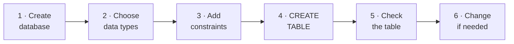

# 🧱 Creating Tables in MySQL

Create a database and a table in MySQL, choose the right data types and constraints, and check the result. The worked example is an **SAP ERP Trial Balance**.

> Part of my learning journey in **Data Engineering, Data Science & AI**.

## 🧾 The example: SAP Trial Balance

A **trial balance (TB)** lists every general ledger (G/L) account with its opening balance, debits, credits and closing balance for a period. We will build the `trial_balance` table that holds the sample file [`data/sap_trial_balance_fy2026.csv`](data/sap_trial_balance_fy2026.csv).

```text
BUKRS,GJAHR,PERIOD,KEY_DATE,HKONT,TXT50,BAL_CF,DEBIT,CREDIT,CLOSING,WAERS
1000,2026,012,2026-12-31,0000100000,Cash at bank - Operating,850000.00,4210300.40,4033028.42,1027271.98,USD
```

## 🗺️ The process



## Step 1 · Create and select a database

A database (also called a **schema**) groups related tables, for example one per audit engagement.

```sql
CREATE DATABASE IF NOT EXISTS audit_fy2026;
USE audit_fy2026;          -- all following statements run in this database
```

## Step 2 · Choose the data types

Choose each column's type from **what the data means**, not what it looks like.

| Data | Type | TB columns | Why |
| --- | --- | --- | --- |
| Fixed-length codes | `CHAR(n)` | `BUKRS`, `PERIOD`, `WAERS` | Always the same length (`1000`, `012`, `USD`) |
| Variable-length codes | `VARCHAR(n)` | `HKONT` | Keeps leading zeros: `0000400000` |
| Text | `VARCHAR(n)` | `TXT50` | SAP descriptions are up to 50 characters |
| Whole numbers | `SMALLINT`, `INT` | `GJAHR` | Years, counts |
| Money | `DECIMAL(15,2)` | `BAL_CF`, `DEBIT`, `CREDIT`, `CLOSING` | Exact: 15 digits, 2 after the point |
| Dates | `DATE` | `KEY_DATE` | Sort, filter and compare by date |

⚠️ Avoid `INT` for account numbers (drops leading zeros) and `FLOAT`/`DOUBLE` for money (rounding errors in totals).

## Step 3 · Add constraints

Constraints are rules the table enforces on every row.

| Constraint | What it does | TB use |
| --- | --- | --- |
| `NOT NULL` | Value is required | Every account must have a number and balance |
| `PRIMARY KEY` | Unique identifier for each row | One row per company + year + period + account |
| `DEFAULT` | Value used when none is given | Currency defaults to `USD` |
| `CHECK` | Value must pass a test | Debits and credits can't be negative |
| `UNIQUE` | No duplicates in a column | Not needed here; the primary key covers it |

## Step 4 · Create the table

```sql
CREATE TABLE trial_balance (
    bukrs     CHAR(4)        NOT NULL,                -- company code
    gjahr     SMALLINT       NOT NULL,                -- fiscal year
    period    CHAR(3)        NOT NULL,                -- posting period '012'
    key_date  DATE           NOT NULL,                -- reporting date
    hkont     VARCHAR(10)    NOT NULL,                -- G/L account
    txt50     VARCHAR(50)    NOT NULL,                -- account description
    bal_cf    DECIMAL(15,2)  NOT NULL DEFAULT 0,      -- opening balance
    debit     DECIMAL(15,2)  NOT NULL DEFAULT 0,
    credit    DECIMAL(15,2)  NOT NULL DEFAULT 0,
    closing   DECIMAL(15,2)  NOT NULL DEFAULT 0,      -- credits negative
    waers     CHAR(3)        NOT NULL DEFAULT 'USD',  -- currency
    PRIMARY KEY (bukrs, gjahr, period, hkont),
    CHECK (debit >= 0 AND credit >= 0)
);
```

**Point and click alternative (MySQL Workbench):** in **Navigator → Schemas**, expand `audit_fy2026` → right-click **Tables** → **Create Table…** → enter the name and columns, tick **PK** / **NN** → **Apply**. Workbench shows the generated `CREATE TABLE` script before running it.

## Step 5 · Check the table

```sql
SHOW TABLES;                        -- trial_balance is listed
DESCRIBE trial_balance;             -- columns, types, keys, defaults
SHOW CREATE TABLE trial_balance;    -- the full definition, ready to copy
```

`DESCRIBE trial_balance;` (first rows):

| Field | Type | Null | Key | Default |
| --- | --- | --- | --- | --- |
| bukrs | char(4) | NO | PRI | NULL |
| gjahr | smallint | NO | PRI | NULL |
| period | char(3) | NO | PRI | NULL |
| key_date | date | NO | | NULL |
| hkont | varchar(10) | NO | PRI | NULL |

## Step 6 · Change or remove a table

```sql
-- Add a column (e.g. account type: balance sheet or P&L)
ALTER TABLE trial_balance ADD COLUMN acct_type CHAR(2) NULL AFTER txt50;

-- Change a column's type or size
ALTER TABLE trial_balance MODIFY COLUMN txt50 VARCHAR(100) NOT NULL;

-- Remove a column
ALTER TABLE trial_balance DROP COLUMN acct_type;

-- Empty the table but keep its structure (before reloading a TB)
TRUNCATE TABLE trial_balance;

-- Delete the table and its data permanently
DROP TABLE IF EXISTS trial_balance;
```

⚠️ `TRUNCATE` and `DROP` can't be undone.

## 🧪 Try creating the table

1. Run Step 1 and Step 4 in MySQL Workbench.
2. Run `DESCRIBE trial_balance;` and check the types and the primary key.
3. Test the constraints. Each statement below should fail:

```sql
-- Duplicate account → Error 1062: Duplicate entry
INSERT INTO trial_balance (bukrs, gjahr, period, key_date, hkont, txt50)
VALUES ('1000', 2026, '012', '2026-12-31', '0000100000', 'Cash at bank'),
       ('1000', 2026, '012', '2026-12-31', '0000100000', 'Cash at bank');

-- Negative debit → Error 3819: Check constraint is violated
INSERT INTO trial_balance (bukrs, gjahr, period, key_date, hkont, txt50, debit)
VALUES ('1000', 2026, '012', '2026-12-31', '0000999999', 'Test', -100);
```

4. Load the sample TB into the table with the **Table Data Import Wizard** → **Use existing table** (see [Importing Excel / CSV into MySQL](importing-excel-csv-into-mysql.md)), and confirm `SELECT COUNT(*) FROM trial_balance;` returns **19**.

## ⚠️ Common issues

| Symptom | Cause | Fix |
| --- | --- | --- |
| `Error 1046: No database selected` | `USE` not run | `USE audit_fy2026;` |
| `Error 1050: Table already exists` | Table created earlier | `CREATE TABLE IF NOT EXISTS` or `DROP TABLE` first |
| `0000400000` stored as `400000` | Account column is `INT` | Use `VARCHAR(10)` |
| TB totals off by a few cents | Money column is `FLOAT`/`DOUBLE` | Use `DECIMAL(15,2)` |
| `Error 1406: Data too long` | Column too short (e.g. long description) | Increase the size with `ALTER TABLE … MODIFY` |
| `Error 1062: Duplicate entry` | Same account loaded twice | `TRUNCATE` before reloading |
| `Error 1064: SQL syntax` | Missing comma, or comma after the last line | Check commas between column lines |

## 🎯 Key takeaways

1. **`CREATE DATABASE` → `USE` → `CREATE TABLE`** is the basic order.
2. **Choose types by meaning:** `VARCHAR` for codes, `DECIMAL` for money, `DATE` for dates.
3. **Constraints protect the data:** `NOT NULL`, `PRIMARY KEY`, `DEFAULT`, `CHECK`.
4. A **composite primary key** (company + year + period + account) stops duplicate TB rows.
5. Check the result with **`DESCRIBE`** and **`SHOW CREATE TABLE`**.
6. **`ALTER`** changes a table, **`TRUNCATE`** empties it, **`DROP`** deletes it.
