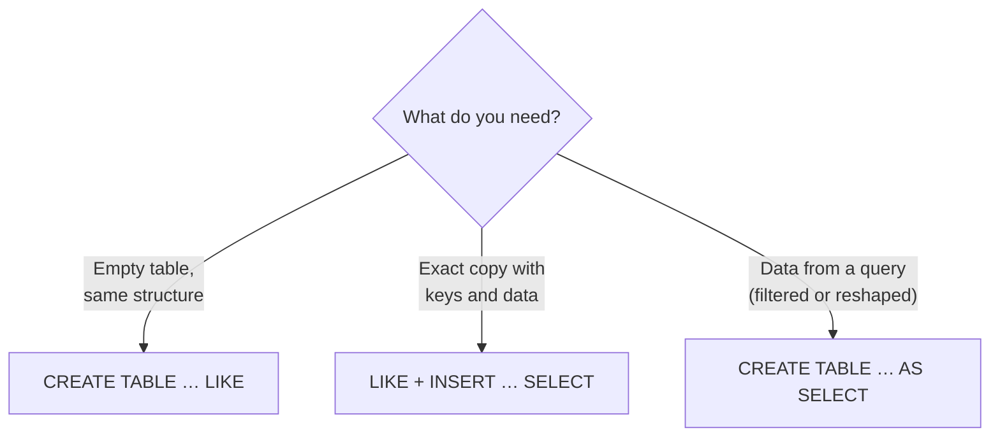

# 📑 Copying Tables in MySQL

Make a copy of a table's structure, its data, or both, with `CREATE TABLE … LIKE` and `CREATE TABLE … AS SELECT`. Typical uses: a **backup before adjustments** and a **snapshot per period** of an SAP ERP Trial Balance.

> Part of my learning journey in **Data Engineering, Data Science & AI**.

**Before you start:** create and load the `trial_balance` table ([Creating Tables](creating-tables-in-mysql.md), [Importing Excel / CSV](importing-excel-csv-into-mysql.md)).

## 🗺️ The options



| What is copied | `LIKE` | `LIKE` + `INSERT … SELECT` | `AS SELECT` |
| --- | --- | --- | --- |
| Columns, types, `NOT NULL`, `DEFAULT` | ✅ | ✅ | ✅ |
| Data | ❌ | ✅ | ✅ |
| Primary key and indexes | ✅ | ✅ | ❌ |
| `CHECK` constraints | ✅ | ✅ | ❌ |
| Foreign keys | ❌ | ❌ | ❌ |

## Step 1 · Back up a table before changing it

Copy the structure with `LIKE`, then the rows with `INSERT … SELECT`. Put the date in the name.

```sql
CREATE TABLE trial_balance_bkp_20261121 LIKE trial_balance;

INSERT INTO trial_balance_bkp_20261121
SELECT * FROM trial_balance;

SELECT COUNT(*) FROM trial_balance_bkp_20261121;   -- same count as trial_balance
```

## Step 2 · Snapshot one period

`AS SELECT` creates the table and fills it from any query in one statement.

```sql
CREATE TABLE tb_1000_2026_p12 AS
SELECT *
FROM trial_balance
WHERE bukrs = '1000' AND gjahr = 2026 AND period = '012';
```

## Step 3 · Build a reshaped extract

Choose columns, rename them, or add calculated ones.

```sql
-- P&L accounts only, with the movement for the year
CREATE TABLE tb_pl_2026 AS
SELECT hkont        AS gl_account,
       txt50        AS description,
       closing,
       closing - bal_cf AS movement
FROM trial_balance
WHERE hkont >= '0000400000';
```

Need an empty table with a query's columns? Add `WHERE 1 = 0`.

## Step 4 · Compare with the backup

After adjustments, list the accounts that changed:

```sql
SELECT t.hkont, t.txt50,
       b.closing AS closing_before,
       t.closing AS closing_after
FROM trial_balance t
JOIN trial_balance_bkp_20261121 b
  ON b.bukrs = t.bukrs AND b.gjahr = t.gjahr AND b.period = t.period AND b.hkont = t.hkont
WHERE t.closing <> b.closing;
```

## Step 5 · Restore from the backup

```sql
START TRANSACTION;
DELETE FROM trial_balance;
INSERT INTO trial_balance SELECT * FROM trial_balance_bkp_20261121;
COMMIT;
```

`DELETE` is used instead of `TRUNCATE` so the restore stays inside one transaction.

## Step 6 · Clean up

```sql
DROP TABLE IF EXISTS tb_pl_2026;
```

Keep backups only as long as needed, and name them consistently (`<table>_bkp_<yyyymmdd>`).

## 🧪 Try it

1. Back up `trial_balance` (Step 1).
2. Post the rent adjustment from [Inserting, Updating & Deleting Data](inserting-updating-deleting-data-in-mysql.md) and `COMMIT`.
3. Run Step 4: two accounts appear (`0000610000`, `0000220000`).
4. Restore (Step 5) and run Step 4 again: no rows.
5. Run `SHOW CREATE TABLE tb_1000_2026_p12;` and note the missing `PRIMARY KEY`.

## ⚠️ Common issues

| Symptom | Cause | Fix |
| --- | --- | --- |
| Copy has no primary key | Made with `AS SELECT` | Use `LIKE` + `INSERT … SELECT`, or `ALTER TABLE … ADD PRIMARY KEY` |
| Copy has no foreign keys | Never copied by either method | Add them with `ALTER TABLE` if needed |
| `Error 1050: Table already exists` | Backup name reused | Use a new date suffix, or drop the old copy |
| `Error 1136: Column count doesn't match` | Tables have different columns | List the columns in both `INSERT` and `SELECT` |
| Restore can't be undone | `TRUNCATE` used | Use `DELETE` in a transaction |

## 🎯 Key takeaways

1. **`CREATE TABLE … LIKE`** copies structure, keys and indexes, with no data.
2. **`CREATE TABLE … AS SELECT`** copies data from any query, but drops keys and indexes.
3. **`LIKE` + `INSERT … SELECT`** gives a complete copy: use it for backups.
4. **Foreign keys are never copied.**
5. Back up before adjustments, compare after, and restore inside a transaction.
