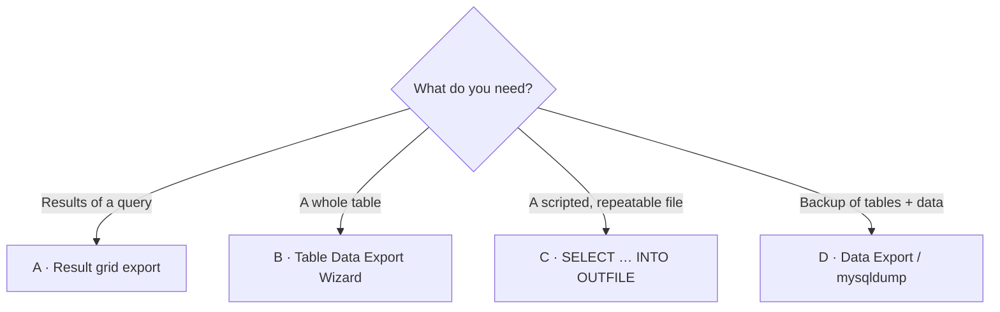

# 📤 Exporting Data from MySQL

Get data **out** of MySQL: query results to CSV for the audit team, whole tables with the **Table Data Export Wizard**, files written by SQL, and a full **backup** of a database. The worked example is an **SAP ERP Trial Balance**.

> Part of my learning journey in **Data Engineering, Data Science & AI**.

**Before you start:** create and load the `trial_balance` table ([Creating Tables](creating-tables-in-mysql.md), [Importing Excel / CSV](importing-excel-csv-into-mysql.md)).

## 🗺️ Which method?



| Method | Output | Header row | Runs on |
| --- | --- | --- | --- |
| A · Result grid export | CSV, JSON, Excel XML, … | ✅ | Your machine |
| B · Table Data Export Wizard | CSV, JSON | ✅ | Your machine |
| C · `SELECT … INTO OUTFILE` | CSV / text | ❌ (add it yourself) | Database server |
| D · Data Export / `mysqldump` | `.sql` script | n/a | Your machine |

## A · Export query results

1. Set **Query → Limit Rows → Don't Limit** (otherwise only 1,000 rows are exported).
2. Run the query, for example the P&L accounts:

```sql
SELECT hkont, txt50, bal_cf, debit, credit, closing
FROM trial_balance
WHERE hkont >= '0000400000'
ORDER BY hkont;
```

3. In the result grid toolbar click **Export recordset to an external file**.
4. Choose **CSV** as the format, enter a file name → **Save**.

## B · Export a whole table

1. In **Navigator → Schemas**, right-click `trial_balance` → **Table Data Export Wizard**.
2. Tick the columns to export → **Next**.
3. Enter the file path; choose **CSV** or **JSON**.
4. Set **Field Separator** (`,`), **Line Separator** (`CRLF` for Windows users), **Enclose Strings in** (`"`) → **Next** → **Finish**.

## C · Write a file with SQL

`SELECT … INTO OUTFILE` writes the file **on the database server**, only into the `secure_file_priv` folder.

```sql
SHOW VARIABLES LIKE 'secure_file_priv';

SELECT 'HKONT', 'TXT50', 'CLOSING'                 -- header row
UNION ALL
SELECT hkont, txt50, closing
FROM trial_balance
INTO OUTFILE 'C:/ProgramData/MySQL/MySQL Server 8.0/Uploads/tb_closing_fy2026.csv'
CHARACTER SET utf8mb4
FIELDS TERMINATED BY ',' OPTIONALLY ENCLOSED BY '"'
LINES TERMINATED BY '\r\n';
```

- `OUTFILE` doesn't add column names, so the first `SELECT` adds a header row.
- The file **must not already exist**.

## D · Back up a whole database

**Workbench:** **Server → Data Export** → tick `audit_fy2026` → **Dump Structure and Data** → **Export to Self-Contained File** (`audit_fy2026_20261121.sql`) → **Start Export**.

**Command line:**

```text
mysqldump -u <user> -p audit_fy2026 > audit_fy2026_20261121.sql
```

The `.sql` file holds the `CREATE TABLE` and `INSERT` statements needed to rebuild everything. Restore it with **Server → Data Import → Import from Self-Contained File**.

## 📂 Opening an exported CSV in Excel

Double-clicking a CSV lets Excel guess the types, which **strips leading zeros** (`0000400000` → `400000`). Instead:

1. **Data → From Text/CSV** → select the file.
2. **Transform Data** → set `HKONT` (and other code columns) to **Text** → **Close & Load**.

## 🧪 Try it

1. Export the P&L query with method A and open it with **Data → From Text/CSV**: 7 accounts, leading zeros kept.
2. Export `trial_balance` with method B: 19 rows plus a header.
3. Back up `audit_fy2026` with method D and open the `.sql` file in a text editor to find the `CREATE TABLE` and `INSERT` statements.

## ⚠️ Common issues

| Symptom | Cause | Fix |
| --- | --- | --- |
| Export has only 1,000 rows | Workbench row limit | **Query → Limit Rows → Don't Limit**, then rerun |
| Leading zeros gone in Excel | Excel guessed `HKONT` as a number | **Data → From Text/CSV**, set column to Text |
| `Error 1290: --secure-file-priv option` | `OUTFILE` path outside the allowed folder | Write into the `secure_file_priv` folder |
| `Error 1086: File already exists` | `OUTFILE` never overwrites | Delete the old file or use a new name |
| Garbled characters (`ü`) in Excel | Encoding not detected | Import with **Data → From Text/CSV**, File Origin `65001: UTF-8` |
| No column names in the file | `INTO OUTFILE` adds none | Add the header with `UNION ALL` |

## 🎯 Key takeaways

1. **Result grid export** is quickest for query results; turn off the 1,000-row limit first.
2. The **Table Data Export Wizard** exports a whole table to CSV or JSON.
3. **`SELECT … INTO OUTFILE`** is scriptable but writes on the server, into `secure_file_priv`, with no header.
4. **Data Export / `mysqldump`** backs up structure and data as a `.sql` script.
5. Open exported CSVs with **Data → From Text/CSV** so G/L accounts keep their leading zeros.
