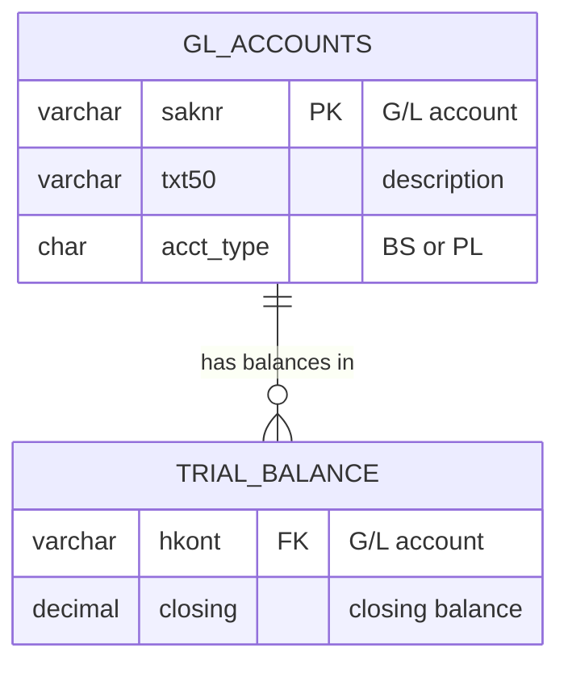
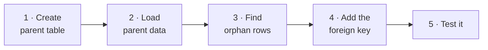

# 🔗 Foreign Keys & Related Tables in MySQL

Link two tables with a **foreign key** so every row in one table must match a row in the other. The worked example links an **SAP ERP Trial Balance** to its **Chart of Accounts**.

> Part of my learning journey in **Data Engineering, Data Science & AI**.

**Before you start:** create and load the `trial_balance` table ([Creating Tables](creating-tables-in-mysql.md), [Importing Excel / CSV](importing-excel-csv-into-mysql.md)).

**Sample file:** [`data/sap_chart_of_accounts.csv`](data/sap_chart_of_accounts.csv): chart of accounts `YCOA`, 22 G/L accounts with type `BS` (balance sheet) or `PL` (profit & loss).

## 🧩 The relationship



- **Parent** table: `gl_accounts`, one row per G/L account (SAP master data).
- **Child** table: `trial_balance`, many rows per account (one per company code, year and period).
- The **foreign key** `trial_balance.hkont → gl_accounts.saknr` blocks balances for accounts that don't exist.

## 🗺️ The process



## Step 1 · Create the parent table

```sql
CREATE TABLE gl_accounts (
    ktopl      CHAR(4)      NOT NULL,   -- chart of accounts
    saknr      VARCHAR(10)  NOT NULL,   -- G/L account
    txt50      VARCHAR(50)  NOT NULL,
    acct_type  CHAR(2)      NOT NULL,   -- BS = balance sheet, PL = profit & loss
    PRIMARY KEY (saknr),
    CHECK (acct_type IN ('BS', 'PL'))
);
```

⚠️ The parent column must be a **primary key or indexed**, and its type must **match the child column** (same type and character set; keep the length identical too: `VARCHAR(10)` on both sides).

## Step 2 · Load the parent data

Import `sap_chart_of_accounts.csv` with the **Table Data Import Wizard** → **Use existing table** → `gl_accounts`. Expect **22 records**.

**Load order:** parent first, then child. A child row can't point to a parent that isn't there yet.

## Step 3 · Find orphan rows

An **orphan** is a child row with no matching parent. The foreign key can't be added while orphans exist.

```sql
SELECT tb.hkont, tb.txt50
FROM trial_balance tb
LEFT JOIN gl_accounts g ON g.saknr = tb.hkont
WHERE g.saknr IS NULL;          -- expected: no rows
```

In audit terms, an orphan is a balance on an account missing from the chart of accounts: a finding to raise with the client.

## Step 4 · Add the foreign key

```sql
ALTER TABLE trial_balance
ADD CONSTRAINT fk_tb_gl_account
    FOREIGN KEY (hkont) REFERENCES gl_accounts (saknr)
    ON UPDATE CASCADE
    ON DELETE RESTRICT;
```

For a new table, declare it inside `CREATE TABLE` instead:

```sql
    CONSTRAINT fk_tb_gl_account FOREIGN KEY (hkont) REFERENCES gl_accounts (saknr)
```

| Option | When the parent row is… | Effect on child rows |
| --- | --- | --- |
| `RESTRICT` (default) | deleted or updated | Blocked while child rows exist |
| `CASCADE` | deleted / updated | Child rows deleted / updated too |
| `SET NULL` | deleted or updated | Child column set to `NULL` (column must allow `NULL`) |

✅ For audit data use **`ON DELETE RESTRICT`**: deleting an account must never silently delete its balances.

MySQL automatically adds an index on the child column (`hkont`) if none exists. In Workbench, see the key under **Alter Table → Foreign Keys**.

## Step 5 · Test the foreign key

```sql
-- Balance for an account not in the chart → Error 1452
INSERT INTO trial_balance (bukrs, gjahr, period, key_date, hkont, txt50)
VALUES ('1000', 2026, '012', '2026-12-31', '0000999999', 'Unknown account');

-- Delete an account that has balances → Error 1451
DELETE FROM gl_accounts WHERE saknr = '0000100000';

-- Delete an account with no balances → works
DELETE FROM gl_accounts WHERE saknr = '0000720000';
```

## 🧪 Try it

1. Run Steps 1 to 4.
2. Run the three statements in Step 5 and note which ones fail.
3. Join the tables to show the account type next to each balance:

```sql
SELECT g.acct_type, SUM(tb.closing) AS closing
FROM trial_balance tb
JOIN gl_accounts g ON g.saknr = tb.hkont
GROUP BY g.acct_type;   -- BS and PL totals are equal and opposite
```

## ⚠️ Common issues

| Symptom | Cause | Fix |
| --- | --- | --- |
| `Error 1452: Cannot add or update a child row` | Child value missing in parent | Load the parent first; check orphans (Step 3) |
| `Error 1451: Cannot delete or update a parent row` | Parent still has child rows | Expected with `RESTRICT`; delete the child rows first if intended |
| `Error 3780: Referencing column and referenced column are incompatible` | Different types or character sets (`INT` vs `VARCHAR`) | Give both columns the same definition |
| `Error 1822: Missing index for constraint` | Parent column not a key | Make it the primary key or add an index |
| `Error 1701: Cannot truncate a table referenced in a foreign key` | `TRUNCATE` on the parent | Empty the child first and use `DELETE`, or drop the key |
| Wizard created `saknr` as `text` | Table made by the wizard | Create the parent table yourself (Step 1), then import |

## 🎯 Key takeaways

1. A **foreign key** makes every child value exist in the parent: no balances on unknown accounts.
2. **Parent first, child second**, for creating, loading and checking; drop or empty in the reverse order.
3. Column types must **match**, and the parent column must be a key.
4. **Find orphans** with `LEFT JOIN … WHERE parent IS NULL` before adding the key.
5. Use **`ON DELETE RESTRICT`** for audit data; `CASCADE` deletes child rows silently.
