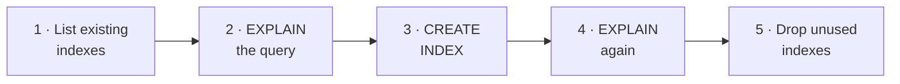

# ⚡ Indexes in MySQL

Speed up searches on large tables with **indexes**, and use `EXPLAIN` to see whether a query uses one. The worked example is an **SAP ERP Trial Balance**; the same steps matter most on big tables such as journal entry extracts.

> Part of my learning journey in **Data Engineering, Data Science & AI**.

**Before you start:** create and load the `trial_balance` table ([Creating Tables](creating-tables-in-mysql.md), [Importing Excel / CSV](importing-excel-csv-into-mysql.md)).

## 💡 What an index is

An index works like the index at the back of a book: MySQL jumps straight to matching rows instead of reading the whole table (a **full table scan**).

| | Without index | With index |
| --- | --- | --- |
| Find 1 account in 5 million JE lines | Reads 5 million rows | Reads a handful |
| Cost | — | Extra disk space; slightly slower `INSERT`/`UPDATE`/loads |

## 🗺️ The process



## Step 1 · List existing indexes

```sql
SHOW INDEX FROM trial_balance;
```

| Key_name | Seq_in_index | Column_name |
| --- | --- | --- |
| PRIMARY | 1 | bukrs |
| PRIMARY | 2 | gjahr |
| PRIMARY | 3 | period |
| PRIMARY | 4 | hkont |

- The **primary key is always an index.**
- A **foreign key** adds one too (e.g. `fk_tb_gl_account` on `hkont`, see [Foreign Keys](foreign-keys-and-related-tables-in-mysql.md)).

**Leftmost-prefix rule:** a multi-column index is used only when the query filters on its **first column(s)**, in order.

| `WHERE` filters on | Uses `PRIMARY`? |
| --- | --- |
| `bukrs` | ✅ |
| `bukrs`, `gjahr`, `period` | ✅ |
| `hkont` only | ❌ (not the first column) |
| `gjahr`, `period` (no `bukrs`) | ❌ |

## Step 2 · Check a query with `EXPLAIN`

Find revenue accounts by description:

```sql
EXPLAIN
SELECT hkont, txt50, closing
FROM trial_balance
WHERE txt50 LIKE 'Revenue%';
```

| type | possible_keys | key | rows |
| --- | --- | --- | --- |
| `ALL` | NULL | NULL | 19 |

`type = ALL` and `key = NULL` mean a **full table scan**.

| `type` | Meaning |
| --- | --- |
| `const` / `eq_ref` | One row via a unique key (best) |
| `ref` / `range` | Index used for a value or range |
| `index` | Whole index read |
| `ALL` | Whole table read (worst on big tables) |

## Step 3 · Create an index

```sql
CREATE INDEX idx_tb_txt50 ON trial_balance (txt50);
```

Other forms:

```sql
-- Composite index: column order matters (leftmost-prefix rule)
CREATE INDEX idx_tb_year_period ON trial_balance (gjahr, period);

-- Unique index: also blocks duplicate values
CREATE UNIQUE INDEX idx_gl_txt50 ON gl_accounts (txt50);
```

For a journal entry table, typical indexes are the **posting date** (cut-off and period tests), **G/L account** and **user** columns.

## Step 4 · Run `EXPLAIN` again

| type | possible_keys | key | rows |
| --- | --- | --- | --- |
| `range` | idx_tb_txt50 | idx_tb_txt50 | 2 |

MySQL now reads 2 rows instead of 19.

⚠️ On very small tables MySQL may still choose a full scan because it is cheaper. That's expected; the benefit shows on large tables.

**Patterns that can't use an index:**

| Query | Why | Index-friendly version |
| --- | --- | --- |
| `txt50 LIKE '%sales'` | Leading wildcard | `txt50 LIKE 'Revenue%'` |
| `YEAR(key_date) = 2026` | Function on the column | `key_date BETWEEN '2026-01-01' AND '2026-12-31'` |
| `hkont = 400000` | Number compared with a text column | `hkont = '0000400000'` |

## Step 5 · Drop indexes you don't need

```sql
DROP INDEX idx_tb_year_period ON trial_balance;
```

Index columns you **filter, join or sort on often**. Skip columns with few distinct values (`waers`, `S`/`H` indicators) and small tables.

## 🧪 Try it

1. Run `SHOW INDEX FROM trial_balance;` and note the indexes.
2. Run the `EXPLAIN` in Step 2: `key` is `NULL`.
3. Create `idx_tb_txt50` and run `EXPLAIN` again: `key` is `idx_tb_txt50`.
4. Change the filter to `LIKE '%sales'` and run `EXPLAIN`: back to `ALL`.
5. Drop the index: `DROP INDEX idx_tb_txt50 ON trial_balance;`.

## ⚠️ Common issues

| Symptom | Cause | Fix |
| --- | --- | --- |
| Index exists but `key = NULL` | Leading `%`, function on column, or type mismatch | Rewrite the filter (Step 4 table) |
| Composite index not used | Filter skips the first column | Reorder the index or add the first column to `WHERE` |
| Loads became slow | Too many indexes | Drop unused ones; for very large loads, add indexes after loading |
| `Error 1061: Duplicate key name` | Index name already used | Pick a new name, or drop the old index |
| `Error 1062` when creating a unique index | Column already has duplicates | Remove the duplicates first |

## 🎯 Key takeaways

1. An **index** avoids full table scans; it costs space and some write speed.
2. **Primary and foreign keys** already create indexes; check with `SHOW INDEX`.
3. **`EXPLAIN`** shows whether a query uses an index: aim to avoid `type = ALL` on big tables.
4. **Leftmost-prefix rule:** composite indexes work from their first column.
5. Leading wildcards, functions on columns and type mismatches **stop an index being used**.
