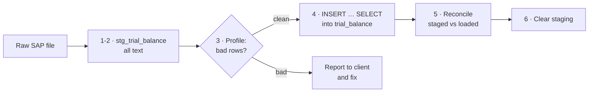

# 🧺 Staging Tables in MySQL

Load messy files into a **staging table** first, find the bad rows with SQL, then move only clean, converted rows into the final table. Nothing is skipped silently. The worked example is a raw **SAP ERP Trial Balance** export.

> Part of my learning journey in **Data Engineering, Data Science & AI**.

**Before you start:** create the `trial_balance` table ([Creating Tables](creating-tables-in-mysql.md)).

**Sample file:** [`data/sap_trial_balance_fy2026_raw.csv`](data/sap_trial_balance_fy2026_raw.csv): 19 accounts in SAP export format (`31.12.2026`, `"1,800,000.00"`, `"540,000.00-"`).

## 💡 Why stage?

| Loading straight into typed columns | Loading into a staging table |
| --- | --- |
| Bad rows are skipped or changed during the load | Every row lands as text: nothing is lost |
| You see a count or warning, not the row itself | Bad rows can be queried, listed and sent to the client |
| Conversion rules sit in the load tool | Conversion is plain SQL you can rerun |

## 🗺️ The process



## Step 1 · Create the staging table

Every file column is text, long enough for any value. Two extra columns trace each row.

```sql
CREATE TABLE stg_trial_balance (
    row_id     INT AUTO_INCREMENT PRIMARY KEY,         -- 1, 2, 3 … in file order
    bukrs      VARCHAR(50),
    gjahr      VARCHAR(50),
    period     VARCHAR(50),
    key_date   VARCHAR(50),
    hkont      VARCHAR(50),
    txt50      VARCHAR(200),
    bal_cf     VARCHAR(50),
    debit      VARCHAR(50),
    credit     VARCHAR(50),
    closing    VARCHAR(50),
    waers      VARCHAR(50),
    loaded_at  DATETIME DEFAULT CURRENT_TIMESTAMP       -- when the row was staged
);
```

`AUTO_INCREMENT` numbers rows automatically, so each problem can be traced back to its line in the file.

## Step 2 · Load the raw file

Use either method; with all-text columns **no row fails conversion**:

- **Import Wizard** → **Use existing table** → `stg_trial_balance` (leave `row_id` and `loaded_at` unmapped), or
- **`LOAD DATA`** with a column list (see [Bulk Loading](bulk-loading-with-load-data-infile-in-mysql.md)):

```sql
LOAD DATA LOCAL INFILE 'C:/data/sap_trial_balance_fy2026_raw.csv'
INTO TABLE stg_trial_balance
FIELDS TERMINATED BY ',' OPTIONALLY ENCLOSED BY '"'
LINES TERMINATED BY '\r\n'
IGNORE 1 LINES
(bukrs, gjahr, period, key_date, hkont, txt50, bal_cf, debit, credit, closing, waers);
```

## Step 3 · Profile the staged rows

Each query lists rows that would fail or corrupt the final table. **Expected on the sample: no rows.**

```sql
-- G/L account not 10 digits (blank, "Total" lines, lost zeros)
SELECT row_id, hkont, txt50 FROM stg_trial_balance
WHERE hkont IS NULL OR hkont NOT REGEXP '^[0-9]{10}$';

-- Dates that don't convert
SELECT row_id, key_date FROM stg_trial_balance
WHERE STR_TO_DATE(key_date, '%d.%m.%Y') IS NULL;

-- Amounts not in SAP format 1,234.56 or 1,234.56-
SELECT row_id, bal_cf, debit, credit, closing FROM stg_trial_balance
WHERE CONCAT_WS('|', bal_cf, debit, credit, closing)
      NOT REGEXP '^[0-9,]+[.][0-9]{2}-?([|][0-9,]+[.][0-9]{2}-?){3}$';

-- Duplicate accounts
SELECT bukrs, gjahr, period, hkont, COUNT(*) AS copies
FROM stg_trial_balance
GROUP BY bukrs, gjahr, period, hkont
HAVING COUNT(*) > 1;
```

## Step 4 · Move clean rows into the final table

`INSERT … SELECT` converts each column and keeps only rows that pass the checks.

```sql
INSERT INTO trial_balance
    (bukrs, gjahr, period, key_date, hkont, txt50, bal_cf, debit, credit, closing, waers)
SELECT bukrs,
       gjahr,
       period,
       STR_TO_DATE(key_date, '%d.%m.%Y'),
       hkont,
       txt50,
       -- "540,000.00-" → "-540000.00"
       REPLACE(IF(bal_cf  LIKE '%-', CONCAT('-', TRIM(TRAILING '-' FROM bal_cf)),  bal_cf),  ',', ''),
       REPLACE(debit,  ',', ''),
       REPLACE(credit, ',', ''),
       REPLACE(IF(closing LIKE '%-', CONCAT('-', TRIM(TRAILING '-' FROM closing)), closing), ',', ''),
       waers
FROM stg_trial_balance
WHERE hkont    REGEXP '^[0-9]{10}$'                       -- valid G/L account
  AND key_date REGEXP '^[0-9]{2}[.][0-9]{2}[.][0-9]{4}$'  -- DD.MM.YYYY
ORDER BY row_id;
```

The date filter uses `REGEXP`, not `STR_TO_DATE`: in strict mode, a bad date inside an `INSERT … SELECT` raises an error even in the `WHERE`.

Run Step 4 inside `START TRANSACTION … COMMIT` so a failed insert leaves the final table untouched.

## Step 5 · Reconcile staged vs loaded

```sql
SELECT (SELECT COUNT(*) FROM stg_trial_balance) AS staged_rows,
       (SELECT COUNT(*) FROM trial_balance)     AS loaded_rows;   -- sample: 19 and 19
```

Any difference must equal the rows listed in Step 3. List them for the client:

```sql
SELECT s.row_id, s.hkont, s.txt50
FROM stg_trial_balance s
LEFT JOIN trial_balance t
  ON t.bukrs = s.bukrs AND t.period = s.period AND t.hkont = s.hkont
WHERE t.hkont IS NULL;
```

## Step 6 · Clear staging for the next file

```sql
TRUNCATE TABLE stg_trial_balance;   -- also resets row_id to 1
```

## 🧪 Try it

1. Run Steps 1 and 2, then `SELECT COUNT(*) FROM stg_trial_balance;` → 19.
2. Open the raw CSV in a text editor and add this line at the end, as SAP reports often do:

```text
,,,,,Total,"0.00","20,774,230.17","20,774,230.17","0.00",USD
```

3. Clear staging (Step 6) and reload: 20 rows staged.
4. Run Step 3: the account and date checks both list `row_id 20` (`Total`).
5. Run Steps 4 and 5: **20 staged, 19 loaded**, and the unmatched row is the Total line.

## ⚠️ Common issues

| Symptom | Cause | Fix |
| --- | --- | --- |
| `Error 1411 / 1292: Incorrect date value` in Step 4 | A date like `31.02.2026` matches the pattern but isn't a real date | Find it with the date check (Step 3) and fix it in staging |
| `Error 1366: Incorrect decimal value` | Unexpected amount format | Find it with the amount check, then adjust the conversion |
| `Error 1062: Duplicate entry` in Step 4 | Duplicates in the file, or final table not empty | Run the duplicate check; empty the final table before a full reload |
| Staged count higher than the file | Staging not cleared from a previous load | `TRUNCATE` staging before each load |
| Hidden `\r` in `waers` | Windows file loaded with `'\n'` | `LINES TERMINATED BY '\r\n'` |

## 🎯 Key takeaways

1. A **staging table** holds raw text, so **no row is lost** during the load.
2. **Profile with SQL** (`REGEXP`, `STR_TO_DATE … IS NULL`, `GROUP BY … HAVING`) to list bad rows by `row_id`.
3. **`INSERT … SELECT`** converts and moves only clean rows into the typed table.
4. **Reconcile** staged and loaded counts; every difference must be explained.
5. **`AUTO_INCREMENT`** and **`DEFAULT CURRENT_TIMESTAMP`** trace each row to its file line and load time.
