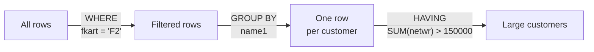

# 🧮 HAVING Clause in SQL

`HAVING` filters **groups** after `GROUP BY` has aggregated them. `WHERE` filters rows; `HAVING` filters summaries.

> Part of my learning journey in **Data Engineering, Data Science & AI** · Data: `revenue_lines` ([setup](README.md#setup))

## Syntax

```sql
SELECT group_column, AGG(column) AS alias
FROM table_name
WHERE row_condition              -- 1 · keep rows
GROUP BY group_column            -- 2 · build groups
HAVING AGG(column) > value       -- 3 · keep groups
ORDER BY alias DESC;             -- 4 · sort
```

## WHERE vs HAVING



| | `WHERE` | `HAVING` |
| --- | --- | --- |
| Filters | Individual rows | Groups |
| Runs | Before `GROUP BY` | After `GROUP BY` |
| Can use `SUM`, `COUNT`, `AVG`… | ❌ (`Error 1111`) | ✅ |
| Example | `fkdat BETWEEN '2026-01-01' AND '2026-12-31'` | `SUM(netwr) > 150000` |

## Examples

**1 · Customers above a revenue threshold** (FY2026)

```sql
SELECT name1, SUM(netwr) AS revenue
FROM revenue_lines
WHERE fkdat BETWEEN '2026-01-01' AND '2026-12-31'
GROUP BY name1
HAVING SUM(netwr) > 150000;
```

| name1 | revenue |
| --- | --- |
| Acme Retail | 155000.00 |
| Delta Distributors | 228000.00 |

**2 · Big revenue from few documents** (`COUNT` in `HAVING`)

```sql
SELECT name1, COUNT(DISTINCT vbeln) AS doc_count, SUM(netwr) AS revenue
FROM revenue_lines
WHERE fkart = 'F2'
GROUP BY name1
HAVING COUNT(DISTINCT vbeln) <= 2;     -- Delta Distributors: 2 documents, 228,000.00
```

**3 · Months more than double the monthly average** (subquery in `HAVING`)

```sql
SELECT MONTH(fkdat) AS month, SUM(netwr) AS revenue
FROM revenue_lines
WHERE fkdat BETWEEN '2026-01-01' AND '2026-12-31'
GROUP BY MONTH(fkdat)
HAVING SUM(netwr) > 2 * (SELECT SUM(netwr) / 12
                         FROM revenue_lines
                         WHERE fkdat BETWEEN '2026-01-01' AND '2026-12-31');
-- month 12: 301,550.00
```

**4 · Products sold at more than one price**

```sql
SELECT matnr, MIN(netpr) AS min_price, MAX(netpr) AS max_price
FROM revenue_lines
WHERE fkart = 'F2' AND netpr > 0
GROUP BY matnr
HAVING MAX(netpr) > MIN(netpr);        -- P-100: 1,250.00 to 1,950.00
```

**5 · WHERE and HAVING together: manual year-end billing**

```sql
SELECT ernam, COUNT(*) AS line_count, SUM(netwr) AS revenue
FROM revenue_lines
WHERE fkdat BETWEEN '2026-12-24' AND '2026-12-31'   -- rows: last week of the year
  AND ernam <> 'BATCH_SD'                           -- rows: manual users only
GROUP BY ernam
HAVING SUM(netwr) >= 100000;                        -- groups: large totals
-- SALES_MGR: 3 lines, 278,000.00
```

Put row conditions in `WHERE`: it removes rows **before** grouping, which is faster.

**6 · Multiple conditions and aliases**

```sql
SELECT region, ROUND(AVG(netwr), 2) AS avg_line
FROM revenue_lines
WHERE fkart = 'F2'
GROUP BY region
HAVING AVG(netwr) > 30000              -- MySQL also accepts: HAVING avg_line > 30000
ORDER BY avg_line DESC;                -- South 35,456.25 · Midwest 31,000.00
```

Combine conditions with `AND` / `OR`, as in `WHERE`.

## 🧪 Try it

1. Customers with more than 5 lines in FY2026 → 2 (Northwind Stores, Sunrise Hospitals).
2. Materials with FY2026 revenue above 200,000 → 2 (`P-100`, `P-200`).
3. Regions whose smallest invoice line is below 10,000 → 3.
4. Remove the date filter from Example 1: why does Delta Distributors drop out? (Its January 2027 credit memo of -156,000 is now included.)

## ⚠️ Common mistakes

| Mistake | Problem | Fix |
| --- | --- | --- |
| `WHERE SUM(netwr) > 150000` | `Error 1111`: aggregates not allowed in `WHERE` | Move to `HAVING` |
| `HAVING region = 'South'` (region not grouped) | `Error 1054`: unknown column | Filter rows in `WHERE`, or add it to `GROUP BY` |
| Row filters in `HAVING` (`HAVING fkart = 'F2'`) | Works only if grouped; slower | Put row filters in `WHERE` |
| Forgetting the period filter | Credits from the next year change totals | Always filter the period in `WHERE` |

## 🎯 Key takeaways

1. `HAVING` filters **groups**; `WHERE` filters **rows**.
2. Order: `WHERE` → `GROUP BY` → `HAVING` → `ORDER BY` → `LIMIT`.
3. `HAVING` can use any aggregate (`SUM`, `COUNT`, `AVG`, `MIN`, `MAX`), aliases (in MySQL) and subqueries.
4. Use `WHERE` for row conditions and `HAVING` only for aggregate conditions.
5. Audit uses: customers above a threshold, months above average, products with price variations, users with large manual totals.
