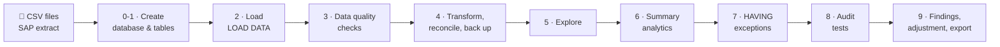

# 💰 Revenue Audit Analytics with SQL (SAP SD Billing, FY2026)

An end-to-end, runnable MySQL project that audits a year of **SAP sales billing data**: load a raw SAP extract, clean and reconcile it, analyse revenue, run revenue audit tests and record the findings.

It brings together every SQL topic from my learning journey so far, from `CREATE TABLE` to `HAVING`.

> Part of my learning journey in **Data Engineering, Data Science & AI**.

## 🎯 Business scenario

You are the data specialist on the audit of **company code 1000, FY2026** (calendar year, USD). The client has sent an SAP billing extract plus customer and material master data. Your job:

1. Load the data and **prove the extract is complete and accurate** (reconcile to SAP's report total).
2. Analyse revenue by month, product, customer, region and user.
3. Run **revenue audit tests**: cut-off, new customers, pricing, credit limits, duplicates, weekend, zero-value and round-amount billing.
4. Record findings and quantify the **proposed audit adjustment**.

## 🗺️ Project flow



## 📁 Project structure

```text
revenue-audit-sql-project/
├── README.md                       ← you are here
├── SUMMARY.md                      ← results and topic coverage on one page
├── INTERVIEW_QUESTIONS.md          ← interview questions and answers
├── requirements.txt                ← software needed
├── run_all.sql                     ← runs steps 0-9 in one go
├── data/
│   ├── customers.csv               ← 20 customers        (like SAP KNA1)
│   ├── materials.csv               ← 8 materials         (like SAP MARA/MAKT)
│   └── billing_lines_raw.csv       ← 958 raw rows        (like SAP VBRK/VBRP)
├── sql/
│   ├── 00_create_database.sql
│   ├── 01_create_tables.sql
│   ├── 02_load_data.sql
│   ├── 03_data_quality_checks.sql
│   ├── 04_transform_and_load.sql
│   ├── 05_exploration.sql
│   ├── 06_summary_analytics.sql
│   ├── 07_having_analysis.sql
│   ├── 08_audit_tests.sql
│   └── 09_findings_and_export.sql
├── scripts/
│   └── generate_data.py            ← recreates the CSV files (optional)
└── docs/
    └── expected_results.md         ← what each step should return
```

## 🗂️ The data

All data is **made up for practice**; the structure follows SAP SD.

**`billing_lines_raw.csv`**: 958 rows in **SAP export format** (`31.12.2026`, `"1,950.00"`, credit memos with a trailing minus `"156,000.00-"`). It holds 955 billing lines (585 documents, January 2026 to January 2027) and **3 deliberate problem rows**: an unknown customer, a missing date and SAP's report total line.

| Column | SAP field | Meaning |
| --- | --- | --- |
| `VBELN` / `POSNR` | VBRK-VBELN / VBRP-POSNR | Billing document / item |
| `FKART` | VBRK-FKART | `F2` invoice, `G2` credit memo |
| `FKDAT` | VBRK-FKDAT | Billing date |
| `KUNAG` | VBRK-KUNAG | Customer (sold-to) |
| `MATNR` | VBRP-MATNR | Material |
| `FKIMG` / `NETPR` / `NETWR` | VBRP | Quantity / net unit price / net value |
| `WAERK` / `ERNAM` | VBRK | Currency / created by |
| `VGBEL` | VBRP-VGBEL | Reference invoice (credit memos) |

**`customers.csv`**: number, name, region, country, customer group, **created-on date**, **credit limit**.
**`materials.csv`**: number, description, product group, **list price**.

## Run the project

### 1 · Prerequisites

- **MySQL Server 8.4 LTS** (8.0+ works) and **MySQL Workbench**: see [requirements.txt](requirements.txt).
- Download or clone this repository.

### 2 · Allow local file loading (once)

Connect as `root` and run:

```sql
SET GLOBAL local_infile = 1;
```

### 3a · Run everything from the command line (recommended)

Open a terminal **in the project folder** (paths in the scripts are relative to it):

```bash
mysql --local-infile=1 -u root -p --table < run_all.sql
```

To save the output: add `> output.txt` at the end. It takes a few seconds.

### 3b · Or run step by step in MySQL Workbench

1. **Edit Connection → Advanced → Others:** add `OPT_LOCAL_INFILE=1`, then reconnect.
2. Open `sql/00_create_database.sql` → run it with ⚡ (**Execute**).
3. Repeat for each script **in order**, `01` to `09`.
4. In `02_load_data.sql`, replace each `'data/…'` with the **full path**, using forward slashes:
   `'C:/Users/me/revenue-audit-sql-project/data/customers.csv'`
5. No `local_infile` allowed? Load the three CSVs with **Table Data Import Wizard → Use existing table** (`customers`, `materials`, `stg_billing_raw`), then continue with step `03`.

### 4 · Check the results

Each script ends with a `Step N complete` line. Compare the numbers with [docs/expected_results.md](docs/expected_results.md). Key checks:

| Check | Expected |
| --- | --- |
| Rows staged / loaded / rejected | 958 / 955 / 3 |
| Loaded total = SAP report total | 11,492,928.49 |
| FY2026 net revenue | 11,719,477.99 |
| Proposed adjustment (cut-off) | 245,400.00 |

Rerunning is safe: step `00` drops and recreates the `revenue_audit` database.

## 🧭 Steps in detail

| Step | Script | What it does | SQL topics |
| --- | --- | --- | --- |
| 0 | `00_create_database` | Create `revenue_audit` | `CREATE DATABASE`, `USE` |
| 1 | `01_create_tables` | Master, staging and billing tables | Data types, `NOT NULL`, `DEFAULT`, `CHECK`, `PRIMARY KEY`, `FOREIGN KEY`, `AUTO_INCREMENT`, `CREATE INDEX` |
| 2 | `02_load_data` | Load 3 CSVs | `LOAD DATA LOCAL INFILE`, `SHOW WARNINGS` |
| 3 | `03_data_quality_checks` | Find bad rows before loading | `DISTINCT`, `LIKE`, `REGEXP`, `IS NULL`, `NOT IN` subquery, `GROUP BY … HAVING` |
| 4 | `04_transform_and_load` | Convert, load, reconcile, back up | `INSERT … SELECT`, `STR_TO_DATE`, `REPLACE`, transaction, `CREATE TABLE … LIKE` |
| 5 | `05_exploration` | First look at the population | `SELECT`, `AS`, `WHERE`, `AND`/`OR`, `IN`, `BETWEEN`, `LIKE`, `ORDER BY`, `LIMIT`, `OFFSET`, `EXPLAIN` |
| 6 | `06_summary_analytics` | Revenue by month, product, user, region | `COUNT`, `SUM`, `MIN`, `MAX`, `AVG`, `ROUND`, `GROUP BY`, `JOIN` |
| 7 | `07_having_analysis` | Exception lists | `HAVING` with aggregates and subqueries |
| 8 | `08_audit_tests` | 9 revenue audit tests (T1–T9) | All of the above |
| 9 | `09_findings_and_export` | Log findings, adjustment, export | `INSERT`, `UPDATE`, `DELETE`, `COMMIT`/`ROLLBACK`, `ALTER TABLE`, `CREATE TABLE … AS SELECT`, `INTO OUTFILE` |

## 🔎 Audit tests

| Test | Audit question | Result |
| --- | --- | --- |
| T1 Cut-off | Were 2026 sales reversed after year-end? | 2 credit memos in Jan 2027, **-245,400.00** |
| T2 New customers | Who was billed right after being created? | Delta Distributors: created 15 Dec, 355,800.00 billed 29–31 Dec |
| T3 Pricing | Any sales above list price? | 2 lines, **55–56% above list** |
| T4 Credit limit | Any single invoice above the customer's limit? | 3 invoices vs a 50,000 limit |
| T5 Duplicates | Same customer, material, quantity, price and date? | 3 pairs |
| T6 Weekend | Billing on Saturday or Sunday? | 2 documents |
| T7 Zero value | Invoice lines with price 0? | 3 lines |
| T8 Round amounts | Manual invoices in round 10,000s? | 5 lines |
| T9 Year-end manual | Manual billing in the last 8 days? | `SALES_MGR`: 430,200.00 |

**Conclusion:** FY2026 revenue is overstated by **245,400.00**: year-end sales to a brand-new customer, at prices well above list and far above its credit limit, entered manually by `SALES_MGR` and reversed in January 2027.

## 🔁 Recreate the data (optional)

The CSV files are included. To regenerate them (identical output, fixed random seed):

```bash
python scripts/generate_data.py
```

## 🎤 Interview preparation

See [INTERVIEW_QUESTIONS.md](INTERVIEW_QUESTIONS.md).
