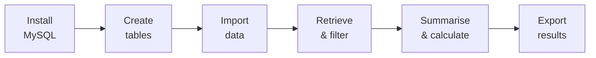

# 🎯 Key Takeaways: SQL Basics (MySQL)

The main lessons from every topic covered so far, in one place. For syntax, see the [cheat sheet](CHEATSHEET.md).

## 🧭 The big picture

1. SQL turns large files into tables you can **query, join, reconcile and test** in seconds.
2. The core of every query is **`SELECT … FROM … WHERE`**; everything else builds on it.
3. MySQL runs a query in this order: **`FROM` → `WHERE` → `GROUP BY` → `HAVING` → `SELECT` → `DISTINCT` → `ORDER BY` → `LIMIT`/`OFFSET`**, not the order it is written.
4. **Getting the data in correctly** (types, completeness, accuracy) matters as much as the analysis.
5. Summaries point to risk; **detail queries give the evidence**.

## 1 · Setting up

- Install **MySQL Server** (the database) and **MySQL Workbench** (the editor). Choose the current **LTS** release (8.4).
- Keep the **root password** safe; every connection needs it.
- `USE database_name;` tells MySQL which database to run queries in, which matters when several exist.

## 2 · Creating tables

- Order: `CREATE DATABASE` → `USE` → `CREATE TABLE`.
- **Choose types by meaning:** `VARCHAR` for codes (keeps leading zeros), `DECIMAL` for money (exact), `DATE` for dates.
- **Constraints protect the data:** `NOT NULL`, `DEFAULT`, `CHECK`, `PRIMARY KEY` (no duplicates), `FOREIGN KEY` (no orphans).
- `ALTER` changes a table, `TRUNCATE` empties it, `DROP` deletes it; the last three can't be undone.
- `CREATE TABLE … LIKE` copies structure; `CREATE TABLE … AS SELECT` copies data from a query.
- **Indexes** speed up filters and joins; check with `EXPLAIN`.

## 3 · Importing and exporting

- MySQL loads **text files**: save Excel as **CSV UTF-8** first.
- The **Import Wizard** is easy but slow, and it **skips rows that fail conversion**: always compare row counts.
- **`LOAD DATA INFILE`** is fast and repeatable, and converts formats while loading (`STR_TO_DATE`, `REPLACE`, `NULLIF`).
- A **staging table** (all text) loses nothing; clean rows move on with `INSERT … SELECT`.
- **Validate every load:** row count and control totals against the source.
- Export with the result grid, the **Export Wizard**, `SELECT … INTO OUTFILE` or `mysqldump`.

## 4 · Changing data

- `INSERT` adds rows, `UPDATE` changes them, `DELETE` removes them.
- **Preview with `SELECT`** using the same `WHERE` before any `UPDATE` or `DELETE`.
- Wrap related changes in a **transaction**: `START TRANSACTION` → check → `COMMIT` or `ROLLBACK`.

## 5 · Retrieving data: text queries

- `*` returns **all columns**; naming columns is faster and clearer.
- `COUNT(*)` counts rows; `COUNT(DISTINCT col)` counts unique values.
- `DISTINCT` shows the **unique values** (or combinations) in the result.
- `LIKE` filters text by pattern: `%` matches any characters, `_` exactly one.
- Text and dates go in **quotes**; `NULL` needs `IS NULL`.

## 6 · Retrieving data: numeric queries

- Compare numbers with `=`, `<>`, `<`, `<=`, `>`, `>=`; combine with `AND` / `OR` (use brackets).
- `BETWEEN` filters a range (**both ends included**); `IN` filters a list.
- `ORDER BY` sorts the result: **ascending by default**, `DESC` for descending.
- `LIMIT n` returns the **top or bottom N** rows; always sort first.
- `OFFSET m` **skips** rows: use it for paging and the Nth-largest value.

## 7 · Summary analytics

- Summary queries power quick **ad hoc analysis**, one of the most common business requests.
- `MIN`, `MAX`, `AVG`, `SUM` and `COUNT` summarise a column; they ignore `NULL`s.
- `AS` gives a calculated column a **readable header**.
- `GROUP BY` produces **one row per group** (customer, month, region); every non-aggregated column must be grouped.

## 8 · HAVING

- `GROUP BY` and `HAVING` usually **go together**.
- `WHERE` filters **rows before** grouping; `HAVING` filters **groups after** grouping.
- `WHERE` can use any table column, even one not selected, but **no aggregates**. `HAVING` works on grouped columns, **aggregates** and `SELECT` aliases.
- Keep row conditions in `WHERE`: correct and faster.

## 9 · Calculated columns

- New columns can be **derived from existing ones**: `amount - cost AS profit`.
- **Revenue and profit** are the metrics analysts calculate most, in every industry.
- `IF(condition, a, b)` handles **two** outcomes; for **more than two**, use `CASE WHEN … THEN … ELSE … END`.
- **Currency and unit conversion** are everyday uses: `amount * rate`, `kg / 1000`.
- `YEAR(date)` extracts the year; the **current year** is `YEAR(CURDATE())`.
- For repeatable results, use a **fixed as-at date** instead of today's date.

## ✅ Ten habits of a good SQL coder

1. Name columns instead of `SELECT *` on big tables.
2. Store codes as text, money as `DECIMAL`, dates as `DATE`.
3. Check row counts and totals after every load.
4. Quote text values and use `'YYYY-MM-DD'` dates.
5. Use brackets whenever `AND` and `OR` mix.
6. Sort before `LIMIT`, with a tie-breaker column.
7. Put row filters in `WHERE` and aggregate filters in `HAVING`.
8. Always add `ELSE` to `CASE`.
9. Preview, then change data inside a transaction.
10. Comment queries and save them as scripts so they can be rerun.
