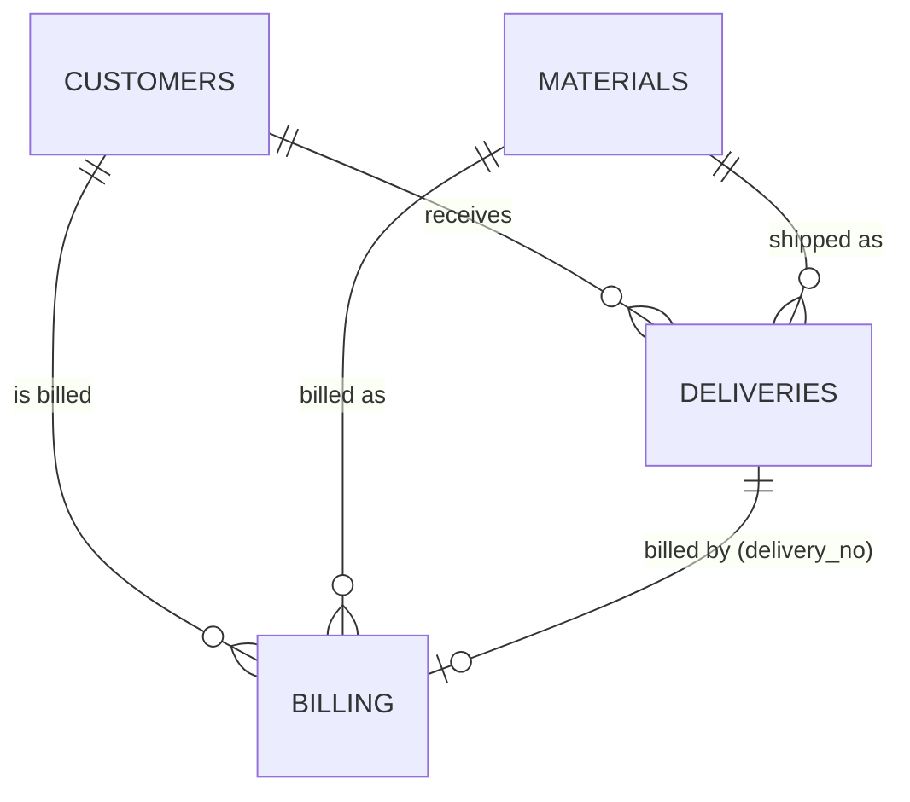

# 🔗 MySQL Joins: INNER, LEFT, RIGHT, FULL

Four short lessons on combining tables with joins, using **SAP revenue (billing) and volume (delivery) data** for a revenue audit: does every shipment have an invoice, and does every invoice have a shipment?

> Part of my learning journey in **Data Engineering, Data Science & AI**.

## 📚 Lessons

| # | Lesson | Returns | Audit use |
| --- | --- | --- | --- |
| 1 | [INNER JOIN](inner-join-in-mysql.md) | Matching rows only | Match volume to revenue, quantity differences |
| 2 | [LEFT JOIN](left-join-in-mysql.md) | All left rows + matches | Completeness: shipped not billed, cut-off |
| 3 | [RIGHT JOIN](right-join-in-mysql.md) | All right rows + matches | Occurrence: billed without delivery |
| 4 | [FULL JOIN](full-join-in-mysql.md) | All rows from both sides | Complete reconciliation (MySQL: `LEFT` + `UNION` + `RIGHT`) |

📝 Quick revision: [SUMMARY.md](SUMMARY.md) · 🎤 [Top 10 interview questions](INTERVIEW_QUESTIONS.md)

> MySQL has no `FULL OUTER JOIN`. The FULL JOIN lesson shows the standard workaround.

## 🗂️ Sample data

Four CSV files in [`data/`](data/), company code 1000, FY2026, USD (made up for practice).

| File | Table | Rows | SAP source | Contents |
| --- | --- | --- | --- | --- |
| `customers.csv` | `customers` | 6 | KNA1 | Customer ID, name, region |
| `materials.csv` | `materials` | 5 | MARA / MAKT | Material ID, description, unit, list price |
| `deliveries.csv` | `deliveries` | 16 | LIKP / LIPS | **Volume**: delivery number, goods-issue date, customer, material, quantity shipped |
| `billing.csv` | `billing` | 18 | VBRK / VBRP | **Revenue**: billing number, date, reference delivery, customer, material, quantity billed, price, net value |



Built-in reconciliation issues to find:

| Issue | Item | Value |
| --- | --- | --- |
| Shipped, never billed | Delivery `80000015` | ~10,650.00 |
| Shipped in 2026, billed in 2027 (cut-off) | Delivery `80000014` | 38,400.00 |
| Billed 3 units less than shipped | Delivery `80000013` | 3,750.00 |
| Billed without a delivery | Billing `90000016` | 50,000.00 |
| Billed against a delivery that doesn't exist | Billing `90000018` | 9,600.00 |
| Billed to a customer not in the master | Billing `90000017` | 3,550.00 |
| Customer with no sales / material never sold | `Great Lakes Supply` / `P-500` | — |

## Setup

Requirements: see [requirements.txt](requirements.txt).

**Option A (recommended):** from this folder, run

```bash
mysql --local-infile=1 -u root -p < setup.sql
```

`setup.sql` creates the four tables in `audit_fy2026`, loads the CSVs and shows **6 / 5 / 16 / 18** rows. If loading is refused, run `SET GLOBAL local_infile = 1;` as root first.

**Option B (MySQL Workbench):** open `setup.sql`, replace each `'data/…'` path with the full path (forward slashes), add `OPT_LOCAL_INFILE=1` under **Edit Connection → Advanced → Others**, and run it.

> The tables have **no foreign keys on purpose**: the data contains the errors that the joins are meant to find.

## Real-world examples

Each lesson ends with extra snippets on audit data from my earlier sections, in the same `audit_fy2026` database:

| Table | Section |
| --- | --- |
| `je_lines` | SQL Basics: SELECT, WHERE, DISTINCT, LIKE, LIMIT |
| `ap_invoices` | Numeric Queries: BETWEEN, IN, ORDER BY, LIMIT, OFFSET |
| `trial_balance`, `gl_accounts` | Importing Files & Creating Tables (Foreign Keys lesson) |

## 📁 Repository structure

```text
.
├── README.md
├── SUMMARY.md
├── INTERVIEW_QUESTIONS.md
├── requirements.txt
├── setup.sql                  ← creates and loads the 4 tables
├── .gitattributes             ← keeps the CSVs' Windows line endings intact
├── inner-join-in-mysql.md
├── left-join-in-mysql.md
├── right-join-in-mysql.md
├── full-join-in-mysql.md
└── data/
    ├── customers.csv
    ├── materials.csv
    ├── deliveries.csv
    └── billing.csv
```
