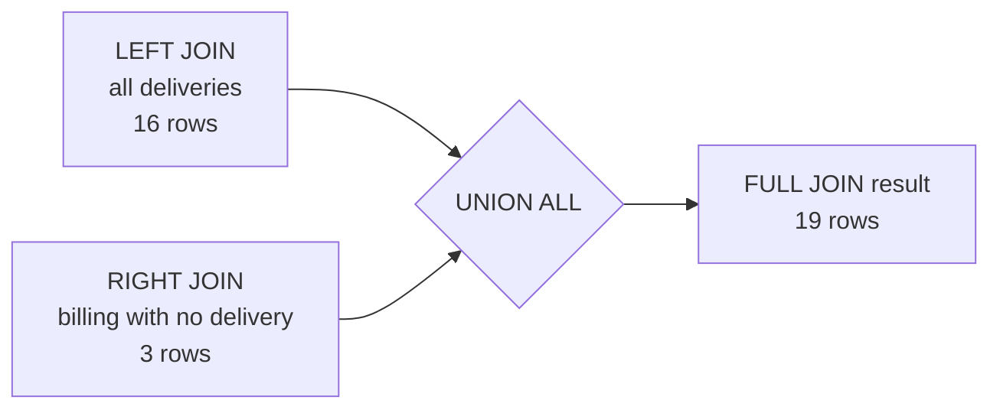

# ↔️ FULL JOIN in MySQL

A `FULL OUTER JOIN` returns **all rows from both tables**: matched rows together, unmatched rows from either side with `NULL`s. It is the complete reconciliation view.

**MySQL does not support `FULL OUTER JOIN`.** Build it from a `LEFT JOIN` and a `RIGHT JOIN` combined with `UNION`.

> Part of my learning journey in **Data Engineering, Data Science & AI** · Data: `deliveries`, `billing` ([setup](README.md#setup))

## How it works



## Syntax

```text
-- Standard SQL (SQL Server, PostgreSQL, Oracle): NOT available in MySQL
SELECT … FROM a FULL OUTER JOIN b ON b.key = a.key;
```

```sql
-- MySQL, recommended: LEFT JOIN + UNION ALL + unmatched right rows
SELECT a.key AS a_key, b.key AS b_key
FROM table_a a
LEFT JOIN table_b b ON b.key = a.key
UNION ALL
SELECT a.key, b.key
FROM table_a a
RIGHT JOIN table_b b ON b.key = a.key
WHERE a.key IS NULL;                    -- only right rows the LEFT JOIN didn't return

-- MySQL, short form: UNION removes the duplicate matched rows
SELECT a.key, b.key FROM table_a a LEFT  JOIN table_b b ON b.key = a.key
UNION
SELECT a.key, b.key FROM table_a a RIGHT JOIN table_b b ON b.key = a.key;
```

`UNION ALL` + `WHERE … IS NULL` is safer: plain `UNION` also removes rows that are genuinely identical.

## Examples

**1 · What happens with `FULL JOIN` in MySQL**

```text
SELECT COUNT(*) FROM deliveries d FULL OUTER JOIN billing b ON b.delivery_no = d.delivery_no;
-- ERROR 1064 (42000): You have an error in your SQL syntax … near 'FULL OUTER JOIN …'

SELECT COUNT(*) FROM deliveries FULL JOIN billing ON billing.delivery_no = FULL.delivery_no;
-- No error, 15 rows: MySQL reads FULL as an ALIAS for deliveries and runs an INNER JOIN
```

⚠️ The second query **looks** like a full join, runs without error, and silently returns the wrong result.

**2 · Full revenue-to-volume reconciliation**

```sql
SELECT d.delivery_no, b.billing_no, d.qty_shipped, b.qty_billed, b.net_value,
       CASE
           WHEN b.billing_no IS NULL          THEN 'Shipped, not billed'
           WHEN d.qty_shipped <> b.qty_billed THEN 'Quantity mismatch'
           ELSE 'Matched'
       END AS recon_status
FROM deliveries d
LEFT JOIN billing b ON b.delivery_no = d.delivery_no
UNION ALL
SELECT d.delivery_no, b.billing_no, d.qty_shipped, b.qty_billed, b.net_value,
       'Billed, no delivery'
FROM deliveries d
RIGHT JOIN billing b ON b.delivery_no = d.delivery_no
WHERE d.delivery_no IS NULL
ORDER BY recon_status, delivery_no, billing_no;
```

| delivery_no | billing_no | qty_shipped | qty_billed | net_value | recon_status |
| --- | --- | --- | --- | --- | --- |
| NULL | 90000016 | NULL | 40.000 | 50000.00 | Billed, no delivery |
| NULL | 90000017 | NULL | 100.000 | 3550.00 | Billed, no delivery |
| NULL | 90000018 | NULL | 20.000 | 9600.00 | Billed, no delivery |
| 80000001 | 90000001 | 20.000 | 20.000 | 25000.00 | Matched |
| … | … | … | … | … | … |
| 80000013 | 90000013 | 35.000 | 32.000 | 40000.00 | Quantity mismatch |
| 80000015 | NULL | 300.000 | NULL | NULL | Shipped, not billed |

19 rows: every delivery and every billing document appears exactly once.

**3 · Reconciliation summary**

```sql
SELECT recon_status, COUNT(*) AS items, SUM(net_value) AS billed_value
FROM (
    SELECT CASE
               WHEN b.billing_no IS NULL          THEN 'Shipped, not billed'
               WHEN d.qty_shipped <> b.qty_billed THEN 'Quantity mismatch'
               ELSE 'Matched'
           END AS recon_status,
           b.net_value
    FROM deliveries d
    LEFT JOIN billing b ON b.delivery_no = d.delivery_no
    UNION ALL
    SELECT 'Billed, no delivery', b.net_value
    FROM deliveries d
    RIGHT JOIN billing b ON b.delivery_no = d.delivery_no
    WHERE d.delivery_no IS NULL
) AS recon
GROUP BY recon_status;
```

| recon_status | items | billed_value |
| --- | --- | --- |
| Matched | 14 | 331575.00 |
| Quantity mismatch | 1 | 40000.00 |
| Shipped, not billed | 1 | NULL |
| Billed, no delivery | 3 | 63150.00 |

The billed values add up to **434,725.00**, the total of the billing table: the reconciliation is complete.

## 🌍 More real-world examples

Tables from my earlier sections (see [README](README.md#real-world-examples)):

```sql
-- Chart of accounts vs trial balance: accounts on one side only
SELECT g.saknr, t.hkont,
       IF(t.hkont IS NULL, 'In chart, not in TB', 'In both') AS status
FROM gl_accounts g
LEFT JOIN trial_balance t ON t.hkont = g.saknr
UNION ALL
SELECT g.saknr, t.hkont, 'In TB, not in chart'
FROM gl_accounts g
RIGHT JOIN trial_balance t ON t.hkont = g.saknr
WHERE g.saknr IS NULL;
```

```text
-- Pattern for any two-system reconciliation (bank vs ledger, sub-ledger vs GL, system A vs B)
SELECT a.ref, a.amount AS amount_a, b.amount AS amount_b
FROM system_a a LEFT JOIN system_b b ON b.ref = a.ref
UNION ALL
SELECT b.ref, NULL, b.amount
FROM system_a a RIGHT JOIN system_b b ON b.ref = a.ref
WHERE a.ref IS NULL;
```

## ⚠️ Common mistakes

| Mistake | Problem | Fix |
| --- | --- | --- |
| `FULL OUTER JOIN` in MySQL | `Error 1064` | `LEFT JOIN` + `UNION ALL` + `RIGHT JOIN … WHERE left.key IS NULL` |
| `a FULL JOIN b` with no alias | Runs as an inner join, no error | Never use `FULL` as a keyword in MySQL |
| `UNION ALL` without the `IS NULL` filter | Matched rows appear twice | Keep only unmatched rows in the second part |
| Different columns in each half | `Error 1222`: different number of columns | Same number and order of columns in both `SELECT`s |

## 🎯 Key takeaways

1. A FULL JOIN returns **all rows from both tables**, matched or not.
2. MySQL has **no `FULL OUTER JOIN`**: combine a LEFT JOIN and a RIGHT JOIN with `UNION`.
3. Prefer `UNION ALL` with `WHERE left.key IS NULL` in the second half.
4. Watch out: `a FULL JOIN b` without an alias runs silently as an **inner join**.
5. Audit use: the **complete reconciliation** of two sources, where every item lands in exactly one category.
