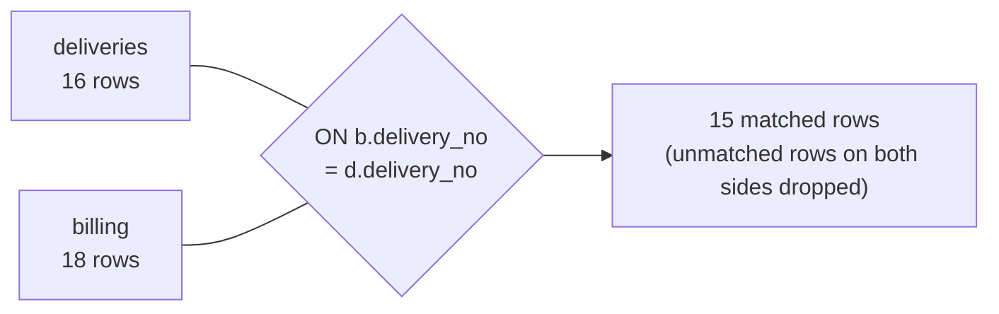

# 🔗 INNER JOIN in MySQL

`INNER JOIN` combines rows from two tables and returns **only the rows that match** in both.

> Part of my learning journey in **Data Engineering, Data Science & AI** · Data: `deliveries`, `billing`, `customers`, `materials` ([setup](README.md#setup))

## How it works



## Syntax

```sql
SELECT a.col, b.col
FROM table_a a                          -- a, b = table aliases
INNER JOIN table_b b                    -- JOIN on its own means INNER JOIN
    ON b.key = a.key;                   -- join condition
```

## Examples

**1 · Match deliveries (volume) to billing (revenue)**

```sql
SELECT d.delivery_no, d.qty_shipped, b.billing_no, b.qty_billed, b.net_value
FROM deliveries d
INNER JOIN billing b ON b.delivery_no = d.delivery_no
ORDER BY d.delivery_no;
```

| delivery_no | qty_shipped | billing_no | qty_billed | net_value |
| --- | --- | --- | --- | --- |
| 80000001 | 20.000 | 90000001 | 20.000 | 25000.00 |
| 80000002 | 50.000 | 90000002 | 50.000 | 24000.00 |
| … | … | … | … | … |

15 matched pairs. One delivery and three billing documents have no match, so they are **not shown**.

**2 · Volume vs revenue: quantity differences**

```sql
SELECT d.delivery_no,
       d.qty_shipped, b.qty_billed,
       d.qty_shipped - b.qty_billed                     AS qty_not_billed,
       ROUND((d.qty_shipped - b.qty_billed) * b.net_price, 2) AS value_not_billed
FROM deliveries d
INNER JOIN billing b ON b.delivery_no = d.delivery_no
WHERE d.qty_shipped <> b.qty_billed;
```

| delivery_no | qty_shipped | qty_billed | qty_not_billed | value_not_billed |
| --- | --- | --- | --- | --- |
| 80000013 | 35.000 | 32.000 | 3.000 | 3750.00 |

**3 · Revenue by region** (bring in a master-data column)

```sql
SELECT c.region, SUM(b.net_value) AS revenue
FROM billing b
INNER JOIN customers c ON c.customer_id = b.customer_id
WHERE b.billing_date BETWEEN '2026-01-01' AND '2026-12-31'
GROUP BY c.region
ORDER BY revenue DESC;                  -- Export 120,700 · Northeast 114,075 · …
```

⚠️ The regions add up to **392,775**, but FY2026 billing is **396,325**. The 3,550 difference is billed to a customer that is **not in the customer master**, and the inner join drops it silently. Always reconcile joined totals to the source.

**4 · Three tables**

```sql
SELECT b.billing_no, c.name, m.description, b.qty_billed, b.net_value
FROM billing b
JOIN customers c ON c.customer_id = b.customer_id
JOIN materials m ON m.material_id = b.material_id
WHERE b.billing_date = '2026-12-31';
```

| billing_no | name | description | qty_billed | net_value |
| --- | --- | --- | --- | --- |
| 90000015 | Acme Retail | Aluminium panel | 50.000 | 16000.00 |
| 90000016 | Northwind Stores | Steel beam | 40.000 | 50000.00 |

## 🌍 More real-world examples

Tables from my earlier sections (see [README](README.md#real-world-examples)):

```sql
-- Journal entry lines with the account name and type from the chart of accounts
SELECT j.belnr, j.hkont, g.txt50, g.acct_type, j.shkzg, j.dmbtr
FROM je_lines j
INNER JOIN gl_accounts g ON g.saknr = j.hkont;

-- Trial balance split into balance sheet and P&L
SELECT g.acct_type, SUM(t.closing) AS closing
FROM trial_balance t
INNER JOIN gl_accounts g ON g.saknr = t.hkont
GROUP BY g.acct_type;                   -- BS and PL are equal and opposite

-- Duplicate vendor invoices: the AP table joined to itself on vendor + invoice reference
SELECT a.belnr, a.name1, a.dmbtr, b.belnr AS other_doc, b.dmbtr AS other_amount
FROM ap_invoices a
INNER JOIN ap_invoices b
    ON b.lifnr = a.lifnr AND b.xblnr = a.xblnr AND b.belnr > a.belnr;   -- duplicate invoice numbers
```

## ⚠️ Common mistakes

| Mistake | Problem | Fix |
| --- | --- | --- |
| Missing or wrong `ON` condition | Every row joins to every row (huge result) | Join on the full key |
| Joining on a non-unique key | Rows multiply; totals double | Check the key is unique on one side |
| `Error 1052: Column 'customer_id' … is ambiguous` | Same column name in both tables | Prefix with the alias: `b.customer_id` |
| Trusting joined totals | Unmatched rows are dropped silently | Reconcile to the source table's total |

## 🎯 Key takeaways

1. `INNER JOIN` returns **only matching rows**; `JOIN` alone means `INNER JOIN`.
2. The `ON` clause defines the match: join on the **key**, with aliases on every column.
3. Rows without a match on **either** side disappear: always reconcile totals.
4. Join master data to add **names, regions, prices** to transactions.
5. Audit use: match **volume to revenue** (delivery to billing) and spot quantity differences.
