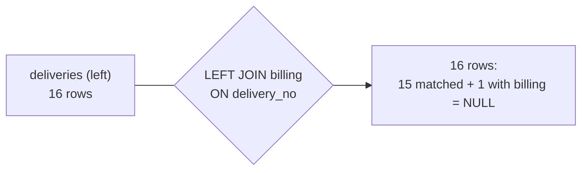

# ⬅️ LEFT JOIN in MySQL

`LEFT JOIN` returns **every row from the left table**, plus the matching rows from the right table. Where there is no match, the right-hand columns are `NULL`.

> Part of my learning journey in **Data Engineering, Data Science & AI** · Data: `deliveries`, `billing`, `customers`, `materials` ([setup](README.md#setup))

## How it works



## Syntax

```sql
SELECT a.col, b.col
FROM table_a a                          -- left table: all rows kept
LEFT JOIN table_b b                     -- LEFT OUTER JOIN is the same
    ON b.key = a.key;

-- Only the rows WITHOUT a match ("anti-join")
SELECT a.*
FROM table_a a
LEFT JOIN table_b b ON b.key = a.key
WHERE b.key IS NULL;
```

## Examples

**1 · December deliveries and their billing**

```sql
SELECT d.delivery_no, d.delivery_date, d.qty_shipped, b.billing_no
FROM deliveries d
LEFT JOIN billing b ON b.delivery_no = d.delivery_no
WHERE d.delivery_date >= '2026-12-01'
ORDER BY d.delivery_no;
```

| delivery_no | delivery_date | qty_shipped | billing_no |
| --- | --- | --- | --- |
| 80000012 | 2026-12-09 | 65.000 | 90000012 |
| 80000013 | 2026-12-22 | 35.000 | 90000013 |
| 80000014 | 2026-12-29 | 80.000 | 90000014 |
| 80000015 | 2026-12-30 | 300.000 | **NULL** |
| 80000016 | 2026-12-31 | 50.000 | 90000015 |

**2 · Completeness: shipped but never billed** (anti-join)

```sql
SELECT d.delivery_no, d.delivery_date, d.qty_shipped,
       d.qty_shipped * m.list_price AS estimated_value
FROM deliveries d
LEFT JOIN billing b ON b.delivery_no = d.delivery_no
JOIN materials m    ON m.material_id = d.material_id
WHERE b.billing_no IS NULL;             -- 80000015: 300 boxes, about 10,650.00 unbilled
```

**3 · Cut-off: shipped in 2026, not billed in 2026** (condition in `ON`)

```sql
SELECT d.delivery_no, d.delivery_date, b.billing_no
FROM deliveries d
LEFT JOIN billing b
       ON b.delivery_no = d.delivery_no
      AND b.billing_date <= '2026-12-31'          -- only 2026 billing counts as a match
WHERE d.delivery_date <= '2026-12-31'
  AND b.billing_no IS NULL;
-- 80000014 (billed 5 Jan 2027) and 80000015 (never billed)
```

**4 · Every customer, with or without sales**

```sql
SELECT c.name,
       COUNT(b.billing_no)          AS documents,
       IFNULL(SUM(b.net_value), 0)  AS revenue_2026
FROM customers c
LEFT JOIN billing b
       ON b.customer_id = c.customer_id
      AND b.billing_date BETWEEN '2026-01-01' AND '2026-12-31'
GROUP BY c.customer_id, c.name
ORDER BY revenue_2026 DESC;             -- Great Lakes Supply: 0 documents, 0.00
```

`COUNT(b.billing_no)` counts only matches, so customers without sales show **0**, not 1.

**5 · Materials never shipped**

```sql
SELECT m.material_id, m.description
FROM materials m
LEFT JOIN deliveries d ON d.material_id = m.material_id
WHERE d.delivery_no IS NULL;            -- P-500 Copper cable drum
```

### ⚠️ `WHERE` on the right table turns a LEFT JOIN into an INNER JOIN

```sql
-- 14 rows: deliveries with no 2026 billing are filtered OUT
SELECT COUNT(*) FROM deliveries d
LEFT JOIN billing b ON b.delivery_no = d.delivery_no
WHERE b.billing_date <= '2026-12-31';

-- 16 rows: every delivery kept; the filter only limits what counts as a match
SELECT COUNT(*) FROM deliveries d
LEFT JOIN billing b ON b.delivery_no = d.delivery_no AND b.billing_date <= '2026-12-31';
```

## 🌍 More real-world examples

Tables from my earlier sections (see [README](README.md#real-world-examples)):

```sql
-- Journal entries posted to accounts missing from the chart of accounts
SELECT DISTINCT j.hkont
FROM je_lines j
LEFT JOIN gl_accounts g ON g.saknr = j.hkont
WHERE g.saknr IS NULL;

-- Accounts in the chart with no journal entry activity
SELECT g.saknr, g.txt50
FROM gl_accounts g
LEFT JOIN je_lines j ON j.hkont = g.saknr
WHERE j.hkont IS NULL;

-- Trial balance debits vs journal entry debits per account (0 when no entries)
SELECT t.hkont, t.debit AS tb_debit,
       IFNULL(SUM(IF(j.shkzg = 'S', j.dmbtr, 0)), 0) AS je_debits
FROM trial_balance t
LEFT JOIN je_lines j ON j.hkont = t.hkont
GROUP BY t.hkont, t.debit;
```

## ⚠️ Common mistakes

| Mistake | Problem | Fix |
| --- | --- | --- |
| Filtering the right table in `WHERE` | Unmatched rows removed: becomes an inner join | Move the condition into `ON` |
| `COUNT(*)` after a LEFT JOIN | Counts 1 for rows with no match | `COUNT(right_table.key)` |
| `SUM` returns `NULL` for no matches | Blank totals | `IFNULL(SUM(…), 0)` |
| Testing a nullable column for `IS NULL` | Can't tell "no match" from "empty value" | Test the right table's **key** |

## 🎯 Key takeaways

1. `LEFT JOIN` keeps **all rows of the left table**; unmatched right columns are `NULL`.
2. `LEFT JOIN … WHERE right.key IS NULL` finds rows **with no match** (anti-join).
3. Conditions on the right table go in **`ON`**, not `WHERE`, or the left join becomes inner.
4. Use `COUNT(right.key)` and `IFNULL(SUM(…), 0)` for correct counts and totals.
5. Audit use: **completeness** (shipped not billed), **cut-off**, unused master data.
