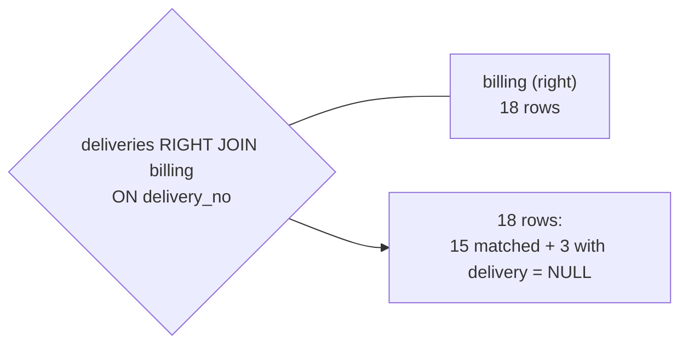

# ➡️ RIGHT JOIN in MySQL

`RIGHT JOIN` returns **every row from the right table**, plus the matching rows from the left table. It is a `LEFT JOIN` with the tables swapped.

> Part of my learning journey in **Data Engineering, Data Science & AI** · Data: `deliveries`, `billing`, `customers`, `materials` ([setup](README.md#setup))

## How it works



## Syntax

```sql
SELECT a.col, b.col
FROM table_a a
RIGHT JOIN table_b b                    -- right table: all rows kept
    ON b.key = a.key;

-- Same result as:
SELECT a.col, b.col
FROM table_b b
LEFT JOIN table_a a ON a.key = b.key;
```

## Examples

**1 · Occurrence: billed without a valid delivery**

```sql
SELECT b.billing_no, b.billing_date, b.delivery_no, b.customer_id, b.net_value
FROM deliveries d
RIGHT JOIN billing b ON b.delivery_no = d.delivery_no
WHERE d.delivery_no IS NULL;
```

| billing_no | billing_date | delivery_no | customer_id | net_value |
| --- | --- | --- | --- | --- |
| 90000016 | 2026-12-31 | NULL | 0000100002 | 50000.00 |
| 90000017 | 2026-11-20 | NULL | 0000100099 | 3550.00 |
| 90000018 | 2026-10-05 | 80000099 | 0000100003 | 9600.00 |

**63,150.00 of revenue has no shipment behind it**: two invoices with no delivery reference, and one pointing to a delivery that doesn't exist.

**2 · Billing to customers missing from the master data**

```sql
SELECT b.billing_no, b.customer_id, b.net_value
FROM customers c
RIGHT JOIN billing b ON b.customer_id = c.customer_id
WHERE c.customer_id IS NULL;            -- 90000017, customer 0000100099, 3,550.00
```

**3 · All billing with customer names (names `NULL` where unknown)**

```sql
SELECT b.billing_no, b.customer_id, c.name, b.net_value
FROM customers c
RIGHT JOIN billing b ON b.customer_id = c.customer_id
ORDER BY b.billing_no;                  -- 18 rows, one with name = NULL
```

**4 · The same as a LEFT JOIN** (more common style)

```sql
SELECT b.billing_no, b.net_value
FROM billing b
LEFT JOIN deliveries d ON d.delivery_no = b.delivery_no
WHERE d.delivery_no IS NULL;            -- same 3 documents as Example 1
```

## 🌍 More real-world examples

Tables from my earlier sections (see [README](README.md#real-world-examples)):

```sql
-- Trial balance accounts missing from the chart of accounts
SELECT t.hkont, t.txt50, t.closing
FROM gl_accounts g
RIGHT JOIN trial_balance t ON t.hkont = g.saknr
WHERE g.saknr IS NULL;

-- Every journal entry line, with the account name where it exists
SELECT j.belnr, j.buzei, j.hkont, g.txt50, j.dmbtr
FROM gl_accounts g
RIGHT JOIN je_lines j ON j.hkont = g.saknr;
```

## ⚠️ Common mistakes

| Mistake | Problem | Fix |
| --- | --- | --- |
| Mixing LEFT and RIGHT joins in one query | Hard to tell which rows are kept | Rewrite as LEFT joins only |
| Filtering the left table in `WHERE` | Drops the unmatched right rows | Put the condition in `ON` |
| Testing the wrong side for `IS NULL` | Returns nothing, or everything | Test the key of the table that may be missing |

## 🎯 Key takeaways

1. `RIGHT JOIN` keeps **all rows of the right table**; unmatched left columns are `NULL`.
2. `A RIGHT JOIN B` = `B LEFT JOIN A`: same rows, tables swapped.
3. `… WHERE left.key IS NULL` finds right-table rows with **no match**.
4. Most teams write LEFT JOINs only; RIGHT JOIN is mainly useful for building a FULL JOIN.
5. Audit use: **occurrence**, i.e. revenue billed without a delivery, or billed to unknown customers.
