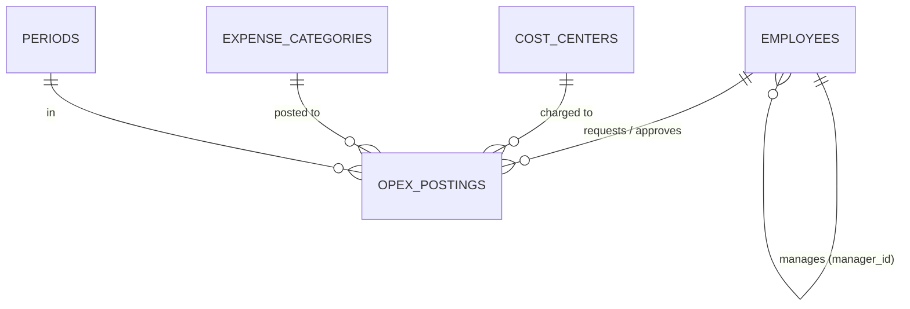

# ✖️🪞 MySQL CROSS JOIN & SELF JOIN

Two short lessons on special joins, using **operating expenses (OpEx)** data from an expense audit:

- **CROSS JOIN** builds complete grids (cost center × month) to find **missing** postings.
- **SELF JOIN** compares rows of the same table: employees with their managers, duplicate expenses, month-over-month changes.

> Part of my learning journey in **Data Engineering, Data Science & AI**.

## 📚 Lessons

| # | Lesson | What it does | Audit use |
| --- | --- | --- | --- |
| 1 | [CROSS JOIN](cross-join-in-mysql.md) | Every row × every row | Completeness grids, spend matrix, % of total |
| 2 | [SELF JOIN](self-join-in-mysql.md) | A table joined to itself | Approval hierarchy, duplicates, period comparisons |

📝 Quick revision: [SUMMARY.md](SUMMARY.md) · 🎤 [Top 10 interview questions](INTERVIEW_QUESTIONS.md)

## 🗂️ Sample data

Five CSV files in [`data/`](data/), FY2026, USD (made up for practice). Total OpEx: **387,840.00**.

| File | Table | Rows | Contents |
| --- | --- | --- | --- |
| `employees.csv` | `employees` | 6 | Employee, title, **manager** (another employee), approval limit |
| `cost_centers.csv` | `cost_centers` | 4 | Finance, Facilities, Marketing, IT (like SAP CSKS) |
| `expense_categories.csv` | `expense_categories` | 5 | G/L accounts: Rent, Utilities, Travel, Consulting fees, Marketing |
| `periods.csv` | `periods` | 12 | Months of 2026 with period-end dates |
| `opex_postings.csv` | `opex_postings` | 28 | Expense postings: date, period, cost center, account, vendor, amount, **requested by**, **approved by** |



Built-in issues to find:

| Issue | Found with | Item |
| --- | --- | --- |
| December rent not recorded (accrual missing) | CROSS JOIN grid + LEFT JOIN | Facilities, 15,000.00 |
| Expenses self-approved | SELF JOIN on employees | 2 postings (2,300.00 and 48,500.00) |
| Approved by someone who isn't the requester's manager | SELF JOIN on employees | 3,200.00 |
| Approved above the approver's limit | SELF JOIN to the approver's manager | 65,000.00 vs 50,000.00 limit |
| Duplicate invoice two days apart | SELF JOIN on postings | 9,400.00, BrightAds Media |
| Rent up 20% in one month | SELF JOIN on previous period | 15,000 → 18,000 |

## Setup

Requirements: see [requirements.txt](requirements.txt).

**Option A (recommended):** from this folder, run

```bash
mysql --local-infile=1 -u root -p < setup.sql
```

`setup.sql` creates the five tables in `audit_fy2026`, loads the CSVs and shows **6 / 4 / 5 / 12 / 28** rows and total OpEx **387,840.00**. If loading is refused, run `SET GLOBAL local_infile = 1;` as root first.

**Option B (MySQL Workbench):** open `setup.sql`, replace each `'data/…'` path with the full path (forward slashes), add `OPT_LOCAL_INFILE=1` under **Edit Connection → Advanced → Others**, and run it.

## Real-world examples

Each lesson ends with extra snippets on audit data from my earlier sections, in the same `audit_fy2026` database:

| Table | Section |
| --- | --- |
| `je_lines` | SQL Basics: SELECT, WHERE, DISTINCT, LIKE, LIMIT |
| `ap_invoices` | Numeric Queries: BETWEEN, IN, ORDER BY, LIMIT, OFFSET |
| `revenue_lines` | Summary Analytics: MIN, MAX, AVG, GROUP BY |
| `trial_balance` | Importing Files & Creating Tables |

## 📁 Repository structure

```text
.
├── README.md
├── SUMMARY.md
├── INTERVIEW_QUESTIONS.md
├── requirements.txt
├── setup.sql                  ← creates and loads the 5 tables
├── .gitattributes             ← keeps the CSVs' Windows line endings intact
├── cross-join-in-mysql.md
├── self-join-in-mysql.md
└── data/
    ├── employees.csv
    ├── cost_centers.csv
    ├── expense_categories.csv
    ├── periods.csv
    └── opex_postings.csv
```
