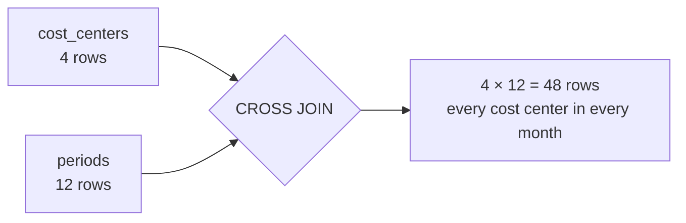

# ✖️ CROSS JOIN in MySQL

`CROSS JOIN` pairs **every row of one table with every row of another** (a Cartesian product). It has no `ON` condition. Use it to build **complete grids**, such as every cost center × every month, then find the gaps.

> Part of my learning journey in **Data Engineering, Data Science & AI** · Data: `cost_centers`, `periods`, `expense_categories`, `opex_postings` ([setup](README.md#setup))

## How it works



## Syntax

```sql
SELECT a.col, b.col
FROM table_a a
CROSS JOIN table_b b;                   -- rows = rows(a) × rows(b)
```

## Examples

**1 · Every cost center in every month**

```sql
SELECT c.cost_center, c.name, p.period, p.month_name
FROM cost_centers c
CROSS JOIN periods p
ORDER BY c.cost_center, p.period;       -- 48 rows
```

| cost_center | name | period | month_name |
| --- | --- | --- | --- |
| CC1000 | Finance | 1 | January |
| CC1000 | Finance | 2 | February |
| … | … | … | … |

**2 · Completeness: months with no rent posted** (grid + LEFT JOIN)

```sql
SELECT p.period, p.month_name
FROM periods p
LEFT JOIN opex_postings o
       ON o.period      = p.period
      AND o.cost_center = 'CC2000'
      AND o.gl_account  = '0000610000'      -- rent
WHERE o.doc_no IS NULL;                     -- December: rent of 15,000 not recorded
```

A monthly cost that is missing at year-end is a possible **unrecorded liability** (accrual needed).

To check **every** cost center and expense account the same way, start from a cross join and left join the postings:

```sql
SELECT c.name, e.category, p.month_name
FROM cost_centers c
CROSS JOIN expense_categories e
CROSS JOIN periods p
LEFT JOIN opex_postings o
       ON o.cost_center = c.cost_center
      AND o.gl_account  = e.gl_account
      AND o.period      = p.period
WHERE c.cost_center = 'CC2000' AND e.category = 'Rent'
  AND o.doc_no IS NULL;                     -- Facilities · Rent · December
```

**3 · Spend matrix: every cost center × every expense category, zeros included**

```sql
SELECT c.name AS cost_center, e.category,
       IFNULL(SUM(o.amount), 0) AS actual
FROM cost_centers c
CROSS JOIN expense_categories e
LEFT JOIN opex_postings o
       ON o.cost_center = c.cost_center
      AND o.gl_account  = e.gl_account
GROUP BY c.cost_center, c.name, e.gl_account, e.category
ORDER BY c.cost_center, e.gl_account;       -- 20 rows
```

| cost_center | category | actual |
| --- | --- | --- |
| Finance | Rent | 0.00 |
| Finance | Travel | 5110.00 |
| Finance | Consulting fees | 137500.00 |
| Facilities | Rent | 168000.00 |
| … | … | … |

A plain `GROUP BY` would show only the combinations that have postings; the cross join shows the **zeros** too.

**4 · Share of total** (cross join with a one-row total)

```sql
SELECT e.category,
       SUM(o.amount)                         AS spend,
       ROUND(SUM(o.amount) / t.total * 100, 1) AS pct_of_total
FROM opex_postings o
JOIN expense_categories e ON e.gl_account = o.gl_account
CROSS JOIN (SELECT SUM(amount) AS total FROM opex_postings) t
GROUP BY e.category, t.total
ORDER BY spend DESC;
```

| category | spend | pct_of_total |
| --- | --- | --- |
| Rent | 168000.00 | 43.3 |
| Consulting fees | 153500.00 | 39.6 |
| Marketing | 42300.00 | 10.9 |
| Utilities | 18930.00 | 4.9 |
| Travel | 5110.00 | 1.3 |

## 🌍 More real-world examples

Tables from my earlier sections (see [README](README.md#real-world-examples)):

```sql
-- Customers × months: how many months each customer had no billing in 2026
SELECT c.name1, COUNT(*) AS months_without_billing
FROM (SELECT DISTINCT kunag, name1 FROM revenue_lines) c
CROSS JOIN periods p
LEFT JOIN revenue_lines r
       ON r.kunag = c.kunag
      AND MONTH(r.fkdat) = p.period
      AND YEAR(r.fkdat)  = 2026
WHERE r.vbeln IS NULL
GROUP BY c.kunag, c.name1
ORDER BY months_without_billing DESC;

-- Each asset account as a % of total assets (one-row total)
SELECT t.hkont, t.txt50, t.closing,
       ROUND(t.closing / x.total_assets * 100, 1) AS pct_of_assets
FROM trial_balance t
CROSS JOIN (SELECT SUM(closing) AS total_assets
            FROM trial_balance WHERE hkont < '0000200000') x
WHERE t.hkont < '0000200000';

-- AP invoices above each materiality level (a small list of thresholds)
SELECT m.level, COUNT(a.belnr) AS items, SUM(a.dmbtr) AS value
FROM (SELECT 'Overall' AS level, 50000 AS threshold
      UNION ALL SELECT 'Performance', 37500
      UNION ALL SELECT 'Clearly trivial', 2500) m
CROSS JOIN ap_invoices a
WHERE a.dmbtr >= m.threshold
GROUP BY m.level, m.threshold
ORDER BY m.threshold DESC;
```

## ⚠️ Common mistakes

| Mistake | Problem | Fix |
| --- | --- | --- |
| Cross joining two large tables | 100,000 × 100,000 = 10 billion rows | Cross join only small lists (periods, categories, thresholds) |
| `FROM a, b` with no `WHERE` | Old comma syntax: an accidental cross join | Write `CROSS JOIN` on purpose, or `JOIN … ON` |
| A `JOIN` with a missing or wrong `ON` | Behaves like a cross join; totals explode | Check row counts after every join |
| Expecting zeros from a plain `GROUP BY` | Missing combinations don't appear | Build the grid with `CROSS JOIN`, then `LEFT JOIN` the data |

## 🎯 Key takeaways

1. `CROSS JOIN` returns **every combination**: rows = rows(A) × rows(B), with no `ON`.
2. Use it on **small lists** to build grids: cost centers × months, categories × periods.
3. **Grid + `LEFT JOIN` + `IS NULL`** finds what is **missing**, such as unrecorded monthly costs.
4. Cross joining a **one-row total** adds it to every row, for percentages of total.
5. An accidental cross join (a missing `ON`) is a classic cause of inflated totals.
