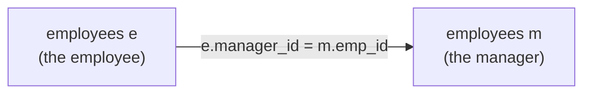

# 🪞 SELF JOIN in MySQL

A **self join** joins a table **to itself**, using two different aliases. Use it to compare rows of the same table: an employee with their manager, an expense with a near-identical expense, this month with last month.

> Part of my learning journey in **Data Engineering, Data Science & AI** · Data: `employees`, `opex_postings` ([setup](README.md#setup))

## How it works



There is no `SELF JOIN` keyword: it is an ordinary `JOIN` (`INNER` or `LEFT`) where both sides are the same table.

## Syntax

```sql
SELECT a.col, b.col
FROM table_x a                          -- first copy
JOIN table_x b                          -- second copy, different alias
    ON b.key = a.related_key;
```

## Examples

**1 · Each employee with their manager**

```sql
SELECT e.emp_id, e.name, e.title, m.name AS manager
FROM employees e
LEFT JOIN employees m ON m.emp_id = e.manager_id     -- LEFT keeps the CFO (no manager)
ORDER BY e.emp_id;
```

| emp_id | name | title | manager |
| --- | --- | --- | --- |
| E01 | Laura Chen | Chief Financial Officer | NULL |
| E02 | Mark Davis | Finance Manager | Laura Chen |
| E04 | Tom Wilson | AP Accountant | Mark Davis |
| … | … | … | … |

**2 · Two levels up the hierarchy**

```sql
SELECT e.name  AS employee,
       m.name  AS manager,
       mm.name AS managers_manager
FROM employees e
JOIN employees m       ON m.emp_id  = e.manager_id
LEFT JOIN employees mm ON mm.emp_id = m.manager_id;
-- Tom Wilson → Mark Davis → Laura Chen
```

**3 · Approval control: was each expense approved by the requester's manager?**

```sql
SELECT o.doc_no, o.amount,
       r.name AS requested_by,
       a.name AS approved_by,
       m.name AS requesters_manager,
       CASE
           WHEN o.approved_by = o.requested_by THEN 'Self-approved'
           ELSE 'Not approved by manager'
       END AS issue
FROM opex_postings o
JOIN employees r      ON r.emp_id = o.requested_by    -- requester
JOIN employees a      ON a.emp_id = o.approved_by     -- approver
LEFT JOIN employees m ON m.emp_id = r.manager_id      -- requester's manager (self join on employees)
WHERE o.approved_by <> r.manager_id
   OR o.approved_by = o.requested_by;
```

| doc_no | amount | requested_by | approved_by | requesters_manager | issue |
| --- | --- | --- | --- | --- | --- |
| 1500000014 | 2300.00 | Mark Davis | Mark Davis | Laura Chen | Self-approved |
| 1500000019 | 48500.00 | Mark Davis | Mark Davis | Laura Chen | Self-approved |
| 1500000025 | 3200.00 | Jake Kim | Tom Wilson | Priya Nair | Not approved by manager |

**4 · Approved above the approver's limit, and who should have approved**

```sql
SELECT o.doc_no, o.amount,
       a.name           AS approver,
       a.approval_limit,
       m.name           AS should_be_approved_by
FROM opex_postings o
JOIN employees a      ON a.emp_id = o.approved_by
LEFT JOIN employees m ON m.emp_id = a.manager_id      -- the approver's own manager
WHERE o.amount > a.approval_limit;
-- 1500000028: 65,000.00 approved by Mark Davis (limit 50,000) → should be Laura Chen
```

**5 · Possible duplicate expenses** (same vendor and amount within 7 days)

```sql
SELECT a.doc_no AS first_doc, b.doc_no AS second_doc,
       a.vendor, a.amount, a.posting_date, b.posting_date AS second_date
FROM opex_postings a
JOIN opex_postings b
  ON b.vendor  = a.vendor
 AND b.amount  = a.amount
 AND b.doc_no  > a.doc_no                                     -- each pair once, never a row with itself
 AND ABS(DATEDIFF(b.posting_date, a.posting_date)) <= 7;
```

| first_doc | second_doc | vendor | amount | posting_date | second_date |
| --- | --- | --- | --- | --- | --- |
| 1500000023 | 1500000024 | BrightAds Media | 9400.00 | 2026-11-10 | 2026-11-12 |

Without the 7-day window, the same query returns **47 pairs**, mostly identical monthly rent. Tight conditions separate real duplicates from recurring costs.

**6 · Month-over-month change** (each month vs the previous one)

```sql
SELECT cur.period,
       prev.amount                                 AS previous_month,
       cur.amount                                  AS this_month,
       cur.amount - prev.amount                    AS change_amount,
       ROUND((cur.amount / prev.amount - 1) * 100, 1) AS change_pct
FROM opex_postings cur
JOIN opex_postings prev
  ON prev.cost_center = cur.cost_center
 AND prev.gl_account  = cur.gl_account
 AND prev.period      = cur.period - 1
WHERE cur.gl_account = '0000610000'                -- rent
  AND cur.amount <> prev.amount;
-- November: 15,000 → 18,000 (+20.0%): check the lease agreement
```

## 🌍 More real-world examples

Tables from my earlier sections (see [README](README.md#real-world-examples)):

```sql
-- Journal entries: the debit and credit side of each document on one row
SELECT d.belnr, d.hkont AS debit_account, c.hkont AS credit_account, d.dmbtr
FROM je_lines d
JOIN je_lines c
  ON c.belnr = d.belnr AND c.gjahr = d.gjahr
 AND d.shkzg = 'S' AND c.shkzg = 'H';

-- Accounts payable: same vendor, same invoice reference, same amount
SELECT a.belnr, b.belnr AS duplicate_doc, a.name1, a.xblnr, a.dmbtr
FROM ap_invoices a
JOIN ap_invoices b
  ON b.lifnr = a.lifnr AND b.xblnr = a.xblnr AND b.dmbtr = a.dmbtr
 AND b.belnr > a.belnr;

-- Revenue: invoices priced more than 20% above another sale of the same material
SELECT a.vbeln, a.matnr, a.netpr, b.vbeln AS compared_with, b.netpr AS other_price
FROM revenue_lines a
JOIN revenue_lines b
  ON b.matnr = a.matnr
 AND a.netpr > b.netpr * 1.2
 AND a.fkart = 'F2' AND b.fkart = 'F2';
```

## ⚠️ Common mistakes

| Mistake | Problem | Fix |
| --- | --- | --- |
| Same alias, or no alias, on both copies | `Error 1066: Not unique table/alias` | Give each copy its own alias |
| `b.doc_no <> a.doc_no` | Every pair appears twice (A-B and B-A) | Use `b.doc_no > a.doc_no` |
| No key comparison at all | Each row matches itself | Exclude the same row: `b.doc_no > a.doc_no` |
| `INNER JOIN` for the hierarchy | Drops the top employee (no manager) | `LEFT JOIN` to the manager copy |
| Loose match conditions | Recurring items flagged as duplicates | Add a date window or more columns |

## 🎯 Key takeaways

1. A self join is a normal `JOIN` with the **same table on both sides** and **two aliases**.
2. Use it for **hierarchies** (employee → manager), **comparisons** (this vs previous period) and **duplicates**.
3. Use `>` between keys so each pair appears **once** and no row matches itself.
4. `LEFT JOIN` keeps rows with no partner, such as the CFO with no manager.
5. Audit uses: approval controls (self-approval, approver not the manager, above limit), duplicate expenses, unusual period-over-period changes.
