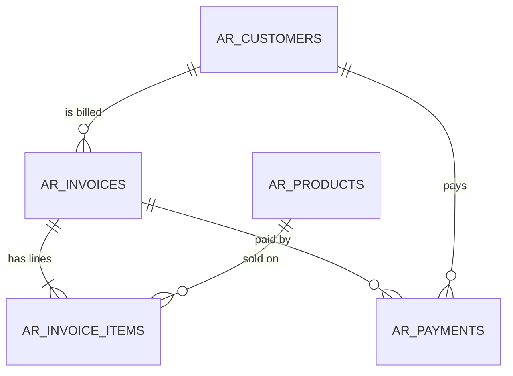

# 📊 MySQL: Joining Multiple Tables & Analytics with SQL

Two lessons on combining several tables and turning the result into **business metrics**, using **revenue and accounts receivable (AR)** data from a year-end audit.

> Part of my learning journey in **Data Engineering, Data Science & AI**.

## 📚 Lessons

| # | Lesson | What it covers | Audit use |
| --- | --- | --- | --- |
| 1 | [Joining multiple tables](joining-multiple-tables-in-mysql.md) | Chained joins, same table twice, mixing INNER/LEFT, the **fan-out trap** and how to avoid it | Price vs list, misapplied cash, open balances |
| 2 | [Analytics with SQL](analytics-with-sql-in-mysql.md) | Growth, mix, concentration, AR aging, DSO, credit utilisation, days to pay, subsequent receipts | Revenue analytics, AR valuation and existence |

📝 Quick revision: [SUMMARY.md](SUMMARY.md) · 🎤 [Top 10 interview questions](INTERVIEW_QUESTIONS.md)

## 🗂️ Sample data

Five CSV files in [`data/`](data/), company code 1000, FY2025–FY2026, year-end **31 December 2026**, USD (made up for practice).

| File | Table | Rows | SAP source | Contents |
| --- | --- | --- | --- | --- |
| `customers.csv` | `ar_customers` | 6 | KNA1 / KNB1 / KNKK | Customer, region, payment terms (days), credit limit |
| `products.csv` | `ar_products` | 4 | MARA / pricing | Product, description, list price |
| `invoices.csv` | `ar_invoices` | 23 | VBRK | Invoice header: number, date, customer |
| `invoice_items.csv` | `ar_invoice_items` | 27 | VBRP | Invoice lines: product, quantity, unit price, net amount |
| `payments.csv` | `ar_payments` | 18 | BSAD (cleared items) | Cash receipts: date, invoice applied to, paying customer, amount (incl. January 2027 receipts) |



Totals: revenue **148,450.00** (2025) and **515,425.00** (2026); AR at year-end **219,875.00** in 9 open items.

Built-in findings:

| Finding | Value |
| --- | --- |
| New customer over its credit limit (172%), sold above list price, nothing collected in January | Delta Distributors, 68,700.00 |
| Invoice paid by a different customer (misapplied cash) | 25,000.00 |
| Overpayment: credit balance at year-end | -2,500.00 |
| Invoice 264 days overdue (bad-debt provision?) | 3,550.00 |
| DSO of 156 days against 30–60-day terms | — |
| Only 27.6% of year-end AR collected after year-end | 61,325.00 of 222,375.00 |
| Revenue up 247% year on year; top 3 customers = 68.8% | — |

## Setup

Requirements: see [requirements.txt](requirements.txt).

**Option A (recommended):** from this folder, run

```bash
mysql --local-infile=1 -u root -p < setup.sql
```

`setup.sql` creates the five `ar_` tables in `audit_fy2026` (with foreign keys), loads the CSVs and shows **6 / 4 / 23 / 27 / 18** rows and total billed **663,875.00**. If loading is refused, run `SET GLOBAL local_infile = 1;` as root first.

**Option B (MySQL Workbench):** open `setup.sql`, replace each `'data/…'` path with the full path (forward slashes), add `OPT_LOCAL_INFILE=1` under **Edit Connection → Advanced → Others**, and run it.

The analytics lesson also creates a helper table, `ar_open_items_ye` (step 0).

## Real-world examples

Each lesson ends with extra snippets on audit data from my earlier sections, in the same `audit_fy2026` database:

| Table | Section |
| --- | --- |
| `je_lines`, `gl_accounts`, `trial_balance` | SQL Basics; Importing Files & Creating Tables |
| `ap_invoices` | Numeric Queries |
| `revenue_lines` | Summary Analytics |
| `deliveries`, `billing`, `customers`, `materials` | SQL Joins |
| `opex_postings`, `employees`, `cost_centers`, `expense_categories` | CROSS JOIN & SELF JOIN |
| `journal_entries` | Transformation Functions |

## 📁 Repository structure

```text
.
├── README.md
├── SUMMARY.md
├── INTERVIEW_QUESTIONS.md
├── requirements.txt
├── setup.sql                              ← creates and loads the 5 ar_ tables
├── .gitattributes                         ← keeps the CSVs' Windows line endings intact
├── joining-multiple-tables-in-mysql.md
├── analytics-with-sql-in-mysql.md
└── data/
    ├── customers.csv
    ├── products.csv
    ├── invoices.csv
    ├── invoice_items.csv
    └── payments.csv
```
