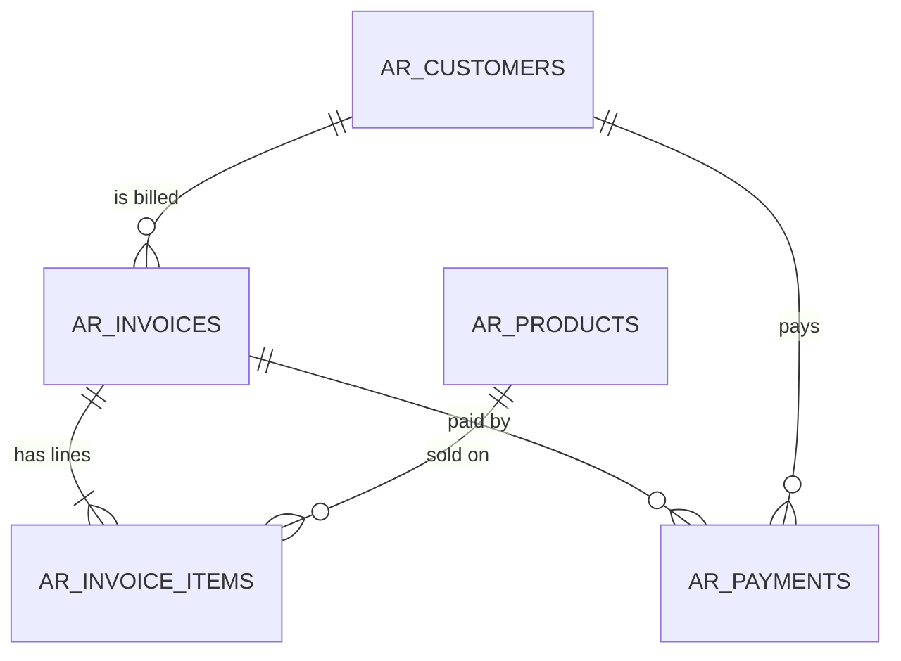

# 🔗🔗 Joining Multiple Tables in MySQL

Real questions need data from several tables at once: an invoice line needs its **header**, **customer** and **product**; an open balance needs **invoices** and **payments**. Joins can be chained: each `JOIN` adds one more table to the result.

> Part of my learning journey in **Data Engineering, Data Science & AI** · Data: `ar_customers`, `ar_products`, `ar_invoices`, `ar_invoice_items`, `ar_payments` ([setup](README.md#setup))

## How the tables connect



## Syntax

```sql
SELECT …
FROM table_a a
JOIN      table_b b ON b.a_key = a.key        -- each JOIN links to a table already in the query
JOIN      table_c c ON c.b_key = b.key
LEFT JOIN table_d d ON d.a_key = a.key        -- INNER and LEFT can be mixed
WHERE …;
```

Joins run in order: each new table attaches to the result so far.

## Examples

**1 · Four tables: invoice line with header, customer and product**

```sql
SELECT i.invoice_no, i.invoice_date, c.name, p.description,
       it.qty, it.unit_price, p.list_price, it.net_amount
FROM ar_invoices i
JOIN ar_customers     c  ON c.customer_id = i.customer_id
JOIN ar_invoice_items it ON it.invoice_no = i.invoice_no
JOIN ar_products      p  ON p.product_id  = it.product_id
WHERE i.invoice_date >= '2026-12-01'
ORDER BY i.invoice_no, it.line_no;
```

| invoice_no | invoice_date | name | description | qty | unit_price | list_price | net_amount |
| --- | --- | --- | --- | --- | --- | --- | --- |
| 90000021 | 2026-12-18 | Delta Distributors | Steel beam | 30.000 | **1650.00** | 1250.00 | 49500.00 |
| 90000022 | 2026-12-29 | Delta Distributors | Steel sheet | 40.000 | 480.00 | 480.00 | 19200.00 |
| 90000023 | 2026-12-30 | Müller GmbH | Steel beam | 36.000 | 1250.00 | 1250.00 | 45000.00 |

**2 · The same table twice: who was invoiced vs who paid** (misapplied cash)

```sql
SELECT pm.payment_no, pm.invoice_no,
       ic.name AS invoiced_customer,
       pc.name AS paying_customer,
       pm.amount
FROM ar_payments pm
JOIN ar_invoices  i  ON i.invoice_no   = pm.invoice_no
JOIN ar_customers ic ON ic.customer_id = i.customer_id     -- customer on the invoice
JOIN ar_customers pc ON pc.customer_id = pm.customer_id    -- customer who paid
WHERE pm.customer_id <> i.customer_id;
```

| payment_no | invoice_no | invoiced_customer | paying_customer | amount |
| --- | --- | --- | --- | --- |
| 1400000013 | 90000014 | Northwind Stores | Pacific Traders | 25000.00 |

**3 · ⚠️ The fan-out trap: two one-to-many tables in one join**

An invoice can have **several lines** and **several payments**. Joining both at once pairs every line with every payment, so totals are multiplied:

```sql
-- WRONG: billed or paid is doubled when an invoice has 2 lines or 2 payments
SELECT i.invoice_no, SUM(it.net_amount) AS billed, SUM(pm.amount) AS paid
FROM ar_invoices i
JOIN ar_invoice_items it ON it.invoice_no = i.invoice_no
LEFT JOIN ar_payments pm ON pm.invoice_no = i.invoice_no
WHERE i.invoice_no IN ('90000007', '90000013')
GROUP BY i.invoice_no;
```

| invoice_no | billed | paid | Actually |
| --- | --- | --- | --- |
| 90000007 | 37100.00 | **74200.00** | 2 lines × 1 payment: paid counted twice |
| 90000013 | **67200.00** | 33600.00 | 1 line × 2 payments: billed counted twice |

**Fix: aggregate each one-to-many table first, then join the totals** (one row per invoice on each side):

```sql
SELECT i.invoice_no,
       b.billed,
       IFNULL(pd.paid, 0)            AS paid,
       b.billed - IFNULL(pd.paid, 0) AS open_amount
FROM ar_invoices i
JOIN (SELECT invoice_no, SUM(net_amount) AS billed
      FROM ar_invoice_items GROUP BY invoice_no) b   ON b.invoice_no  = i.invoice_no
LEFT JOIN (SELECT invoice_no, SUM(amount) AS paid
      FROM ar_payments
      WHERE payment_date <= '2026-12-31'
      GROUP BY invoice_no) pd                         ON pd.invoice_no = i.invoice_no
WHERE i.invoice_no IN ('90000007', '90000013', '90000020');
```

| invoice_no | billed | paid | open_amount |
| --- | --- | --- | --- |
| 90000007 | 37100.00 | 37100.00 | 0.00 |
| 90000013 | 33600.00 | 33600.00 | 0.00 |
| 90000020 | 41325.00 | 0.00 | 41325.00 |

**4 · Mix INNER and LEFT joins: every customer, with or without invoices**

```sql
SELECT c.name,
       COUNT(DISTINCT i.invoice_no)  AS invoices_2026,
       IFNULL(SUM(it.net_amount), 0) AS revenue_2026
FROM ar_customers c
LEFT JOIN ar_invoices i
       ON i.customer_id = c.customer_id
      AND i.invoice_date BETWEEN '2026-01-01' AND '2026-12-31'
LEFT JOIN ar_invoice_items it ON it.invoice_no = i.invoice_no   -- LEFT again, or customers without invoices drop out
GROUP BY c.customer_id, c.name
ORDER BY revenue_2026 DESC;                       -- a customer with no 2026 invoices would show 0 · 0.00
```

Once a chain starts with `LEFT JOIN`, keep the following joins `LEFT` too. An `INNER JOIN` later in the chain removes the rows the left join kept.

## 🌍 More real-world examples

Tables from my earlier sections (see [README](README.md#real-world-examples)):

```sql
-- OpEx: posting with cost center, category, requester and approver (5 tables, employees twice)
SELECT o.doc_no, cc.name AS cost_center, e.category,
       r.name AS requested_by, a.name AS approved_by, o.amount
FROM opex_postings o
JOIN cost_centers       cc ON cc.cost_center = o.cost_center
JOIN expense_categories e  ON e.gl_account   = o.gl_account
JOIN employees          r  ON r.emp_id       = o.requested_by
JOIN employees          a  ON a.emp_id       = o.approved_by
WHERE o.amount >= 40000;

-- Revenue vs volume: delivery → billing → customer → material
SELECT d.delivery_no, b.billing_no, c.name, m.description,
       d.qty_shipped, b.qty_billed, b.net_value
FROM deliveries d
JOIN billing   b ON b.delivery_no = d.delivery_no
JOIN customers c ON c.customer_id = d.customer_id
JOIN materials m ON m.material_id = d.material_id;

-- Journal entries vs trial balance, with the account type from the chart of accounts
SELECT j.hkont, g.txt50, g.acct_type,
       SUM(IF(j.shkzg = 'S', j.dmbtr, -j.dmbtr)) AS je_net,
       t.closing                                 AS tb_closing
FROM je_lines j
JOIN gl_accounts   g ON g.saknr = j.hkont
JOIN trial_balance t ON t.hkont = j.hkont
GROUP BY j.hkont, g.txt50, g.acct_type, t.closing;
```

## ⚠️ Common mistakes

| Mistake | Problem | Fix |
| --- | --- | --- |
| Joining two one-to-many tables at once | Fan-out: totals multiplied | Aggregate each in a derived table first |
| `LEFT JOIN` followed by `INNER JOIN` on the optional side | Unmatched rows removed again | Keep the chain `LEFT` |
| Same alias, or no alias, for a table used twice | `Error 1066` | Give each copy its own alias (`ic`, `pc`) |
| Unprefixed columns | `Error 1052: ambiguous` | Prefix every column with its alias |
| Not checking totals after joining | Silent duplicates or drops | Compare `SUM` with the source table's `SUM` |

## 🎯 Key takeaways

1. Chain joins one table at a time; each `ON` links the new table to one already joined.
2. Use **aliases** everywhere, and different aliases when the **same table** is joined twice.
3. Joining **two one-to-many tables** to the same parent multiplies rows: **aggregate first, then join**.
4. Mix `INNER` and `LEFT` carefully: once optional, stay `LEFT`.
5. Always **reconcile** totals after a multi-table join.
