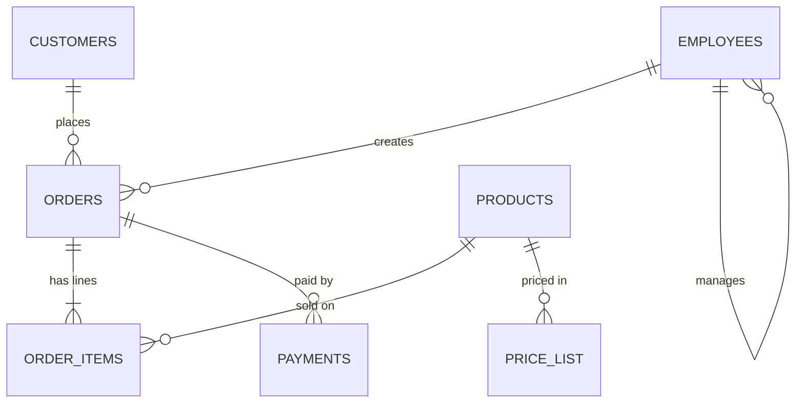

# ⚡ MySQL Cheat Sheet: SQL Intermediate

Syntax and examples for every topic in the [key takeaways](KEY_TAKEAWAYS.md), in the same order. Every `sql` block runs on the demo data in [`cheatsheet_examples.sql`](cheatsheet_examples.sql). Blocks marked `text` are templates.

## Contents

1. [Why multiple tables: ERD](#1--why-multiple-tables-erd)
2. [Joins: INNER, LEFT, RIGHT, FULL](#2--joins-inner-left-right-full)
3. [CROSS JOIN and SELF JOIN](#3--cross-join-and-self-join)
4. [Transformation functions](#4--transformation-functions)
5. [Joining more than two tables](#5--joining-more-than-two-tables)
6. [Analytics on tables](#6--analytics-on-tables)

---

## 1 · Why multiple tables: ERD



Each customer, product and employee is stored **once**; orders refer to them by key.

## 2 · Joins: INNER, LEFT, RIGHT, FULL

```text
SELECT a.col, b.col
FROM table_a a                 -- alias "a"
JOIN table_b b                 -- JOIN = INNER JOIN
  ON b.key = a.key             -- match condition
 AND b.key2 = a.key2;          -- extra columns with AND
```

```sql
USE cheatsheet_intermediate;

-- INNER JOIN (JOIN alone means INNER): matching rows only
SELECT o.order_no, o.order_date, c.name
FROM orders o
JOIN customers c ON c.customer_id = o.customer_id;

-- Join on two columns with AND: price for the product IN the customer's region
SELECT o.order_no, c.region, it.product_id, it.unit_price, pl.list_price
FROM order_items it
JOIN orders o      ON o.order_no     = it.order_no
JOIN customers c   ON c.customer_id  = o.customer_id
JOIN price_list pl ON pl.product_id  = it.product_id
                  AND pl.region      = c.region;          -- 5000000006 sold at 1450 vs 1300 list
```

| Join | Returns |
| --- | --- |
| `INNER JOIN` | Only rows that match in both tables |
| `LEFT JOIN` | All rows of the left table + matches (`NULL` where none) |
| `RIGHT JOIN` | All rows of the right table + matches (`NULL` where none) |
| `FULL JOIN` | All rows of both (MySQL: LEFT `UNION` RIGHT) |

```sql
-- LEFT JOIN: every customer, with or without orders
SELECT c.name, o.order_no
FROM customers c
LEFT JOIN orders o ON o.customer_id = c.customer_id;

-- LEFT JOIN + IS NULL: customers with no orders
SELECT c.name
FROM customers c
LEFT JOIN orders o ON o.customer_id = c.customer_id
WHERE o.order_no IS NULL;                                 -- Great Lakes Supply

-- RIGHT JOIN: every order, with its payments where they exist
SELECT o.order_no, p.payment_no, p.amount
FROM payments p
RIGHT JOIN orders o ON o.order_no = p.order_no;

-- FULL JOIN in MySQL: LEFT JOIN UNION RIGHT JOIN
SELECT c.customer_id, o.order_no
FROM customers c LEFT JOIN orders o ON o.customer_id = c.customer_id
UNION
SELECT c.customer_id, o.order_no
FROM customers c RIGHT JOIN orders o ON o.customer_id = c.customer_id;
```

**Export to CSV (MySQL Workbench):** run the query → result grid toolbar → **Export recordset to an external file** → choose **CSV** → **Save**.

## 3 · CROSS JOIN and SELF JOIN

```sql
-- CROSS JOIN: every customer × every month (no common column needed)
SELECT c.name, m.month_name
FROM customers c
CROSS JOIN months m;                                      -- 5 × 3 = 15 rows

-- CONCAT: combine text
SELECT CONCAT(c.name, ' - ', m.month_name) AS label
FROM customers c
CROSS JOIN months m;
```

```sql
-- SELF JOIN: employee and manager from the same table (two aliases)
SELECT e.name AS employee, m.name AS manager
FROM employees e
LEFT JOIN employees m ON m.emp_id = e.manager_id;         -- LEFT keeps the top manager
```

## 4 · Transformation functions

```sql
-- Text
SELECT name,
       CONCAT('[', name, ']')          AS shows_spaces,
       TRIM(name)                      AS trimmed,
       UPPER(TRIM(name))               AS upper_case,
       LOWER(name)                     AS lower_case,
       LEFT(customer_id, 4)            AS first_4,
       RIGHT(customer_id, 6)           AS last_6,
       SUBSTRING(customer_id, 5, 3)    AS middle_3,
       REPLACE(name, 'GmbH', 'Ltd')    AS replaced,
       LPAD('100001', 10, '0')         AS padded         -- '0000100001'
FROM customers;
```

```sql
-- Numbers
SELECT order_no,
       qty * unit_price                     AS line_value,
       ROUND(qty * unit_price / 1000, 1)    AS value_k,
       ABS(-qty)                            AS abs_qty,
       MOD(qty * unit_price, 1000) = 0      AS is_round_thousand
FROM order_items;
```

```sql
-- Dates
SELECT order_no, order_date,
       DAYNAME(order_date)                          AS weekday,        -- 5000000006: Saturday
       MONTH(order_date)                            AS month_no,
       DATE_FORMAT(order_date, '%d.%m.%Y')          AS sap_style,
       DATE_ADD(order_date, INTERVAL 30 DAY)        AS due_date,
       DATEDIFF('2026-03-31', order_date)           AS days_old,
       STR_TO_DATE('31.03.2026', '%d.%m.%Y')        AS text_to_date
FROM orders;
```

```sql
-- Conversion & NULL
SELECT c.name,
       CAST(c.customer_id AS UNSIGNED)      AS customer_no,        -- '0000100001' → 100001
       IFNULL(o.order_no, 'No orders')      AS order_or_label,
       COALESCE(o.order_no, c.region)       AS first_not_null,
       NULLIF(TRIM(c.name), '')             AS blank_to_null
FROM customers c
LEFT JOIN orders o ON o.customer_id = c.customer_id;
```

## 5 · Joining more than two tables

```sql
-- Chain joins one table at a time (4 tables)
SELECT o.order_no, c.name, p.description, it.qty, it.unit_price
FROM orders o
JOIN customers   c  ON c.customer_id = o.customer_id
JOIN order_items it ON it.order_no   = o.order_no
JOIN products    p  ON p.product_id  = it.product_id;
```

```sql
-- GROUP_CONCAT: text from many rows into one row
SELECT o.order_no,
       GROUP_CONCAT(p.description ORDER BY it.line_no SEPARATOR ', ') AS products
FROM orders o
JOIN order_items it ON it.order_no  = o.order_no
JOIN products    p  ON p.product_id = it.product_id
GROUP BY o.order_no;                                      -- 5000000001: Steel beam, Fastener box
```

```sql
-- Aggregate one-to-many tables FIRST, then join (avoids double counting)
SELECT o.order_no,
       b.order_value,
       IFNULL(pd.paid, 0)                 AS paid,
       b.order_value - IFNULL(pd.paid, 0) AS open_amount
FROM orders o
JOIN (SELECT order_no, ROUND(SUM(qty * unit_price), 2) AS order_value
      FROM order_items GROUP BY order_no) b  ON b.order_no  = o.order_no
LEFT JOIN (SELECT order_no, SUM(amount) AS paid
      FROM payments GROUP BY order_no) pd    ON pd.order_no = o.order_no;
```

## 6 · Analytics on tables

```sql
-- Merge + group: sales by region, with % of total
SELECT c.region,
       ROUND(SUM(it.qty * it.unit_price), 2)                AS sales,
       ROUND(SUM(it.qty * it.unit_price) / t.total * 100, 1) AS pct_of_total
FROM order_items it
JOIN orders o    ON o.order_no    = it.order_no
JOIN customers c ON c.customer_id = o.customer_id
CROSS JOIN (SELECT SUM(qty * unit_price) AS total FROM order_items) t
GROUP BY c.region, t.total;
```

```sql
-- Top N: 3 largest customers by sales
SELECT c.name, ROUND(SUM(it.qty * it.unit_price), 2) AS sales
FROM order_items it
JOIN orders o    ON o.order_no    = it.order_no
JOIN customers c ON c.customer_id = o.customer_id
GROUP BY c.customer_id, c.name
ORDER BY sales DESC
LIMIT 3;

-- Bottom N: 2 smallest order lines
SELECT order_no, line_no, ROUND(qty * unit_price, 2) AS line_value
FROM order_items
ORDER BY line_value ASC
LIMIT 2;
```
