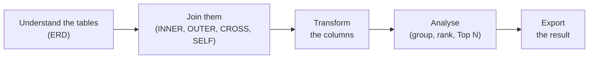

# 🎯 Key Takeaways: SQL Intermediate (MySQL)

The main lessons from working with **multiple tables**, in one place. For syntax, see the [cheat sheet](CHEATSHEET.md).

## 🧭 The big picture

1. Business data lives in **many related tables**; most real questions need several of them at once.
2. **Joins** are the skill you will use most in SQL: take the time to understand them thoroughly.
3. Before writing a query, **break the requirement into simple pieces**: which tables, which keys, which filters, which totals.
4. After every join, **check row counts and totals**: joins can silently drop or duplicate rows.

## 1 · Why multiple tables?

- Companies store data in **multiple related tables**, not one big sheet.
- Splitting data **avoids repetition**, which saves space (a customer's name is stored once, not on every order).
- Data is **better organised**: customers, products, orders and payments each have their own table.
- **Updates are easier**: change a customer's region once, and every order sees it.
- An **Entity Relationship Diagram (ERD)** shows how tables relate through their keys.
- The **`JOIN`** clause brings related tables back together in a query.

## 2 · Joins: INNER, LEFT, RIGHT, FULL

- `JOIN` combined with **`ON`** merges two tables on a matching column.
- Add **`AND`** in the `ON` clause to join on **several columns** (e.g. product **and** region).
- **Table aliases** (`orders o`) shorten queries; prefix every column with its alias.
- Join types: **INNER, LEFT, RIGHT, FULL, CROSS**. `JOIN` on its own is an **INNER JOIN**.
- **LEFT, RIGHT and FULL** are **outer joins**: they keep rows without a match and fill the gaps with `NULL`.
- `LEFT JOIN … WHERE right.key IS NULL` finds rows **missing** from the other table.
- MySQL has no `FULL OUTER JOIN`: build it with a LEFT JOIN **`UNION`** a RIGHT JOIN.
- Results can be downloaded as a **CSV** with the editor's **Export** button.

## 3 · CROSS JOIN and SELF JOIN

- `CROSS JOIN` pairs **every row with every row**; use it when two tables have **no common column** (e.g. customers × months).
- **Concatenation** combines text: `CONCAT()` joins two or more strings into one.
- A **self join** joins a table **to itself** with two aliases, e.g. employee and manager.
- Thinking in Excel terms helps: a join is like `VLOOKUP`, and `CONCAT` is like `&`.

## 4 · Transformation functions

- **Text:** `CONCAT`, `UPPER`, `LOWER`, `TRIM`, `LEFT`, `RIGHT`, `SUBSTRING`, `REPLACE` and `LPAD` standardise and reshape text before comparing it.
- **Numbers:** `ROUND`, `ABS` and `MOD` control decimals, remove signs and test for round amounts.
- **Dates:** `STR_TO_DATE` and `DATE_FORMAT` convert between text and dates; `DATE_ADD` and `DATEDIFF` shift and compare dates; `DAYNAME` and `MONTH` extract parts.
- **Conversion & NULL:** `CAST` changes types; `IFNULL` and `COALESCE` replace `NULL`s; `NULLIF` turns placeholders into `NULL`.
- Transform in the query and **keep the raw data unchanged**.

## 5 · Joining more than two tables

- Start from the **ERD**, then chain joins one table at a time.
- **`GROUP_CONCAT`** combines text from **several rows into one** (e.g. all products on an order).
- Joining two **one-to-many** tables to the same parent multiplies rows: **aggregate each first, then join**.

## 6 · Analytics on tables

- You will **merge tables** constantly to turn raw data into **business insights**.
- Typical analytics: totals and averages per group, **% of total**, comparisons against a list or a target.
- **Top N / Bottom N** is a common request: `ORDER BY … DESC` / `ASC` with `LIMIT`.

## ✅ Ten habits for multi-table SQL

1. Sketch or read the ERD before joining.
2. Give every table a short alias and prefix every column.
3. Join on the **full key**, using `AND` for multi-column keys.
4. Use `INNER` for matches only, `LEFT` to keep everything from the main table.
5. Put conditions on the optional table in `ON`, not `WHERE`.
6. Use `CROSS JOIN` deliberately, and only on small tables.
7. Aggregate one-to-many tables before joining them together.
8. Clean text (`TRIM`, `UPPER`) before joining or grouping on it.
9. Sort before `LIMIT` for Top N / Bottom N.
10. Reconcile row counts and totals, then export.
