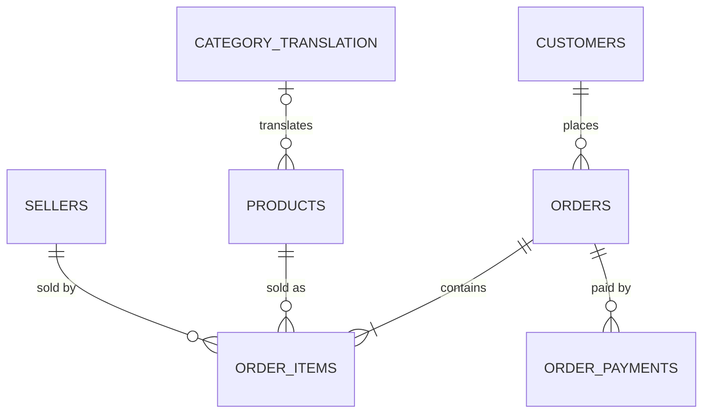

# 🛒 E-Commerce Revenue Assurance with SQL (Olist, Kaggle)

An end-to-end, runnable MySQL project on **real e-commerce data from Kaggle**: about 100,000 orders from the Brazilian marketplace Olist. You load seven raw CSV files, check and clean them, analyse revenue, and run a **revenue assurance audit** for financial year 2017.

It uses every SQL topic from my learning journey so far: from `CREATE TABLE`, `LOAD DATA` and `WHERE` to `HAVING`, `CASE`, every kind of join, transformation functions and analytics.

> Part of my learning journey in **Data Engineering, Data Science & AI**.

## 🎯 Business scenario

You are the data specialist on the **FY2017 audit** of a marketplace. Revenue is the item price of **delivered** orders; payments come from cards, boleto (bank slip), vouchers and debit cards. Your tasks:

1. Load the raw extract and **prove it is complete and accurate**.
2. Explore and **analyse** revenue: trends, categories, sellers, payments, delivery.
3. Run **revenue assurance tests**: payment reconciliation, refunds, cut-off, timestamp integrity, pricing.
4. Record findings and quantify the **proposed adjustment**.

## 🗺️ Project flow

```mermaid
flowchart LR
    A["📄 7 CSV files<br/>(Kaggle)"] --> B["00-01 · Create<br/>database & tables"]
    B --> C["02 · Load<br/>staging"]
    C --> D["03 · Data quality<br/>checks"]
    D --> E["04 · Transform,<br/>reconcile, back up"]
    E --> F["05 · Explore"]
    F --> G["06 · Summaries &<br/>calculated columns"]
    G --> H["07 · Joins"]
    H --> I["08 · Multi-table &<br/>transformations"]
    I --> J["09 · Analytics"]
    J --> K["10 · Audit<br/>tests"]
    K --> L["11 · Findings,<br/>adjustment, export"]
```



## 🗂️ The data

**Source:** [Brazilian E-Commerce Public Dataset by Olist](https://www.kaggle.com/datasets/olistbr/brazilian-ecommerce) on Kaggle. Real, anonymised orders from September 2016 to October 2018. Licence: **CC BY-NC-SA 4.0** (see [DATA_LICENSE.md](DATA_LICENSE.md)).

Seven of the dataset's files are used (geolocation and reviews are not needed):

| File | Table | Rows | Contents |
| --- | --- | --- | --- |
| `olist_customers_dataset.csv` | `customers` | 99,441 | Customer per order, real customer (`customer_unique_id`), zip, city, state |
| `olist_sellers_dataset.csv` | `sellers` | 3,095 | Seller zip, city, state |
| `olist_products_dataset.csv` | `products` | 32,951 | Category (Portuguese), photos, weight and size |
| `product_category_name_translation.csv` | `category_translation` | 71 | Category name in English |
| `olist_orders_dataset.csv` | `orders` | 99,441 | Status, purchase / approval / carrier / delivery / estimated dates |
| `olist_order_items_dataset.csv` | `order_items` | 112,650 | Lines: product, seller, price, freight |
| `olist_order_payments_dataset.csv` | `order_payments` | 103,886 | Payments: method, installments, value |

### Entity Relationship Diagram



Real data-quality issues you will meet: zip codes that lost their leading zero, a translation file with Windows line endings and a byte-order mark, products without a category, orders with no items, "delivered" orders without a delivery date.

## 📁 Project structure

```text
olist-revenue-assurance-sql-project/
├── README.md                   ← you are here
├── SUMMARY.md                  ← results on one page
├── INTERVIEW_QUESTIONS.md      ← questions and answers about the project
├── requirements.txt            ← software needed
├── DATA_LICENSE.md             ← dataset source and licence
├── run_all.sql                 ← runs every step in one go
├── .gitattributes / .gitignore
├── data/                       ← the 7 Olist CSV files (48 MB)
├── sql/
│   ├── 00_create_database.sql
│   ├── 01_create_tables.sql
│   ├── 02_load_staging.sql
│   ├── 03_data_quality_checks.sql
│   ├── 04_transform_and_load.sql
│   ├── 05_exploration.sql
│   ├── 06_summary_and_calculated_columns.sql
│   ├── 07_joins.sql
│   ├── 08_multi_table_and_transformations.sql
│   ├── 09_analytics.sql
│   ├── 10_audit_tests.sql
│   └── 11_findings_and_export.sql
├── scripts/
│   └── download_data.py        ← optional: fresh copy from Kaggle
└── docs/
    ├── expected_results.md     ← what each step should return
    └── topic_coverage.md       ← where each SQL topic is used
```

## Run the project

### 1 · Install

- **MySQL Server 8.4 LTS** (8.0+ works) and **MySQL Workbench**: see [requirements.txt](requirements.txt).
- Clone or download this repository. The data is already in `data/`.

### 2 · Allow local file loading (once)

Connect as `root` and run:

```sql
SET GLOBAL local_infile = 1;
```

### 3a · Run everything from the command line (recommended)

Open a terminal **in the project folder** (the scripts use paths relative to it):

```bash
mysql --local-infile=1 -u root -p --table < run_all.sql > output.txt
```

It takes about **30 seconds**. Open `output.txt`: each step ends with a `Step N complete` line.

### 3b · Or step by step in MySQL Workbench

1. **Edit Connection → Advanced → Others:** add `OPT_LOCAL_INFILE=1`, then reconnect.
2. Open `sql/00_create_database.sql` and run it with ⚡ **Execute**.
3. Repeat for each script **in order**, `01` to `11`.
4. In `02_load_staging.sql`, replace each `'data/…'` with the **full path** (forward slashes), e.g. `'C:/Users/me/olist-revenue-assurance-sql-project/data/olist_orders_dataset.csv'`.
5. No `local_infile`? Load each CSV into its `stg_` table with **Table Data Import Wizard → Use existing table**, then continue with step `03`.

### 4 · Check the results

Compare your output with [docs/expected_results.md](docs/expected_results.md). Key checks:

| Check | Expected |
| --- | --- |
| Rows staged = rows loaded (orders / items / payments) | 99,441 / 112,650 / 103,886 |
| Price total staged = loaded | 13,591,643.70 BRL |
| Payment total staged = loaded | 16,008,872.12 BRL |
| FY2017 revenue (delivered, purchase date) | 5,962,902.01 BRL |
| Proposed cut-off adjustment | 349,787.86 BRL |

Rerunning is safe: step `00` drops and recreates the `olist_audit` database.

### 5 · Export results (optional)

- **Workbench:** run a query → result grid → **Export** → CSV.
- **SQL:** `SELECT … INTO OUTFILE` (template at the end of `11_findings_and_export.sql`).
- **Whole database:** `mysqldump -u root -p olist_audit > olist_audit_backup.sql`

## 🧭 Steps in detail

| Step | Script | What it does |
| --- | --- | --- |
| 0 | `00_create_database` | Create `olist_audit` |
| 1 | `01_create_tables` | 7 all-text staging tables + 7 typed tables with keys, checks and indexes |
| 2 | `02_load_staging` | Load the 7 CSVs with `LOAD DATA LOCAL INFILE` |
| 3 | `03_data_quality_checks` | Missing dates, short zip codes, hidden `\r`, orphans, duplicates, impossible timestamps |
| 4 | `04_transform_and_load` | Clean and convert into typed tables, reconcile counts and totals, back up |
| 5 | `05_exploration` | First look: filters, patterns, sorting, paging, `EXPLAIN` |
| 6 | `06_summary_and_calculated_columns` | FY2017 totals, `GROUP BY`/`HAVING`, `IF`, `CASE`, USD and kg conversions, profit proxy |
| 7 | `07_joins` | INNER, LEFT, RIGHT, FULL (`UNION`), two-column join, CROSS JOIN grid, SELF JOIN |
| 8 | `08_multi_table_and_transformations` | 5-table join, `GROUP_CONCAT`, fan-out trap and fix, text/number/date/NULL functions |
| 9 | `09_analytics` | Monthly trend, Top/Bottom N, % of total, seller concentration, growth, payment mix, delivery |
| 10 | `10_audit_tests` | 8 revenue assurance tests (T1–T8) and a summary |
| 11 | `11_findings_and_export` | Findings log with `INSERT`/`UPDATE`/`DELETE`, `ROLLBACK`, adjustment, clean-up, export |

The full map of topic → script is in [docs/topic_coverage.md](docs/topic_coverage.md).

## 🔎 Audit results (FY2017)

| Test | Question | Result |
| --- | --- | --- |
| T1 Accuracy | Do payments equal items + freight? | 310 delivered orders differ by more than 1 BRL |
| T2 Occurrence | Delivered orders never paid? | 1 order |
| T3 Refunds | Paid orders that were canceled/unavailable? | 1,234 orders · **269,735.11 BRL** |
| T4 Cut-off | FY2017 orders delivered in 2018? | 2,496 orders · **349,787.86 BRL** |
| T5 Integrity | Impossible or missing timestamps? | 8 delivered without date · 14 without approval · 1,359 shipped before approval |
| T6 Pricing | Sold at > 2× the seller's own average? | 8 items |
| T7 Payments | Zero-value or undefined payments? | 9 payments |
| T8 Service | Delivered > 30 days late? | 345 orders |

**Conclusion:** if revenue is recognised when goods are **delivered**, FY2017 revenue (5,962,902.01 BRL on a purchase-date basis) is overstated by **349,787.86 BRL** (5.9%). Refunds of 269,735.11 BRL on canceled and unavailable orders need to be traced to bank records.

## 🎤 Interview preparation

See [INTERVIEW_QUESTIONS.md](INTERVIEW_QUESTIONS.md).

## 🙏 Acknowledgement

Data: Olist, *Brazilian E-Commerce Public Dataset by Olist*, Kaggle, CC BY-NC-SA 4.0. This project is for non-commercial learning.
