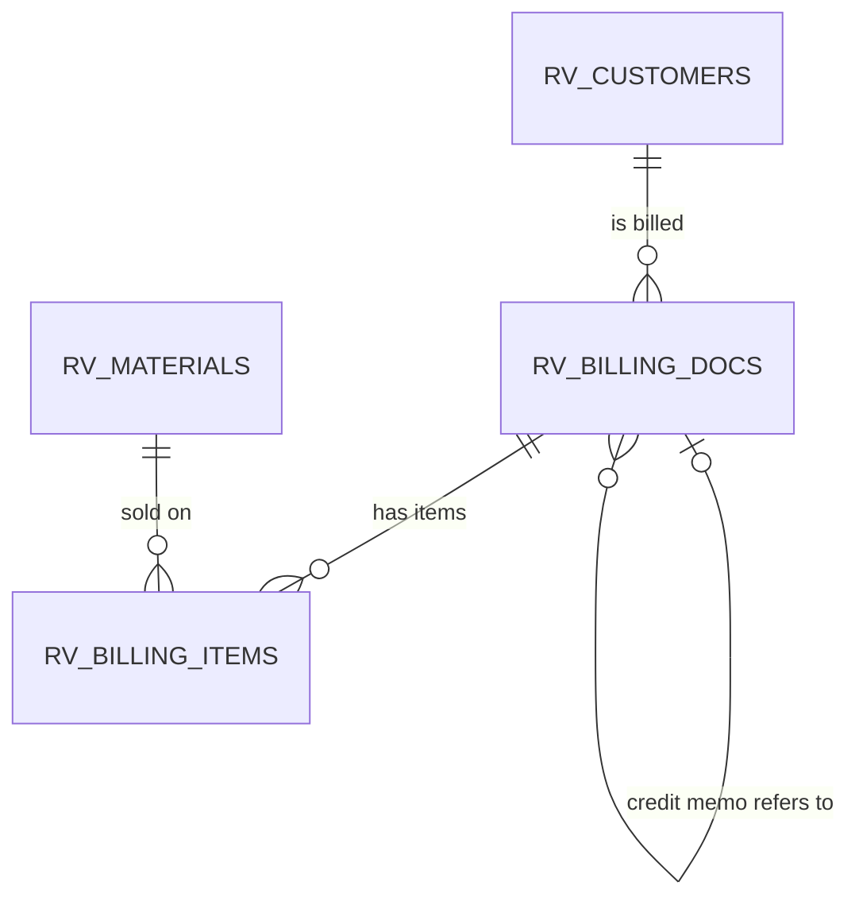

# 🔍 MySQL: Subqueries

Three lessons on **subqueries**: queries inside queries, using **revenue** data from a year-end audit.

> Part of my learning journey in **Data Engineering, Data Science & AI**.

## 📚 Lessons

| # | Lesson | What it covers | Audit use |
| --- | --- | --- | --- |
| 1 | [Subqueries in WHERE](subqueries-in-where-in-mysql.md) | Single value, `IN` / `NOT IN`, the NULL trap, `ANY` / `ALL`, second-highest | Large invoices, blocked customers, intercompany, dormant customers |
| 2 | [Subqueries in FROM and SELECT](subqueries-in-from-and-select-in-mysql.md) | Derived tables, average of totals, % of total, header vs items | Credit limit, monthly trend, concentration |
| 3 | [Correlated subqueries and EXISTS](correlated-subqueries-and-exists-in-mysql.md) | Per-row comparison, latest per group, `EXISTS` / `NOT EXISTS`, subquery vs JOIN | Pricing, completeness, credit memos, cut-off |

📝 Quick revision: [SUMMARY.md](SUMMARY.md) · 🎤 [Top 10 interview questions](INTERVIEW_QUESTIONS.md)

## 🗂️ Sample data

Four CSV files in [`data/`](data/), FY2026, year-end **31 December 2026**, USD (made up for practice).

| File | Table | Rows | SAP source | Contents |
| --- | --- | --- | --- | --- |
| `customers.csv` | `rv_customers` | 8 | KNA1 / KNKK | Customer group, credit limit, billing block, created on |
| `materials.csv` | `rv_materials` | 5 | MARA / pricing | Material, description, list price |
| `billing_docs.csv` | `rv_billing_docs` | 24 | VBRK | Invoices (F2) and credit memos (G2): dates, customer, reference invoice, header value |
| `billing_items.csv` | `rv_billing_items` | 30 | VBRP | Items: material, quantity, unit price, net amount |

Credit memos are stored as **negative** amounts.



Totals: headers **147,300.00**, items **141,300.00**. Built-in findings:

| Finding | Value |
| --- | --- |
| New customer (Delta) over credit limit, sold above list price | 27,300.00 vs 20,000.00 limit |
| Invoice with no items | 5,500.00 |
| Header ≠ sum of items | 500.00 |
| Invoice to a blocked customer | 2,400.00 |
| Credit memos without a valid original invoice | -2,700.00 |
| Billed 4 January 2027, posted 31 December 2026 (cut-off) | 5,000.00 |
| Intercompany revenue to exclude | 15,000.00 |
| Customer never billed | Granite Builders |

## Setup

Requirements: see [requirements.txt](requirements.txt).

**Option A (recommended):** from this folder, run

```bash
mysql --local-infile=1 -u root -p < setup.sql
```

`setup.sql` creates the four `rv_` tables in `audit_fy2026` (with foreign keys), loads the CSVs and shows **8 / 5 / 24 / 30** rows, header total **147,300.00** and item total **141,300.00**. If loading is refused, run `SET GLOBAL local_infile = 1;` as root first.

**Option B (MySQL Workbench):** open `setup.sql`, replace each `'data/…'` path with the full path (forward slashes), add `OPT_LOCAL_INFILE=1` under **Edit Connection → Advanced → Others**, and run it.

## Real-world examples

Each lesson ends with extra snippets on audit data from my earlier sections, in the same `audit_fy2026` database:

| Table | Section |
| --- | --- |
| `je_lines`, `trial_balance` | SQL Basics; Importing Files & Creating Tables |
| `ap_invoices` | Numeric Queries |
| `revenue_lines`, `materials` | Summary Analytics; SQL Joins |
| `opex_postings`, `employees` | CROSS JOIN & SELF JOIN |
| `ar_customers`, `ar_open_items_ye` | Joining Multiple Tables & Analytics |

## 📁 Repository structure

```text
.
├── README.md
├── SUMMARY.md
├── INTERVIEW_QUESTIONS.md
├── requirements.txt
├── setup.sql                                   ← creates and loads the 4 rv_ tables
├── .gitattributes                              ← keeps the CSVs' Windows line endings intact
├── subqueries-in-where-in-mysql.md
├── subqueries-in-from-and-select-in-mysql.md
├── correlated-subqueries-and-exists-in-mysql.md
└── data/
    ├── customers.csv
    ├── materials.csv
    ├── billing_docs.csv
    └── billing_items.csv
```
