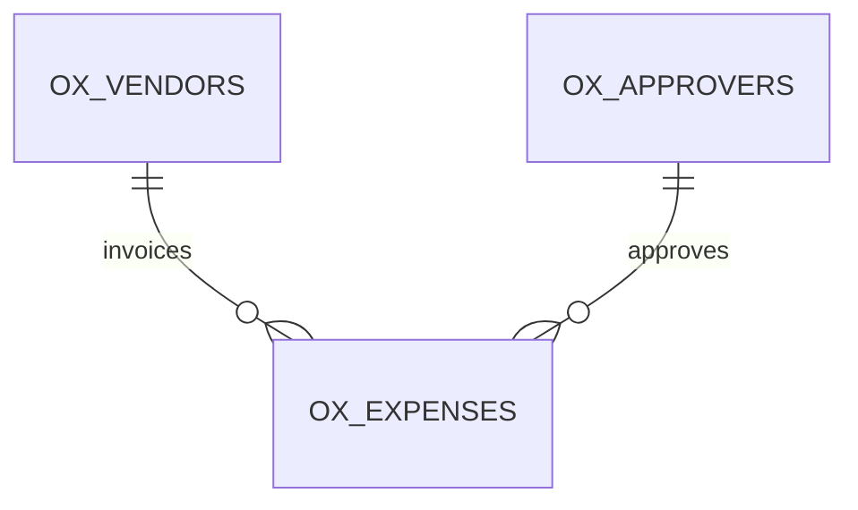

# 🔹🔸 MySQL: ANY and ALL Operators

Two lessons on comparing a value with **a list returned by a subquery**, using **operating expenses (opex)** data from a year-end audit.

> Part of my learning journey in **Data Engineering, Data Science & AI**.

## 📚 Lessons

| # | Lesson | What it covers | Audit use |
| --- | --- | --- | --- |
| 1 | [ANY operator](any-operator-in-mysql.md) | `= ANY`, `> ANY`, correlated `ANY`, the `<> ANY` trap, empty lists | Unapproved and related-party vendors, duplicate amounts |
| 2 | [ALL operator](all-operator-in-mysql.md) | `> ALL`, `>= ALL`, `<> ALL`, correlated `ALL`, the NULL and empty-list traps | Approval limits, top cost centre, new highs |

📝 Quick revision: [SUMMARY.md](SUMMARY.md) · 🎤 [Top 10 interview questions](INTERVIEW_QUESTIONS.md)

## 🗂️ Sample data

Three CSV files in [`data/`](data/), FY2026, USD (made up for practice).

| File | Table | Rows | SAP source | Contents |
| --- | --- | --- | --- | --- |
| `approvers.csv` | `ox_approvers` | 6 | Delegation of authority | Approver, title, approval limit (one not yet set: NULL) |
| `vendors.csv` | `ox_vendors` | 7 | LFA1 | Vendor, category, approved flag, related-party flag |
| `expenses.csv` | `ox_expenses` | 27 | BSEG (opex accounts) | Document, date, cost centre, vendor, type, amount, approver |



Total opex **663,448.00**. Built-in findings:

| Finding | Value |
| --- | --- |
| Expense above every approval limit, including the CFO's | 275,000.00 |
| Expenses above the approver's own limit | 4 · 364,398.00 |
| Spend with unapproved vendors (incl. a related party) | 4 · 61,398.00 |
| December utilities nearly 3× the usual bill | 8,900.00 |
| Approver with no limit set (NULL) | A06 |

## Setup

Requirements: see [requirements.txt](requirements.txt).

**Option A (recommended):** from this folder, run

```bash
mysql --local-infile=1 -u root -p < setup.sql
```

`setup.sql` creates the three `ox_` tables in `audit_fy2026` (with foreign keys), loads the CSVs and shows **6 / 7 / 27** rows and total opex **663,448.00**. If loading is refused, run `SET GLOBAL local_infile = 1;` as root first.

**Option B (MySQL Workbench):** open `setup.sql`, replace each `'data/…'` path with the full path (forward slashes), add `OPT_LOCAL_INFILE=1` under **Edit Connection → Advanced → Others**, and run it.

## Real-world examples

Each lesson ends with extra snippets on audit data from my earlier sections, in the same `audit_fy2026` database:

| Table | Section |
| --- | --- |
| `trial_balance` | SQL Basics; Importing Files & Creating Tables |
| `ap_invoices` | Numeric Queries |
| `opex_postings`, `employees` | CROSS JOIN & SELF JOIN |
| `rv_billing_docs`, `rv_customers` | Subqueries |

## 📁 Repository structure

```text
.
├── README.md
├── SUMMARY.md
├── INTERVIEW_QUESTIONS.md
├── requirements.txt
├── setup.sql                   ← creates and loads the 3 ox_ tables
├── .gitattributes              ← keeps the CSVs' Windows line endings intact
├── any-operator-in-mysql.md
├── all-operator-in-mysql.md
└── data/
    ├── approvers.csv
    ├── vendors.csv
    └── expenses.csv
```
