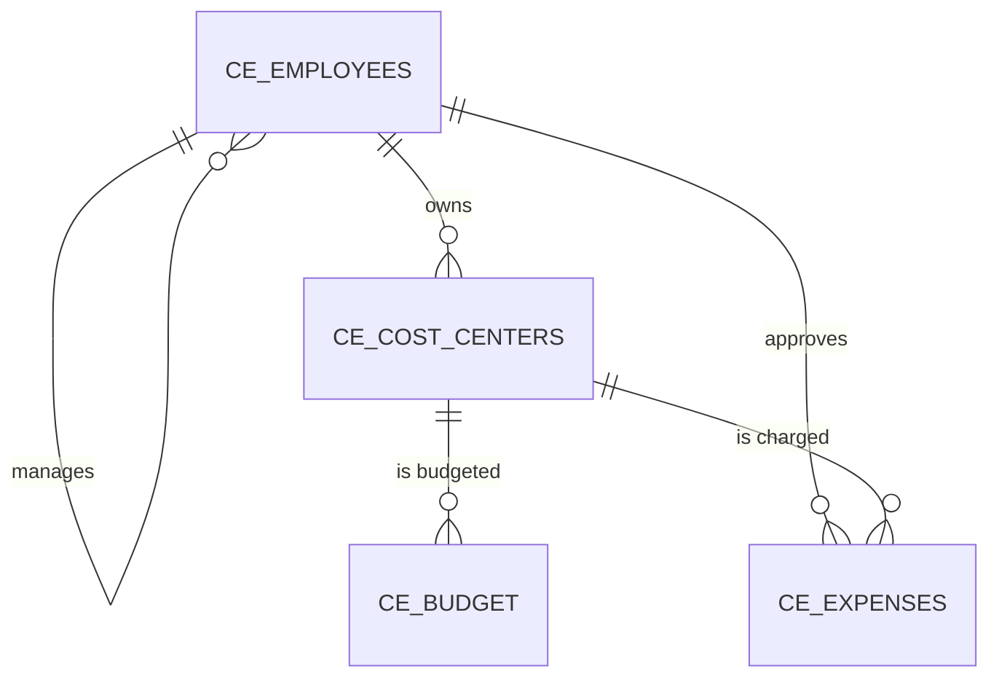

# 🧩 MySQL: Common Table Expressions (CTE)

Two lessons on **CTEs**: named, temporary result sets built with `WITH`, using **operating expenses (opex)** data from a year-end audit.

> Part of my learning journey in **Data Engineering, Data Science & AI**.

## 📚 Lessons

| # | Lesson | What it covers | Audit use |
| --- | --- | --- | --- |
| 1 | [Common Table Expressions](common-table-expressions-in-mysql.md) | Syntax, multiple and chained CTEs, **benefits**, CTE vs subquery vs temp table vs view | Budget vs actual, unusual months, approvals above limit, unbudgeted spend |
| 2 | [Applications of CTEs](cte-applications-in-mysql.md) | Recursive CTEs (series, hierarchies), a CTE joined to itself, saving workpapers, **other applications** | Missing rent, required approver, H1 vs H2, variance table |

📝 Quick revision: [SUMMARY.md](SUMMARY.md) · 🎤 [Interview questions](INTERVIEW_QUESTIONS.md)

## 🗂️ Sample data

Four CSV files in [`data/`](data/), FY2026, USD (made up for practice).

| File | Table | Rows | SAP source | Contents |
| --- | --- | --- | --- | --- |
| `employees.csv` | `ce_employees` | 8 | HR / delegation of authority | Employee, title, manager, approval limit |
| `cost_centers.csv` | `ce_cost_centers` | 4 | CSKS | Cost centre, name, owner |
| `budget.csv` | `ce_budget` | 9 | Budget (KP06) | Annual budget by cost centre and expense type |
| `expenses.csv` | `ce_expenses` | 42 | BSEG (opex accounts) | Document, date, cost centre, type, vendor, amount, approver |



Totals: budget **427,600.00**, actual **436,348.00**. Built-in findings:

| Finding | Value |
| --- | --- |
| Consulting 99.3% over budget (hidden in a cost centre that looks on budget) | 29,898.00 vs 15,000.00 |
| August rent never posted | 15,000.00 |
| Approvals above the approver's limit | 4 · 96,198.00 |
| Spend with no budget line | 3,500.00 |
| September spike: one software invoice | 62,000.00 |

## Setup

Requirements: see [requirements.txt](requirements.txt). CTEs need **MySQL 8.0 or later**.

**Option A (recommended):** from this folder, run

```bash
mysql --local-infile=1 -u root -p < setup.sql
```

`setup.sql` creates the four `ce_` tables in `audit_fy2026` (with foreign keys), loads the CSVs and shows **8 / 4 / 9 / 42** rows, budget **427,600.00** and actual **436,348.00**. If loading is refused, run `SET GLOBAL local_infile = 1;` as root first.

**Option B (MySQL Workbench):** open `setup.sql`, replace each `'data/…'` path with the full path (forward slashes), add `OPT_LOCAL_INFILE=1` under **Edit Connection → Advanced → Others**, and run it.

## Real-world examples

The applications lesson ends with extra snippets on audit data from my earlier sections, in the same `audit_fy2026` database:

| Table | Section |
| --- | --- |
| `je_lines` | SQL Basics |
| `ap_invoices` | Numeric Queries |
| `opex_postings`, `employees` | CROSS JOIN & SELF JOIN |
| `ar_open_items_ye` | Joining Multiple Tables & Analytics |
| `rv_billing_docs`, `rv_billing_items` | Subqueries |

## 📁 Repository structure

```text
.
├── README.md
├── SUMMARY.md
├── INTERVIEW_QUESTIONS.md
├── requirements.txt
├── setup.sql                               ← creates and loads the 4 ce_ tables
├── .gitattributes                          ← keeps the CSVs' Windows line endings intact
├── common-table-expressions-in-mysql.md
├── cte-applications-in-mysql.md
└── data/
    ├── employees.csv
    ├── cost_centers.csv
    ├── budget.csv
    └── expenses.csv
```
