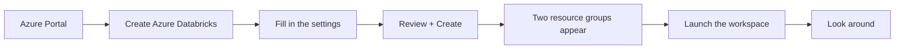
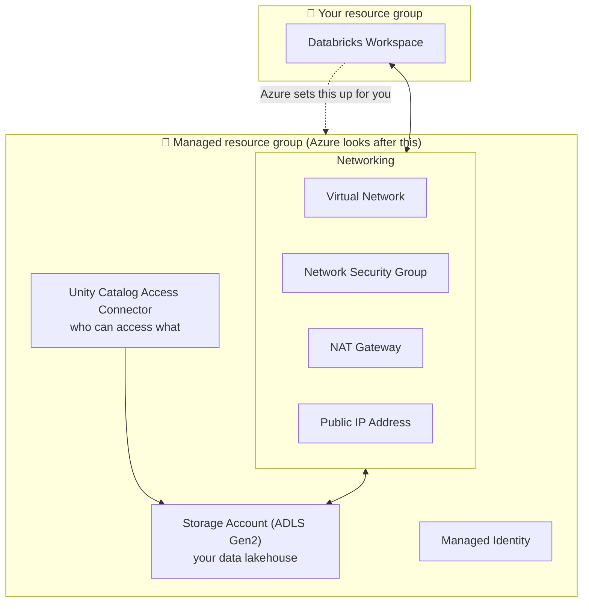
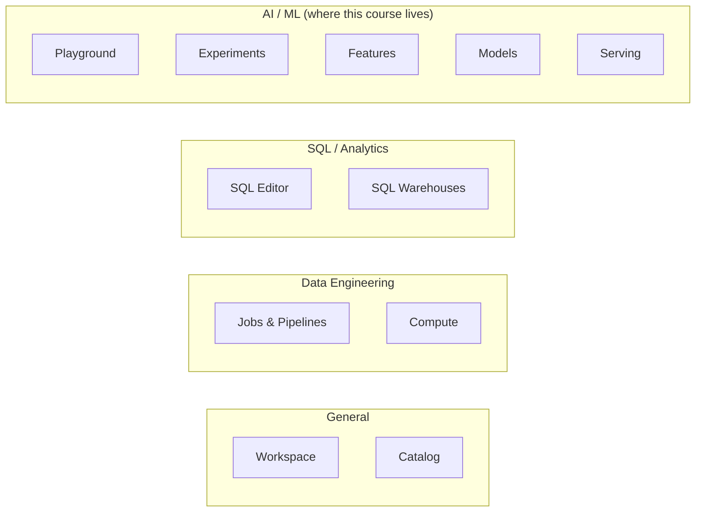
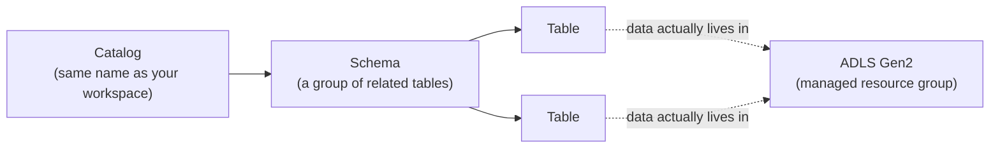
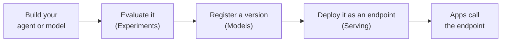

# Lab 01: Deploying a Databricks Workspace on Azure

This lab walks through setting up a Databricks workspace on Azure, looking at what Azure quietly creates behind the scenes, and taking a quick tour of the workspace itself. It only takes about 10 minutes, and most of that is waiting for the deployment to finish.

**What you'll need:** an Azure subscription where you're allowed to create resource groups.

---

## The big picture

Here's the whole flow before we get into the details:

---

## Step 1: Find Azure Databricks

Head over to [portal.azure.com](https://portal.azure.com), type **Azure Databricks** into the search bar at the top, and click **Create**.

---

## Step 2: Fill in the settings

First, decide on your names. Anything works, but it helps to pick a short prefix (your project name, for example) and stick with it so everything is easy to find later. The examples below use `<name>` as a stand-in.

| Setting | What to enter | Why |
|---|---|---|
| Resource group | Create a new one, like `<name>-databricks-rg` | This is the main group that will hold your workspace |
| Workspace name | Something like `<name>-databricks` | |
| Region | Whatever's close to you (the course used Sweden Central) | |
| Pricing tier | **Premium** | More on this below. Don't pick Trial |
| Workspace type | **Hybrid** | So Spark can run on virtual machines |
| Managed resource group name | Something like `<name>-databricks-managed-rg` | You name it, Azure fills it |

**Why Premium and not Trial?** Later in the course we'll create Mosaic AI endpoints to serve our AI agents. The Trial tier doesn't let you create those endpoints, so it's easier to start on Premium than to hit a wall later.

**Why Hybrid?** Spark needs a cluster of virtual machines (one driver plus some worker nodes) to actually run queries on your data. Hybrid lets you set that up.

You can leave everything on the other tabs as it is.

---

## Step 3: Review and create

Click **Review + create**, wait a moment for validation to pass, and then click **Create**. Grab a coffee, because the deployment takes a couple of minutes.

---

## Step 4: See what Azure built for you

When it's done, you'll notice there are now **two** resource groups instead of one. The first is the one you created, and it holds just the Databricks workspace. The second is the managed resource group, and that's where all the plumbing lives:

Here's what each of those pieces does:

| Resource | What it's for |
|---|---|
| Storage account (ADLS Gen2) | This is your data lake, or lakehouse. Everything you store in Databricks ends up here. |
| Unity Catalog access connector | Lets you control who can see and change which data, a bit like an access list. |
| Managed identity | The identity Databricks uses to talk to other Azure resources securely. |
| VNet, NSG, NAT gateway, public IP | Handle the network traffic between the workspace and the storage account. |

The nice part is that you don't have to create or manage any of this yourself. You just give the group a name and Azure takes care of the rest.

---

## Step 5: Open the workspace

Go back to your resource group and click on the Databricks workspace. On the **Overview** page you'll see a **Launch Workspace** button. Click it, sign in with your Azure account, and you're in.

---

## Step 6: Take a look around

The left sidebar can feel like a lot at first, but it makes more sense once you group it by who would use each part:

### The general stuff

**Workspace** is where your files and notebooks live. For this course, we connect it to a GitHub repo that has all the lab notebooks in it.

**Catalog** is where you browse Unity Catalog. Databricks creates a catalog for you with the same name as your workspace. Inside a catalog you have schemas, and a schema is basically a folder that groups related tables together. The tables themselves are stored in the storage account from the managed resource group.

### Data engineering

**Jobs & Pipelines** is where a data engineer would build Spark Declarative Pipelines to do ETL or ELT work, and then run them as jobs with monitoring. We won't spend much time here, since this course is about GenAI engineering rather than data engineering.

**Compute** is where you create the clusters (Azure virtual machines) that run your Spark queries. We'll set one up in a later lab.

### SQL and analytics

**SQL Editor** lets you write SQL queries against the data in your storage account, and **SQL Warehouses** is the serverless engine that runs those queries.

### AI and ML

This is the part we'll use most.

- **Playground** is the quickest way to try out a model. Type a prompt and see how it responds.
- **Experiments** is where you evaluate your RAG apps, AI agents and ML models.
- **Features** stores the data you'll use to train your own ML models.
- **Models** is the model registry. You'll see some foundation LLMs already there, and once you build your own agent you can register it here and keep track of its versions.
- **Serving** is where you turn a registered model into an endpoint that apps can call. Databricks calls this "serving" a model, which is where the name comes from.

Put together, the journey of a model looks like this:

The foundation models you see under Serving are already deployed for you and you pay per use. Later in the course we'll build our own models and agents and put them on our own endpoints. That's exactly why we needed the Premium tier back in Step 2.

---

## Key takeaways

- Pick **Premium**, not Trial, or you won't be able to create serving endpoints later.
- One deployment gives you two resource groups: yours, with the workspace, and a managed one that Azure looks after.
- The storage account in the managed group is your lakehouse, and the Unity Catalog connector controls who can get to it.
- Unity Catalog is organised as catalog, then schema, then tables, and the data itself sits in ADLS.
- For GenAI work, the path is Playground, Experiments, Models and then Serving.

---

## Cleaning up

When you're done with the course, delete your resource group so you stop paying for it. Azure will remove the workspace and the managed resource group along with it.

---

*Part of the Databricks learning notes series. See also: [Introduction to Databricks](./001-Introduction-to-Databricks.md)*
