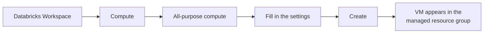
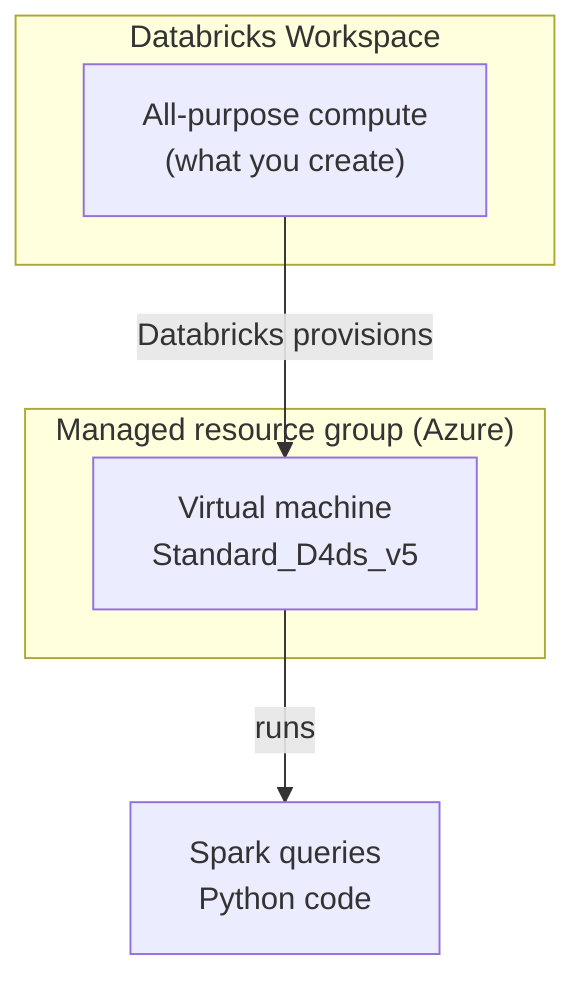
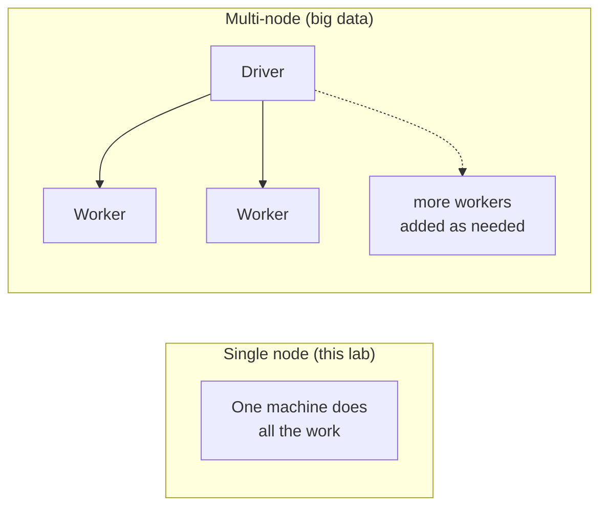

# Lab 02: Deploying a Managed Compute Instance on Databricks

This lab walks through creating an all-purpose compute cluster inside the Databricks workspace. Behind the scenes, Databricks spins up a virtual machine in the managed resource group, and that machine becomes the engine that runs all your Spark queries and Python code.

---

## The big picture

Here's how the compute you create in Databricks connects back to Azure:

---

## Step 1: Start creating the compute

In your Databricks workspace, open **Compute** from the left sidebar, make sure you're on the **All-purpose compute** tab, and click **Create compute**.

---

## Step 2: Fill in the settings

As with Lab 01, pick your own name. The examples use `<name>` as a stand-in.

| Setting | What to enter | Why |
|---|---|---|
| Compute name | Something like `<name>-compute` | |
| Policy | Unrestricted | Gives you access to all the options |
| Databricks runtime | **Machine Learning**, version **17.3 LTS** (Scala 2.13, Spark 4.0.0) | Comes with ML libraries already installed |
| Node type | **Single node** | Plenty for learning, and cheaper |
| Worker type | **Standard_D4ds_v5** (16 GB memory, 4 cores) | |
| Terminate after inactivity | **Disabled** | Avoids waiting for restarts (see below) |
| Photon acceleration | **Disabled** | Costs extra and isn't needed for small labs |

### What's a Databricks runtime?

A runtime is a ready-made bundle of software that gets installed on your compute when it starts. The Machine Learning runtime includes Spark plus the common ML libraries, so you can start writing code straight away instead of installing packages first. If you click the runtime dropdown, you'll see the full list of versions and what each one includes.

### Single node or multiple nodes?

For this course a single node is enough, since the queries are small. If you're working with very large datasets, you'd switch to multiple nodes and set a **minimum** and **maximum** number of workers. Databricks then adds or removes workers automatically (autoscaling) so the count always stays within that range.

### Auto-termination

You can tell the cluster to shut itself down after a period of inactivity, which saves money. The course turns this off, because starting a cluster back up takes a few minutes and that gets annoying during labs. Just remember to stop it yourself when you're done.

### Photon acceleration

Photon is a faster query engine built into Databricks. It really helps with big batch jobs on huge datasets, but it costs extra. Since this is for learning and not production, it's left off.

---

## Step 3: Create it

Click **Create**. Go back to the **Compute** page and you'll see the cluster in a **provisioning** state, with your user profile listed as the creator. It takes a few minutes to be ready.

---

## Why not just use serverless compute?

Databricks also offers serverless compute, which is quicker to get going. So why bother with a managed cluster? The labs need to create files on the machine itself and read them back later, and serverless doesn't let you do that.

| | Serverless compute | Managed (all-purpose) compute |
|---|---|---|
| Setup | None, it's ready to go | You create and configure it |
| Access to the machine's terminal | ❌ | ✅ |
| Create and read files on local disk | ❌ | ✅ |
| Cost | Pay only while it's in use | Higher, since you pay while the VM runs |
| Used in this course | No | **Yes** |

The managed cluster does cost more, but it's the only way to do everything the labs need.

---

## Key takeaways

- All-purpose compute in Databricks is really an Azure virtual machine, created in the managed resource group.
- The **Machine Learning runtime** saves setup time because Spark and the ML libraries come pre-installed.
- **Single node** is fine for learning. For big data, use multiple nodes with min and max workers and let autoscaling handle it.
- Auto-termination and Photon are both turned off here, one to avoid restart delays and one to save money.
- The labs use managed compute instead of serverless because they need terminal access and local files.

---

## Cleaning up

Because auto-termination is off, the cluster keeps running (and billing) until you stop it. When you finish a session, go to **Compute** and click **Terminate** on your cluster. You can start it again next time.

