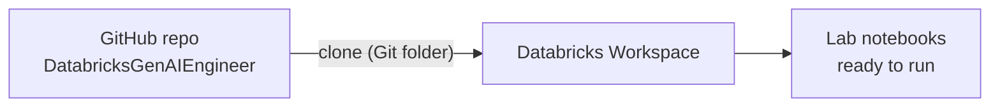
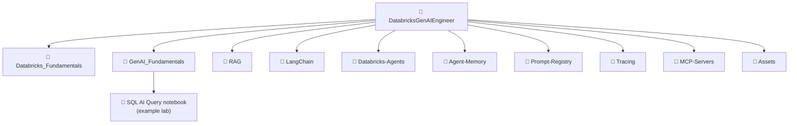

# Lab 03: Setting Up the GitHub Repo in Databricks

All the lab notebooks for this course live in a public GitHub repository. This lab walks through pulling that repo into the Databricks workspace as a **Git folder**, so every notebook is ready to open and run.

**What you'll need:** the Databricks workspace from [Lab 01](./Lab-01-Deploy-Databricks-Workspace-on-Azure.md).

**Course repo:** [github.com/kuljotSB/DatabricksGenAIEngineer](https://github.com/kuljotSB/DatabricksGenAIEngineer)

---

## The big picture



---

## Step 1: Copy the repo URL

Grab the repository URL and add `.git` to the end. You'll need the full version in the next step:

```
https://github.com/kuljotSB/DatabricksGenAIEngineer.git
```

---

## Step 2: Create a Git folder

In your Databricks workspace, open **Workspace** from the left sidebar, then choose **Create → Git folder**. Fill it in like this:

| Field | What to enter |
|---|---|
| Git repository URL | `https://github.com/kuljotSB/DatabricksGenAIEngineer.git` (don't forget the `.git`) |
| Git provider | GitHub |
| Git folder name | Filled in automatically as `DatabricksGenAIEngineer` |

Click **Create Git folder**.

---

## Step 3: Check that everything came across

Databricks copies the whole repo (every folder, file and notebook) into your workspace. Open the new `DatabricksGenAIEngineer` folder and you should see something like this:



To make sure it worked, open one of the notebooks, for example the **SQL AI Query** notebook inside `GenAI_Fundamentals`. It's a Python notebook containing one of the course labs. If it opens, you're all set.

---

## Key takeaways

- A **Git folder** in Databricks is a clone of a Git repository that lives right inside your workspace.
- Add **`.git`** to the end of the repo URL when you create it.
- Set the Git provider to **GitHub**.
- Once cloned, all the course notebooks are in one place and ready to run on the compute from [Lab 02](./Lab-02-Deploy-Managed-Compute-on-Databricks.md).
