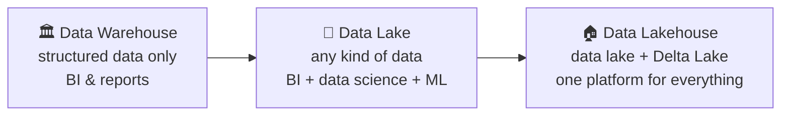
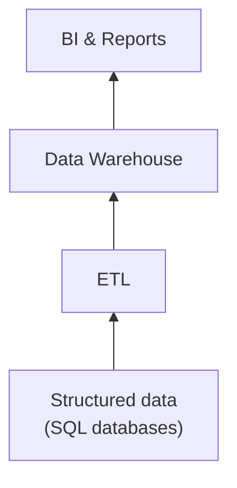
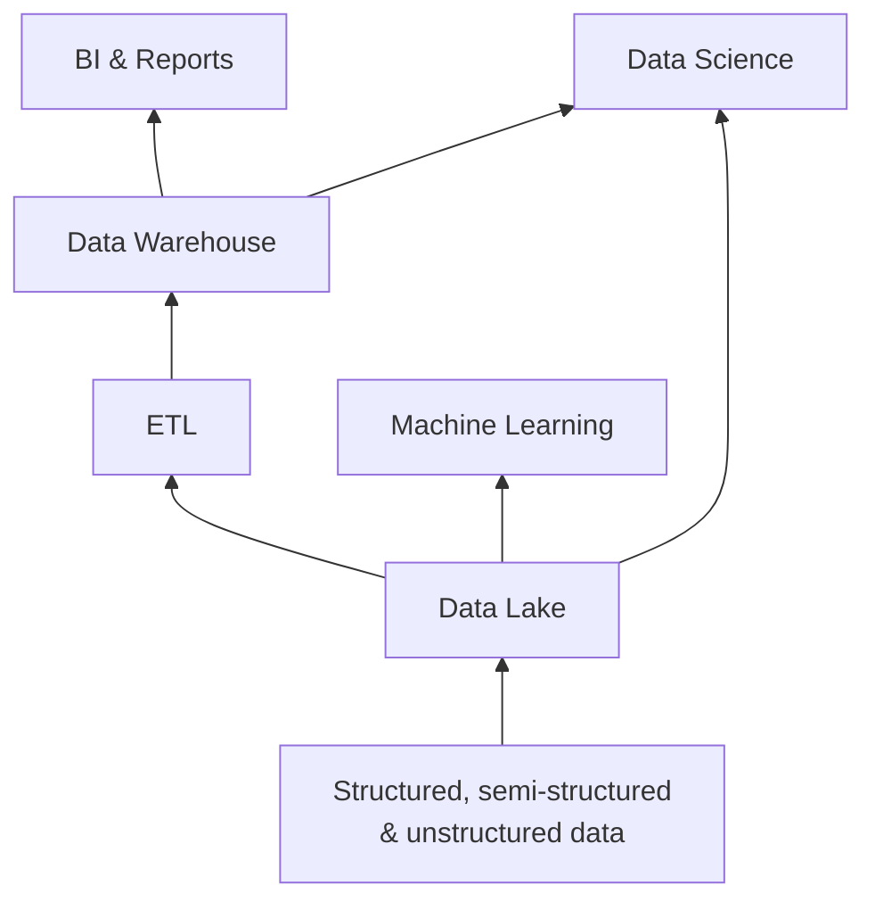
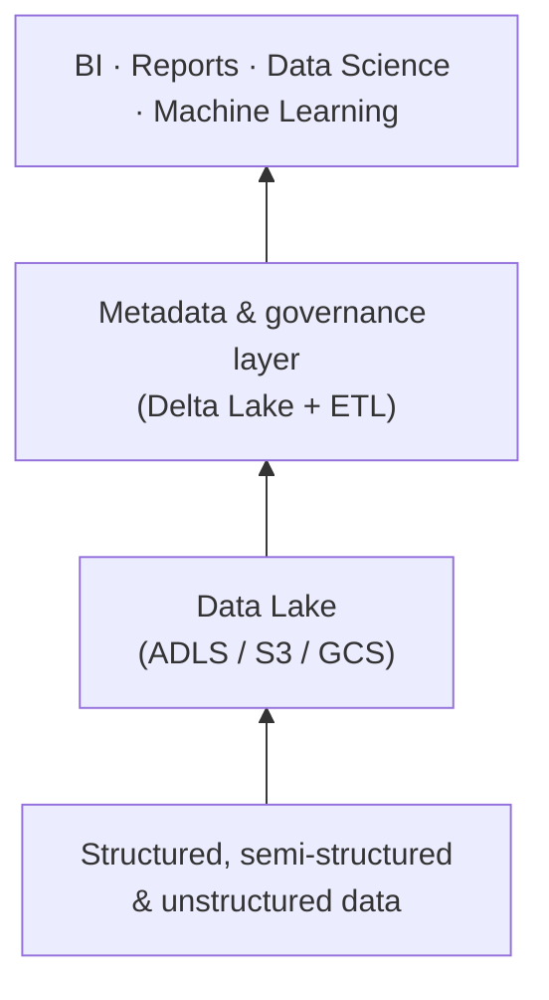
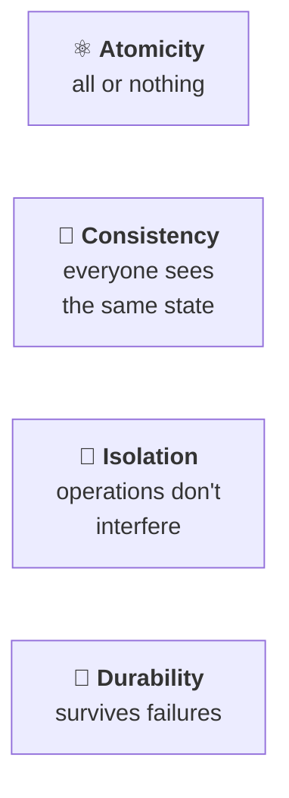
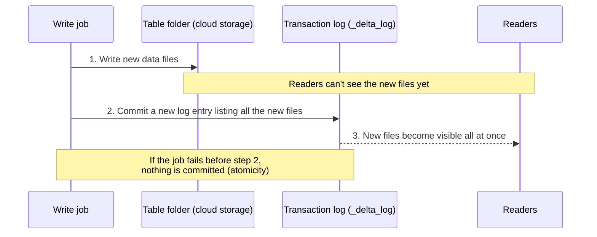

# Understanding Data Warehouse, Data Lake and Data Lakehouse

Databricks is built on top of something called a **data lakehouse**. To understand why it exists, it helps to follow how the way companies store data has changed over time: from data warehouses, to data lakes, and finally to lakehouses. This page walks through that journey and then explains **ACID**, the set of rules that makes a lakehouse ready for serious business use.

---

## The journey at a glance

---

## 1. The data warehouse era

Before AI and ML took off, most companies mainly wanted **business intelligence (BI) reports** for their executives, things like customer churn rate or average time spent on the website.

All of that data was **structured** (rows and columns in SQL databases). It went through ETL into a **data warehouse**, where SQL queries produced final tables that could be plugged into a Power BI report.

**The limitation:** it only works for structured data.

---

## 2. The data lake era

With AI and ML came a new need: storing **unstructured and semi-structured** data too, like images, audio, video and PDF documents. And it wasn't only for ML. A lot of useful business insight is hidden in that kind of data as well.

That's when the **data lake** was born. Cloud object storage such as **Azure Data Lake Storage (ADLS)** or **AWS S3** lets you throw every kind of file into one place: tables, images, PDFs, slide decks, videos and audio. The files are stored as immutable objects.

This works, but you still often copy data from the lake into a separate warehouse for BI. And as big data kept growing, two gaps showed up:

1. **No governance.** There was no easy way to grant some people permission to work with the data and take it away from others. In other words, no proper **access control list**.
2. **No transactions.** Nothing stopped two people from changing the same file at the same time in different ways, which could corrupt the whole dataset. The lake needed **ACID** guarantees.

---

## 3. The data lakehouse era

The fix was to add a layer on top of the data lake that brings in transactions and governance. That layer is **Delta Lake**.

> **Data Lake (cloud storage) + Delta Lake (transactions & governance) = Data Lakehouse**

A lakehouse combines the best of both worlds:

- the **scale and flexibility** of a data lake, and
- the **data management and transactions** of a data warehouse.

This means you no longer need separate systems for BI and ML. You get a **single source of truth**, you stop paying for duplicate copies of data, and the data stays **fresh** because there's no copying between systems.

### How the pieces fit in Databricks on Azure

| Layer | What it does |
|---|---|
| **ADLS** (storage foundation) | Cheap, scalable storage for huge volumes of data |
| **Delta Lake** (on top of ADLS) | Adds ACID transactions, schema enforcement and performance features |
| **Databricks** (unified access) | One platform to access and analyse all of it, instead of juggling several tools |

### Is Delta Lake a data warehouse?

Not quite. Delta Lake gives a data lake some warehouse-like features, but it isn't a warehouse itself. Think of it as the **bridge** between the two.

| | Delta Lake | Data Warehouse |
|---|---|---|
| **What it is** | An open-source storage layer that makes data lakes reliable and fast | A system for querying and analysing large volumes of structured data |
| **Key features** | ACID transactions, scalable metadata, batch and streaming in one place | Optimised storage, complex queries, data transformation (star or snowflake schemas) |
| **Works with** | Big data tools like Apache Spark | BI and reporting tools |

---

## 4. ACID: what makes a lakehouse enterprise-ready

ACID is a set of four guarantees. Applying them to a data lake (through Delta Lake) is what lets the lake become a trustworthy **single source of truth**.

**Atomicity: all or nothing.** A transaction either fully succeeds or fully fails. There's no half-finished state in between. The course uses a nice analogy from chemistry: an electron's spin is either up or down, never somewhere in the middle. A transaction works the same way.

**Consistency: everyone sees the same thing.** When a row or file changes, that change shows up the same way for every user. At any moment, everyone sees the same state of the data.

**Isolation: no stepping on each other's toes.** If several people or applications are changing the data at once, each operation runs as if it were alone, so one doesn't mess up another.

**Durability: data survives failures.** If a data centre goes down, the data is still safe because it's replicated. This part is handled by the cloud object storage itself (ADLS, S3 or Google Cloud Storage), which is built to be highly available and fault-tolerant.

### How Databricks actually delivers ACID

| Guarantee | How it's done in Azure Databricks |
|---|---|
| **Atomicity** | A **transaction log** controls commits (see below) |
| **Isolation** | **Write serializable** isolation for writes and updates; **snapshot** isolation for reads |
| **Concurrency** | **Optimistic concurrency control** keeps simultaneous writes safe |
| **Durability** | Data files and the transaction log both live in highly durable **cloud object storage** |

Here's what happens when data is written to a Delta table:

Because the new files only "count" once the log entry is committed, readers never see half a write.

---

## Key takeaways

- **Data warehouse:** structured data only, great for BI, but can't handle images, audio, video or documents.
- **Data lake:** stores any kind of data cheaply in cloud object storage (ADLS, S3), but has no transactions or governance on its own.
- **Data lakehouse = data lake + Delta Lake.** It adds ACID transactions and governance, so one platform can serve BI, data science and ML from a single source of truth.
- **Delta Lake isn't a data warehouse**, but it brings warehouse-style reliability to a data lake.
- **ACID** means all-or-nothing transactions, the same view for everyone, operations that don't interfere, and data that survives failures.
- In Databricks, the **transaction log** is the heart of it all: data only becomes visible when a commit is written to the log.
