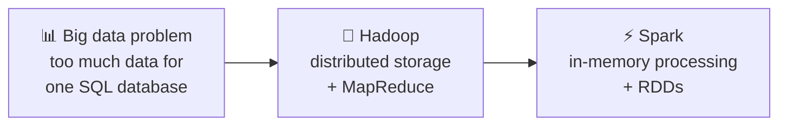
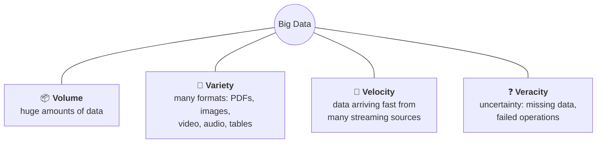
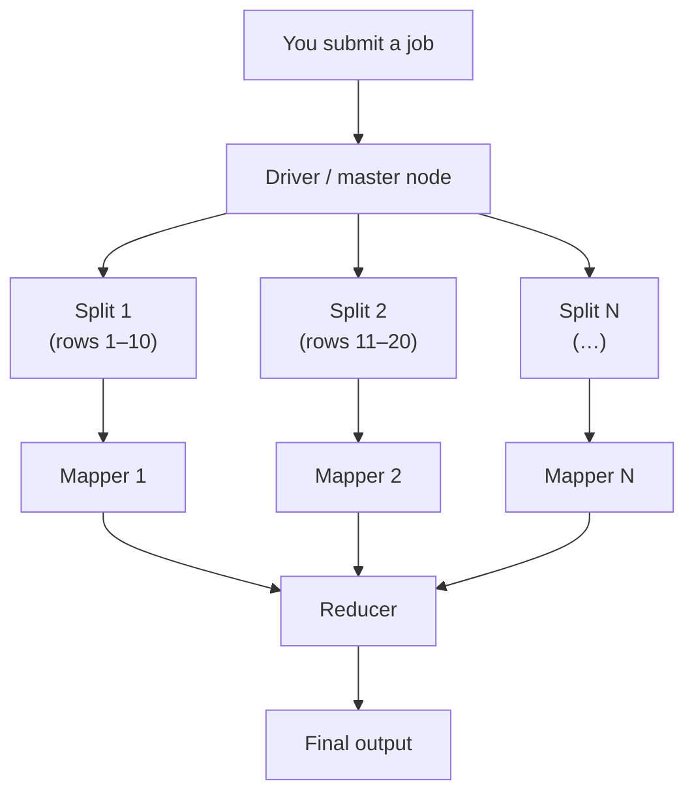
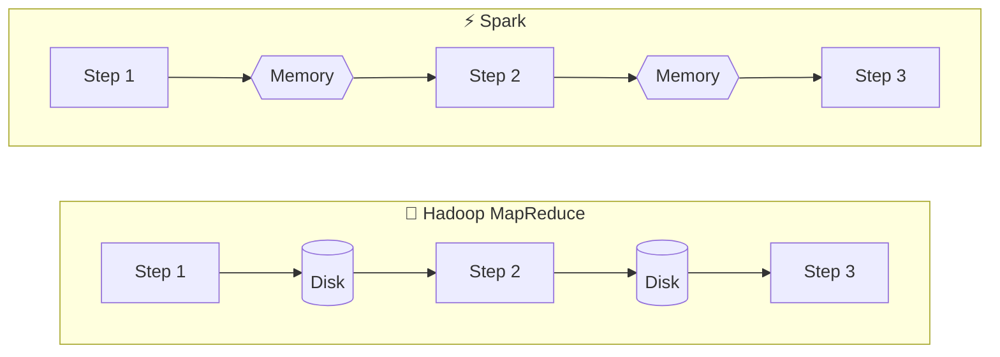
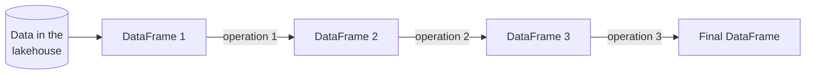
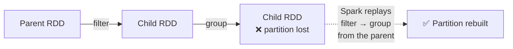

# Introduction to Apache Spark

Apache Spark is the engine that does the heavy lifting in Databricks. To see why it works the way it does, it helps to start with the problem it was built to solve (**big data**), then look at what came before it (**Hadoop and MapReduce**), and finally at what makes Spark faster (**in-memory processing and RDDs**).

---

## The journey at a glance

---

## 1. The big data problem

Companies used to run their BI on a single SQL database and a data warehouse. Then the data exploded. Take an e-commerce site: it has to store product images, track how users behave on the site, and keep audio and video files, all in one place.

That kind of data is hard to handle because of the **four Vs**:

---

## 2. Hadoop: the first answer

**Hadoop** is an open-source framework for distributed storage and processing. It was designed to process large-scale data across cheap, ordinary (commodity) hardware, and it was the go-to tool before cloud-native systems like Spark and Databricks came along.

Hadoop is made of four parts, each solving one piece of the problem:

| Component | What it solves |
|---|---|
| **HDFS** (Hadoop Distributed File System) | **Storage**: spreads huge amounts of data across many machines |
| **MapReduce** | **Processing**: analyses that data in parallel |
| **YARN** (Yet Another Resource Negotiator) | **Scheduling**: hands out work across the machines and manages resources |
| **Hadoop Common** | **Developer tools**: Java libraries and utilities (Java was the dominant language at the time) |

### How MapReduce works

1. You send your job to the **driver** (master) node, which is the node you interact with.
2. The data in HDFS is cut into **splits**, say the first 10 rows, the next 10, and so on (in reality, thousands or millions of rows each).
3. Each split goes to a **mapper**, which runs your operation on just that chunk. Many mappers work in parallel on different machines, which is where the speed comes from.
4. A **reducer** collects all the mapper outputs and combines them into one final result.

### Where Hadoop falls short

After **every** map and reduce step, Hadoop writes its results to **disk** and then reads them back for the next step. All that disk input/output adds up:

- **High latency** from repeated disk reads and writes
- A strict **two-stage Map → Reduce** model
- **Batch jobs only** (no streaming)
- A **complicated programming model**

It was fast for its time, but people realised that if the data could stay in **memory** between steps, things could be far faster. That idea led to Spark. (Fun fact from the course: Spark was built by a group that broke away from the Hadoop developers.)

---

## 3. Spark: processing in memory

Spark keeps intermediate results in **memory buffers** instead of writing them to disk after every step, so it avoids most of Hadoop's slow disk I/O.

| | Hadoop (MapReduce) | Spark |
|---|---|---|
| Where in-between results go | Disk | Memory |
| Processing model | Strict Map → Reduce | Many transformations chained together |
| Speed | Slower (lots of disk I/O) | Much faster |
| Workloads | Batch only | Batch, streaming, SQL and machine learning |
| Main data structures | Files in HDFS | RDDs and DataFrames |

---

## 4. RDDs: Spark's building block

An **RDD (Resilient Distributed Dataset)** is Spark's core, low-level way of representing data. It is:

- **Immutable**: once created, it never changes
- **Distributed**: split into partitions spread across the cluster's nodes
- **Built for fault-tolerant parallel processing**

Most of the time you'll work with **DataFrames**, a friendlier layer built on top of RDDs. A DataFrame is basically a table of rows and columns that you can run operations on.

### Every operation creates a new one

Because RDDs are immutable, Spark never changes data in place. Each operation produces a brand new dataset from the previous one:

### Lineage: why it's called "resilient"

Spark keeps a record of every step that turned the original data into the current result. This record is called **lineage**. It gives you:

- **Fault recovery.** If a partition is lost (say a machine fails), Spark doesn't need a backup copy in memory. It just **replays the steps** from the parent data to rebuild the missing piece.
- **Traceability.** You can look back at exactly which transformations were applied, which is useful for governance and for understanding where your data came from.

---

## Key takeaways

- **Big data** means huge volume, many formats (variety), fast arrival (velocity) and uncertain quality (veracity).
- **Hadoop** solved it with HDFS for storage, MapReduce for processing, YARN for scheduling and Hadoop Common for Java tools.
- **MapReduce** splits the data, maps each split in parallel and reduces the results, but writes to disk after every step, which makes it slow.
- **Spark** keeps in-between results in memory, chains many steps together, and handles batch, streaming, SQL and ML.
- **RDDs** are immutable, distributed collections of data. **DataFrames** are the table-like layer you'll usually work with.
- **Lineage** lets Spark rebuild lost data by replaying the steps, so it recovers from failures without keeping extra copies.
