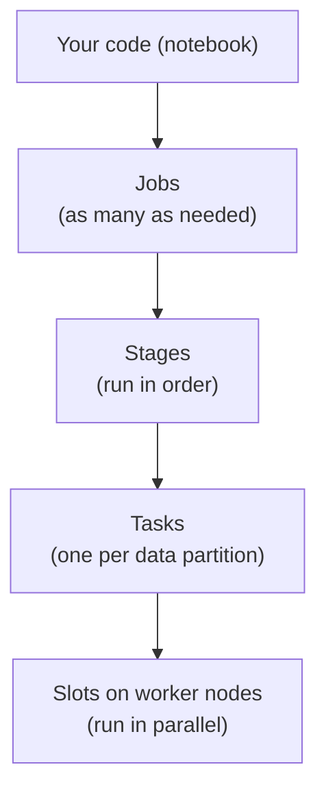
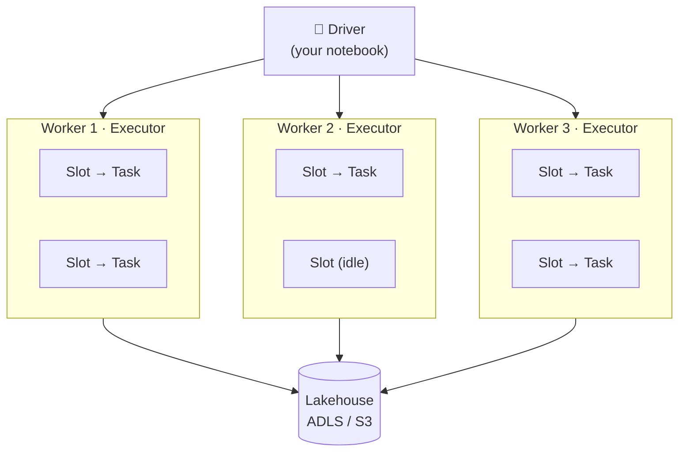
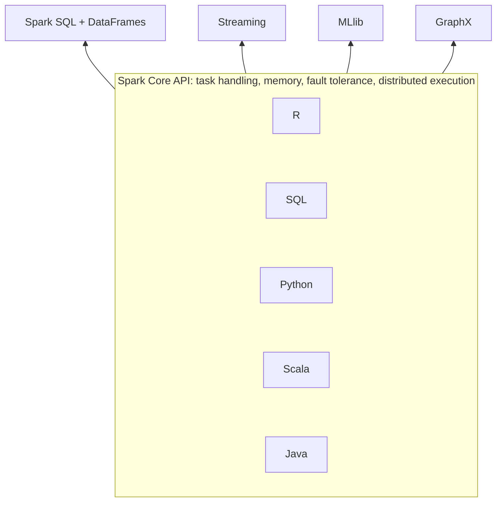
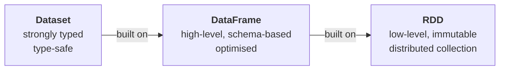
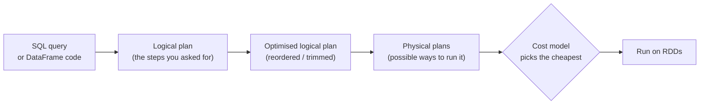
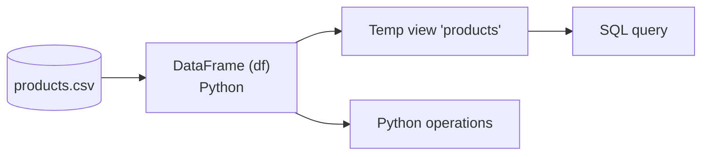

# Understanding Spark: Deep Dive and Usage

This page goes one level deeper into Apache Spark: how a Databricks cluster actually splits up the work, which Spark APIs and libraries are available, why DataFrames are preferred over RDDs (hint: the **Catalyst Optimizer**), and what basic Spark code looks like in Python and SQL.

---

## 1. How a cluster runs your work: driver and worker nodes

A Spark cluster is a group of machines that act together like one big computer. It has two kinds of nodes:

- **Driver node**: the "boss". It holds the main program, decides how to split up the work, creates the distributed datasets and tells the workers which data to pull and what to do with it. It talks to Spark through a **SparkSession** object. **In Databricks, your notebook is usually the driver program.**
- **Worker nodes**: the "team". They each process a slice of the data at the same time.

Both are just **virtual machines** (VMs). The cloud provider (Azure or AWS) runs them, and **automatically adds or removes workers** based on your cluster settings. Auto-termination can also shut the cluster down after a set time with no activity.

The data comes from the **Databricks file system**, which sits on top of your lakehouse in cloud object storage: **ADLS** on Azure or **S3** on AWS.

### How work gets broken down



| Term | What it means |
|---|---|
| **Job** | The driver splits your work into as many independent jobs as it thinks is best. |
| **Stage** | Each job is broken into stages that must happen in order, like building a house: foundation, then walls, then roof. |
| **Task** | Each stage is split into tasks. Each task handles one **partition** (chunk) of the data. |
| **Executor** | A Java virtual machine (JVM) running on a worker, usually one per worker node. This is the **first level** of parallelism. |
| **Slot** | Each executor has several slots, depending on how many CPU cores the node has. Each slot runs one task. This is the **second level** of parallelism. |



**Why this makes Spark fast:** making one machine bigger (scaling **vertically**) eventually hits a limit on memory, threads and CPU speed. Spark instead scales **horizontally** by adding more machines. The driver hands each task its own partition of data, and partitions may get reshuffled across the network between stages.

---

## 2. Spark APIs and libraries



**Spark Core** is the engine underneath everything. It handles running the tasks, managing memory, recovering from failures and spreading the work out. You can talk to it in **R, SQL, Python, Scala or Java**, and in every case the code still runs on Spark's distributed engine.

On top of the core sit four higher-level libraries for specific jobs:

| Library | What it's for |
|---|---|
| **Spark SQL + DataFrames** | The go-to for analytics, data engineering and Databricks work. SQL developers can write plain SQL, and Python developers can work with DataFrames much like they would in **pandas**. Either way, it runs distributed. |
| **Streaming** | Processing live data streams from sources like **Kafka**, **Event Hubs** and file streams. Great for IoT and real-time devices. |
| **MLlib** | Machine learning at scale: feature extraction (preparing data for training) and training models such as linear regression and binary classification, spread across the workers. |
| **GraphX** | Graph processing and analytics. Not used very often. |

---

## 3. RDDs vs DataFrames vs Datasets


Before DataFrames and Datasets existed, people coded against **RDDs** directly. That meant long, complicated code full of Python lambda functions. DataFrames and Datasets are **high-level APIs** that hide that complexity: you write much less code, and Spark still uses RDDs underneath.



| | RDD | DataFrame | Dataset |
|---|---|---|---|
| Level | Low-level | High-level | High-level |
| Data types enforced? | No | **No** (not strongly typed) | **Yes** (strongly typed) |
| Uses the Catalyst Optimizer? | ❌ | ✅ | ✅ |
| Ease of use | Hard, lots of code | Easy | Easy |
| Used in this course | No | **Yes** | No |

**How they relate:**
- A DataFrame is really a **Dataset of rows** (`Dataset[Row]`).
- A Dataset is a DataFrame plus **type safety**, so you control the data type of every column.
- Both use **RDDs** internally.

The course uses **DataFrames** because they don't force strict types, which makes them easier to learn.

### The Catalyst Optimizer: why you shouldn't use RDDs directly

When you run DataFrame or Dataset code, Spark doesn't just do exactly what you wrote. It first passes your query through the **Catalyst Optimizer**, which works out a faster way to get the **same result**:



**Example:** say you ask Spark to **join** two tables and then **filter** the result. Catalyst might realise it's much cheaper to **filter first** and then join the smaller data. It can also drop steps it decides aren't needed. You get the same output, faster.

What Catalyst does:
- Turns high-level queries into an **optimised execution plan**
- Applies **rule-based and cost-based** optimisations
- Speeds things up **automatically**, without you doing anything

> **Catalyst only works with DataFrames and Datasets, not RDDs.** If you code against RDDs directly, you lose these optimisations (unless you're an RDD expert), and you write much more code too. That's why the high-level APIs are recommended.

---

## 4. Using Spark with data files

The same task, reading a CSV file and analysing it, can be done in **Python** or in **SQL**. The labs in this course use both.

### With the DataFrame API (Python)

```python
%python
df = spark.read.load('/data/products.csv',
    format='csv',
    header=True
)
display(df.limit(10))
```

- `format='csv'` tells Spark the file type.
- `header=True` means the **first row** holds the column names.
- The result is a DataFrame stored in `df`, and `display(df.limit(10))` shows the first 10 rows.

### With the Spark SQL API

First, register the DataFrame as a **temporary view** so SQL can see it:

```python
%python
df.createOrReplaceTempView("products")
```

Then query it with plain SQL:

```sql
%sql
SELECT Category, COUNT(ProductID) AS ProductCount
FROM products
GROUP BY Category
ORDER BY Category
```

This counts the products in each category and sorts the result by category name.



> 💡 **Note:** the original slide uses `%pyspark` as the cell magic, which comes from other notebook tools such as Zeppelin. In Databricks notebooks, use **`%python`** (or no magic in a Python notebook) and **`%sql`** for SQL cells.

---

## Key takeaways

- A Spark cluster has a **driver** (in Databricks, your notebook) and **workers** (VMs managed by Azure or AWS, which also handle autoscaling).
- Work is split into **jobs → stages → tasks**. Each task processes one **partition** in a **slot** on a worker's **executor**.
- Spark scales **horizontally** by adding machines, rather than making one machine bigger.
- **Spark Core** runs everything and supports R, SQL, Python, Scala and Java. On top sit **Spark SQL/DataFrames, Streaming, MLlib and GraphX**.
- **DataFrame** = not strictly typed. **Dataset** = strictly typed. Both are built on **RDDs**.
- The **Catalyst Optimizer** speeds up DataFrame and Dataset code automatically (for example by filtering before a join), but **doesn't work with RDDs**, so stick to the high-level APIs.
- You can do the same work in **Python** (DataFrames) or **SQL** (via a temporary view).
