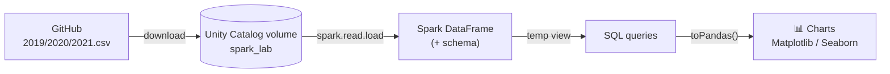
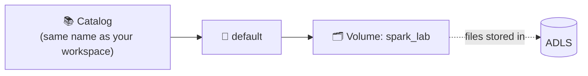
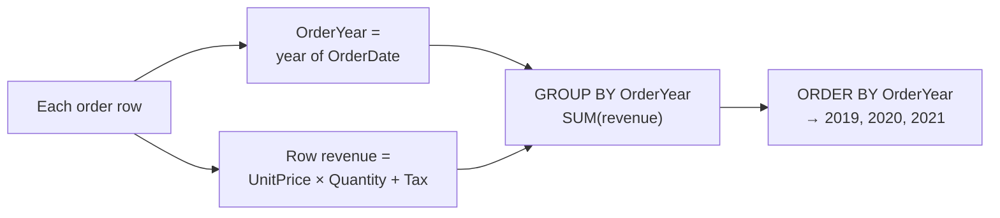
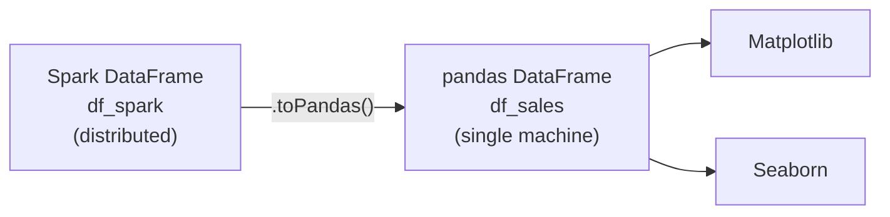

# Lab 04: Getting Hands-on with Spark

This is the first hands-on Spark lab (**Databricks Fundamentals, Module 1**). It covers storing raw CSV files in a **Unity Catalog volume**, loading them into a **Spark DataFrame**, giving that DataFrame a proper **schema**, querying it with **SQL**, and finally drawing a **chart** of the results.

---

## The big picture



---

## Step 0: Open the notebook and attach your compute

In **Workspace**, go into the cloned repo and open `Databricks_Fundamentals`. Alongside the notebook you'll find three CSV files (`2019.csv`, `2020.csv`, `2021.csv`) with one year of sales orders each: order number, customer name and email, item, quantity, price, tax and order date.

Open **Module_1** and, from the compute dropdown at the top, attach your **managed compute cluster**, not serverless. Many labs in this course rely on features only managed compute has, so pick it every time.

---

## Step 1: Create a Unity Catalog volume

```sql
%sql
CREATE VOLUME IF NOT EXISTS spark_lab
```

A **volume** is a Unity Catalog-governed folder for files. The files physically live in your cloud object storage (ADLS on Azure, S3 on AWS), but Unity Catalog controls who can do what with them.

No schema was named, so the volume lands in the **default** schema. You can see it in **Catalog**:



> 💡 Tip: open **Catalog** in a second browser tab so you can watch the volume and files appear as you run each cell.

---

## Step 2: Download the CSV files into the volume

```python
import requests

# Get the current catalog name (same as your workspace name)
catalog_name = spark.sql("SELECT current_catalog()").collect()[0][0]

# Path to the volume
volume_base = f"/Volumes/{catalog_name}/default/spark_lab"

files = ["2019.csv", "2020.csv", "2021.csv"]

for file in files:
    url = f"https://raw.githubusercontent.com/kuljotSB/DatabricksGenAIEngineer/refs/heads/main/Databricks_Fundamentals/{file}"
    response = requests.get(url)
    response.raise_for_status()

    # Write to the Unity Catalog volume
    with open(f"{volume_base}/{file}", "wb") as f:
        f.write(response.content)
```

What's happening:
1. A Spark SQL query looks up the **catalog name** and saves it in `catalog_name`.
2. It builds the volume path, following the pattern `/Volumes/<catalog>/<schema>/<volume>`.
3. For each file, it builds the **raw GitHub URL**, downloads the file with `requests.get`, and writes it into the volume.

Refresh the Catalog tab and all three CSVs now show up inside `spark_lab`.

### Controlling access to the volume

Because the files are in a Unity Catalog volume, you can decide who gets to do what. Open the volume, go to **Permissions → Grant**, choose a user or group, and pick from these privileges:

| Privilege | What it allows |
|---|---|
| `READ VOLUME` | Read the files in the volume |
| `WRITE VOLUME` | Add or change files in the volume |
| `APPLY TAG` | Add tags to the volume |
| `ALL PRIVILEGES` | All of the above |
| `MANAGE` | Owner-like control, including managing other people's permissions |

This matters in a team setting, where you'd want, for example, analysts to have read-only access and engineers to have read and write.

---

## Step 3: Load the CSVs into a DataFrame

```python
df = spark.read.load(f'/Volumes/{catalog_name}/default/spark_lab/*.csv', format='csv')
display(df.limit(100))
```

The `*.csv` wildcard loads **all three files into one DataFrame**, and `display(df.limit(100))` shows the first 100 rows.

The data loads fine, but there's a problem: the CSV files don't have a header row, so Spark names the columns `_c0`, `_c1`, `_c2`… and treats most of them as plain text. That's hard to read and hard to maintain.

---

## Step 4: Give the DataFrame a schema

A **schema** defines each column's **name** and **data type**. You build one with `StructType`, which is a list of `StructField`s:

```python
from pyspark.sql.types import *
from pyspark.sql.functions import *

orderSchema = StructType([
    StructField("SalesOrderNumber", StringType()),
    StructField("SalesOrderLineNumber", IntegerType()),
    StructField("OrderDate", DateType()),
    StructField("CustomerName", StringType()),
    StructField("Email", StringType()),
    StructField("Item", StringType()),
    StructField("Quantity", IntegerType()),
    StructField("UnitPrice", FloatType()),
    StructField("Tax", FloatType())
])

df = spark.read.load(f'/Volumes/{catalog_name}/default/spark_lab/*.csv',
                     format='csv', schema=orderSchema)
display(df.limit(100))
```

Passing `schema=orderSchema` when loading **enforces** those names and types:

| Before (no schema) | After (with schema) |
|---|---|
| `_c0` (string) | `SalesOrderNumber` (string) |
| `_c1` (string) | `SalesOrderLineNumber` (integer) |
| `_c2` (string) | `OrderDate` (date) |
| `_c3` (string) | `CustomerName` (string) |
| `_c4` (string) | `Email` (string) |
| `_c5` (string) | `Item` (string) |
| `_c6` (string) | `Quantity` (integer) |
| `_c7` (string) | `UnitPrice` (float) |
| `_c8` (string) | `Tax` (float) |

---

## Step 5: Query the data with SQL

First, turn the DataFrame into a **temporary view** so SQL can see it, then query everything in it:

```python
df.createOrReplaceTempView("salesorders")
spark_df = spark.sql("SELECT * FROM salesorders")
display(spark_df)
```

`spark.sql(...)` runs a SQL query and returns the result as a new DataFrame. Here it's just all the rows from the three files combined.

### Gross revenue per year

```python
sqlQuery = "SELECT CAST(YEAR(OrderDate) AS CHAR(4)) AS OrderYear, \
               SUM((UnitPrice * Quantity) + Tax) AS GrossRevenue \
        FROM salesorders \
        GROUP BY CAST(YEAR(OrderDate) AS CHAR(4)) \
        ORDER BY OrderYear"
df_spark = spark.sql(sqlQuery)
df_spark.show()
```



The result is one row per year with its **GrossRevenue**.

---

## Step 6: Visualise the results

Charting libraries like Matplotlib and Seaborn **work with pandas DataFrames, not Spark DataFrames**, so the first step is converting with `.toPandas()`.



### With Matplotlib

```python
from matplotlib import pyplot as plt

# matplotlib needs a pandas DataFrame, not a Spark one
df_sales = df_spark.toPandas()

plt.bar(x=df_sales['OrderYear'], height=df_sales['GrossRevenue'])
plt.show()
```

### With Seaborn

Seaborn builds on Matplotlib and gets the same chart with slightly less code:

```python
import seaborn as sns

plt.clf()  # clear the previous plot
ax = sns.barplot(x="OrderYear", y="GrossRevenue", data=df_sales)
plt.show()
```

Both produce a bar chart with **OrderYear** (2019, 2020, 2021) along the x-axis and **GrossRevenue** up the y-axis.

---

## Key takeaways

- Always attach **managed compute** (not serverless) for this course's labs.
- A **Unity Catalog volume** stores raw files in cloud storage while letting you control access with privileges like `READ VOLUME` and `WRITE VOLUME`.
- Volume paths follow `/Volumes/<catalog>/<schema>/<volume>/<file>`.
- `spark.read.load(...)` with a `*.csv` wildcard loads many files into **one DataFrame**.
- Without a schema, headerless CSVs get columns like `_c0`. Use a **`StructType` schema** to set proper names and data types.
- `createOrReplaceTempView` + `spark.sql(...)` lets you query a DataFrame with plain **SQL**.
- Convert to **pandas** with `.toPandas()` before charting with **Matplotlib** or **Seaborn**.
