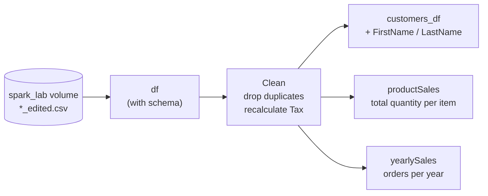
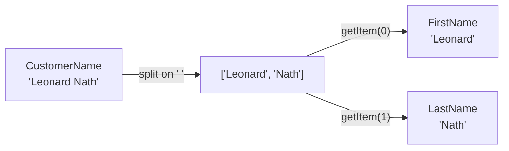
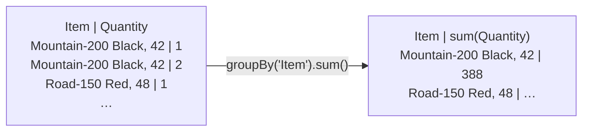

# Lab 05: Advanced Apache Spark Operations

This lab (**Databricks Fundamentals, Module 2**) builds on [Lab 04](./Lab-04-Getting-Hands-on-with-Spark.md). After loading the sales data into a DataFrame again, it moves on to **cleaning** it, **deriving new columns**, building **new DataFrames from existing ones**, and **aggregating** the data with `groupBy`.

**What you'll need:** your managed compute cluster attached to the notebook.

**Notebook:** `DatabricksGenAIEngineer/Databricks_Fundamentals/Module_2.ipynb`

---

## The big picture



---

## Steps 1–3: Load the data (same as Lab 04)

These first cells repeat what you did in Lab 04, just with a different set of files:

1. **Create the volume.** `CREATE VOLUME IF NOT EXISTS spark_lab` does nothing if the volume already exists from Lab 04.
2. **Download the files.** This time it's `2019_edited.csv`, `2020_edited.csv` and `2021_edited.csv`, fetched from GitHub into the volume.
3. **Load them with the same `orderSchema`.** The `*_edited.csv` wildcard picks up only the new files.

```python
df = spark.read.load(f'/Volumes/{catalog_name}/default/spark_lab/*_edited.csv',
                     format='csv', schema=orderSchema)
display(df.limit(100))
```

As before, loading without a schema gives unnamed `_c0`, `_c1`… columns. Adding the schema fixes the names and types. (See Lab 04 for the full schema code.)

---

## Step 4: Clean the data

```python
from pyspark.sql.functions import col

df = df.dropDuplicates()
df = df.withColumn('Tax', col('UnitPrice') * 0.08)
df = df.withColumn('Tax', col('Tax').cast("float"))
```

| Line | What it does |
|---|---|
| `dropDuplicates()` | Removes rows that are exact copies of another row |
| `withColumn('Tax', col('UnitPrice') * 0.08)` | Recalculates **Tax as 8% of UnitPrice** for every row, replacing the old values |
| `withColumn('Tax', col('Tax').cast("float"))` | Makes sure Tax is a **float** again |

**Why cast again?** A calculation can change a column's data type depending on the types it was built from (here, `UnitPrice`). Casting afterwards guarantees the type you want.

> 💡 `withColumn` either **adds** a new column or **replaces** an existing one with the same name.

---

## Step 5: Build a customers DataFrame with first and last names

```python
customers_df = df.select("CustomerName", "Email", "Item", "Quantity")
customers_df = customers_df.withColumn("FirstName", split(customers_df["CustomerName"], " ").getItem(0))
customers_df = customers_df.withColumn("LastName", split(customers_df["CustomerName"], " ").getItem(1))

display(customers_df)
```

1. `select(...)` creates a **new DataFrame** with just four columns.
2. `split(CustomerName, " ")` breaks the name at the space into a list of parts.
3. `.getItem(0)` takes the first part (**FirstName**) and `.getItem(1)` takes the second (**LastName**).



| CustomerName | Email | Item | Quantity | **FirstName** | **LastName** |
|---|---|---|---|---|---|
| Leonard Nath | … | … | … | Leonard | Nath |
| Terry Dank | … | … | … | Terry | Dank |

---

## Step 6: Count all rows vs distinct rows

```python
print(customers_df.count())             # all rows
print(customers_df.distinct().count())  # unique rows only
```

| | Count |
|---|---|
| All rows | **32,718** |
| Distinct rows | **32,200** |
| Repeated rows | **518** |

`count()` counts every row, and `distinct()` keeps only unique rows before counting. Exact duplicates were already removed in Step 4, but `customers_df` only has four columns. So the repeats here are customers who bought the **same item in the same quantity** more than once.

---

## Step 7: Total quantity sold per product

```python
productSales = df.select("Item", "Quantity").groupBy("Item").sum()
display(productSales)
```



`groupBy("Item")` puts all rows for the same product together, and `.sum()` adds up their quantities. The result is a new DataFrame with one row per product and its total quantity ordered. For example, **Mountain-200 Black, 42** sold **388** units.

---

## Step 8: Number of orders per year

```python
yearlySales = df.select(year("OrderDate").alias("Year")).groupBy("Year").count().orderBy("Year")
display(yearlySales)
```

| Part | What it does |
|---|---|
| `year("OrderDate").alias("Year")` | Pulls just the year from each order date and names the column `Year` |
| `groupBy("Year").count()` | Counts the order lines in each year |
| `orderBy("Year")` | Sorts the result 2019 → 2021 |

| Year | Order lines |
|---|---|
| 2019 | 1,201 |
| 2020 | 2,733 |
| 2021 | about 28,800 * |

Sales grew sharply in 2021.

\* The video only says "nearly 30,000" for 2021. This figure is the total of 32,718 rows minus the 2019 and 2020 counts, so check it against your own output.

---

## Key takeaways

- `dropDuplicates()` removes exact duplicate rows.
- `withColumn()` adds or replaces a column, and `.cast()` sets its data type.
- `select()` creates a new DataFrame with only the columns you need.
- `split()` + `getItem()` breaks a text column into parts, for example first and last names.
- `count()` counts all rows, while `distinct().count()` counts unique rows.
- `groupBy().sum()` and `groupBy().count()` aggregate data into summaries, like totals per product or orders per year.
- `year()` extracts the year from a date, and `alias()` renames the result.
- Spark DataFrames are immutable, so each of these operations returns a **new** DataFrame (see [Introduction to Apache Spark](./Introduction-to-Apache-Spark.md)).
