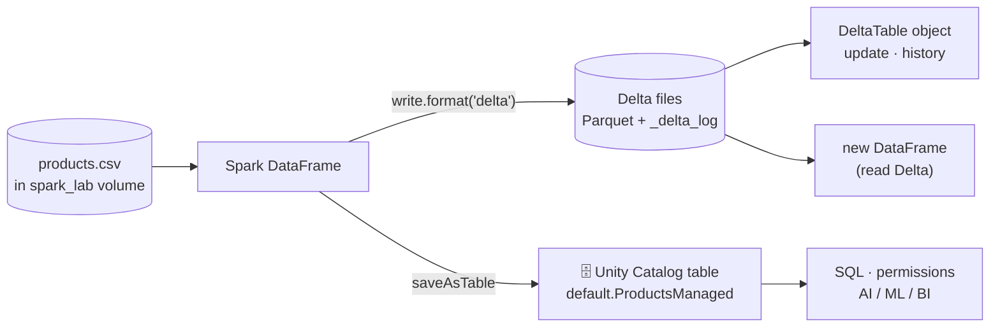
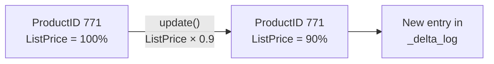
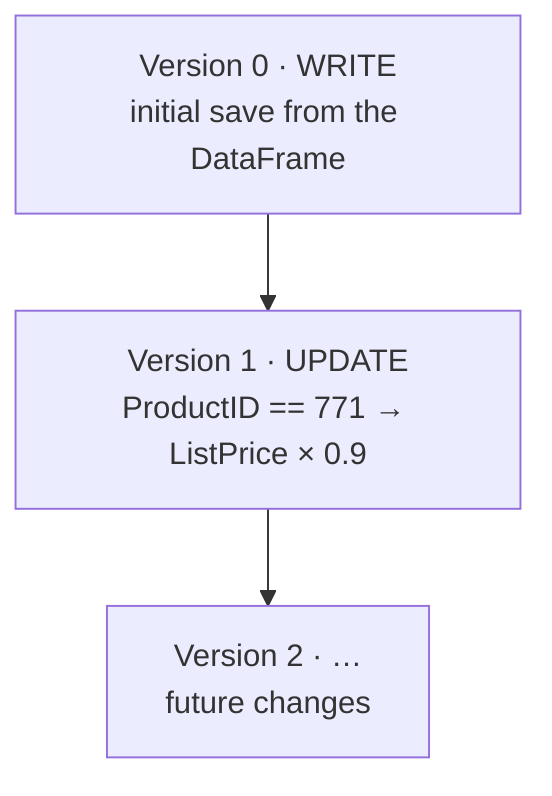
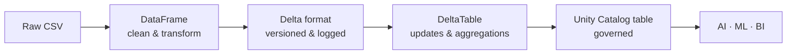

# Lab 06: Delta Table Operations in Databricks

This lab (**Databricks Fundamentals, Module 3**) takes a raw CSV file and turns it into **Delta Lake** data. Along the way it covers saving data in Delta format, updating it in place, reading its **change history**, and finally registering it as a **Unity Catalog managed table** that can be governed and queried with SQL. Delta brings versioning, logging and lineage, which is what makes the data trustworthy enough to power AI, ML and BI work.

---

## The big picture



---

## Step 1: Put the CSV in the volume

Same pattern as the earlier labs: `CREATE VOLUME IF NOT EXISTS spark_lab` (harmless if it already exists), then download **`products.csv`** from the GitHub repo into the volume. Check the Catalog tab to confirm it's there before moving on.

---

## Step 2: Load it into a DataFrame

```python
df = spark.read.load(f'/Volumes/{catalog_name}/default/spark_lab/products.csv',
                     format='csv', header=True)
display(df.limit(10))
```

`header=True` tells Spark the **first row** holds the column names, so you get **ProductID, ProductName, Category and ListPrice** without writing a schema.

> ⚠️ No schema is enforced, so every column is read as a **string**, even ProductID, which holds numbers.

---

## Step 3: Save the data in Delta format

```python
delta_table_path = f"/Volumes/{catalog_name}/default/spark_lab/delta/products-delta"
df.write.format("delta").save(delta_table_path)
```

This writes the DataFrame as **Delta** into a new folder inside the volume. Saving as Delta gives you:

- **Versioning, logging and lineage**: a record of who changed what, and when
- **Parquet files**: a columnar format that makes Spark and SQL queries faster
- **Compression**: much smaller files than the original CSV

Refresh the volume in Catalog and you'll see the new folder:

```
spark_lab/
└── delta/
    └── products-delta/
        ├── part-0000-….snappy.parquet    ← the actual data
        └── _delta_log/                    ← the transaction log
            ├── 00000000000000000000.json  ← one JSON file per change (commit)
            └── … (.crc checksum files)
```

The **`_delta_log`** folder is the heart of Delta. Each JSON file records one change: what operation ran, who ran it and what it affected. That gives you **auditability, traceability and lineage**.

---

## Step 4: Update the data with a DeltaTable object

To change the Delta data **in place** (without turning it into a DataFrame first), create a `DeltaTable` object:

```python
from delta.tables import *
from pyspark.sql.functions import *

deltaTable = DeltaTable.forPath(spark, delta_table_path)

# Reduce the price of product 771 by 10%
deltaTable.update(
    condition = "ProductID == 771",
    set = { "ListPrice": "ListPrice * 0.9" })

deltaTable.toDF().show(10)
```



- `condition` picks **which rows** to change (only product 771).
- `set` says **what to change** (ListPrice becomes 90% of its old value).
- `.toDF()` turns the Delta table into a DataFrame on the fly so you can view it. (Product 771 isn't in the first 10 rows, so you won't see the change in this output.)

---

## Step 5: Read the Delta data into a new DataFrame

```python
new_df = spark.read.format("delta").load(delta_table_path)
new_df.show(10)
```

This creates a proper, standalone DataFrame from the Delta files. It includes the updated price for product 771.

| | `deltaTable.toDF()` | `spark.read.format("delta").load(...)` |
|---|---|---|
| What you get | A quick DataFrame view of the DeltaTable object | A new, independent DataFrame |
| Typical use | Checking the result of an update | Carrying on with analysis |

---

## Step 6: Look at the change history

```python
deltaTable.history(10).show(10, False, True)
```

This reads the `_delta_log` and shows the **last 10 operations**, including the **version**, **timestamp**, **user**, **operation type** (for example `WRITE` or `UPDATE`) and its **parameters** (here, the `ProductID == 771` condition).

> 💡 History is a feature of the **DeltaTable** object, not of Spark DataFrames, which don't keep a change log.



---

## Step 7: Create a Unity Catalog managed table

```python
df.write.format("delta").saveAsTable("default.ProductsManaged")
```

This writes the DataFrame as a Delta **table registered in Unity Catalog**, under the `default` schema, named `ProductsManaged`. It's the final, governed table you'd use for AI, ML and BI work.

> ⚠️ This line writes **`df`** (the original DataFrame from Step 2), **not** the updated Delta data. So `ProductsManaged` has product 771's **original** price. To keep the update, write `new_df` instead.

Find it in **Catalog → your catalog → default → Tables → productsmanaged**. Click **Sample data** and choose a SQL warehouse (for example the **Serverless Starter Warehouse**) to preview the rows.

### Path-based Delta vs managed table

| | Delta files in a volume (Steps 3–6) | Unity Catalog managed table (Step 7) |
|---|---|---|
| How you reach it | By file path | By name: `default.ProductsManaged` |
| Shows up under | Catalog → Volumes | Catalog → Tables |
| Query with plain SQL by name | ❌ | ✅ |
| Table-level permissions | ❌ (volume permissions only) | ✅ |

### Table permissions

Because the table is managed by Unity Catalog, you can control access in **Permissions → Grant**:

| Privilege | What it allows |
|---|---|
| `SELECT` | Read the table |
| `MODIFY` | Change the data (insert, update, delete) |
| `APPLY TAG` | Add tags to the table |
| `ALL PRIVILEGES` | All of the above |
| `MANAGE` | Owner-like control over the table |

---

## Step 8: Query the table with SQL

```sql
%sql
USE default;
SELECT * FROM ProductsManaged;
```

`USE default` switches to the `default` schema, so the table can be referred to by its short name. These queries **respect Unity Catalog permissions**: a user without read access (`SELECT`) on the table can't run them.

---

## The recommended flow



---

## Key takeaways

- `df.write.format("delta").save(path)` stores data as **Parquet files + a `_delta_log`** transaction log.
- The **`_delta_log`** records every change, giving you versioning, auditing and lineage.
- `DeltaTable.forPath(...)` lets you **update data in place** with a condition and a set of new values.
- `deltaTable.history()` shows **who changed what and when**. DataFrames can't do this.
- `spark.read.format("delta").load(path)` reads Delta data back into a DataFrame.
- `saveAsTable("schema.table")` creates a **Unity Catalog managed table** you can query by name and secure with permissions like `SELECT` and `MODIFY`.
- Make sure you save the DataFrame that has your latest changes when you create the final table.
