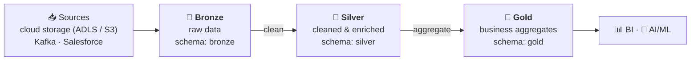
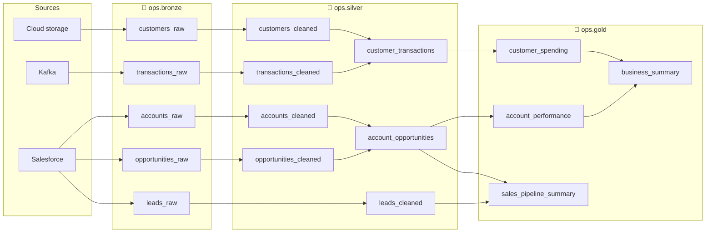
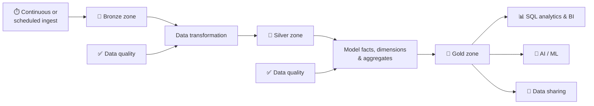
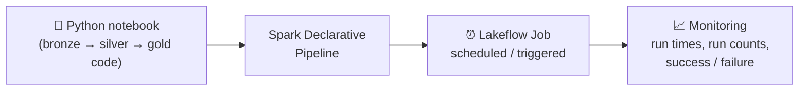

# Medallion Architecture and Spark Declarative Pipelines

The **Medallion architecture** is the standard way to organise data in a lakehouse: raw data comes in, gets cleaned, and ends up as business-ready summaries. **Spark Declarative Pipelines (SDP)** are how you run that process automatically and reliably in production.

---

## 1. The Medallion architecture

Data moves through three layers, getting a little cleaner and more useful at each step. Every layer is a set of **Delta tables**, and each layer usually lives in its **own schema** in Unity Catalog.

| Layer | What's in it | Typical work done |
|---|---|---|
| 🥉 **Bronze** | **Raw data** in its original form, straight from the sources. Unprocessed, and may contain duplicates, missing values and other inconsistencies. | Ingest data from cloud storage, Kafka, Salesforce and other sources into Delta tables, as is. |
| 🥈 **Silver** | **Cleaned and enriched** data. More structured and ready for analysis. | Remove duplicates, handle missing (null) values, apply basic transformations, join related tables. |
| 🥇 **Gold** | **Curated, aggregated** data, optimised for business use. Ready for end users and applications. | Build business aggregates, for example gross revenue per year, to power dashboards, AI and ML. |

### A real-world example

Here's what this looks like for a business operations team, with everything in an `ops` catalog and one schema per layer:

Notice the pattern: each raw table gets its own cleaned version in silver, related cleaned tables are **joined** (still in silver), and gold tables **summarise** them for the business.

---

## 2. Spark Declarative Pipelines (SDP)

Running bronze → silver → gold by hand isn't practical in production. You want it to run **on a schedule or continuously**, recover from errors, and tell you how it's doing. That's what **Spark Declarative Pipelines** are for.

> 📝 **Name change:** SDP used to be called **Delta Live Tables (DLT)**. You'll still see "Delta Live Tables" in many articles and diagrams. It's the same thing, just rebranded.

**Declarative** means you describe **what** each table should contain (the transformations), not **how** to run them. You write that code, usually in a Python notebook, and Databricks takes care of the rest:

- Task orchestration (running steps in the right order)
- Cluster management
- Monitoring
- Data quality checks
- Error handling

### How an SDP pipeline flows

Everything runs on **Spark** (optionally sped up with **Photon**) and is stored in **Delta Lake**.

### What SDP handles for you

| Capability | What it means |
|---|---|
| **Continuous batch or stream processing** | Handles both one-off batches and data that keeps arriving |
| **Error handling and automatic recovery** | Retries and recovers when something fails |
| **Data pipeline observability** | Shows what ran, when, and how healthy it was |
| **Automatic deployments and operations** | Sets up and manages the infrastructure for you |
| **Orchestration** | Figures out dependencies and runs tables in the right order |
| **Data quality** | Checks data as it moves between layers |

### Running it in production

1. Write the Medallion logic in a **Python notebook**.
2. Turn that notebook into a **Spark Declarative Pipeline**.
3. Run the pipeline as a **Lakeflow Job**, on a schedule or continuously.
4. Use the job's **monitoring metrics** to see how the pipeline is behaving: when it ran, how many times, and whether it succeeded.

---

## Key takeaways

- The **Medallion architecture** organises lakehouse data into **Bronze (raw) → Silver (clean) → Gold (business-ready)** Delta tables.
- Each layer usually gets its **own Unity Catalog schema** (`bronze`, `silver`, `gold`).
- **Silver** is where cleaning happens: removing duplicates, handling nulls, applying transformations and joining tables.
- **Gold** holds aggregates that power **BI dashboards, AI/ML and data sharing**.
- **Spark Declarative Pipelines** (formerly **Delta Live Tables**) let you declare the transformations, while Databricks handles orchestration, clusters, monitoring, data quality and error handling.
- In production, pipelines run as **Lakeflow Jobs**, which provide scheduling and monitoring.
