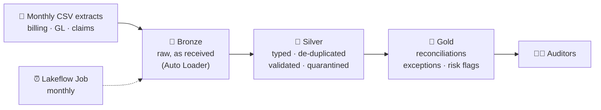
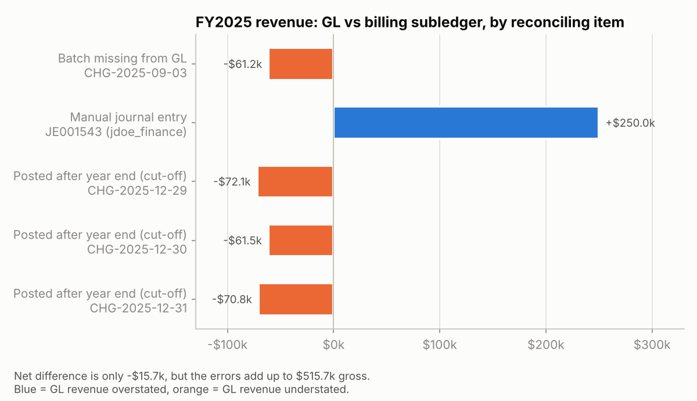

# Healthcare Revenue & AR Audit Lakehouse

**A Databricks medallion pipeline (Bronze → Silver → Gold) that reconciles a hospital's patient revenue and accounts receivable between its billing system and its general ledger, the way a financial statement auditor would.**

Built with **Python / PySpark** on **Databricks**: Unity Catalog, Auto Loader, Spark Declarative Pipelines and Lakeflow Jobs. It uses fully synthetic patient data from **[Synthea](https://github.com/synthetichealth/synthea)**, so there are no privacy concerns.

---

## The problem

Patient revenue and receivables are among the highest-risk areas in a hospital audit. Every charge and payment is recorded in the **billing system**, but the **general ledger** (which feeds the financial statements) only receives daily summaries, plus any manual entries accountants make. If the two disagree, the auditor needs to know **exactly why**.

## What the pipeline does



| Layer | Tables | Highlights |
|---|---|---|
| 🥉 **Bronze** | 6 streaming tables | Auto Loader picks up new monthly files; every column kept as text, with source-file lineage |
| 🥈 **Silver** | 4 materialized views | Type conversion, duplicate removal, data quality rules with a **quarantine table**, claim → encounter → payer links |
| 🥇 **Gold** | 9 materialized views | Monthly revenue reconciliation, AR roll-forward, daily batch matching, reconciling items, AR aging, payment exceptions, journal entry risk scoring, audit summary |

## Results (FY2025)

Known errors were deliberately planted in the source data. **The pipeline found all of them, and the unexplained difference is $0.00.**

| | Billing subledger | General ledger | Difference | Unexplained |
|---|---|---|---|---|
| Revenue | $25,330,065.67 | $25,314,391.21 | -$15,674.46 | **$0.00** |
| Year-end AR | $5,153,358.48 | $5,070,720.84 | -$82,637.64 | **$0.00** |



**Key findings**
- A **-$15.7k net** revenue difference (0.06%) was hiding **$515.7k of gross errors**: a missing batch, a year-end cut-off error and an unsupported $250k manual entry.
- One manual journal entry hit **all 5 fraud-risk flags**: weekend, after hours, round amount, days before year end, posted straight to revenue.
- **37 of 67 credit balances** were caused by data quality problems, not real overpayments.
- **$441k of AR (8%)** was over 180 days old at year end.

👉 **Full walkthrough, findings and takeaways: [docs/STEP_BY_STEP_GUIDE.md](docs/STEP_BY_STEP_GUIDE.md)**

---

## Repository structure

```
healthcare-revenue-ar-audit/
├── README.md
├── docs/
│   ├── STEP_BY_STEP_GUIDE.md        ← how it was built, findings, takeaways
│   └── images/                      ← charts used in the docs
├── data_prep/                       ← runs locally, before Databricks
│   ├── generate_synthea.sh          ← Step 1: generate synthetic patients and claims
│   ├── build_source_files.py        ← Step 2: billing extract + GL + planted errors
│   └── answer_key.csv               ← the planted errors (never loaded into Databricks)
├── src/
│   ├── setup/
│   │   └── 00_setup_unity_catalog.py  ← catalog, schemas, volume, grants
│   └── pipeline/                      ← Spark Declarative Pipeline source
│       ├── 01_bronze.py
│       ├── 02_silver.py
│       └── 03_gold.py
├── jobs/
│   └── revenue_ar_audit_job.yml     ← pipeline + monthly schedule (Asset Bundle)
├── local_validation/
│   ├── run_pipeline_locally.py      ← runs the same pipeline files with plain PySpark
│   └── make_charts.py
├── sample_data/                     ← first 20 rows of each source file
└── outputs/                         ← Gold tables exported from the validation run
```

## Tech stack

`Databricks` · `Unity Catalog` · `Auto Loader` · `Spark Declarative Pipelines` · `Lakeflow Jobs` · `Delta Lake` · `PySpark` · `Python (pandas)` · `Synthea`

## Disclaimer

All data is synthetic. Patients come from Synthea, and the billing extract and general ledger were generated for this project. Any resemblance to a real organisation is coincidental. Names like `jdoe_finance` are made up.
