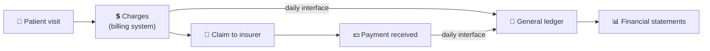
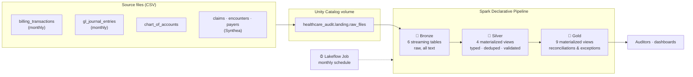
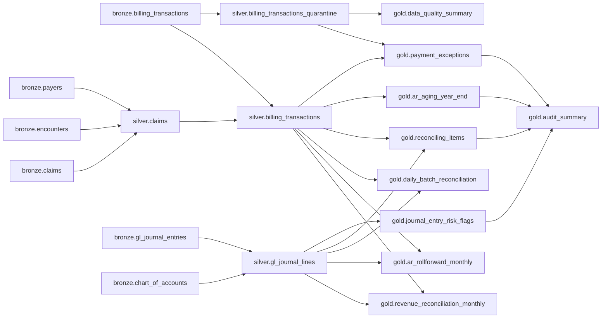
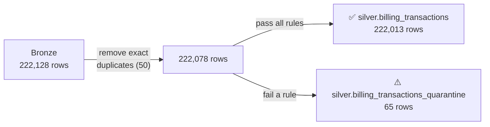
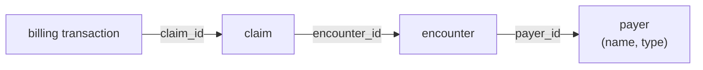
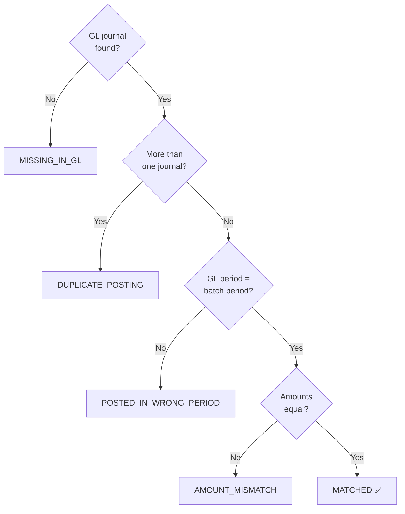
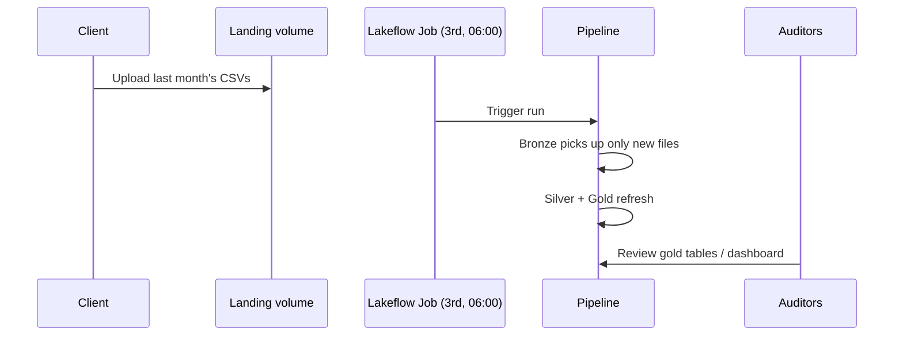
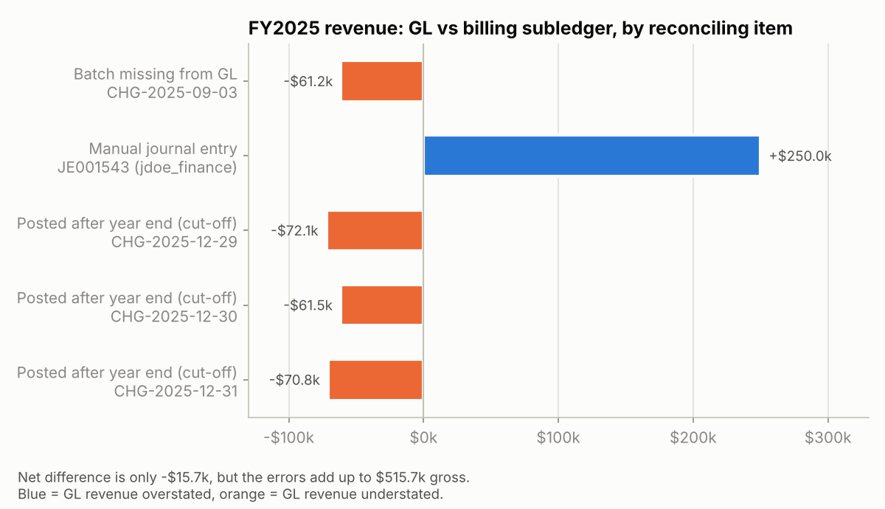
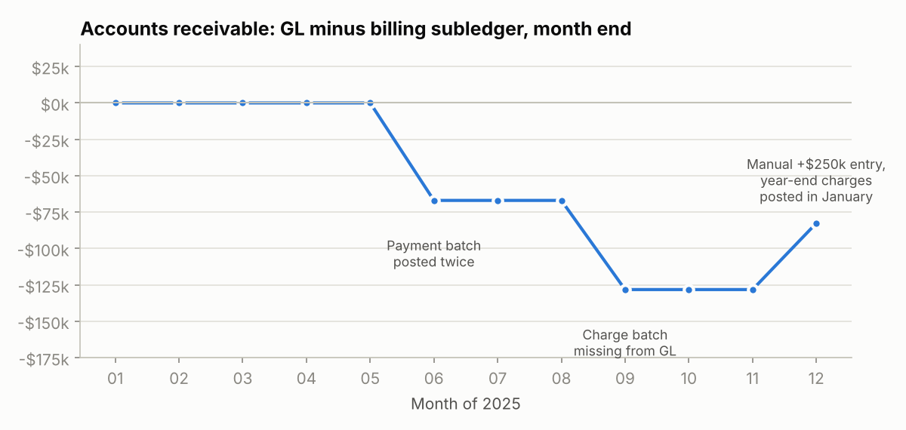
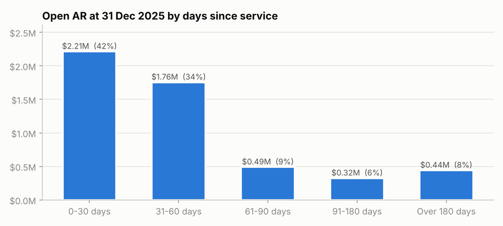

# Step-by-Step Guide: Building the Revenue & AR Audit Pipeline

This guide walks through every step taken to build this project, from generating synthetic hospital data to scheduling a Bronze → Silver → Gold pipeline in Databricks, and ends with the findings and key takeaways.

---

## Contents

1. [The business problem](#1-the-business-problem)
2. [Architecture](#2-architecture)
3. [Step 1: Generate synthetic healthcare data with Synthea](#step-1-generate-synthetic-healthcare-data-with-synthea)
4. [Step 2: Build the client's source files (with planted errors)](#step-2-build-the-clients-source-files-with-planted-errors)
5. [Step 3: Set up Unity Catalog and upload the files](#step-3-set-up-unity-catalog-and-upload-the-files)
6. [Step 4: Bronze layer](#step-4-bronze-layer)
7. [Step 5: Silver layer](#step-5-silver-layer)
8. [Step 6: Gold layer](#step-6-gold-layer)
9. [Step 7: Create the pipeline in Databricks](#step-7-create-the-pipeline-in-databricks)
10. [Step 8: Schedule it with a Lakeflow Job](#step-8-schedule-it-with-a-lakeflow-job)
11. [Step 9: Validate the results](#step-9-validate-the-results)
12. [Findings](#findings)
13. [Key takeaways](#key-takeaways)
14. [Limitations and next steps](#limitations-and-next-steps)

---

## 1. The business problem

In a hospital's financial statement audit, **patient service revenue** and **patient accounts receivable (AR)** are usually the highest-risk balances: they're large, high-volume and pass through several systems before reaching the financial statements.



The billing system (the **subledger**) records every charge and payment. Once a day, an **interface** posts summary totals to the **general ledger (GL)**, which feeds the financial statements. Accountants can also post **manual journal entries** directly to the GL.

**The audit question:** *Do revenue and AR in the GL agree with the billing system, and if not, exactly why?*

| Audit assertion | What the pipeline checks |
|---|---|
| **Completeness** | Every billing batch reached the GL |
| **Occurrence** | GL revenue is backed by real billing activity (no unsupported entries) |
| **Cut-off** | Revenue is recorded in the right fiscal year |
| **Accuracy** | GL amounts equal subledger amounts |
| **Valuation of AR** | How old the open balances are, and which payments look wrong |

**Scope of this first version:** fiscal year 2025 (1 Jan – 31 Dec 2025), with 2024 included so that AR has an opening balance.

---

## 2. Architecture



**Tech stack:** Databricks (Unity Catalog, Auto Loader, Spark Declarative Pipelines, Lakeflow Jobs), PySpark, Delta Lake, Python (pandas) for data preparation, Synthea for synthetic data.

### Table lineage



---

## Step 1: Generate synthetic healthcare data with Synthea

[Synthea](https://github.com/synthetichealth/synthea) is MITRE's open-source simulator of realistic but fictional patients. Because none of the data is real, there are no patient privacy concerns and everything can be shared publicly.

Script: [`data_prep/generate_synthea.sh`](../data_prep/generate_synthea.sh)

```bash
java -jar synthea.jar -p 2000 -s 2025 -cs 2025 -e 20260131 \
  --exporter.csv.export=true \
  --exporter.years_of_history=2 \
  Massachusetts
```

| Setting | Why |
|---|---|
| `-p 2000` | About 2,000 patients: enough volume (220k+ billing rows) without being slow |
| `-s 2025 -cs 2025` | Fixed seeds, so anyone can regenerate exactly the same data |
| `-e 20260131` | Ends one month after FY2025, so January 2026 activity is available for cut-off testing |
| `years_of_history=2` | Detailed records for FY2024 and FY2025 |

**Output used:** `claims_transactions.csv` (the charge and payment lines), `claims.csv`, `encounters.csv`, `payers.csv`. The run produced 2,296 patients, 9 payers (Medicare, Medicaid, Blue Cross Blue Shield, Aetna, etc.) plus a "no insurance" option.

---

## Step 2: Build the client's source files (with planted errors)

Synthea gives clinical and billing data, but not what an auditor actually receives from a hospital. A Python script fills that gap.

Script: [`data_prep/build_source_files.py`](../data_prep/build_source_files.py)

### 2a. Billing subledger extract

Synthea pays every claim on the day of service, which would leave no receivables. The script adds **realistic payment delays** so that AR exists:

| Payer type | Days from service to payment |
|---|---|
| Government (Medicare, Medicaid) | 14–45 |
| Private insurers | 20–60 |
| Self-pay | 0–90 |
| Patient's share after insurance | +15–45 more |
| 4% of claims (denials and appeals) | +150–400 more |

Payments that would arrive after 31 Jan 2026 are left out, because they're still unpaid at the extract date. The file is split **one CSV per posting month**, like a real monthly extract.

### 2b. General ledger

The GL is built the way a real billing interface works: **one journal entry per day per transaction type**.

| Daily batch | Debit | Credit |
|---|---|---|
| Charges (`CHG-yyyy-mm-dd`) | 1200 Patient AR | 4000 Gross Patient Service Revenue |
| Payments (`PAY-yyyy-mm-dd`) | 1100 Cash | 1200 Patient AR |

Routine manual entries (monthly bank fees) are added too, so that not every manual entry is suspicious.

### 2c. Planted errors

Known errors were planted so the pipeline's results can be checked against an **answer key** ([`data_prep/answer_key.csv`](../data_prep/answer_key.csv)). The answer key is **never uploaded to Databricks**.

| ID | Where | Error | Amount |
|---|---|---|---|
| E1 | GL | Payment batch for 16 Jun 2025 posted twice | $66,963.18 |
| E2 | GL | Charge batch for 3 Sep 2025 never posted | $61,242.96 |
| E3 | GL | Charges for 29–31 Dec 2025 posted on 2 Jan 2026 (cut-off) | $204,431.50 |
| E4 | GL | Manual revenue entry: Saturday 27 Dec, 9:47 pm, round $250,000, "Revenue true-up per CFO" | $250,000.00 |
| S1 | Subledger | Same payment keyed in twice under a new transaction id | 30 payments |
| S2 | Subledger | Payments pointing to a claim that doesn't exist | 12 payments |
| S3 | Subledger | Missing amounts, negative charges, impossible dates (`2025-13-45`) | 65 rows |
| S4 | Subledger | Exact duplicate rows from a re-run extract | 50 rows |

### 2d. Final source files

| Folder | Files | Rows |
|---|---|---|
| `billing_transactions/` | 25 monthly CSVs (Jan 2024 – Jan 2026) | 222,128 |
| `gl_journal_entries/` | 25 monthly CSVs | 3,086 lines |
| `chart_of_accounts/` | 1 | 4 |
| `claims/`, `encounters/`, `payers/` | 1 each (Synthea, filtered to in-scope claims) | 34,219 / 18,073 / 10 |

Samples of every file are in [`sample_data/`](../sample_data).

---

## Step 3: Set up Unity Catalog and upload the files

Notebook: [`src/setup/00_setup_unity_catalog.py`](../src/setup/00_setup_unity_catalog.py)

```python
CATALOG = "healthcare_audit"
spark.sql(f"CREATE CATALOG IF NOT EXISTS {CATALOG}")
for schema in ["landing", "bronze", "silver", "gold"]:
    spark.sql(f"CREATE SCHEMA IF NOT EXISTS {CATALOG}.{schema}")
spark.sql(f"CREATE VOLUME IF NOT EXISTS {CATALOG}.landing.raw_files")
```

```
📚 healthcare_audit
├── 📂 landing
│   └── 🗂️ raw_files (volume)
│       ├── billing_transactions/   ← 25 monthly CSVs
│       ├── gl_journal_entries/     ← 25 monthly CSVs
│       ├── chart_of_accounts/
│       ├── claims/
│       ├── encounters/
│       └── payers/
├── 📂 bronze   ← written by the pipeline
├── 📂 silver   ← written by the pipeline
└── 📂 gold     ← written by the pipeline
```

Files were uploaded through **Catalog → healthcare_audit → landing → raw_files → (folder) → Upload to this volume**.

The notebook also contains (commented out) the grants for the target access model: **auditors can read `gold` only**, and data engineers own everything else.

---

## Step 4: Bronze layer

File: [`src/pipeline/01_bronze.py`](../src/pipeline/01_bronze.py)

**Goal:** load every file exactly as received. Nothing is changed or dropped.

```python
def autoload_csv(folder: str):
    return (
        spark.readStream.format("cloudFiles")              # Auto Loader
        .option("cloudFiles.format", "csv")
        .option("cloudFiles.inferColumnTypes", "false")    # keep everything as text
        .option("header", "true")
        .load(f"{LANDING}/{folder}")
        .withColumn("_source_file", F.col("_metadata.file_path"))
        .withColumn("_ingested_at", F.current_timestamp())
    )

@dp.table(name=f"{BRONZE}.billing_transactions")
def bronze_billing_transactions():
    return autoload_csv("billing_transactions")
```

**Design decisions**

| Decision | Reason |
|---|---|
| **Auto Loader** (streaming tables) | Each monthly run only reads **new** files. Dropping next month's extract in the folder is all that's needed. |
| **All columns kept as text** | A bad value (like `2025-13-45`) can't break the load. Bronze is a faithful copy of what the client sent, which matters as audit evidence. |
| **`_source_file` and `_ingested_at`** | Every row can be traced back to the exact file it came from. |

**Result:** six Bronze tables, including 222,128 billing rows and 3,086 GL lines.

---

## Step 5: Silver layer

File: [`src/pipeline/02_silver.py`](../src/pipeline/02_silver.py)

**Goal:** typed, de-duplicated, validated data, with each transaction linked to its claim and payer.

### 5a. Types and technical duplicates

```python
latest_first = Window.partitionBy("transaction_id").orderBy(F.col("_ingested_at").desc())
spark.read.table(f"{BRONZE}.billing_transactions") \
    .withColumn("_rn", F.row_number().over(latest_first)) \
    .filter("_rn = 1")                               # same transaction_id loaded twice
```

Dates are converted with `try_to_timestamp`, so an invalid date becomes `NULL` instead of failing the pipeline. That `NULL` is then caught by a data quality rule.

### 5b. Data quality rules (expectations) and quarantine

```python
BILLING_RULES = {
    "amount_present_and_positive": "amount IS NOT NULL AND amount > 0",
    "posting_date_valid":          "posting_date IS NOT NULL",
    "service_date_valid":          "service_date IS NOT NULL",
    "transaction_type_valid":      "transaction_type IN ('CHARGE', 'PAYMENT')",
}

@dp.materialized_view(name=f"{SILVER}.billing_transactions")
@dp.expect_all_or_drop(BILLING_RULES)          # failing rows are dropped here...
def silver_billing_transactions(): ...

@dp.materialized_view(name=f"{SILVER}.billing_transactions_quarantine")
def silver_billing_quarantine(): ...           # ...and kept here, with a reason
```



**Why quarantine instead of just dropping?** In an audit, a row that silently disappears is a completeness risk. The quarantine table keeps every rejected row and its reason so it can be followed up with the client.

| Quarantine reason | Rows | Amount |
|---|---|---|
| Missing amount | 40 | n/a |
| Zero or negative amount | 15 | -$53,726.18 |
| Invalid posting date | 10 | $3,470.84 |

### 5c. Linking transactions to claims and payers



A **left join** is used, so payments whose claim can't be found are **kept** and flagged `has_matching_claim = false`. They're real cash and must be investigated, not dropped.

### 5d. GL lines

`silver.gl_journal_lines` types the GL detail, joins the chart of accounts, and adds `net_debit` (debit − credit) and `is_manual`. Its expectations include a warning if an account isn't in the chart of accounts.

---

## Step 6: Gold layer

File: [`src/pipeline/03_gold.py`](../src/pipeline/03_gold.py)

**Goal:** answer the audit question. The fiscal year is a pipeline setting (`audit.fiscal_year`), so the same code works for any year.

| Gold table | What it answers |
|---|---|
| `revenue_reconciliation_monthly` | Does GL revenue match subledger charges each month? |
| `ar_rollforward_monthly` | Opening AR + charges − payments = closing AR. Does the GL agree? |
| `daily_batch_reconciliation` | Did every daily batch reach the GL once, in the right period, for the right amount? |
| `reconciling_items` | Which specific items explain the fiscal-year difference, and by how much? |
| `ar_aging_year_end` | How old is the open AR at year end, and with which payers? |
| `payment_exceptions` | Which payments are duplicated, unmatched, or over-applied? |
| `journal_entry_risk_flags` | Which manual entries look risky? |
| `data_quality_summary` | What was removed or quarantined along the way? |
| `audit_summary` | One-page headline results |

### 6a. Matching each daily batch to the GL

Each subledger batch (for example `CHG-2025-09-03`) is matched to GL journals carrying the same `batch_reference`, then classified:



### 6b. Measuring each item's fiscal-year impact

For every batch, the pipeline compares how much was booked **inside the fiscal year** (for revenue) and **up to year end** (for AR) on each side:

```python
.withColumn("revenue_impact",
    F.when(is_charge, gl_in_fy - sub_in_fy).otherwise(0))
.withColumn("ar_impact",
    F.when(is_charge, gl_to_fye - sub_to_fye)        # charges increase AR
     .otherwise(-(gl_to_fye - sub_to_fye)))           # payments decrease AR
```

Manual journal entries that hit revenue or AR are added as their own reconciling items. Because the logic is generic, it handles missing, duplicated and late postings without a special rule for each.

### 6c. Manual journal entry risk scoring

Each manual entry gets one point per red flag:

| Flag | Rule |
|---|---|
| Weekend | Posted on Saturday or Sunday |
| Round amount | Exact multiple of $1,000 |
| Near year end | Within 7 days of fiscal year end |
| After hours | Created before 7 am or after 8 pm |
| Hits revenue or AR | Touches the accounts under audit |

Score ≥ 3 = **HIGH**, 2 = **MEDIUM**, otherwise **LOW**.

### 6d. A note on pipeline rules

Pipeline dataset functions must only *describe* a DataFrame. Actions like `.count()` or `.collect()` aren't allowed. So summary tables such as `audit_summary` are built purely from aggregations, cross joins and a SQL `stack()` to turn one wide row into metric rows.

---

## Step 7: Create the pipeline in Databricks

1. **Jobs & Pipelines → Create → ETL pipeline.**
2. Name it `revenue-ar-audit-pipeline`. Set the default catalog `healthcare_audit` and schema `bronze`. The code writes to `bronze`, `silver` and `gold` with fully qualified names.
3. Add the three source files `01_bronze.py`, `02_silver.py` and `03_gold.py`.
4. Under **Configuration**, add:

   | Key | Value |
   |---|---|
   | `audit.catalog` | `healthcare_audit` |
   | `audit.landing_path` | `/Volumes/healthcare_audit/landing/raw_files` |
   | `audit.fiscal_year` | `2025` |

5. Choose **Serverless**, keep **Triggered** mode, and click **Start**.
6. Review the **pipeline graph** (it matches the lineage diagram above) and the **data quality** tab, which shows how many rows each expectation passed or dropped.

The same settings are defined as code in [`jobs/revenue_ar_audit_job.yml`](../jobs/revenue_ar_audit_job.yml) (Databricks Asset Bundle).

---

## Step 8: Schedule it with a Lakeflow Job

The client sends the previous month's extracts by the 2nd of each month, so the job runs on the **3rd at 06:00 Central**:

```yaml
jobs:
  revenue_ar_audit_monthly:
    schedule:
      quartz_cron_expression: "0 0 6 3 * ?"
      timezone_id: America/Chicago
    tasks:
      - task_key: run_revenue_ar_pipeline
        pipeline_task:
          pipeline_id: ${resources.pipelines.revenue_ar_audit_pipeline.id}
```

In the UI: **Jobs & Pipelines → Create → Job → add a "Pipeline" task → select the pipeline → Add trigger → Scheduled**. An email alert on failure is also set.



---

## Step 9: Validate the results

Before relying on the results, the pipeline was tested with [`local_validation/run_pipeline_locally.py`](../local_validation/run_pipeline_locally.py). It runs the **exact same pipeline files** with plain PySpark, using a small stand-in for the pipeline decorators and Auto Loader, and exports every Gold table to [`outputs/`](../outputs).

The Gold results were then compared with the answer key:

| Planted error | Detected? | How |
|---|---|---|
| E1 Payment batch posted twice | ✅ | `DUPLICATE_POSTING`, AR impact -$66,963.18 |
| E2 Charge batch missing | ✅ | `MISSING_IN_GL`, revenue impact -$61,242.96 |
| E3 Year-end cut-off (3 batches) | ✅ | `POSTED_IN_WRONG_PERIOD`, revenue impact -$204,431.50 |
| E4 Unsupported $250k manual entry | ✅ | Reconciling item **and** risk score 5/5 (HIGH) |
| S1 30 duplicate payments | ✅ | 30 `Duplicate payment` exceptions, $9,707.60 |
| S2 12 payments with no claim | ✅ | 12 `Payment with no matching claim` exceptions, $1,983.36 |
| S3 65 bad rows | ✅ | 65 rows in quarantine, by reason |
| S4 50 exact duplicates | ✅ | 50 rows removed in Silver |

**Every planted error was found, and the unexplained difference is $0.00 for both revenue and AR.**

---

## Findings

### Headline results: FY2025

| | Billing subledger | General ledger | Difference | Explained | Unexplained |
|---|---|---|---|---|---|
| **Revenue** | $25,330,065.67 | $25,314,391.21 | **-$15,674.46** | -$15,674.46 | **$0.00** |
| **Year-end AR** | $5,153,358.48 | $5,070,720.84 | **-$82,637.64** | -$82,637.64 | **$0.00** |

### Finding 1: A small net difference was hiding $515k of errors



The net revenue difference is only **-$15.7k (0.06% of revenue)**, small enough to look immaterial. But it is the sum of errors in **both directions**: a $250k unsupported entry pushing revenue up, and $265.7k of missing and late postings pushing it down. In gross terms that's **$515.7k, or 2.0% of revenue**. Testing only the net difference would have missed all of it.

| Reconciling item | Revenue impact | AR impact |
|---|---|---|
| Manual entry JE001543 (jdoe_finance, 27 Dec) | +$250,000.00 | +$250,000.00 |
| Cut-off: 29–31 Dec charges posted 2 Jan 2026 | -$204,431.50 | -$204,431.50 |
| Charge batch 3 Sep missing from GL | -$61,242.96 | -$61,242.96 |
| Payment batch 16 Jun posted twice | n/a | -$66,963.18 |
| **Total** | **-$15,674.46** | **-$82,637.64** |

### Finding 2: The AR roll-forward shows exactly when things went wrong



GL and subledger AR agreed to the cent from January to May 2025. The difference appears in **June** (duplicate payment posting), grows in **September** (missing charge batch), and shifts in **December** (manual entry and cut-off). A month-by-month view tells the auditor *where to look*, not just *that* something is wrong.

### Finding 3: One manual journal entry hit every red flag

Of 26 manual journal entries, only **JE001543** was rated HIGH, scoring **5 out of 5**: posted on a **Saturday**, created at **9:47 pm**, a **round $250,000**, **4 days before year end**, and booked straight to **revenue and AR** with the vague description "Revenue true-up per CFO". The 25 routine bank-fee entries scored 0–1.

### Finding 4: Data quality problems create misleading exceptions downstream

There are **67 claims with credit balances** (paid more than billed, $71,213.78 in total). Tracing their cause:

| Likely cause | Claims | Amount |
|---|---|---|
| A duplicate payment on the claim | 30 | $9,707.60 |
| A charge on the claim was quarantined in Silver | 37 | $61,506.18 |

So **55% of the credit balances aren't real overpayments**. They exist because the matching charge row failed data quality checks. Without the `likely_cause` link, someone might refund $61.5k that isn't owed. Fixing the 65 bad source rows is a prerequisite to trusting the credit-balance list.

### Finding 5: Year-end AR aging



| Days since service | Open AR | Share |
|---|---|---|
| 0–30 | $2.21M | 42% |
| 31–60 | $1.76M | 34% |
| 61–90 | $0.49M | 9% |
| 91–180 | $0.32M | 6% |
| Over 180 | $0.44M | 8% (359 claims) |

The **$441k over 180 days** is the main valuation risk and should be assessed for collectability (an allowance for doubtful accounts). The largest old balances are with **Medicare ($100.7k)**, **Blue Cross Blue Shield ($83.6k)** and **Medicaid ($72.1k)**. A further 66 claims had credit balances totalling **-$69.9k** at year end, which should be reclassified as a liability rather than left inside AR.

### Finding 6: Unapplied cash

**12 payments ($1,983.36)** reference claim ids that don't exist. That's cash received with no record of what it was for. It's small here, but it shows a control gap in payment posting.

---

## Key takeaways

**Audit and analytics**

- **Reconcile at the most detailed level available.** Monthly totals showed *that* revenue was off. Daily batch matching showed *which* batches and *why*.
- **Look at gross, not just net.** Offsetting errors can make a $515k problem look like a $16k one.
- **Explain every dollar.** The target is "unexplained difference = $0.00", with each reconciling item backed by a specific batch or journal entry.
- **Data quality is an audit issue.** Bad source rows didn't just disappear. They created 37 false credit-balance exceptions.
- **Plant known errors to test the tests.** An answer key turns "the pipeline ran" into "the pipeline provably finds what it should".

**Databricks engineering**

- **Bronze = evidence.** Loading everything as text with file lineage means nothing is lost and every number can be traced back to its source file.
- **Quarantine, don't just drop.** `expect_all_or_drop` plus a quarantine table keeps the clean table clean while keeping every rejected row visible.
- **Auto Loader makes the schedule simple.** Each monthly run only processes new files; there's no tracking logic to write.
- **Parameterise the audit period.** `audit.fiscal_year` lets the same pipeline run for FY2026 by changing one setting.
- **Declarative pipelines have rules.** Dataset functions return DataFrames; actions like `.count()` belong outside them, so summary tables are built from aggregations instead.
- **Test pipeline code before deploying.** A thin local harness ran the *same files* with plain PySpark, which caught a mislabelled reconciling item before it reached Databricks.

---

## Limitations and next steps

**Limitations**

- **Synthetic data.** Synthea doesn't model contractual allowances (the discount between billed charges and what insurers actually pay), so this version reconciles **gross** revenue. Real hospitals report **net** patient revenue.
- **Payment timing is simulated.** The delays in Step 2 are reasonable assumptions, not Synthea output.
- **One entity, four GL accounts.** A real hospital GL has many more revenue and AR sub-accounts.
- **Validated locally.** The logic was tested with open-source PySpark. Running it in Databricks may need small adjustments.

**Next steps**

1. Add **contractual adjustments and bad debt** to reconcile **net** revenue.
2. Build an **AI/BI dashboard** on the Gold tables, with alerts when the unexplained difference isn't zero.
3. Add **Benford's Law** testing on payment amounts as another fraud screen.
4. Extend journal entry testing (unusual users, entries just below approval limits, reversals after year end).
5. Compare against real hospitals with the **CMS Hospital Cost Report** public file (analytical review).
