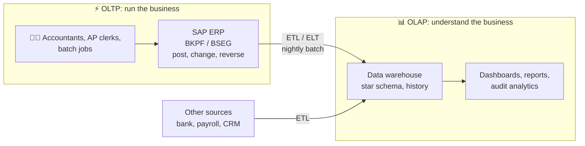
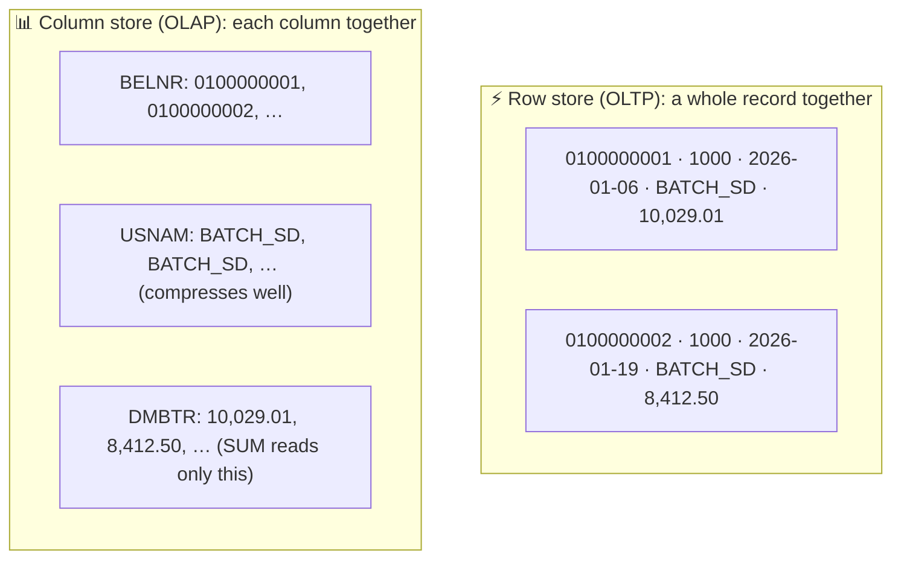
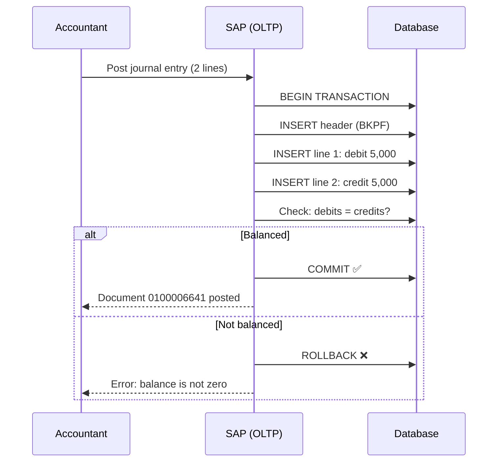
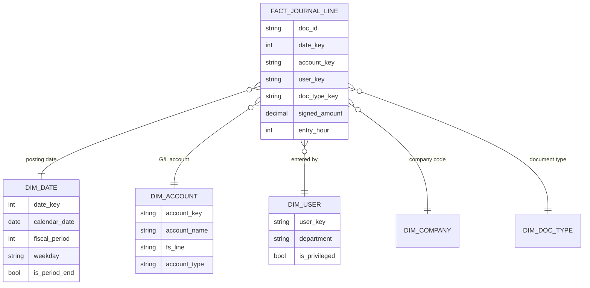
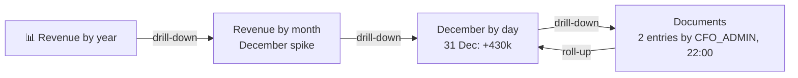
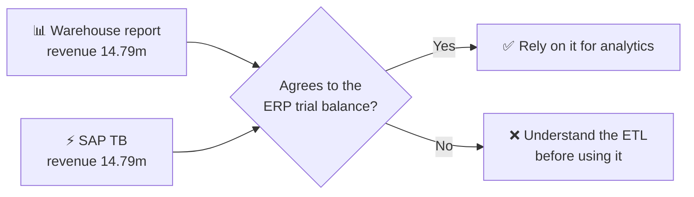
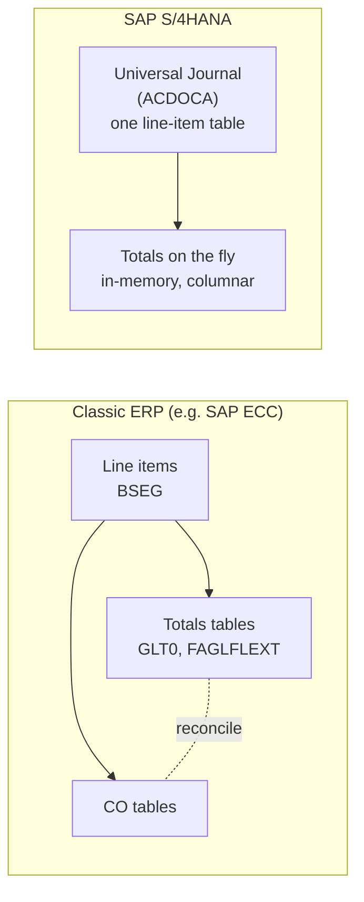

<div align="center">

# 🗄️ OLAP vs OLTP
### A data engineering guide with financial statement audit examples

</div>

## 💡 Why this matters

When an auditor asks for "the journal entry data", it can come from two very different places:

- **The ERP itself**, where accountants post entries.
- **A data warehouse or BI system**, where the same data has been copied, reshaped and summarised.

Knowing which one you're looking at tells you how **current, complete and reliable** the data is, and how to query it without bringing the client's finance system to a halt.

## 1. The two systems in one picture



- **OLTP (online transaction processing)** manages and processes transactions **in real time**: an invoice is posted, a payment is made, an entry is reversed.
- **OLAP (online analytical processing)** analyses **large volumes of historical data** from multiple sources to support decisions: trends, ratios, comparisons.

An OLTP system is usually **one of several data sources** feeding an OLAP system.

## 2. Side-by-side comparison

| | ⚡ OLTP | 📊 OLAP |
| --- | --- | --- |
| Purpose | Record transactions | Analyse transactions |
| Typical operations | `INSERT`, `UPDATE`, `DELETE` of a few rows | `SELECT` with `GROUP BY` over millions of rows |
| Workload | Heavy writes, moderate reads | Heavy reads, periodic bulk loads |
| Data | Current, detailed | Historical, often aggregated, from many sources |
| Data model | **Highly normalised** (3NF) | **Denormalised**: star or snowflake schema, cubes |
| Response time | Milliseconds | Seconds to minutes |
| Volume | Gigabytes | Terabytes to petabytes |
| Users | Many concurrent operational users | Fewer analysts, auditors, management |
| Consistency | **ACID** guarantees | Consistent as at the last load |
| Updates | Real time | Batches: nightly, hourly |
| Availability | High priority: downtime stops the business | Lower priority |
| Storage | Usually **row-oriented** | Usually **column-oriented** |
| SAP example | ECC / S/4HANA posting tables | SAP BW/4HANA, a Snowflake or Databricks audit warehouse |

### Row vs column storage



A row store is fast at **"write or fetch this one document"**. A column store is fast at **"sum this one column across 50 million lines"**, because it reads only the columns the query needs.

## 3. OLTP in the audit world

### What happens when an entry is posted in SAP



The same idea in SQL:

```sql
START TRANSACTION;
INSERT INTO bkpf (bukrs, belnr, gjahr, blart, budat, usnam)
VALUES ('1000', '0100006641', 2026, 'SA', '2026-06-30', 'ARAO');
INSERT INTO bseg (bukrs, belnr, gjahr, buzei, hkont, shkzg, dmbtr) VALUES
('1000', '0100006641', 2026, 1, '0000630000', 'S', 5000.00),
('1000', '0100006641', 2026, 2, '0000200000', 'H', 5000.00);
COMMIT;            -- all or nothing: never half a journal entry
```

**ACID is why the ledger can be trusted:**

| ACID property | Meaning | Audit relevance |
| --- | --- | --- |
| **Atomicity** | The whole transaction succeeds or fails as one unit | No half-posted journal entries |
| **Consistency** | Rules hold after every transaction | Every document balances |
| **Isolation** | Concurrent transactions don't interfere | Two clerks can't use the same document number |
| **Durability** | Committed data survives failures | Posted entries aren't lost after a crash |

**Audit insight:** because SAP enforces atomicity and the balancing rule, an **unbalanced document in an extract** means lines are missing from the **extract**, not from the ledger.

### Why auditors don't query the production ERP directly

Aggregate analytics over millions of transactions are very resource-intensive for an OLTP system, and can slow down or block the users posting transactions. The usual approach:

| Option | How | Trade-off |
| --- | --- | --- |
| Table extract | BKPF, BSEG and the TB downloaded by IT | Point-in-time snapshot; completeness must be tested |
| Read replica / reporting copy | A copy of production | Slight lag, but no load on production |
| Data warehouse | Client's existing BW or warehouse | Convenient, but it's **transformed data** |

## 4. OLAP in the audit world

### The star schema

OLTP tables are **normalised** (BKPF + BSEG + account master + user master …), so analytical queries need many joins. OLAP **denormalises** into a **fact table** surrounded by **dimension tables**:



### OLAP operations, audit style

| Operation | Meaning | Audit example |
| --- | --- | --- |
| **Roll-up** | Summarise to a higher level | Journal lines → account → FS line (revenue, COGS) |
| **Drill-down** | Go to more detail | December revenue → by day → the 250,000 entry → its lines |
| **Slice** | Fix one dimension | Only manual (SA) entries |
| **Dice** | Fix several dimensions | Manual entries, December, by privileged users |
| **Pivot** | Rotate the view | Users as rows × fiscal periods as columns |



A typical OLAP query: manual entries by user and quarter, with subtotals.

```sql
SELECT u.user_key,
       d.fiscal_quarter,
       COUNT(DISTINCT f.doc_id)           AS manual_docs,
       SUM(GREATEST(f.signed_amount, 0))  AS debit_value
FROM fact_journal_line f
JOIN dim_user     u  ON u.user_key = f.user_key
JOIN dim_date     d  ON d.date_key = f.date_key
JOIN dim_doc_type t  ON t.doc_type_key = f.doc_type_key
WHERE t.is_manual = TRUE
GROUP BY u.user_key, d.fiscal_quarter WITH ROLLUP;        -- MySQL syntax: subtotals per user and a grand total
```

### Audit risks specific to OLAP data

| Risk | Why | Auditor's response |
| --- | --- | --- |
| **Transformation errors** | ETL can drop, duplicate or misclassify rows | Reconcile warehouse totals back to the ERP trial balance |
| **Timing lag** | Loaded nightly or monthly | Confirm the load date; late postings may be missing |
| **Aggregation hides detail** | Summaries can't be vouched | Drill to document-level data for testing |
| **Business logic in reports** | "Revenue" may be defined differently from the GL | Understand the report logic (information produced by the entity) |
| **History overwritten** | Some dimensions keep only current values | Check how changes are kept (slowly changing dimensions) |



## 5. HTAP: when one system does both

**HTAP (hybrid transactional/analytical processing)** runs transactions and analytics on the **same** data. SAP S/4HANA is a well-known example in finance:

- The **Universal Journal** is the single source of truth, combining financial accounting (FI) and controlling (CO) line items.
- Line items are written **only once**.
- **Totals are calculated on the fly** when needed, instead of being stored in separate totals tables.
- Integrity is built into the design, removing the reconciliation effort between FI and CO.



**Audit impact:** in S/4HANA, the journal entry population usually comes from **one table** (ACDOCA) rather than BKPF + BSEG. Fewer reconciliations are needed between ledgers, but extracts are **much wider** (hundreds of columns) and need careful field selection.

## 6. Which one for which audit task?

| Audit task | Source | Why |
| --- | --- | --- |
| Full JE population for testing | **OLTP** extract (BKPF/BSEG or ACDOCA) | Complete, document-level, closest to the books |
| Change history, who changed what | **OLTP** change logs (e.g. CDHDR/CDPOS) | The audit trail lives in the transactional system |
| Multi-year trend analytics | **OLAP** warehouse | History and fast aggregation |
| Analytical procedures (ISA 520) | **OLAP** (or extract loaded into one) | Group, compare, pivot |
| Testing a management report | Both | Report from OLAP, **reconciled** to OLTP |
| Continuous monitoring dashboards | OLAP or HTAP | Frequent refreshes without hurting the ERP |

## 7. Interview key takeaways

1. **OLTP runs the business; OLAP analyses it.** OLTP handles many small, fast read/write transactions; OLAP handles fewer, large, read-heavy analytical queries.
2. **Modelling:** OLTP is **normalised** (3NF) to avoid redundancy and update anomalies; OLAP is **denormalised** (star or snowflake schema) to minimise joins.
3. **Storage:** OLTP uses row stores; OLAP uses column stores with compression, and reads only the columns needed.
4. **ACID** is essential for OLTP. Know what each letter means and give an example.
5. **ETL/ELT** moves data from OLTP to OLAP. Know the difference: transform before loading vs load raw, then transform in the warehouse.
6. **Star schema:** a fact table holds **measures** (amounts) and **foreign keys**; dimension tables hold **descriptive attributes** (date, account, user).
7. **OLAP operations:** roll-up, drill-down, slice, dice and pivot.
8. **Don't run heavy analytics on production OLTP.** Use replicas, extracts or a warehouse.
9. **HTAP** (SAP S/4HANA, and similar database features) blurs the line, but the trade-offs still apply.

| Quick question | Strong answer |
| --- | --- |
| OLTP or OLAP for an ATM withdrawal? | OLTP: a small, real-time, ACID transaction |
| OLTP or OLAP for "revenue by region for 5 years"? | OLAP: a large aggregation over historical data |
| Why normalise OLTP but denormalise OLAP? | Normalisation makes writes efficient and consistent; denormalisation makes reads and aggregations fast |
| What's a fact vs a dimension? | A fact holds measurable events (amounts, quantities); a dimension holds context (when, who, what, where) |
| Why are column stores faster for analytics? | They read only the needed columns and compress similar values well |
| How do you keep dimension history? | Slowly changing dimensions: Type 1 overwrites, Type 2 adds a new row with validity dates |
| Name OLTP and OLAP technologies | OLTP: MySQL, PostgreSQL, SQL Server, Oracle. OLAP: Snowflake, BigQuery, Redshift, Databricks, SAP BW |
