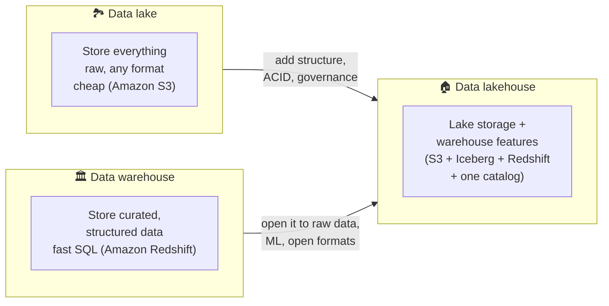
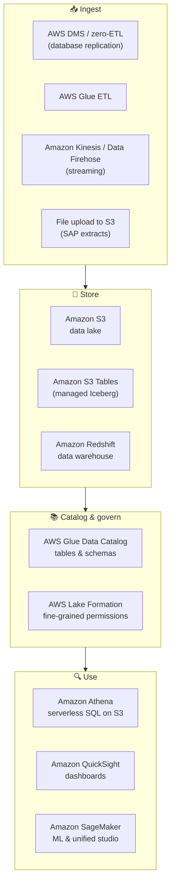
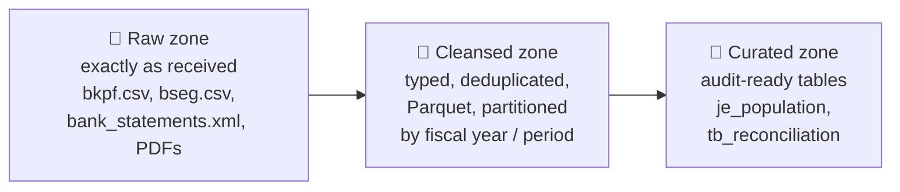
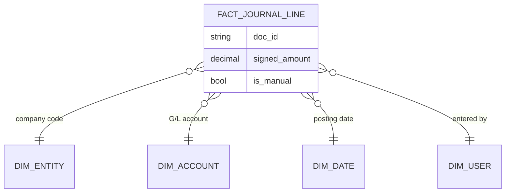
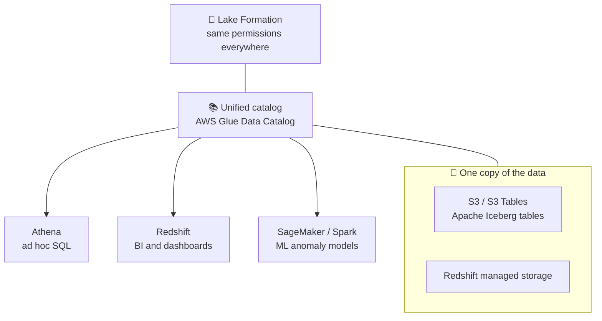
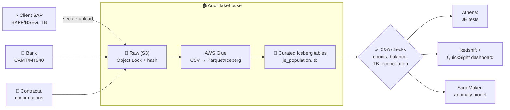
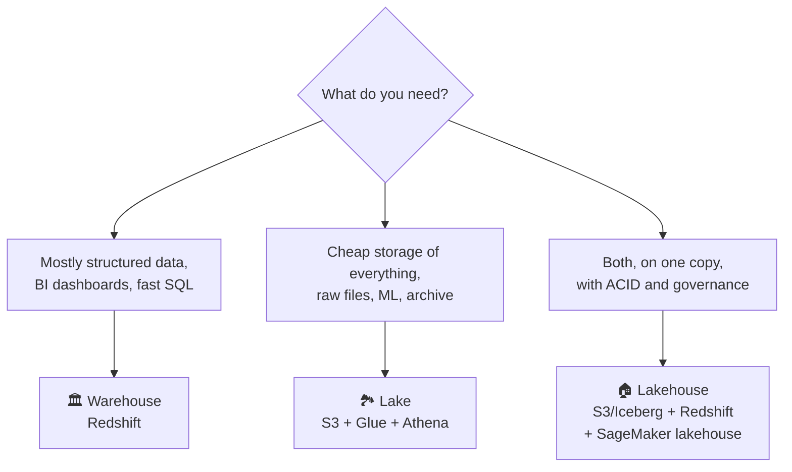

<div align="center">

# 🏞️ Data Lake vs Data Warehouse vs Data Lakehouse
### An AWS perspective, with financial statement audit examples

</div>

## 💡 Why this matters

An audit team today receives much more than a trial balance. There are SAP journal entry extracts, bank statements in XML, contracts as PDFs, confirmations by email, and system logs. Where that data lands, and how it's organised, decides:

- how fast analytics can run
- whether results can be **reproduced** months later
- whether sensitive data such as payroll is **properly controlled**

## 1. The three architectures at a glance



| | 🏞️ Data lake | 🏛️ Data warehouse | 🏠 Data lakehouse |
| --- | --- | --- | --- |
| Data | Structured, semi-structured, unstructured | Structured, relational | All types |
| Schema | **Schema-on-read**: applied when queried | **Schema-on-write**: defined before loading | Schema enforced on open table formats; supports schema evolution |
| Storage cost | Low (object storage) | Higher | Low (object storage) |
| Query speed | Good, depends on file layout | Fastest for BI | Near-warehouse for many workloads |
| ACID transactions | ❌ Not on plain files | ✅ | ✅ (Apache Iceberg tables) |
| Main users | Data engineers, data scientists | Business analysts, BI | Everyone, on one copy of the data |
| Typical use | ML, exploration, raw archive | Reporting, dashboards | Both, without duplicating data |
| Main risk | Becomes a **data swamp** | Rigid, costly, struggles with raw data | More moving parts to govern |
| AWS services | Amazon S3, AWS Lake Formation, AWS Glue, Amazon Athena | Amazon Redshift | Amazon SageMaker lakehouse architecture, S3 Tables, Apache Iceberg, Redshift, Athena |

## 2. The AWS building blocks



| Service | Role | Audit example |
| --- | --- | --- |
| **Amazon S3** | Object storage: the lake itself | Raw SAP extracts, bank files, contracts |
| **AWS Glue Data Catalog** | Central metadata: table names, columns, types | "bseg_fy2026 has 9 columns; hkont is a string" |
| **AWS Glue (crawlers / ETL)** | Discovers schemas; transforms data | Converts CSV extracts to Parquet, standardises dates |
| **AWS Lake Formation** | Permissions at database, table, column and row level | Hide salary columns; restrict each team to its client |
| **Amazon Athena** | Serverless SQL directly on S3 | Query 50m journal lines without loading them anywhere |
| **Amazon Redshift** | Managed, columnar data warehouse | Group-wide audit analytics and dashboards |
| **Apache Iceberg / S3 Tables** | Open table format: ACID, time travel, schema evolution | Reproduce results "as at" the extract date |
| **Amazon SageMaker lakehouse architecture** | Unifies S3 lakes and Redshift warehouses under one catalog | Analysts (SQL) and data scientists (ML) on the same tables |
| **Amazon QuickSight** | BI dashboards | Journal entry risk dashboard for the engagement team |

## 3. Data lake: the audit evidence archive

### Zones (often called bronze, silver and gold)



```text
s3://audit-datalake/
├── raw/client=acme/fy=2026/sap/bseg_2027-01-12.csv        # never modified
├── raw/client=acme/fy=2026/bank/camt053_dec.xml
├── raw/client=acme/fy=2026/contracts/lease_hq.pdf
├── cleansed/client=acme/fy=2026/je_lines/period=12/part-0001.parquet
└── curated/client=acme/fy=2026/je_population/
```

### Query the lake directly with Athena (schema-on-read)

```sql
CREATE EXTERNAL TABLE cleansed.je_lines (
    belnr  string,
    hkont  string,          -- string keeps leading zeros
    shkzg  string,
    dmbtr  decimal(15,2),
    budat  date,
    usnam  string
)
PARTITIONED BY (period int)
STORED AS PARQUET
LOCATION 's3://audit-datalake/cleansed/client=acme/fy=2026/je_lines/';

-- Only period 12 is scanned (partition pruning): less data read, lower cost
SELECT usnam, COUNT(*) AS lines, SUM(dmbtr) AS debit_value
FROM cleansed.je_lines
WHERE period = 12 AND shkzg = 'S'
GROUP BY usnam
ORDER BY debit_value DESC;
```

### Audit uses of a data lake

| Use | Why a lake fits |
| --- | --- |
| **Evidence archive** | Keep the client's original files unchanged; S3 Object Lock can make them write-once (WORM) for retention |
| **Unstructured evidence** | Contracts, invoices and confirmation PDFs alongside the ledger data |
| **Large SAP extracts** | Hundreds of millions of lines at low storage cost |
| **ML and text analytics** | Read journal entry descriptions, or extract contract terms from PDFs |
| **Integrity** | Store a hash (e.g. SHA-256) of each received file to prove it hasn't changed |

⚠️ **The data swamp risk:** without a catalog, naming rules and ownership, a lake fills with files nobody can trust or find. In audit, an untraceable file is **not evidence**.

## 4. Data warehouse: fast, structured audit analytics



Loading curated lake data into Redshift:

```sql
COPY audit.fact_journal_line
FROM 's3://audit-datalake/curated/client=acme/fy=2026/je_population/'
IAM_ROLE 'arn:aws:iam::<account-id>:role/<redshift-s3-read-role>'
FORMAT AS PARQUET;
```

| Audit use | Why a warehouse fits |
| --- | --- |
| Group audits across 40 entities | Consistent, conformed dimensions: one chart of accounts mapping |
| Dashboards for the engagement team | Fast, predictable SQL for BI tools such as QuickSight |
| Year-on-year analytical procedures | Structured history in a star schema |
| Strict data types | Schema-on-write rejects malformed data at load time |

**Trade-off:** data must be modelled **before** it's loaded, so new evidence types (a new bank file format, PDFs) don't fit without engineering work.

## 5. Data lakehouse: one copy, both worlds

A lakehouse keeps data in **open formats on low-cost object storage (S3)**, but adds what a warehouse offers: **ACID transactions, schemas, governance and fast SQL**. On AWS, the **Amazon SageMaker lakehouse architecture**:

- unifies S3 data lakes and Redshift warehouses
- exposes tables through **one catalog** (the AWS Glue Data Catalog, with an Apache Iceberg REST interface)
- enforces **fine-grained permissions through Lake Formation** across all engines



### Lakehouse features that matter in audit

| Feature | What it does | Audit value |
| --- | --- | --- |
| **ACID transactions** | Reliable inserts, updates and deletes on lake tables | No half-loaded extracts; safe re-runs |
| **Time travel** | Query a table as it was at a past point in time | **Re-perform** analytics exactly as at the evidence date |
| **Schema evolution** | Add or rename columns without rewriting data | A new SAP field (e.g. S/4HANA ACDOCA columns) doesn't break history |
| **Open format (Iceberg)** | Readable by many engines | No lock-in; the same table serves SQL and ML |
| **Unified governance** | One set of permissions | Payroll columns masked for everyone, in every tool |

**Time travel: reproduce what the auditor saw**

```sql
-- Athena, Apache Iceberg table: the JE population exactly as it was at sign-off
SELECT COUNT(*) AS lines, SUM(dmbtr) AS total
FROM curated.je_population
FOR TIMESTAMP AS OF TIMESTAMP '2027-02-15 18:00:00 UTC';
```

If the client later re-sends a corrected extract and the table is updated, the analytics behind the audit opinion can still be reproduced exactly. That supports **audit documentation** and review.

## 6. A worked audit architecture on AWS



| Step | AWS | Audit purpose |
| --- | --- | --- |
| 1. Receive files | S3 raw zone + Object Lock + hash | Evidence integrity |
| 2. Catalog | Glue crawler → Glue Data Catalog | Know what was received |
| 3. Standardise | Glue ETL → Parquet / Iceberg | Typed data, leading zeros kept, dates converted |
| 4. Completeness & accuracy | Athena SQL | Counts, debits = credits, reconcile to the TB |
| 5. Test | Athena / Redshift | Journal entry tests, analytics |
| 6. Govern | Lake Formation | Each engagement sees only its own client; PII masked |
| 7. Reproduce | Iceberg time travel | Re-perform for review or inspection |

## 7. Choosing between them



## 8. Interview key takeaways

1. **Data lake** = low-cost storage of **any** data in raw form, with **schema-on-read**. On AWS: S3 + Glue Data Catalog + Athena, governed by Lake Formation.
2. **Data warehouse** = structured, modelled data with **schema-on-write**, optimised for SQL and BI. On AWS: Redshift.
3. **Data lakehouse** = lake storage + warehouse capabilities (ACID, schemas, governance, performance) using **open table formats** such as Apache Iceberg. On AWS: the SageMaker lakehouse architecture, S3 Tables, Redshift and Athena.
4. **Separating storage and compute** lets you scale and pay for each independently. It's a core idea behind lakes and lakehouses.
5. **Open table formats** (Iceberg, Delta Lake, Hudi) add ACID, **time travel** and **schema evolution** to files in object storage.
6. **Medallion / zone design** (raw → cleansed → curated) keeps the raw data immutable and the business data trusted.
7. **File formats matter:** columnar Parquet with partitioning cuts Athena scan costs and speeds queries compared with CSV.
8. **Governance prevents a data swamp:** a catalog, ownership, lineage and fine-grained access control (Lake Formation).

| Quick question | Strong answer |
| --- | --- |
| Schema-on-read vs schema-on-write? | Read: structure applied at query time (lake, flexible). Write: structure enforced at load time (warehouse, consistent) |
| How do you query S3 data with SQL without loading it? | Amazon Athena, using table definitions in the Glue Data Catalog (Redshift Spectrum can too) |
| Why convert CSV to Parquet? | Columnar, compressed and splittable: queries read less data, so they're faster and cheaper |
| What is partitioning? | Organising data into folders by a key (e.g. fiscal period) so queries skip irrelevant data |
| What does Apache Iceberg add to a data lake? | ACID transactions, time travel, schema and partition evolution, and multi-engine access |
| How do you restrict access to sensitive columns on AWS? | AWS Lake Formation column-, row- and cell-level permissions, enforced across Athena, Redshift and other engines |
| When would you still choose a warehouse? | Mostly structured data, heavy BI with high concurrency, and predictable low-latency SQL |
