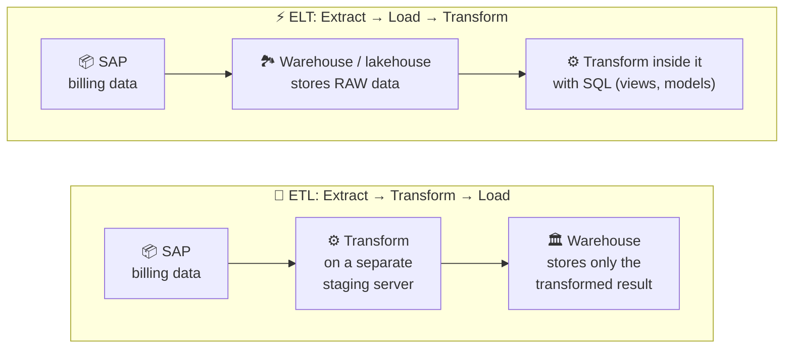
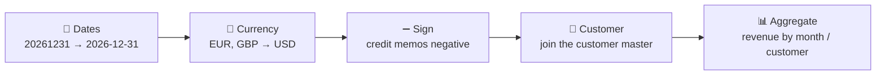
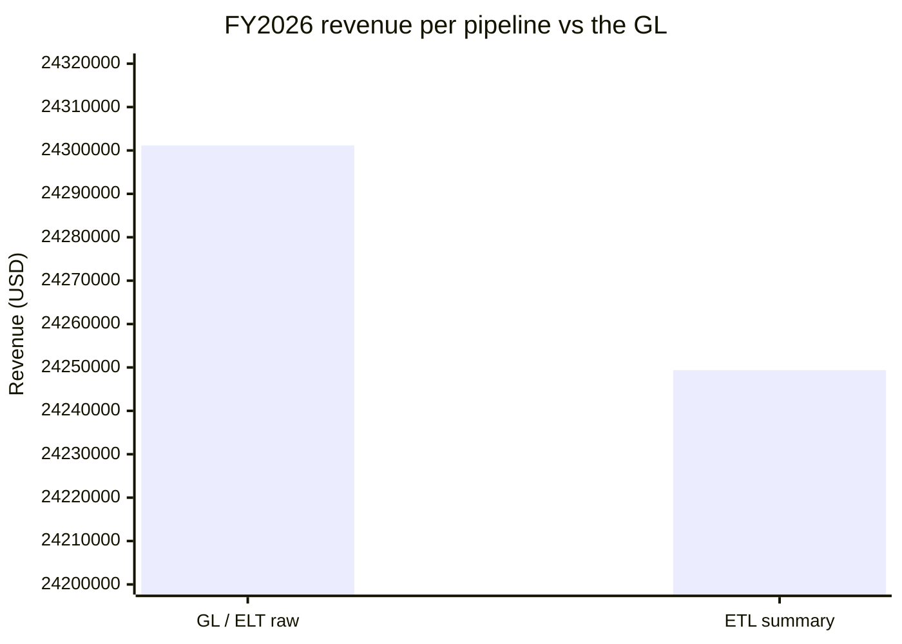
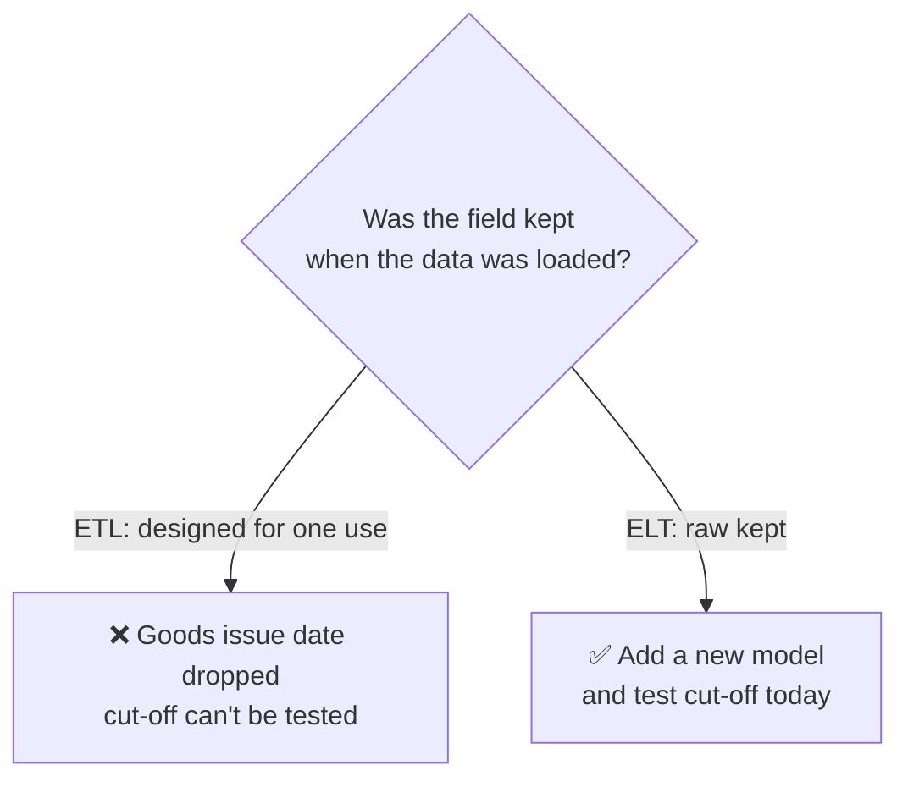
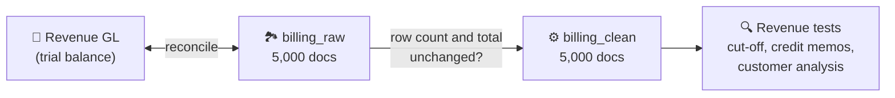
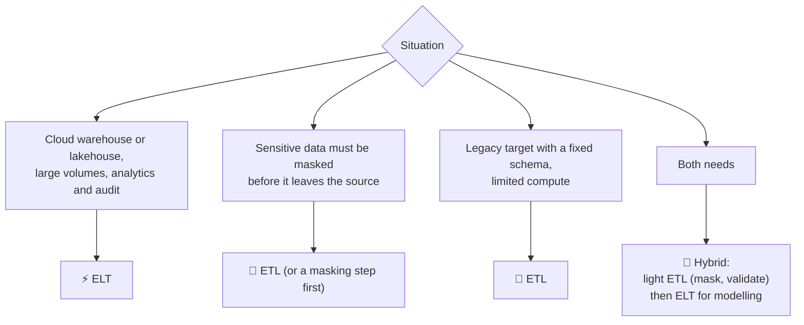

<div align="center">

# 🔄 ETL vs ELT
### A data engineering guide using revenue data in a financial statement audit

</div>

## 💡 Why this matters

Revenue is usually a **presumed fraud risk** in an audit, and almost every revenue test depends on data that has passed through a pipeline: SAP billing documents, deliveries, credit memos, FX rates. **When** that data is transformed, before or after it's loaded, decides whether the auditor can still see the **raw detail**: the goods issue date for cut-off, the credit memo, the line with a missing customer.

## 1. The two patterns



| | 🔧 ETL | ⚡ ELT |
| --- | --- | --- |
| Where the transform runs | A separate staging or processing server | Inside the target warehouse or lakehouse |
| What's stored in the target | Transformed data only | **Raw data** + transformed models |
| Business rules | Designed **upfront**, before loading | Can be added or changed **later** |
| Data types | Best for structured data | Any: structured, semi-structured, unstructured |
| Speed and scale | Extra hop; harder to scale with volume | Loads fast; uses the warehouse's parallel compute |
| Re-processing | Must re-extract from the source | Re-run the SQL on the stored raw data |
| Sensitive data | Can be **masked before** it reaches the target | Lands raw first; protect it with access controls |
| History | Since the 1970s, on-premise warehouses | Widespread since around 2010 with cloud warehouses |
| Typical tools | Informatica, SSIS, AWS Glue jobs, Talend | dbt, Snowflake, BigQuery, Redshift, Databricks SQL |

## 2. The revenue data

SAP Sales & Distribution billing data, simplified:

| Field | SAP name | Meaning |
| --- | --- | --- |
| Billing document | `VBELN` | Invoice or credit memo number |
| Billing type | `FKART` | `F2` = invoice, `G2` = credit memo |
| Billing date | `FKDAT` | When revenue was invoiced (format `YYYYMMDD`) |
| Goods issue date | `WADAT_IST` | When goods actually left the warehouse |
| Customer | `KUNAG` | Sold-to party |
| Currency / net value | `WAERK` / `NETWR` | Document currency and amount |

```text
VBELN,FKART,FKDAT,KUNAG,WAERK,NETWR,WADAT_IST
900000001,F2,20260912,C0193,USD,4681.9,20260912
900000002,F2,20261010,C0001,EUR,4128.01,20261009
```

**Transforms needed for revenue analytics:**



## 3. Worked example: the same data, two pipelines

A simulated year of **5,000 billing documents** (FY2026), including:
- 325 credit memos
- 9 documents with **no customer** recorded
- 12 invoices **billed on 29–31 December whose goods left in January 2027**

### 🔧 The ETL pipeline (built for a sales dashboard)

```python
import numpy as np

fx = {"USD": 1.00, "EUR": 1.08, "GBP": 1.27}

e = billing[billing["KUNAG"] != ""].copy()                       # rule: drop lines without a customer
e["AMOUNT_USD"] = (e["NETWR"] * e["WAERK"].map(fx)
                   * np.where(e["FKART"] == "G2", -1, 1)).round(2)
e["MONTH"] = e["FKDAT"].dt.to_period("M").astype(str)

revenue_by_month_customer = (e.groupby(["MONTH", "KUNAG"], as_index=False)["AMOUNT_USD"].sum())
revenue_by_month_customer.to_sql("rev_by_month_customer", warehouse)    # only the summary is loaded
```

The warehouse receives **2,107 summary rows**. The document numbers, goods issue dates and dropped lines **never arrive**.

### ⚡ The ELT pipeline (raw first, transform in SQL)

```sql
-- 1. LOAD: raw billing lines land unchanged
COPY billing_raw FROM 's3://audit/raw/sap/vbrk_vbrp_fy2026.csv' ... ;

-- 2. TRANSFORM: a model (view) built on top of the raw table
CREATE VIEW billing_clean AS
SELECT b.vbeln, b.fkart, b.kunag,
       TO_DATE(b.fkdat, 'YYYYMMDD')      AS billing_date,
       TO_DATE(b.wadat_ist, 'YYYYMMDD')  AS goods_issue_date,
       ROUND(b.netwr * f.rate * CASE WHEN b.fkart = 'G2' THEN -1 ELSE 1 END, 2) AS amount_usd
FROM billing_raw b
JOIN fx_rates f ON f.waerk = b.waerk;
```

*(Snowflake/Redshift-style SQL. The figures below come from running the equivalent logic.)*

### What the auditor can and can't see

| Question | 🔧 ETL summary table | ⚡ ELT (raw + model) |
| --- | --- | --- |
| Total FY2026 revenue | **24,249,382.13** | **24,301,165.68** |
| Agrees to the revenue GL? | ❌ Short by **51,783.55** | ✅ Complete population |
| Why the gap? | 9 lines without a customer were **silently dropped** by a business rule | Visible and testable |
| Credit memos | Netted inside monthly totals | 325 documents, −1,669,580.11 |
| Cut-off: billed in 2026, shipped in 2027 | ❌ **Impossible**: goods issue date never loaded | ✅ **12 invoices, 785,018.53** |
| Drill to the invoice | ❌ Summary only | ✅ Document level |



```sql
-- Cut-off test on the ELT model: invoiced before year end, goods issued after
SELECT vbeln, kunag, billing_date, goods_issue_date, amount_usd
FROM billing_clean
WHERE billing_date <= DATE '2026-12-31'
  AND goods_issue_date > DATE '2026-12-31'
ORDER BY amount_usd DESC;          -- 12 invoices, 785,018.53
```

**Audit meaning:** under IFRS 15 / ASC 606, revenue is recognised when **control transfers**. If control passes on shipment, these 12 invoices (785k) may be **revenue recorded in the wrong year**. The ETL pipeline was perfectly fine for a sales dashboard, but its upfront design **removed exactly the fields the audit needed**.



## 4. Audit considerations for each pattern

| Topic | 🔧 ETL | ⚡ ELT |
| --- | --- | --- |
| Completeness | Filters and business rules can silently drop rows: ask for **rejected-record logs** | Raw table available: reconcile **raw → model → GL** |
| Accuracy | Transform logic hidden in a tool: review the mapping documents | Transform logic in **version-controlled SQL** (e.g. dbt): read it and re-perform it |
| Re-performance | Needs a new extract from SAP | Re-run the model on the same raw data |
| New audit questions | Require pipeline changes | Write a new query or model |
| Data privacy | Mask customer PII **before** loading | Raw PII lands in the warehouse: restrict access (column or row level) |
| Information produced by the entity | Test the ETL controls and the mapping | Test the raw extract **and** the SQL models |

### Reconciliation chain for revenue (ELT)



```sql
-- Prove the transform didn't lose or change anything
SELECT 'raw'   AS layer, COUNT(*) AS docs FROM billing_raw
UNION ALL
SELECT 'clean' AS layer, COUNT(*) AS docs FROM billing_clean;
```

## 5. Which to choose?



In practice, most modern stacks are **hybrid**: extract and land the raw data (with masking where required), then transform inside the warehouse.

## 6. Interview key takeaways

1. **ETL** transforms **before** loading, on a separate engine; **ELT** loads raw data **first** and transforms **inside** the target.
2. **ELT** became the default with cloud warehouses: cheap storage, elastic compute, and the raw data kept for re-processing.
3. **ETL** still fits when data must be **masked or cleansed before** reaching the target, when the target is legacy, or when the schema is fixed.
4. **Keep raw data immutable.** It's your safety net for new questions, bug fixes and audits.
5. **Transform logic as code:** version-controlled SQL models (e.g. dbt) with tests make pipelines reviewable and reproducible.
6. **Data quality checks at every layer:** row counts, control totals, nulls, duplicates, referential integrity. Never drop rows silently; log rejects.
7. **Idempotency:** re-running a pipeline for the same period must give the same result, not duplicates.
8. **Incremental loads:** use watermarks (e.g. a change date) or change data capture (CDC) instead of full reloads, but **reconcile** them to the source.

| Quick question | Strong answer |
| --- | --- |
| ETL vs ELT in one sentence? | ETL transforms in transit before loading; ELT loads raw and transforms in the destination |
| Why is ELT popular now? | Cloud warehouses separate storage and compute, so loading raw data is cheap and transforms scale |
| When would you still use ETL? | PII masking before load, legacy targets, strict fixed schemas, or limited target compute |
| How do you make sure no rows are lost? | Reconcile row counts and control totals between source, raw and modelled layers; log rejected records |
| What is dbt? | A tool for writing SQL transformations as version-controlled, tested models: the "T" in ELT |
| What is idempotency? | Running the same job twice produces the same result, e.g. by using `MERGE` or partition overwrite instead of blind `INSERT` |
| What is CDC? | Change data capture: loading only inserts, updates and deletes since the last run, often read from database logs |
