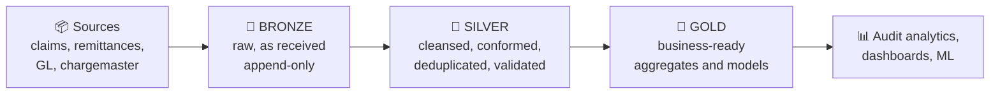
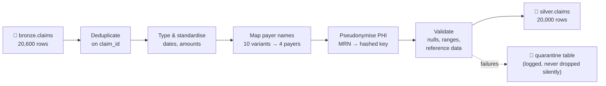
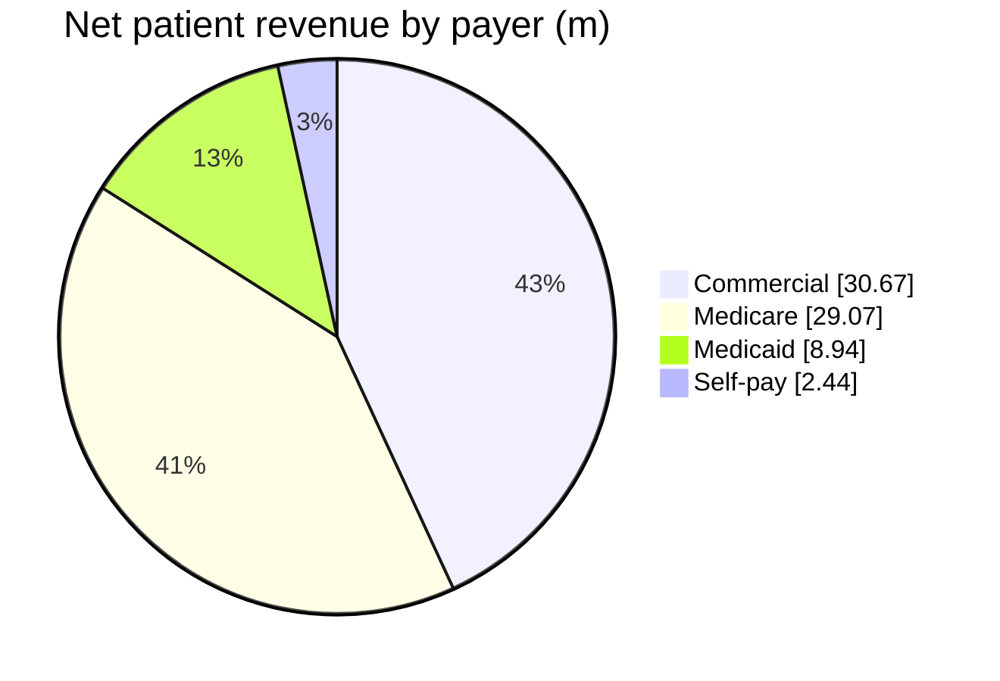
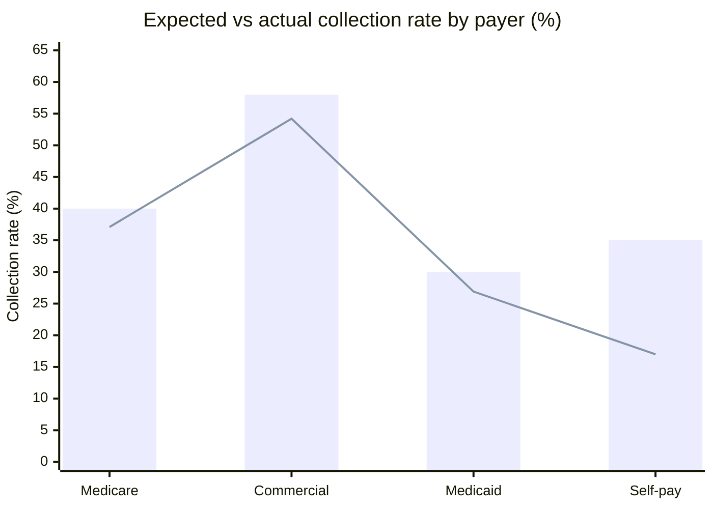
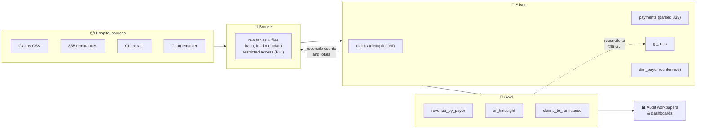

<div align="center">

# 🥉🥈🥇 Medallion Architecture
### A data engineering guide with healthcare financial statement audit examples

</div>

## 💡 Why this matters

A hospital audit pulls data from many messy sources: claims from the billing system, payer remittances, the general ledger, the chargemaster, payer contracts. The **medallion architecture** is a simple pattern for turning that mess into trusted, audit-ready tables **step by step**, without ever losing the original evidence. Each step is traceable, so every number in the audit file can be followed back to the file the client sent.

## 1. What it is

The medallion architecture is a **data design pattern for organising data in a lakehouse** into layers of increasing quality. It's also called a **multi-hop** architecture.



| Layer | Also called | Purpose | Typical content | Who uses it |
| --- | --- | --- | --- | --- |
| 🥉 **Bronze** | Raw | Land everything **exactly as it arrives**; no changes | Source files and tables + load metadata (load time, file name, batch ID) | Data engineers |
| 🥈 **Silver** | Enriched, cleansed | Fix errors, standardise formats, remove duplicates, conform entities | One clean table per business entity: claims, payments, patients | Data engineers, data scientists, analysts |
| 🥇 **Gold** | Curated | Organise for reports, dashboards and ML | Aggregates and star schemas: revenue by payer, AR aging | Analysts, auditors, management |

**Key properties:**
- **Bronze is the historical archive:** downstream tables can be **rebuilt from bronze** without going back to the source system.
- **Incremental processing:** each hop processes only new or changed data.
- **Table formats with ACID and time travel** (Delta Lake, Apache Iceberg) underpin the silver and gold layers.
- Medallion is a **pattern, not a strict rule.** Some teams add layers (e.g. a "platinum" layer, or a separate sandbox), or keep each layer in its own lakehouse or workspace for tighter governance.

## 2. The healthcare audit scenario

**A hospital's FY2026 audit.** The key areas are **net patient service revenue** and **patient accounts receivable**. Under ASC 606, revenue is recorded at the amount the hospital expects to collect, net of contractual adjustments and implicit price concessions. That's an **estimate**, and the auditor needs data to test it.

| Source | Format | What it holds |
| --- | --- | --- |
| Billing system claims extract | CSV | Claim ID, patient MRN, payer, discharge date, gross charges |
| Payer remittances (ERA, X12 835) | EDI text files | Payments, contractual adjustments, denial codes |
| General ledger | SAP / ERP extract | Revenue and AR balances |
| Chargemaster | Excel | Standard price list per service code |
| Payer contracts | PDF | Agreed rates and terms |

## 3. Layer by layer

### 🥉 Bronze: keep the evidence exactly as received

```text
s3://hospital-audit/bronze/
├── claims/load_date=2027-01-15/claims_fy2026.csv          # unchanged
├── remittance_835/load_date=2027-01-15/*.edi
├── gl/load_date=2027-01-15/acdoca_fy2026.csv
├── chargemaster/cdm_2026.xlsx
└── contracts/payer_contracts_2026/*.pdf
```

```sql
-- Bronze table: source columns as strings + load metadata, append-only
CREATE TABLE bronze.claims (
    claim_id    STRING, mrn STRING, payer_raw STRING,
    discharge   STRING, gross_charges STRING,
    _source_file STRING, _loaded_at TIMESTAMP, _batch_id STRING
);
```

| Bronze rule | Audit reason |
| --- | --- |
| Never modify or delete | It's the **evidence as received** |
| Keep every column, even unused ones | Future audit questions (e.g. cut-off) may need them |
| Add load metadata | Lineage: which file, when, which batch |
| Store a file hash | Proves the file hasn't changed since receipt |
| Lock down access | It contains **PHI** (protected health information) in its raw form |

**In the simulation:** bronze holds **20,600 claim rows**, including **600 resubmitted (duplicate) claims**, with the payer written **10 different ways** (`MEDICARE`, `Medicare Part A`, `BCBS`, `Blue Cross` …).

### 🥈 Silver: clean, conform and protect



```python
silver = bronze.drop_duplicates("claim_id")                               # resubmissions removed
silver["payer"] = silver["payer_raw"].str.strip().str.upper().map(payer_map)   # 'BCBS' → 'Commercial'
silver["patient_key"] = silver["mrn"].map(lambda m: sha256((salt + m).encode()).hexdigest()[:12])
silver = silver.drop(columns="mrn")                                        # raw MRN stays only in bronze
```

| Measure | Bronze | Silver | Difference |
| --- | --- | --- | --- |
| Claim rows | 20,600 | **20,000** | 600 duplicates removed |
| Gross charges | 182,675,520 | **177,750,242** | **4,925,278** of double-counted charges |
| Payer values | 10 variants | **4** standard payers | Conformed |
| Patient identifier | MRN (PHI) | Hashed key | Pseudonymised |

**Audit meaning:** if analytics had been run on bronze, gross charges would have been **overstated by 4.9m**. Silver is where **completeness and accuracy** are established, and the bronze → silver reconciliation **documents exactly what changed and why**.

> **PHI handling:** HIPAA protects patient data. Hashing the MRN *pseudonymises* it. That's useful for analytics, but it isn't automatically "de-identified" under HIPAA. Keep access to bronze restricted, and share only what each layer's users need.

### 🥇 Gold: audit-ready answers

Gold tables are built for **specific questions**, often as star schemas or purpose-built aggregates.

**Gold table 1: net patient revenue by payer (reconciled to the GL)**

| Payer | Claims | Net revenue (m) |
| --- | --- | --- |
| Medicare | 8,495 | 29.07 |
| Commercial | 6,330 | 30.67 |
| Medicaid | 3,598 | 8.94 |
| Self-pay | 1,577 | 2.44 |
| **Total** | **20,000** | **71.12** |



**Gold table 2: hindsight (look-back) analysis of patient AR**

The hospital values year-end AR using **expected collection rates per payer**. The auditor compares those rates with **actual cash collected after year end** on the same claims:

| Payer | Gross AR at year end | Hospital's expected collection | Actual (hindsight) | Hospital net AR | Hindsight net AR | Possible overstatement |
| --- | --- | --- | --- | --- | --- | --- |
| Medicare | 20,242,224 | 40.0% | 37.1% | 8,096,890 | 7,509,865 | 587,025 |
| Commercial | 13,663,705 | 58.0% | 54.2% | 7,924,949 | 7,405,728 | 519,221 |
| Medicaid | 7,848,798 | 30.0% | 26.9% | 2,354,639 | 2,111,327 | 243,312 |
| **Self-pay** | 3,573,771 | **35.0%** | **17.0%** | 1,250,820 | 607,541 | **643,279** |
| **Total** | **45,328,498** | | | **19,627,298** | **17,634,461** | **1,992,837** |



*(Bars: the hospital's assumption. Line: actual collections after year end.)*

**Reading it:** every payer collected less than assumed, but **self-pay** stands out: half the assumed rate. Net AR may be **overstated by about 2.0m**, with a third of that from self-pay alone. That's a matter to discuss with management, and a potential misstatement in the **implicit price concession / allowance estimate**.

**Other gold tables an audit team would build:**

| Gold table | Audit use |
| --- | --- |
| `ar_aging_by_payer` | Valuation of receivables; days in AR trend |
| `claims_to_remittance_match` | Completeness of cash; unmatched payments; denial rates |
| `revenue_cutoff` | Discharges around year end vs revenue period |
| `charges_vs_chargemaster` | Prices billed vs the standard price list |
| `third_party_settlements` | Medicare/Medicaid cost report estimates |

## 4. The full picture



### Quality checks at each hop

| Hop | Check | Example result |
| --- | --- | --- |
| Source → bronze | File count, row count, hash | 20,600 rows received = 20,600 loaded |
| Bronze → silver | Duplicates, nulls, invalid dates, unmapped payers | 600 duplicates removed; 0 unmapped payers |
| Silver → gold | Totals tie back to silver; gold revenue = GL revenue | Differences explained or escalated |

## 5. Benefits and pitfalls

| ✅ Benefits | ⚠️ Pitfalls |
| --- | --- |
| Raw evidence preserved: **re-perform** at any time | Copying data three times: storage and pipeline cost |
| Clear lineage from report back to source file | Too many layers or "silver-ish" tables: unclear ownership |
| Quality improves at each hop, and checks sit at each hop | Silently dropping bad rows instead of quarantining them |
| Different access per layer (PHI only in bronze) | Business logic scattered across silver and gold |
| Incremental processing scales to large volumes | Gold built for one report can't answer the next question |

## 6. Interview key takeaways

1. **Medallion = bronze (raw) → silver (cleansed, conformed) → gold (business-ready)**, a multi-hop design pattern for lakehouses.
2. **Bronze is immutable and append-only**, with load metadata. It enables replay, rebuilding downstream tables, and lineage.
3. **Silver** handles deduplication, typing, standardisation, conforming entities (e.g. one payer list) and data quality rules. Bad rows go to **quarantine**, not the bin.
4. **Gold** is modelled for consumption: star schemas, aggregates and feature tables, designed per use case.
5. **ACID table formats** (Delta Lake, Iceberg) enable reliable upserts (`MERGE`), schema enforcement and time travel across layers.
6. **Incremental loads** use watermarks or change data capture, with **idempotent** writes so re-runs don't duplicate data.
7. **Governance by layer:** restrict raw sensitive data (PHI, PII), and pseudonymise or mask it at silver.
8. It's a **pattern, not a product.** Adapt the number of layers and the rules to the organisation.

| Quick question | Strong answer |
| --- | --- |
| Why keep a bronze layer if silver is cleaner? | Replay and rebuild without re-extracting from source, full lineage, and evidence of what was received |
| Where do you deduplicate? | Usually bronze → silver, using business keys and `MERGE` for idempotency |
| How is gold different from silver? | Silver = clean entity tables (claims, payments); gold = business-ready, aggregated or dimensional tables for specific uses |
| How do you handle bad records? | Validate at silver, route failures to a quarantine table with the reason, and monitor counts |
| How does medallion relate to ELT? | It's typically ELT: load raw into bronze, then transform inside the lakehouse through silver and gold |
| How do you protect sensitive data? | Restrict bronze, mask or pseudonymise at silver, apply column- and row-level access controls, and expose only the gold data each user needs |
