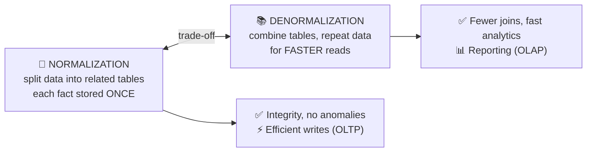
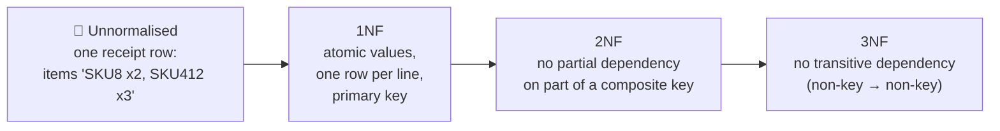
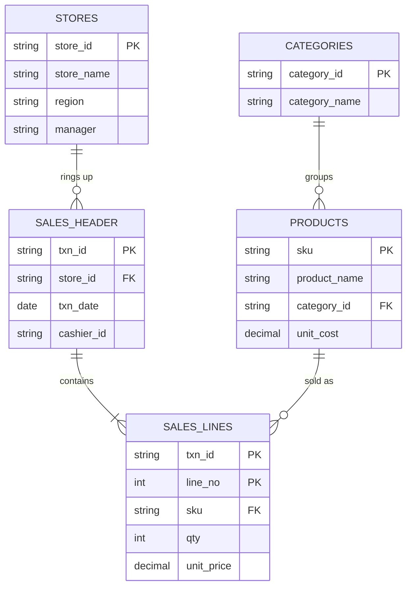
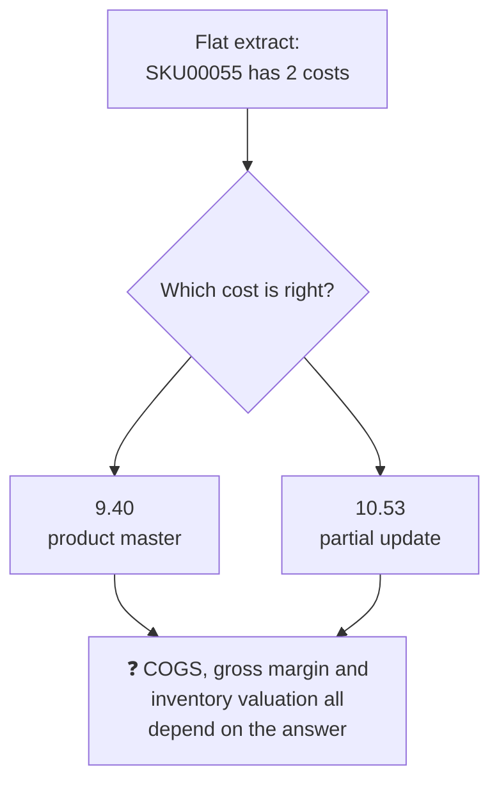
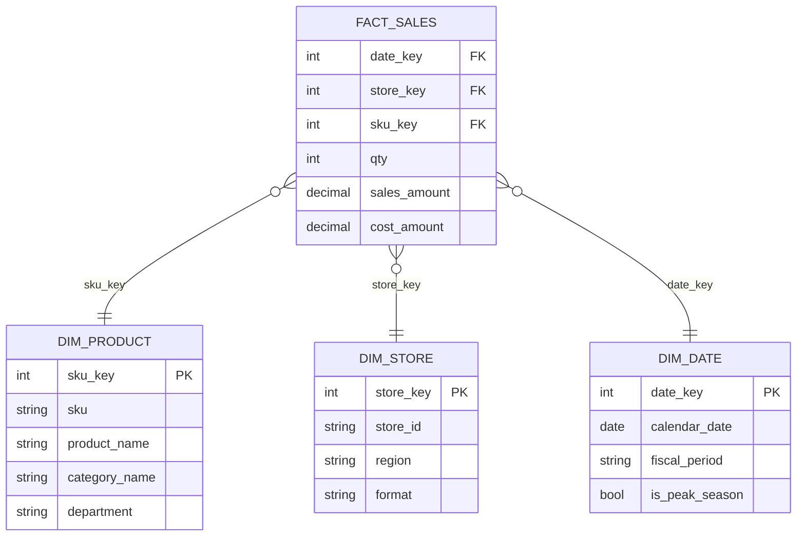
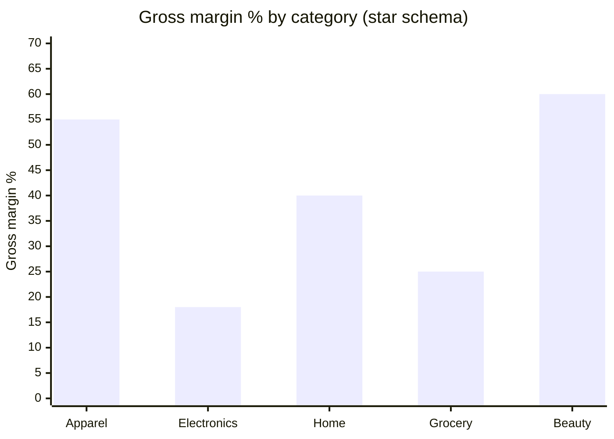
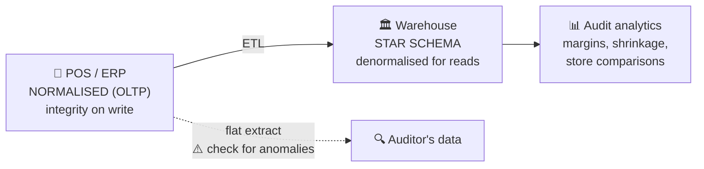

<div align="center">

# 🧩 Data Normalization & Denormalization
### A data engineering guide with retail financial statement audit examples

</div>

## 💡 Why this matters

A retailer's audit is built on high-volume data: point-of-sale (POS) transactions, product master, store master, inventory and costs. How that data is **structured** decides two things:

- **Can it be trusted?** Normalised data has one version of each fact.
- **Can it be analysed quickly?** Denormalised data is fast to query.

Auditors receive both kinds, often a giant flat POS extract, and need to know the risks of each.

## 1. The two ideas



| | 🧩 Normalization | 📚 Denormalization |
| --- | --- | --- |
| Goal | Remove redundancy and inconsistent dependencies | Speed up reads by reducing joins |
| Structure | Many narrow tables linked by keys | Fewer, wider tables |
| Each fact stored | **Once** | Possibly **many times** |
| Writes and updates | Simple and safe | Must update every copy |
| Reads and analytics | More joins | Fewer joins, faster |
| Typical home | OLTP: POS system, ERP | OLAP: data warehouse, BI models |
| Main risk | Slow, complex analytical queries | **Update anomalies**, inconsistent copies, larger storage |

**A practical rule:** normalise first, typically to **third normal form (3NF)**, which is enough for most applications. Then **denormalise deliberately** where read performance needs it, and manage the redundancy you've introduced.

## 2. Why redundancy is dangerous: the three anomalies

Imagine one flat POS table where every sale line repeats the store and product details:

| txn_id | store_id | store_region | sku | product_name | category | unit_cost | qty |
| --- | --- | --- | --- | --- | --- | --- | --- |
| T0057955 | S020 | South | SKU00008 | Product 8 | Electronics | 25.27 | 2 |
| T0010371 | S021 | North | SKU00008 | Product 8 | **Home** ⚠️ | 25.27 | 1 |
| T0071269 | S047 | West | SKU00055 | Product 55 | Apparel | **9.40** | 2 |
| T0036316 | S001 | West | SKU00055 | Product 55 | Apparel | **10.53** ⚠️ | 1 |

| Anomaly | What goes wrong | Retail audit example |
| --- | --- | --- |
| **Update** | A change must be made in every copy; miss one and the copies disagree | SKU00055's cost updated in some rows, not others: **which cost is right for COGS?** |
| **Insert** | You can't record a fact without an unrelated one | A new store can't be recorded until it makes its first sale |
| **Delete** | Deleting one fact deletes another | Deleting a closed store's last sale loses its region and manager |

## 3. Normal forms with a POS receipt



| Normal form | Rule | POS example: what moves out |
| --- | --- | --- |
| **1NF** | Atomic values; no repeating groups; a primary key | "SKU8 x2, SKU412 x3" in one cell → **one row per receipt line**, key = (txn_id, line_no) |
| **2NF** | 1NF + every non-key column depends on the **whole** key | `product_name` depends only on `sku`, not on (txn_id, line_no) → **products** table. `store_id` and `txn_date` depend only on `txn_id` → **sales_header** |
| **3NF** | 2NF + no non-key column depends on another non-key column | `store_region` depends on `store_id` → **stores** table. `category_name` depends on `category_id` → **categories** |
| BCNF | Every determinant is a candidate key | A stricter 3NF; matters for unusual overlapping keys |

### The normalised (3NF) retail model



Each fact now lives in **exactly one place**: a product's cost and category in `products`, a store's region in `stores`.

## 4. Audit example: a flat POS extract vs a normalised model

**Simulation:** a retailer with 50 stores, 1,000 SKUs and **200,000 sale lines**. The client sends one **flat extract** (12 columns, every line repeating store and product details). Over the year, cost and category updates were applied **inconsistently** to some rows.

```python
cost_versions = flat.groupby("sku")["unit_cost"].nunique()
cat_versions  = flat.groupby("sku")["category"].nunique()
print((cost_versions > 1).sum(), (cat_versions > 1).sum())     # 15 SKUs with 2 costs, 1 SKU in 2 categories
```

| Finding in the flat extract | Result |
| --- | --- |
| SKUs with **more than one unit cost** | **15** (959 lines affected) |
| SKUs in **more than one category** | **1** (127 lines: Electronics vs Home) |
| Store region repeated | 200,000 times, for only 50 stores |
| File size | 17.5 MB flat vs **7.2 MB** normalised (3 tables) |

**Impact on the numbers an auditor tests:**

| Measure | Flat extract | Normalised (product master) | Difference |
| --- | --- | --- | --- |
| Cost of goods sold | 7,966,884.00 | 7,958,819.29 | **+8,064.71** |
| Electronics revenue | 2,919,874 | 2,929,705 | −9,831 (shifted into Home) |
| Home revenue | 2,404,825 | 2,394,993 | +9,831 |



**Audit meaning:** the differences here are small, but the **issue** isn't. When the same product has two costs, COGS, gross margin by category and **inventory valuation** can't be relied on until the auditor knows which one is authoritative. Before testing, check every attribute that should be constant per key:

```sql
-- One cost and one category per SKU? (a functional dependency check)
SELECT sku,
       COUNT(DISTINCT unit_cost) AS cost_versions,
       COUNT(DISTINCT category)  AS category_versions
FROM pos_flat
GROUP BY sku
HAVING COUNT(DISTINCT unit_cost) > 1 OR COUNT(DISTINCT category) > 1;
```

## 5. Denormalization done right: the star schema

For **analytics**, the normalised model needs many joins (lines → header → store; lines → product → category). A **star schema** denormalises **on purpose**, in a controlled way:

- **Fact table:** events at a consistent grain, with keys and numeric measures (one row per sale line).
- **Dimension tables:** descriptive context, **flattened** (category folded into the product dimension; region in the store dimension).



| Normalised (3NF) | Snowflake schema | Star schema |
| --- | --- | --- |
| products → categories, lines → header → stores | Dimensions still split into sub-tables | Dimensions flattened into one table each |
| Best for **recording** sales | In between | Best for **analysing** sales |

**Gross margin by category from the star schema: one join**

```sql
SELECT p.category_name,
       SUM(f.sales_amount)                                     AS revenue,
       ROUND(100 * (1 - SUM(f.cost_amount) / SUM(f.sales_amount)), 1) AS gross_margin_pct
FROM fact_sales f
JOIN dim_product p ON p.sku_key = f.sku_key
GROUP BY p.category_name
ORDER BY revenue DESC;
```

| Category | Revenue | Gross margin |
| --- | --- | --- |
| Apparel | 3,069,016 | 55.0% |
| Electronics | 2,929,705 | 18.0% |
| Home | 2,394,993 | 40.0% |
| Grocery | 2,391,849 | 25.0% |
| Beauty | 2,361,525 | 60.0% |



**Why this is safe denormalization:** the dimensions are **built from the normalised master data** by a controlled pipeline, so the repeated category name is **consistent by construction**. The flat extract in section 4 was redundancy **without** that control.

### Other denormalization techniques in retail analytics

| Technique | Example | Watch out for |
| --- | --- | --- |
| Flattened dimensions | Category and department in `dim_product` | Rebuild dimensions when the master changes |
| Pre-aggregated tables | `daily_sales_by_store` for dashboards | Must reconcile to the detail and the GL |
| Derived columns | `gross_margin` stored on the fact | Recompute if cost restatements happen |
| Snapshot facts | Month-end inventory by SKU and store | Consistent snapshot timing |
| Slowly changing dimensions (Type 2) | Keep the category a SKU had **at the time of sale** | Join on validity dates correctly |

## 6. Where each fits in a retail audit



| Audit task | Best structure | Why |
| --- | --- | --- |
| Testing the master data (one cost per SKU) | Normalised | One authoritative value per key |
| Gross margin by category or store | Star schema | Fast aggregation, simple joins |
| Inventory valuation and costing | Normalised master + snapshot fact | Authoritative cost, consistent timing |
| Store-level analytical procedures | Star or pre-aggregated table | Speed, reconciled to the detail |
| Receiving a flat client extract | Treat as **denormalised**: test functional dependencies first | Hidden update anomalies |

## 7. Interview key takeaways

1. **Normalization** organises data to **remove redundancy and inconsistent dependencies**: each fact stored once. It prevents **update, insert and delete anomalies**.
2. **Know the normal forms:** 1NF (atomic, no repeating groups, a key), 2NF (no partial dependency on a composite key), 3NF (no transitive dependency). BCNF is a stricter 3NF.
3. **3NF is usually enough** for transactional systems; higher forms are rarely needed in practice.
4. **Denormalization** deliberately adds redundancy to **speed up reads**. It's standard in warehouses (star schemas) and BI models.
5. **Star vs snowflake:** a star flattens each dimension into one table (fewer joins, simpler); a snowflake keeps dimensions normalised.
6. **Facts vs dimensions:** facts are events with numeric measures at a consistent grain; dimensions are the descriptive context used to filter and group.
7. **Controlled redundancy:** build denormalised tables from authoritative normalised sources through pipelines, and reconcile aggregates back to the detail.
8. **Spot denormalised source data:** test functional dependencies (`COUNT(DISTINCT attribute) per key`) before trusting a flat extract.

| Quick question | Strong answer |
| --- | --- |
| What is normalization and why do it? | Structuring tables to eliminate redundancy and inconsistent dependencies, so each fact has one source and anomalies are avoided |
| Explain 2NF vs 3NF | 2NF removes columns that depend on only part of a composite key; 3NF removes columns that depend on other non-key columns |
| Why denormalize a data warehouse? | Analytical queries read far more than they write; fewer joins means faster, simpler queries |
| What's an update anomaly? | The same fact stored in several places gets changed in some but not others, leaving inconsistent data |
| Star vs snowflake schema? | Star: flattened dimensions, fewer joins. Snowflake: normalised dimensions, less redundancy but more joins |
| How do you keep denormalized data consistent? | Generate it from normalised masters via pipelines, use surrogate keys and SCDs, and reconcile totals |
