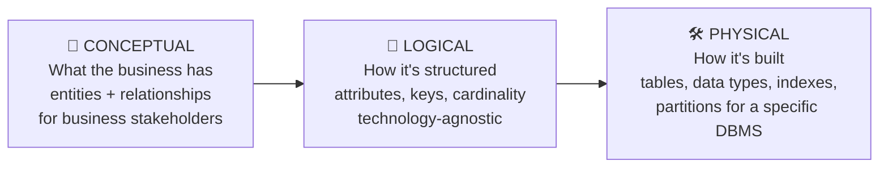
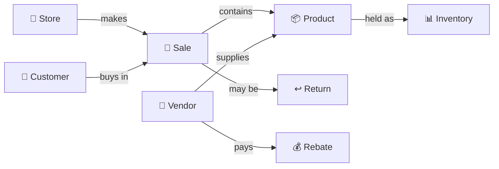
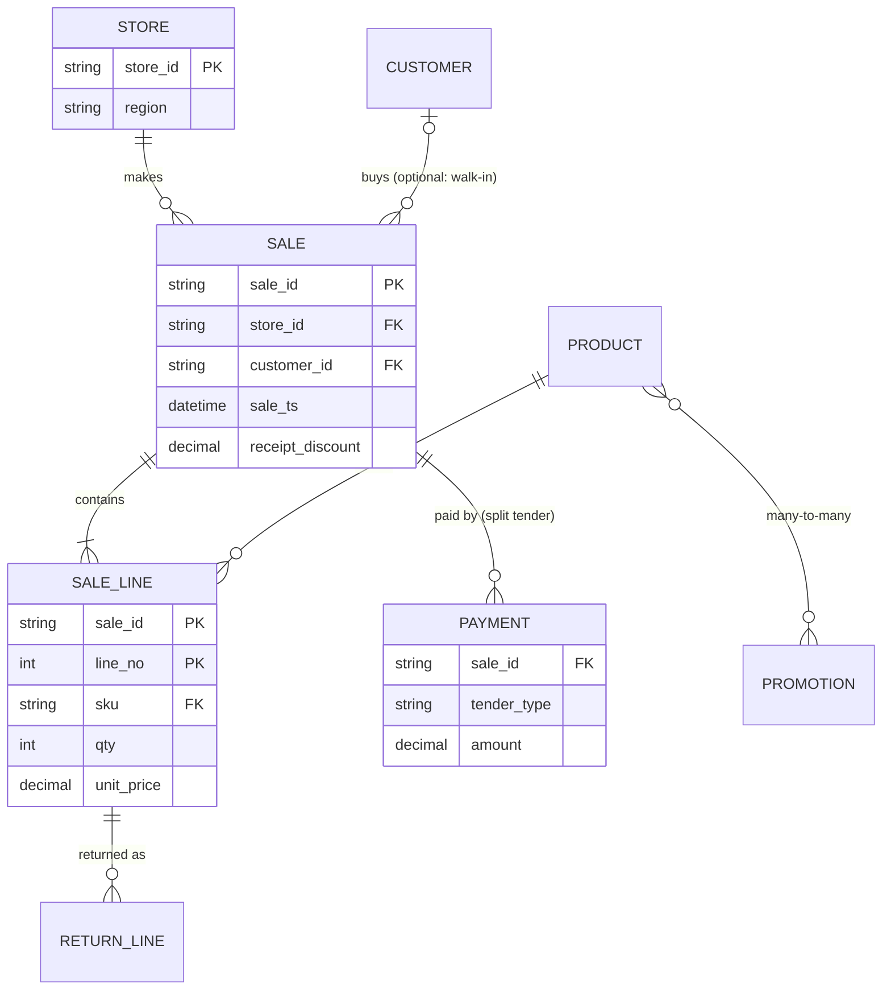
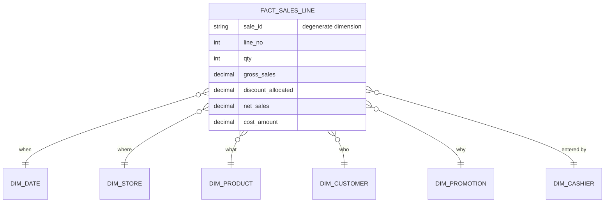
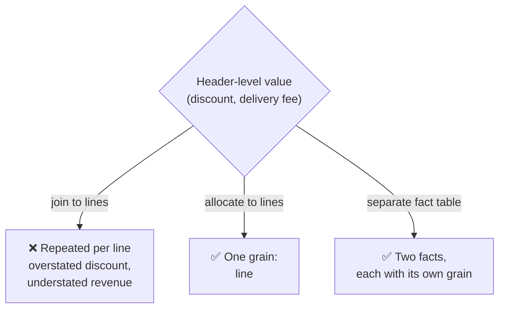
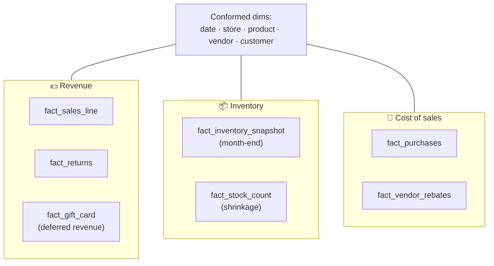

<div align="center">

# 📐 Data Modelling
### A data engineering guide with retail financial statement audit examples

</div>

## 💡 Why this matters

A **data model** is the blueprint of how data is organised: what the business entities are, how they relate, and how they're stored. For an auditor in retail, models matter twice over:

- **Reading the client's model:** understanding how the POS, ERP and inventory systems store sales, returns and stock, to know **what an extract really contains**.
- **Building an audit model:** structuring client data so revenue, inventory and margin tests are **correct, repeatable and fast**.

A wrong model gives wrong numbers. Count a discount once per line instead of once per receipt, and revenue is misstated before any testing starts.

## 1. Three levels of data model



| Level | Audience | Contains | Retail example |
| --- | --- | --- | --- |
| **Conceptual** | Business, auditors, analysts | Main entities and relationships, business rules | "A store makes sales; a sale contains products; customers can return products" |
| **Logical** | Data architects, analysts | Attributes, primary and foreign keys, cardinality, normalisation | `SALE_LINE(sale_id, line_no, sku, qty, unit_price)` |
| **Physical** | Data engineers, DBAs | Data types, indexes, partitions, constraints for one DBMS | `DECIMAL(15,2)`, partitioned by `sale_date`, clustered by `store_id` |

### Conceptual: retail revenue and inventory



### Logical: keys and cardinality



| Cardinality | Retail example | How it's modelled |
| --- | --- | --- |
| **One-to-one** | Store ↔ store lease contract | One table, or two tables sharing a key |
| **One-to-many** | Sale → sale lines | Foreign key on the "many" side |
| **Many-to-many** | Products ↔ promotions | **Bridge table** `product_promotion(sku, promo_id)` |
| **Optional** | Sale → customer (walk-ins have none) | Nullable foreign key, or an "Unknown customer" row |

### Physical: built for one platform

```sql
CREATE TABLE sale_line (
    sale_id     VARCHAR(20)   NOT NULL,
    line_no     SMALLINT      NOT NULL,
    sku         VARCHAR(12)   NOT NULL,    -- text: keeps leading zeros
    qty         INT           NOT NULL,
    unit_price  DECIMAL(15,2) NOT NULL,    -- exact money type
    sale_date   DATE          NOT NULL,
    PRIMARY KEY (sale_id, line_no),
    FOREIGN KEY (sku) REFERENCES product (sku)
);
CREATE INDEX ix_sale_line_date ON sale_line (sale_date);   -- year-end cut-off queries
```

## 2. Modelling techniques

| Technique | Idea | Best for | Retail audit fit |
| --- | --- | --- | --- |
| **Relational / ER (3NF)** | Normalised tables linked by keys | Transactional systems (OLTP) | Understanding the POS / ERP source |
| **Dimensional (Kimball)** | Facts + dimensions, star schema | Analytics and BI | Revenue, margin and inventory analytics |
| **Data Vault** | Hubs (keys), links (relationships), satellites (history) | Auditable enterprise integration of many sources | Full history and lineage across systems |
| **One Big Table (OBT)** | A single wide, denormalised table | Simple, fast dashboards | Quick views; risky as the "source of truth" |
| **Hierarchical / document** | Nested parent-child records (JSON) | APIs, e-commerce orders | Raw online order data before flattening |

## 3. Dimensional modelling: the four steps


Applied to **retail sales for a revenue audit**:

| Step | Decision | Retail audit answer |
| --- | --- | --- |
| 1. Business process | Which activity generates the data? | **POS sales** (separately: returns, inventory, vendor rebates) |
| 2. Grain | What exactly is **one row**? | **One row per receipt line**: the atomic, lowest level |
| 3. Dimensions | Who, what, where, when, how? | Date, store, product, customer, promotion, cashier, tender |
| 4. Facts | What is measured? | Quantity, gross sales, discount, net sales, cost |

**Declaring the grain is the pivotal step:** it's a binding contract on the design. Start at the **atomic grain**, because it can answer questions nobody has asked yet, including the auditor's.



`sale_id` is a **degenerate dimension**: a key with no table of its own, kept on the fact so the auditor can **drill back to the receipt**.

### Three types of fact table

| Fact type | Grain | Retail audit example |
| --- | --- | --- |
| **Transaction** | One row per event | Each receipt line: revenue testing, cut-off |
| **Periodic snapshot** | One row per entity per period | Month-end inventory by SKU and store: valuation, slow-moving stock |
| **Accumulating snapshot** | One row per process instance, updated at milestones | Online order: ordered → shipped → delivered → returned: **revenue recognition timing** |
| **Factless fact** | Records that something happened, no measures | Which products were on promotion: did sales rise? |


*One accumulating-snapshot row with all four dates. If control transfers on delivery, this order is **next year's revenue**, which matters for cut-off.*

## 4. Grain mistakes: how a model misstates revenue

A receipt with **three lines** and a **receipt-level discount of 10.00**:

| sale_id | line_no | sku | net line value |
| --- | --- | --- | --- |
| R1001 | 1 | SKU-A | 40.00 |
| R1001 | 2 | SKU-B | 35.00 |
| R1001 | 3 | SKU-C | 25.00 |

Joining the header discount straight onto the lines **repeats it on every line**:

```sql
-- ❌ Mixed grain: the header value is repeated per line
SELECT SUM(h.receipt_discount)                -- 30.00, not 10.00
FROM sale h JOIN sale_line l ON l.sale_id = h.sale_id;
```

| Approach | Discount reported | Net revenue |
| --- | --- | --- |
| ❌ Header discount joined to lines | **30.00** (triple-counted) | **70.00** |
| ✅ Discount **allocated** to lines pro rata (4.00 / 3.50 / 2.50) | 10.00 | 90.00 |
| ✅ Kept in a **separate receipt-grain fact** | 10.00 | 90.00 |



**Audit check:** before using a client's sales model, ask **"what is one row?"**, then reconcile the model's totals to the GL revenue account.

## 5. Conformed dimensions and the bus matrix

**Conformed dimensions** are shared, identical dimensions used by several fact tables, so revenue, returns and inventory can be compared **like for like**.

| Business process ↓ / Dimension → | Date | Store | Product | Customer | Vendor | Promotion |
| --- | --- | --- | --- | --- | --- | --- |
| POS sales | ✅ | ✅ | ✅ | ✅ | | ✅ |
| Returns | ✅ | ✅ | ✅ | ✅ | | |
| Inventory snapshot | ✅ | ✅ | ✅ | | | |
| Purchases | ✅ | ✅ | ✅ | | ✅ | |
| Vendor rebates | ✅ | | ✅ | | ✅ | |
| Gift cards / loyalty | ✅ | ✅ | | ✅ | | |

**Audit use:** with conformed `dim_product` and `dim_store`, the auditor can compute **gross margin by store**, **return rate by product** and **shrinkage** (expected vs counted stock), all on consistent definitions.

## 6. Slowly changing dimensions (SCD): history matters

Store S012 moved from the **East** region to the **West** region on 1 July 2026.

| SCD type | How it's stored | Effect on "H1 2026 sales by region" |
| --- | --- | --- |
| **Type 0** | Never changes | Region stays as originally loaded |
| **Type 1** | Overwrite the value | ❌ H1 sales now show under **West**: history restated |
| **Type 2** | New row with `valid_from` / `valid_to` and a new surrogate key | ✅ H1 under **East**, H2 under **West**: as it was |
| **Type 3** | Add a `previous_region` column | Current and one prior value only |

```text
dim_store (Type 2)
store_key | store_id | region | valid_from  | valid_to    | is_current
101       | S012     | East   | 2020-03-01  | 2026-06-30  | N
245       | S012     | West   | 2026-07-01  | 9999-12-31  | Y
```

**Audit relevance:** segment and regional analyses, and comparisons with prior-year workpapers, need **Type 2** history. Otherwise last year's numbers silently change.

### Natural vs surrogate keys

| Key | Example | Pros | Cons |
| --- | --- | --- | --- |
| **Natural (business) key** | `store_id = 'S012'`, SKU | Meaningful; traceable to the source | Can change or be reused; can't version history |
| **Surrogate key** | `store_key = 245` | Stable; enables SCD Type 2; fast joins | Meaningless on its own: keep the natural key too |

## 7. Retail audit areas and the models behind them



| Audit area | Model | Key test enabled |
| --- | --- | --- |
| Revenue occurrence and cut-off | Transaction + accumulating snapshot facts | Sales and deliveries around year end |
| Returns provision | Returns fact linked to original sale lines | Return rates by product → estimate of future returns |
| Gift cards and loyalty | Liability fact (issued, redeemed, expired) | Deferred revenue and breakage estimates |
| Inventory valuation | Periodic snapshot + product cost history (SCD) | Lower of cost and NRV; slow-moving stock |
| Shrinkage | Expected vs counted stock by store | Unexplained losses by location |
| Vendor rebates | Purchases + rebate agreements | Rebate income recognised vs volumes purchased |

## 8. Interview key takeaways

1. **Three levels:** conceptual (what, for business), logical (structure, keys, cardinality; technology-agnostic), physical (tables, types, indexes for one DBMS).
2. **Choose the technique for the workload:** 3NF for OLTP; dimensional (star schema) for analytics; Data Vault for auditable integration of many sources.
3. **Kimball's four steps:** business process → **grain** → dimensions → facts. The grain is the most important decision.
4. **Never mix grains** in one fact table. Allocate header values or use separate fact tables.
5. **Fact types:** transaction, periodic snapshot, accumulating snapshot, factless.
6. **Conformed dimensions** and the **bus matrix** enable consistent cross-process analysis.
7. **SCDs:** Type 1 overwrites; Type 2 preserves history with surrogate keys and validity dates.
8. **Surrogate keys** decouple the warehouse from source key changes. Keep the natural key for traceability.
9. **Validate the model against the books:** row-level grain checks and reconciliation of totals to the GL.

| Quick question | Strong answer |
| --- | --- |
| What's the grain of a fact table? | Exactly what one row represents, e.g. one receipt line. Declare it before choosing dimensions or facts |
| Logical vs physical model? | Logical: entities, attributes, keys and relationships, independent of the database. Physical: implementation-specific tables, types, indexes and partitions |
| How do you model many-to-many? | With a bridge (associative) table holding both keys, e.g. product_promotion |
| What's a degenerate dimension? | A dimension key with no dimension table, such as a receipt or invoice number, kept on the fact for drill-through |
| SCD Type 1 vs Type 2? | Type 1 overwrites (no history); Type 2 adds a new versioned row (full history) |
| What's a conformed dimension? | A dimension shared identically across fact tables, so metrics from different processes can be compared |
| When would you use Data Vault? | Integrating many changing sources where full history, auditability and parallel loading matter |
