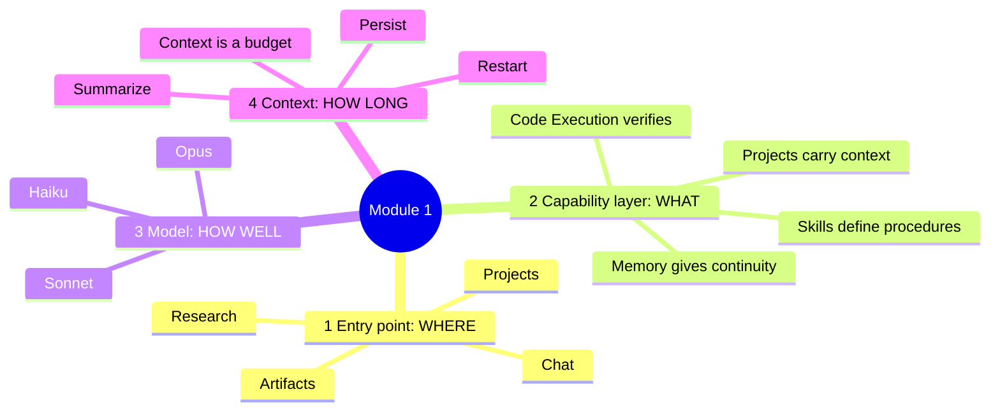
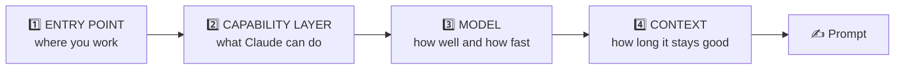
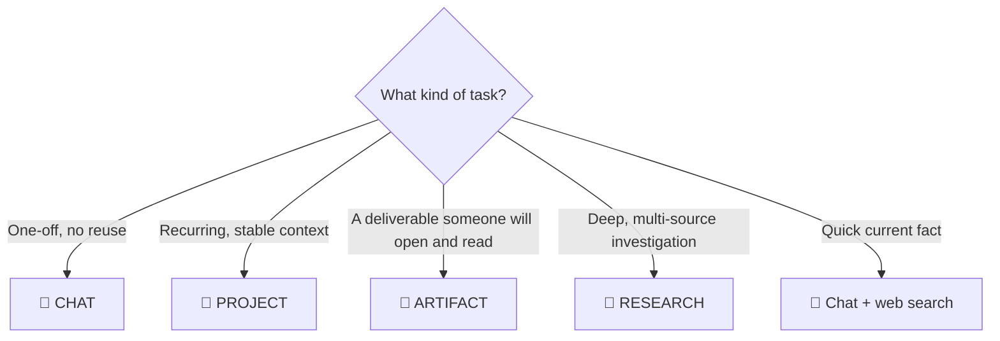
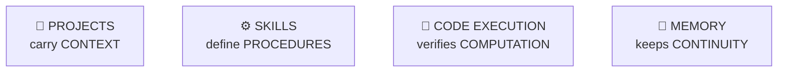
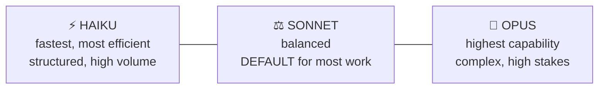
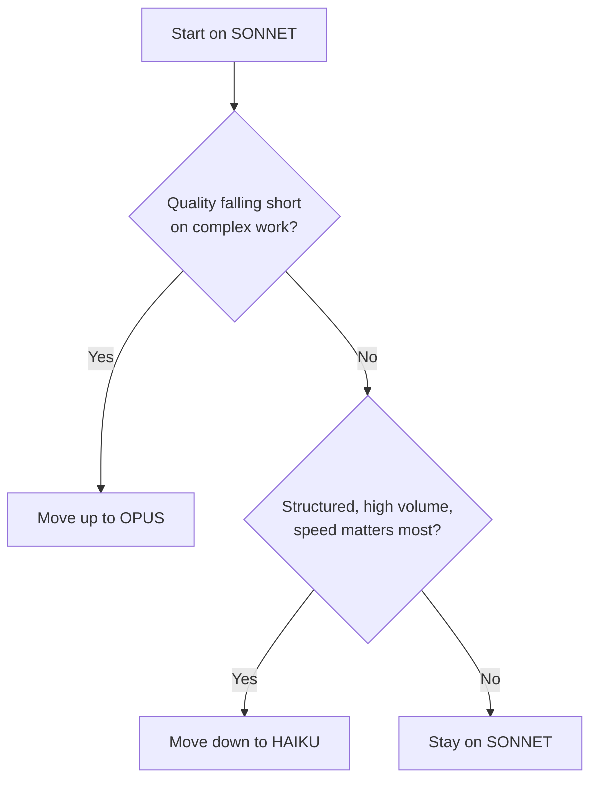
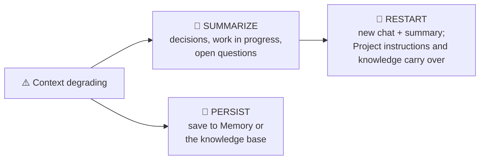

# 📘 Module 1: Claude Platform & Model Foundations
### Last-minute revision notes for CCAO-F

> ⭐ **The big idea:** **four decisions made *before* you write a prompt** set the quality ceiling for every session, and they decide whether each session **builds on earlier work or has to be set up again**.

<!-- NOTES-START -->

## ⚡ 60-second recap





---

## 1. Five behaviors of generative AI (true for every feature)

| Behavior | What it means |
|---|---|
| **Responses vary** | Outputs are generated from probabilities, not retrieved from a database. Plan for variation and **build in review**. |
| **Confident tone ≠ accuracy** | A made-up statistic reads exactly like a verified one |
| **Context is a budget** | Near the limit, earlier messages are **summarized** *(paid plans with Code Execution on)*. Detail is lost, so early instructions lose force. |
| **Knowledge has a training cutoff** | For recent events, current regulations or market data, **connect a source, turn on web search, or use Research** |
| **Configured procedures still vary** | A Skill **reduces** variation but **doesn't eliminate it**. Review stays. |

---

## 2. Decision 1: Entry point



**💬 Chat:** the default, unstructured conversation. It's saved, and Memory and past-chat search can carry some context forward, but it **lacks a Project's standing instructions and curated knowledge base**.
🚩 *You've outgrown Chat when you keep pasting the same background paragraph every week.*

**📁 Project:** a persistent workspace that holds:
- **Standing instructions:** **how** Claude should behave, every time
- **Knowledge base:** documents uploaded **once** = **what** Claude knows
- **Its own conversation list:** chats share the instructions and knowledge but **not each other's context**

✅ **The Project test:** *Does the task recur? Is the background stable? Is the output format consistent?* **Two or more yes answers means build it.** The setup time pays for itself within **2–3 sessions**.

**📄 Artifact:** a **separate, editable block** for deliverables (drafts, tables, reports, code). Use **inline** replies for answers you'll act on in the chat.

**🔎 Research (paid plans):** **multi-step searches across many sources, combined into one answer**. **Web search** (all plans, a per-chat toggle) is for quick lookups. On **Team and Enterprise**, an **Owner or Primary Owner must enable web search** first.

> **Course example:** weekly status report. A new Chat each Monday took **40 min** (about 12 min loading context). A Project took **25 min**, with the **same quality**. The Project **removed the weekly setup work**.

---

## 3. Decision 2: Capability layer

> Entry point = **where** you work. Capability layer = **what** Claude can do there.



The layers are **independent**. A one-off question needs **none**. A recurring analysis may use **all four**.

### ⚙️ Skills: reusable procedures
- Built in for **Excel, Word, PowerPoint, PDF**. Custom Skills can be added in settings.
- They live at the **account level, not inside a Project**, and Claude uses them **automatically** in any chat.
- ⚠️ They **reduce variation but don't eliminate it.**
- ⚠️ **Decide whether to trust a Skill first.** A Skill can access whatever Claude can access in the session. **Check a third-party Skill's source and the permissions it asks for.** Anthropic-provided or organization-approved Skills are the **lower-risk** starting point.

### 🧮 Code Execution: verified computation
A **sandboxed** environment where Claude writes and runs the code itself. **Text generation gives plausible numbers; running code gives verified ones.**
**Use it when:** numbers will be **used or reported** · data needs **cleaning or transforming** · you need a **chart** · you need a **real file** (.xlsx, .pptx, .docx, .pdf).

### 🧠 Memory: continuity
- Stores recurring facts: your role, preferred formats, frequent collaborators, constraints that always apply.
- **Curate it:** review it **at least monthly**, **delete or update** outdated entries, and keep it **focused**. Outdated memory can **mislead**. **Accuracy matters more than quantity.**
- **Project-scoped Memory:** each Project has its own memory, so **Client A context never appears in Client B**. Separate workstreams → separate Projects.
- **Incognito:** keeps a **standalone chat** out of Memory and history, for sensitive work. It does **not** override your organization's data retention.
- **Memory import** *(experimental)*: Free, Pro, Max and Team (not Enterprise). Fallback: **add the key facts to Memory manually**, not to a Project knowledge base.

### Course case: the monthly regulatory report
In Chat it took **65 min** and the verification step caught errors. After moving it to a Project + knowledge base + Skill + Code Execution it took **30 min**, with **zero errors in months 3–8**. **Verification still ran.**

| Question to ask | Points to |
|---|---|
| What's the same every time? | Standing instructions + Skill |
| What reference material keeps coming back? | Knowledge base |
| What must be **computed** correctly? | Code Execution |
| What should carry across sessions? | Memory |

**Checkpoint (contract review):** "Flag clauses that depart from the playbook" → **instructions** · the playbook + this cycle's contracts → **knowledge base** · extract and format into the template → **Skill** · penalty-clause exposure calculation → **Code Execution**.

---

## 4. Decision 3: Model



| Model | Use for |
|---|---|
| **Haiku** | Classification, extraction, formatting, simple summaries, **high-volume** routine work where an imperfect output costs little |
| **Sonnet** | Drafting, synthesis, analysis, research help, document review. **The right starting point for most knowledge work.** |
| **Opus** | Nuanced judgment, complex multi-step reasoning, **ambiguous inputs**, client-facing, strategic, high-stakes |



💰 On **metered or usage-budgeted plans (including the API)**, Opus uses more per call, so the trade-off is also about cost. On a standard subscription, treat **speed and remaining usage** as the cost. *The exam uses the three-tier frame. The Fable tier above Opus is not exam-relevant.*

---

## 5. Decision 4: Context management

```
Start   [██░░░░░░░░░░░░░░░░]  instructions sharp
Later   [██████████████████▓]  near limit → earlier messages SUMMARIZED → detail compresses
```

**🚨 Warning signs:** Claude stops following earlier instructions · replies address only the latest message · accuracy drops in ways consistent with missing early context.



❌ **Doesn't fix it:** switching to Opus, repeating instructions in the same chat, turning on Research.

**⏳ Usage limits:** a **short rolling session window** + **weekly limits** (with a **separate pool for the top tier**). For big tasks: **split them into segments, save progress to the knowledge base, restart from a summary.**

---

## 6. Course exercise: configuration cards

| Scenario | Configuration |
|---|---|
| Competitor launches in the last 90 days | **Research · Sonnet** |
| Weekly meeting notes, same template | **Project + Skill · Sonnet** |
| 15-page board analysis, ambiguous signals | **Project (knowledge base) + Artifact · Opus** |
| 800 survey responses → response rates by department | **Code Execution · Haiku or Sonnet** |
| Monthly variance analysis in a standard template | **Project + Code Execution + Skill · Sonnet** |
| One-off vendor reply | **Chat + Artifact · Sonnet** |

*Why Opus for the board analysis?* It **gives you deeper reasoning at the cost of speed**, which is worth it for a one-off, high-stakes deliverable.

---

## 🎯 Key takeaways (read these last)

1. **Choose the entry point before you write the prompt:** Chat for one-off work, Project for recurring work, Artifact for deliverables, Research for current multi-source work.
2. **Four layers, four problems:** Projects = context, Skills = procedures, Code Execution = computation, Memory = continuity.
3. **Match the model to the task:** Haiku for structured volume, **Sonnet by default**, Opus for complex, high-stakes work.
4. **Context is a budget:** when it degrades, **restart, summarize, persist**. A bigger model won't fix it.
5. **Variation is built in, so review is too.** Even configured Skills vary.

<!-- NOTES-END -->

---

# 📝 Question bank: 20 practice questions

> Answer all 20 first, then check the **answer key** at the end. *(Select TWO)* questions need both answers to count as correct.

**Q1.** You run the same prompt twice and get two different, equally reasonable answers. What does the module say?
- A. Something is broken; report it
- B. Outputs are generated from probabilities, so variation is normal; plan for it and build in review
- C. Switch to Opus to get identical outputs
- D. Turn on a Skill to eliminate variation completely

**Q2.** *(Select TWO.)* Claude confidently quotes a figure about last month's interest-rate change. Which behaviors should make you cautious?
- A. Confident tone is not a sign of accuracy
- B. Knowledge has a training cutoff
- C. Artifacts are always accurate
- D. Projects share context between chats
- E. Skills remove all variation

**Q3.** A manager needs a one-time reply to a supplier's question about delivery dates. Which entry point fits?
- A. Project
- B. Research
- C. Chat
- D. Code Execution

**Q4.** A trainer writes quiz sheets every week in the same format, but each week covers a different topic. Should she build a Project?
- A. No; only one condition holds
- B. Yes; two of the three conditions hold (it recurs, the format is consistent)
- C. No; all three conditions must hold
- D. Only if she uses Opus

**Q5.** Which statement about chats inside the same Project is correct?
- A. They share each other's conversation context
- B. They share the Project's instructions and knowledge base, but not each other's context
- C. They share nothing
- D. They share Skills, which live inside the Project

**Q6.** A policy analyst needs a synthesis of tax changes across 10 countries over the past quarter. What's the best choice?
- A. Chat with no tools
- B. Chat with web search for a quick lookup
- C. Research
- D. Memory

**Q7.** On a Team plan, a member can't find the web search toggle. What's the most likely reason?
- A. Web search is only for Enterprise plans
- B. An Owner or Primary Owner hasn't enabled web search for the organization
- C. Web search requires Opus
- D. Web search only works inside Projects

**Q8.** In a Project for reviewing invoices, the rule *"Flag any invoice without a PO number"* belongs in:
- A. The knowledge base
- B. Standing instructions
- C. Memory
- D. Code Execution

**Q9.** Where do Skills live?
- A. Inside a single Project
- B. At the account level, used automatically in any relevant chat, inside or outside Projects
- C. Only in Artifacts
- D. In Memory

**Q10.** *(Select TWO.)* A colleague shares a third-party Skill from the internet. Which statements are correct?
- A. Check its source and the permissions it asks for before enabling it
- B. Once enabled, its outputs no longer need review
- C. Anthropic-provided or organization-approved Skills are the lower-risk starting point
- D. Skills can't access anything Claude has access to
- E. Skills eliminate output variation

**Q11.** A finance team needs exact commission totals for 250 reps and a downloadable .xlsx. Which capability fits?
- A. Ask Claude to calculate in plain text
- B. Code Execution
- C. Research
- D. Memory

**Q12.** Which of these is **NOT** a reason given for using Code Execution?
- A. Numbers will be used or reported
- B. Data needs cleaning (e.g., date normalization, removing duplicates)
- C. You need a chart or a real downloadable file
- D. You need a persuasive, friendly tone

**Q13.** *(Select TWO.)* What does the module recommend for Memory curation?
- A. Review stored memories at least monthly (for active users)
- B. Store as many facts as possible
- C. Delete or update entries that no longer hold
- D. Never edit memories once saved
- E. Put all memories into a Project knowledge base

**Q14.** A consultant works for two competing clients and needs their context kept completely separate. What's the correct setup?
- A. Incognito for every chat
- B. Separate Projects per client, with Project-scoped Memory
- C. A different model tier for each client
- D. Clear Memory manually before each session

**Q15.** Automatic memory import isn't available in your account. What's the documented fallback?
- A. Paste the memories into a Project knowledge base
- B. Add the key facts to Memory manually through memory settings
- C. Use Incognito mode
- D. Memory import isn't possible at all

**Q16.** A retailer must sort 3,000 product reviews into "positive / neutral / negative" using clear rules, quickly. Which model?
- A. Opus
- B. Sonnet
- C. Haiku
- D. It doesn't matter

**Q17.** For most everyday drafting, synthesis and analysis, which model does the module call the right starting point?
- A. Haiku
- B. Sonnet
- C. Opus
- D. Whichever is newest

**Q18.** Sonnet's draft of a strategic recommendation, built from conflicting reports, misses important nuances. What's the next step?
- A. Move down to Haiku
- B. Move up to Opus
- C. Turn on Memory
- D. Use Incognito

**Q19.** After two hours in one chat, Claude ignores the analysis framework you set at the start. What's the best response?
- A. Switch to Opus
- B. Repeat the framework in the same chat
- C. Ask for a summary of decisions and progress, start a new chat, paste the summary, and save the lasting rules to the knowledge base or Memory
- D. Turn on Research

**Q20.** *(Select TWO.)* Which are signs a conversation needs attention?
- A. Claude stops following instructions it followed earlier
- B. Claude creates an Artifact
- C. Replies address only the latest exchange, ignoring earlier decisions
- D. Claude responds quickly
- E. Claude uses a Skill

---

# ✅ Answer key

| Q | Answer | Why (from the module) |
|---|---|---|
| 1 | **B** | "Responses vary": generated, not retrieved. Plan for it and review. |
| 2 | **A, B** | Confident tone ≠ accuracy, and recent events are past the training cutoff |
| 3 | **C** | One-off task that starts and ends in the session |
| 4 | **B** | Two or more yes answers on the Project test means build it |
| 5 | **B** | Chats share the instructions and knowledge base but not each other's context |
| 6 | **C** | Deep, multi-source, current synthesis = Research. Web search is for quick lookups. |
| 7 | **B** | On Team and Enterprise, an Owner or Primary Owner must enable web search first |
| 8 | **B** | Standing instructions = how Claude behaves. Knowledge base = what it knows. |
| 9 | **B** | Skills are account-level and used automatically wherever relevant |
| 10 | **A, C** | Decide whether to trust a Skill first. Anthropic-provided or org-approved Skills are lower-risk. Skills still need review. |
| 11 | **B** | Reported numbers and a real file → Code Execution |
| 12 | **D** | Tone is a writing task. The other three are listed uses. |
| 13 | **A, C** | Review monthly, delete or update, keep it focused. Accuracy matters more than quantity. |
| 14 | **B** | Project-scoped Memory keeps Client A out of Client B |
| 15 | **B** | Add the facts to Memory manually, not to a Project knowledge base |
| 16 | **C** | Structured classification at volume = Haiku |
| 17 | **B** | Sonnet is the right starting point for most knowledge work |
| 18 | **B** | Ambiguous, high-stakes work where quality falls short → move up to Opus |
| 19 | **C** | Summarize, restart, persist. A model change or repeating instructions doesn't fix context loss. |
| 20 | **A, C** | Warning signs of context degradation (the third is an accuracy drop) |

**🎯 Score guide:** 18–20 ready · 14–17 re-read the sections you missed · below 14 go back through sections 2–5
