# 📘 Module 1: Claude Platform & Model Foundations
### Quick revision notes for CCAO-F (Claude Certified Associate – Foundations)

> **How to use this file**
> 1. Read the **1-minute summary** first.
> 2. Skim the diagrams in each section. They hold most of the module.
> 3. Do the **15 practice questions** at the end. Answers are hidden. Click **"Show answer"** to reveal them.
>
> *Based on the official Module 1 course material. The course says product details change often and should be checked on Anthropic's site.*

---

## 📑 Contents
- [⚡ The 1-minute summary](#-the-1-minute-summary)
- [0. The big idea: 4 decisions before any prompt](#0-the-big-idea-4-decisions-before-any-prompt)
- [1. Five truths about generative AI](#1-five-truths-about-generative-ai)
- [2. Decision 1: Entry point (Chat, Projects, Artifacts, Research)](#2-decision-1-entry-point)
- [3. Decision 2: Capability layer (Projects, Skills, Code Execution, Memory)](#3-decision-2-capability-layer)
- [4. Decision 3: Model (Haiku, Sonnet, Opus)](#4-decision-3-model)
- [5. Decision 4: Context management](#5-decision-4-context-management)
- [6. Putting it all together: configuration cards](#6-putting-it-all-together)
- [7. Cheat sheet and memory hooks](#7-cheat-sheet-and-memory-hooks)
- [8. Common exam traps](#8-common-exam-traps)
- [9. 15 practice questions](#9-15-practice-questions)
- [10. Answer key](#10-answer-key)

---

## ⚡ The 1-minute summary

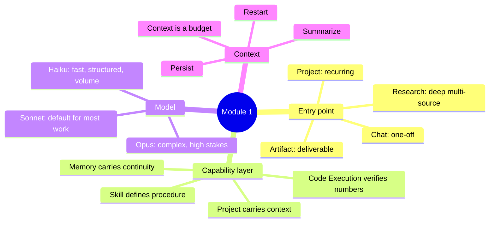

**The five rules to remember**
1. **Pick the entry point before writing the prompt.**
2. **Four layers solve four different problems:** context, procedure, computation, continuity.
3. **Model choice trades speed against capability.** Haiku for fast volume work, Sonnet for most work, Opus for hard, high-stakes work.
4. **Context is a budget.** Long chats lose detail. When that happens, restart, summarize, or persist.
5. **Outputs always vary, so review is always part of the workflow.**

---

## 0. The big idea: 4 decisions before any prompt

The quality of a session is mostly decided **before you type the first prompt**.

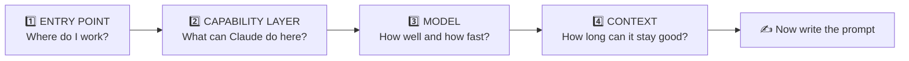

🍳 **Simple analogy: cooking a meal**
| Decision | Cooking version |
|---|---|
| Entry point | Which kitchen? (quick snack counter or a fully stocked restaurant kitchen) |
| Capability layer | Which tools? (recipe book, measuring scale, notes from last time) |
| Model | Which cook? (fast line cook, skilled chef, master chef) |
| Context | How much counter space is left before things get messy? |

These four decisions decide whether **each session builds on earlier work** or **you have to set everything up again every time**.

---

## 1. Five truths about generative AI

These apply **no matter which feature or model** you use.

| # | Truth | In simple words | Real-world example |
|---|---|---|---|
| 1 | **Responses vary** | Same question, different answer. It's generated, not looked up. | You ask for a tagline twice and get two different but equally good ones. **Build review into any workflow that needs consistency.** |
| 2 | **Confident tone ≠ accuracy** | Claude sounds equally sure whether it's right or wrong. | A made-up "73% of customers…" statistic reads exactly like a real one. **Check the facts.** |
| 3 | **Context is a budget** | Each chat has a working-memory limit. Long chats get summarized, and detail is lost. | Rules you set at minute 5 of a 2-hour chat may be ignored by minute 110. |
| 4 | **Knowledge has a training cutoff** | Claude doesn't reliably know events after its training date. | "What did the regulator change last month?" needs **web search, Research, or a connected source**. |
| 5 | **Configured procedures still vary** | A Skill **reduces** variation but doesn't **remove** it. | A weekly-report Skill gives the same format but different wording each week. **Still review it.** |

> 🧠 **Memory hook:** *"Varies, Sounds sure, Budget, Boundary, Still varies"*

---

## 2. Decision 1: Entry point

Claude has **one interface** but **four ways to work**.

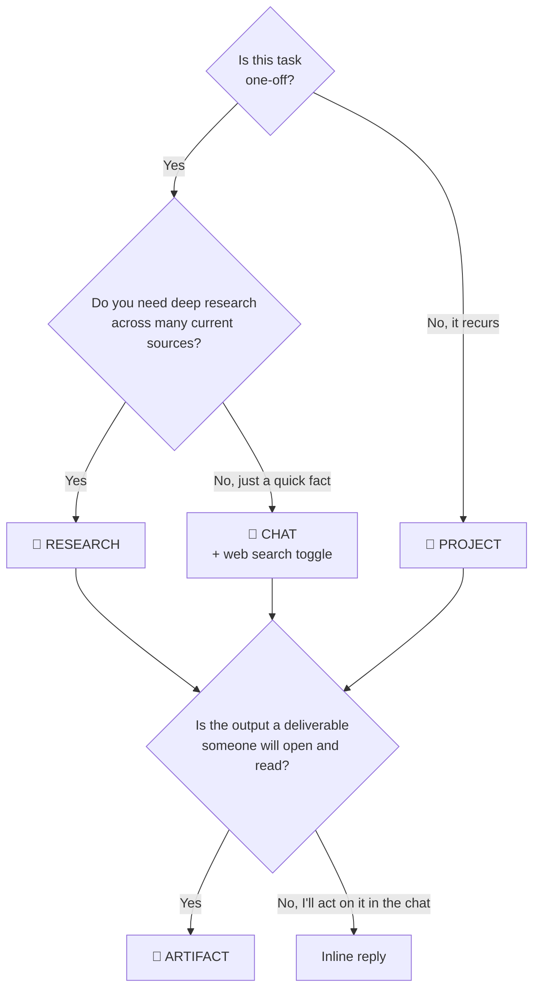

### 💬 Chat: the default
- An **unstructured conversation**. It's saved to history, and Memory and past-chat search can carry some context forward.
- What it **lacks**: a Project's **standing instructions** and **curated knowledge base**.
- Use it for one-off questions, quick drafts, exploring ideas, and tasks you won't repeat.
- 🚩 **Sign you've outgrown Chat:** you keep pasting the same background paragraph you pasted last week.

> 🏠 **Example:** "Rewrite this email to sound more polite." Done in one go, so use Chat.

### 📁 Projects: a persistent workspace
A Project holds **three things**:

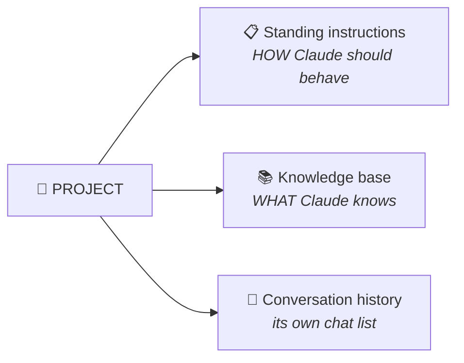

- Every chat in a Project **shares the instructions and knowledge base**.
- ⚠️ Chats inside a Project **do NOT share context with each other**.
- Projects remove the biggest time-waster: **explaining the same background every session**.

**✅ The "worth building a Project?" test: answer 3 questions**

| Question | ✔ / ✘ |
|---|---|
| Does the task **recur**? | |
| Is the **background context stable** across sessions? | |
| Is the **output format consistent**? | |

👉 **Two or more yes answers means build the Project.** The setup time pays for itself within **2–3 sessions**.

> 🏢 **Course example: weekly status report**
> | | ❌ New Chat every Monday | ✅ Project |
> |---|---|---|
> | Setup | Retypes project name, team, stakeholders, format and open items each time | Background in the knowledge base, format and escalation rules in the instructions |
> | Time | **40 min** (about 12 min just loading context) | **25 min** |
> | Quality | Good | Same |
>
> The quality is the same. The Project just **removes the weekly setup work**.

### 📄 Artifacts: for deliverables
- They appear as a **separate, editable block** next to the chat, not in the chat thread.
- Use them for **draft documents, data tables, formatted reports, code**.
- Use **inline replies** for answers you'll act on inside the conversation.

> 🏠 **Example:** A one-page proposal your manager will open goes in an Artifact. "Which of these two options is cheaper?" gets an inline reply.

### 🔎 Research: deep, multi-source synthesis (paid plans)
- **Web search** (all plans, a per-chat toggle) is for **quick lookups**.
  - On Team and Enterprise plans, an Owner or Primary Owner must first **enable web search for the organization**.
- **Research** runs **multi-step searches across many sources and combines the results**.

| Need | Use |
|---|---|
| "What's today's exchange rate?" | Chat + web search |
| "Which competitors launched products in the last 90 days, summarized for planning?" | **Research** |

### 🗺️ Selection logic

| Task type | Entry point |
|---|---|
| One-off question or quick task | **Chat** |
| Recurring work with stable context | **Project** |
| A deliverable someone will open and read | **Artifact** |
| Deep investigation or synthesis across many sources | **Research** |

---

## 3. Decision 2: Capability layer

> **Entry point = WHERE you work. Capability layer = WHAT Claude can do there.**

### The four-layer model

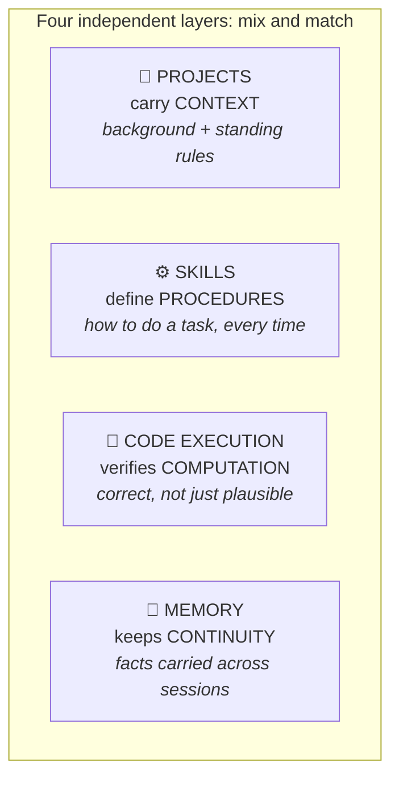

- The layers are **independent**, so use any combination.
- A one-off question needs **none**. A recurring analysis workflow might use **all four**.

🏭 **Analogy: a new employee**
| Layer | Employee version |
|---|---|
| Project | Their team folder: background documents plus "how we do things here" |
| Skill | A step-by-step checklist (SOP) for a specific task |
| Code Execution | A calculator or spreadsheet instead of mental arithmetic |
| Memory | Remembering your name, role and preferences from last week |

### ⚙️ Skills: reusable procedures
- **Built-in Skills** for Excel, Word, PowerPoint and PDF (create, edit, analyze).
- **Custom Skills** can be added in settings.
- Skills live at the **ACCOUNT level, not inside a Project**. Claude uses them **automatically when relevant**, in any chat, inside or outside Projects.
- **Two things to keep in mind:**
  1. **They reduce variation but don't eliminate it.** Same format, different wording. Keep reviewing.
  2. **Decide whether to trust a Skill before enabling it.** A Skill can access whatever you give Claude access to. **Check its source and the permissions it asks for** before turning on a third-party Skill. The safer starting point is **Anthropic-provided or organization-approved** Skills.

### 🧮 Code Execution: verified computation
- A **sandboxed environment** where Claude **writes and runs code itself**. You don't write any code.
- **Why it matters:** normal text generation predicts the *most likely next words*. For maths, that gives **numbers that look plausible but may be wrong**. Running real code gives a **verified** result.

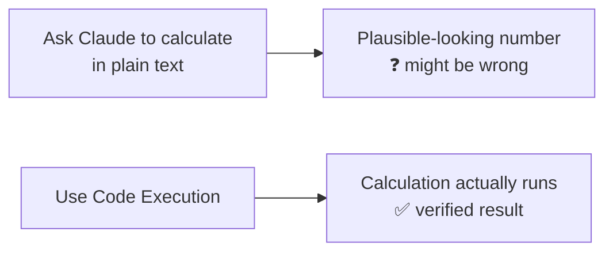

**Use Code Execution when:**
- ✅ Any number will be **used or reported** (calculations, projections, summaries of figures)
- ✅ Data needs **cleaning or transforming** (date formats, removing duplicates, field formatting)
- ✅ You need a **chart or visualization**
- ✅ You need a **real downloadable file** (.xlsx, .pptx, .docx, .pdf)

> 🏠 **Example:** "Total my team's expense claims from this spreadsheet and flag anything over $500." Use Code Execution, not mental arithmetic.

### 🧠 Memory: continuity across sessions
- Keeps **work-relevant facts** so you don't re-enter them. For example: your role, preferred output formats, names of frequent collaborators, constraints that always apply.

**Memory needs regular tidying (curation)**
- 🗓️ Review it **at least once a month** if you use Claude actively.
- 🗑️ **Delete or update** entries that are no longer true.
- 🎯 Keep only things that **genuinely come up again and again**.
- ⚠️ An outdated memory can be **actively misleading**. **Accuracy matters more than quantity.**

**Keeping things separate**

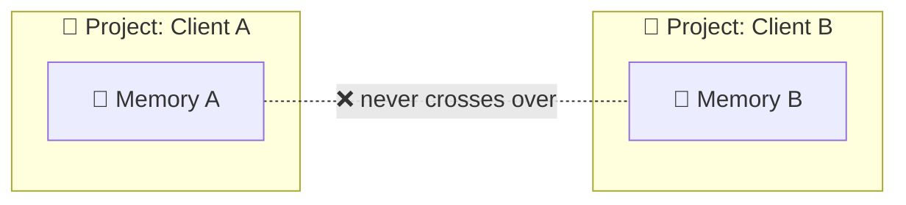

| Tool | What it does | When to use |
|---|---|---|
| **Project-scoped Memory** | Each Project has its **own** memory. Client A context never appears in Client B. | Separate workstreams or clients → **separate Projects** |
| **Incognito mode** | Keeps a **standalone** chat (outside Projects) **out of Memory and chat history** | Sensitive or confidential exploratory chats. ⚠️ It does **not** override your organization's data retention. |
| **Memory import** | Brings in memories from other AI platforms. *Experimental (June 2026)*, documented for Free, Pro, Max and Team (not Enterprise). | If automatic import isn't available, **add key facts to Memory manually in memory settings**, not to a Project knowledge base. |

### 🏦 Course case study: the monthly regulatory report

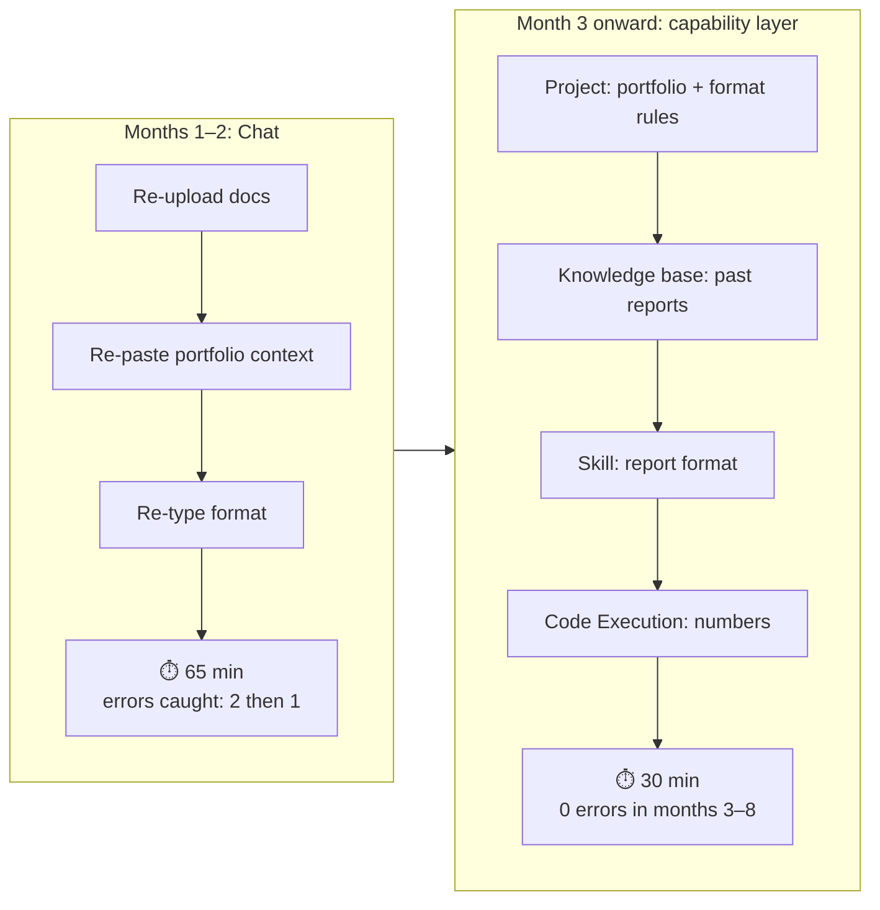

⭐ **Key point:** the analyst **kept the verification step**. It got faster *and* more accurate, but review never stopped.

**Questions to ask before rebuilding a workflow**
| Question | Points to |
|---|---|
| Which parts are **the same every time**? | Standing instructions + Skill |
| Which **reference material** keeps coming back? | Knowledge base |
| Which outputs must be **computed correctly**, not just "sound right"? | Code Execution |
| Which context should **carry across sessions**? | Memory |

### ✅ Course checkpoint: contract review workflow

| Component | Layer |
|---|---|
| "Flag any clause that departs from the playbook and explain the departure in one sentence" | 📋 **Standing instructions** |
| The company's standard contract playbook (acceptable terms, required clauses, risk thresholds) | 📚 **Knowledge base** |
| This cycle's contract documents, uploaded at the start of each session | 📚 **Knowledge base** |
| A procedure that pulls out flagged clauses and formats them into the standard review template | ⚙️ **Skill** |
| Calculating financial exposure from a penalty clause with a variable rate | 🧮 **Code Execution** |

> 💡 **Standing instructions = how Claude behaves. Knowledge base = what Claude knows.** Both live in the Project, but they do different jobs.

---

## 4. Decision 3: Model

> **The capability layer decides WHAT Claude does. The model decides HOW WELL, and how fast.**

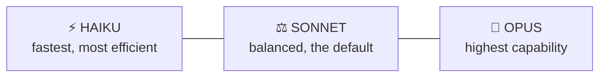
<p align="center"><b>⟵ faster, lighter, cheaper · · · · · · · · · · · more capable, slower, uses more ⟶</b></p>

| | ⚡ **Haiku** | ⚖️ **Sonnet** | 🧠 **Opus** |
|---|---|---|---|
| **Strength** | Speed and efficiency | Strong quality across most tasks | Nuanced judgment, complex reasoning |
| **Best for** | Classification, extraction, formatting, simple summaries, **high-volume routine work** | Drafting, synthesis, analysis, research help, document review | **Ambiguous inputs**, multi-step reasoning, client-facing deliverables, strategy, high-stakes synthesis |
| **Cost of an imperfect output** | Low | Medium | High |
| **Think of it as** | Fast line cook 🍟 | Skilled chef 🍝 | Master chef for a state dinner 🍽️ |

### Decision flow

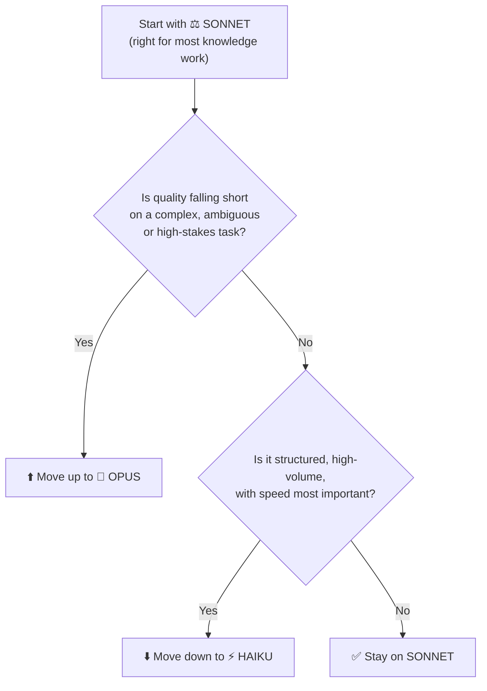

### Real-world examples
| Task | Model | Why |
|---|---|---|
| Tag 1,000 customer reviews as positive, neutral or negative | ⚡ Haiku | Structured, clear rules, high volume |
| Pull invoice number, date and amount from 300 PDFs | ⚡ Haiku | Extraction at volume |
| Draft a project update email from your notes | ⚖️ Sonnet | Everyday drafting |
| Summarize a 20-page policy for your team | ⚖️ Sonnet | Standard synthesis |
| Board strategy paper from 4 conflicting market reports | 🧠 Opus | Ambiguous signals, high stakes |
| Assess a complex merger contract for hidden risks | 🧠 Opus | Nuanced judgment |

### 💰 Usage and cost
- On **metered or usage-budgeted plans** (including the API), the speed-vs-capability trade-off is also a **cost per call** trade-off. Opus uses more than Sonnet or Haiku.
- On a **standard claude.ai subscription**, think of "efficiency" as **speed and remaining usage**. The selection logic stays the same.
- The models offered, the default model and automatic model-switching **vary by plan and change over time**.

> 📝 **Exam note (from the course):** the certification uses the **three-tier Haiku / Sonnet / Opus** framework. A fourth tier above Opus (Claude Fable) exists, but the course says it is **not exam-relevant**. For exam answers, **Sonnet is the default starting point**.

---

## 5. Decision 4: Context management

> **Model and capabilities decide WHAT Claude can do. Context management decides HOW LONG it can do it well.**

### Context is a budget 💰

```
Start of chat   [██░░░░░░░░░░░░░░░░░░]  plenty of room, instructions sharp
After 1 hour    [██████████░░░░░░░░░░]  still fine
After 2 hours   [██████████████████▓▓]  near the limit, older messages get SUMMARIZED
                                          ↳ detail compresses, early rules lose force
```

- As the chat fills up, claude.ai **automatically summarizes earlier messages** to make room (on paid plans with Code Execution enabled). The full history is still available for reference.
- Claude **isn't ignoring you**. Your early instructions were **compressed**.

🎒 **Analogy:** a backpack. Keep adding things and eventually you have to squash older items down to fit. They're still there, but crumpled.

### 🚨 Warning signs a chat needs attention
1. Claude **stops following instructions** it followed earlier.
2. Replies only address **the latest message** and ignore earlier decisions.
3. **Accuracy drops** in ways that suggest early context is missing.

### 🔧 Three ways to respond: Restart, Summarize, Persist

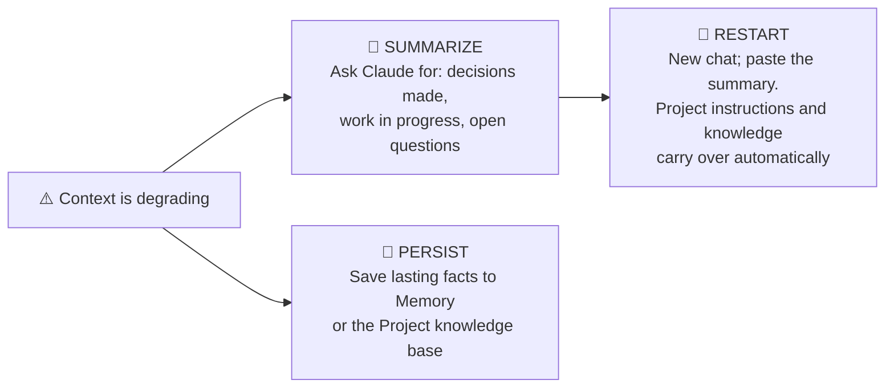

| Response | When | What carries over |
|---|---|---|
| 🔄 **Restart** | The chat has drifted too far, or you're starting a **genuinely new task** | Project instructions + knowledge base ✅, the chat thread ❌ |
| 📝 **Summarize** | Before restarting, to keep the thread going | Decisions, work in progress, open questions (pasted into the new chat) |
| 💾 **Persist** | Information **every future session** needs | Saved in Memory or the knowledge base |

> 🏠 **Example:** You've spent 2 hours planning a product launch and Claude has forgotten your budget rule. Ask for a summary, open a **new chat in the Project**, paste the summary, and save the budget rule to the **knowledge base** so it never gets lost again.

❌ **What doesn't fix context loss:** switching to Opus, repeating instructions in the same long chat, or turning on Research.

### ⏳ Usage limits
- There's more than one time window: a **short rolling session window** plus **weekly limits** on paid plans across models (with a **separate weekly pool for the top tier**).
- Long sessions on higher-tier models may hit a limit before you finish.
- **Plan ahead:** break big tasks into segments, save interim progress to the knowledge base, and restart from a summary instead of stretching one chat forever.

---

## 6. Putting it all together

### Course exercise: match the scenario to the configuration

| Card | Configuration | Fits when… |
|---|---|---|
| **A** | Project + Skill · Sonnet | Recurring, stable context, fixed format |
| **B** | Research · Sonnet | Current information beyond the training cutoff |
| **C** | Code Execution · Haiku or Sonnet | Calculations on a set dataset that must be accurate |
| **D** | Project (knowledge base) + Artifact · Opus | Nuanced multi-source, ambiguous, high-stakes deliverable |
| **E** | Chat + Artifact · Sonnet | One-off drafting, no capability layer needed |
| **F** | Project + Code Execution + Skill · Sonnet | Recurring, verified numbers, consistent format |

| Scenario | Card |
|---|---|
| S1 Competitors' launches in the last 90 days, for a planning session | **B** |
| S2 Weekly meeting notes, same template for 6 months | **A** |
| S3 15-page board analysis from 4 reports with ambiguous signals | **D** |
| S4 800 survey responses → response rates by department, flag below 60% | **C** |
| S5 Monthly variance analysis: actuals vs. budget, flag over 10%, standard template | **F** |
| S6 One-off reply to a vendor's payment-terms question | **E** |

**Why Opus for S3?** The analysis depends on interpreting ambiguous signals across four sources, so quality matters more than speed. Opus **gives you deeper reasoning at the cost of speed**, which is worth it for a one-off, high-stakes deliverable. Sonnet would suit a routine or time-critical version. Haiku would be too weak for the interpretation needed.

---

## 7. Cheat sheet and memory hooks

| If you see… | Think… |
|---|---|
| "one-off", "quick", "just this once" | 💬 Chat |
| "every week", "same template", "same background" | 📁 Project (+ ⚙️ Skill for a fixed procedure) |
| "deliverable", "report they'll open", "draft document" | 📄 Artifact |
| "last 90 days", "latest", "across many sources" | 🔎 Research |
| "quick current fact" | 💬 Chat + web search |
| "calculate", "totals", "percentages", "chart", ".xlsx file" | 🧮 Code Execution |
| "remember my role or preferences next time" | 🧠 Memory |
| "keep Client A and Client B separate" | 📁 Separate Projects + project-scoped Memory |
| "confidential, keep out of history" | 🕶️ Incognito (standalone chat) |
| "hundreds of items, clear rules" | ⚡ Haiku |
| "most everyday drafting and analysis" | ⚖️ Sonnet |
| "ambiguous, nuanced, high stakes, board or client" | 🧠 Opus |
| "Claude forgot my early instructions" | 📝 Summarize → 🔄 Restart → 💾 Persist |

**🧠 Short phrases to remember**
- **"Where, What, How well, How long"**: entry point, capability layer, model, context.
- **"Context, Procedure, Compute, Continuity"**: Project, Skill, Code Execution, Memory.
- **"Two of three, build it"**: recurs, stable context, consistent format.
- **"Instructions = HOW it behaves, Knowledge = WHAT it knows."**
- **"Text guesses numbers, code proves them."**
- **"Restart, Summarize, Persist."**
- **"Variation is built in, so review is too."**

---

## 8. Common exam traps

| ❌ Tempting answer | ✅ Why it's wrong |
|---|---|
| "Switch to Opus" to fix forgotten instructions | The model isn't the problem; context ran out. Summarize and restart. |
| "Repeat the instructions in the same long chat" | It keeps a degraded session going |
| "Use Opus for anything legal or important" | A **clear rubric at volume** is a Haiku task. Opus is for **nuanced judgment**. |
| "Ask Claude to estimate the number carefully" | Text generation gives plausible numbers. Use **Code Execution**. |
| "A Skill means the output no longer needs review" | Skills **reduce** variation but don't remove it |
| "Skills live inside a Project" | Skills are **account-level** and work in any chat |
| "Use Incognito to keep two clients separate" | Use **separate Projects** with project-scoped Memory |
| "Save Artifacts as the way to carry context forward" | Use Projects, the knowledge base and Memory for continuity |
| "Chats in the same Project share context with each other" | They share **instructions and knowledge**, not chat context |
| "Put imported memories into a Project knowledge base" | The fallback is adding them **manually to Memory** |
| "Web search and Research are the same" | Web search is a quick lookup. Research is deep, multi-step synthesis. |

---

## 9. 15 practice questions

> Each question is tagged with its topic. Try it **before** clicking "Show answer".

### 🅰️ Topic: Generative AI behavior

**Q1.** A team lead runs the same prompt twice and gets two different summaries of the same meeting. Both are reasonable. What's the right takeaway?

- A. Claude is malfunctioning; report it to support
- B. Switch to Opus so the output is always identical
- C. This is normal for generative AI; plan for variation and build review into the workflow
- D. Turn on Research so Claude retrieves one fixed answer

<details><summary>Show answer</summary>

**✅ C.** Outputs are generated from probabilities, not retrieved from a database, so they vary. No model or feature makes them identical. Plan for it and review.
</details>

---

**Q2.** *(Select TWO.)* Claude confidently says, "Our competitor raised prices 12% last month." Which two properties of generative AI should make you cautious?

- A. Confident tone is not a sign of accuracy
- B. Knowledge has a training cutoff
- C. Skills remove all variation
- D. Artifacts are always correct
- E. Projects share context between chats

<details><summary>Show answer</summary>

**✅ A and B.** A fluent, specific figure can be made up (A), and "last month" is probably after the training cutoff unless a current source was connected (B). Verify, or use web search or Research.
</details>

---

### 🅱️ Topic: Entry points

**Q3.** A sales rep needs a polite one-time reply to a customer asking for a delivery update. Which entry point fits best?

- A. Build a new Project
- B. Chat
- C. Research
- D. Turn on Code Execution

<details><summary>Show answer</summary>

**✅ B. Chat.** It's one-off, starts and ends in one session, and won't be repeated. A Project would be overkill.
</details>

---

**Q4.** A recruiter writes job descriptions **every week** in the **same company format**, but each role has a **different background** (team, skills, location). Should she build a Project?

- A. No. Only 1 of the 3 conditions is met.
- B. Yes. 2 of the 3 conditions (recurs, consistent format) are met.
- C. No. Projects only work if all 3 conditions are met.
- D. Yes, but only on the Opus model.

<details><summary>Show answer</summary>

**✅ B.** The test is **two or more yes answers**. It recurs ✔, the format is consistent ✔, and the context changes ✘. That's 2 of 3, so build it. The company format and house style go in the standing instructions.
</details>

---

**Q5.** A finance manager needs a **formatted one-page budget summary** that the CFO will open and read. Which output format fits?

- A. An inline chat reply
- B. An Artifact
- C. A Memory entry
- D. A Research report

<details><summary>Show answer</summary>

**✅ B. Artifact.** It's a deliverable someone will open and read, so it belongs in a separate, editable block. Inline replies are for answers you act on inside the chat.
</details>

---

**Q6.** A compliance officer needs a combined summary of **data-privacy rule changes across 8 countries in the last 6 months**. What's the best choice?

- A. Chat with no tools, since Claude already knows privacy law
- B. Chat with web search for one quick lookup
- C. Research
- D. Haiku in a Project

<details><summary>Show answer</summary>

**✅ C. Research.** It needs **current** information (after the training cutoff) **from many sources**, combined into one picture. Web search is for quick single lookups. Research runs multi-step searches and synthesizes the results.
</details>

---

### 🅲 Topic: Capability layer

**Q7.** In a Project for reviewing supplier invoices, where should each item go?
> (i) "Always flag invoices with no PO number and explain why in one line"
> (ii) The approved supplier price list

- A. (i) Knowledge base, (ii) Standing instructions
- B. (i) Memory, (ii) Skill
- C. (i) Standing instructions, (ii) Knowledge base
- D. Both in Code Execution

<details><summary>Show answer</summary>

**✅ C.** Standing instructions say **how Claude behaves** (the flagging rule). The knowledge base says **what Claude knows** (the reference price list).
</details>

---

**Q8.** *(Select TWO.)* A colleague shares a free third-party Skill from the internet that "auto-formats board reports." Which statements are correct?

- A. Check its source and the permissions it asks for before enabling it
- B. Once enabled, its reports no longer need human review
- C. It works only inside the Project where you install it
- D. Anthropic-provided or organization-approved Skills are the lower-risk starting point
- E. Skills give Claude access to fewer resources than a normal chat

<details><summary>Show answer</summary>

**✅ A and D.** A Skill can access whatever you give Claude during the session, so **decide whether to trust it** first. B is wrong because Skills reduce variation but don't remove the need for review. C is wrong because Skills are account-level and work in any chat.
</details>

---

**Q9.** An HR coordinator uploads a spreadsheet of 1,200 employee training records and needs **completion percentages by department** plus a **downloadable .xlsx** for leadership. What should she use?

- A. Ask Claude to estimate the percentages in plain text
- B. Code Execution
- C. Research
- D. Memory

<details><summary>Show answer</summary>

**✅ B. Code Execution.** The numbers will be **reported** and a **real file** is needed. Code Execution runs the calculation for a verified result. Plain text generation only gives plausible-looking numbers.
</details>

---

**Q10.** *(Select TWO.)* A consultant notices Claude keeps saying her manager is "Priya", but Priya left the company 3 months ago. Which practices does the module recommend?

- A. Review stored memories regularly (at least monthly for active users)
- B. Store as many facts as possible so nothing is missed
- C. Delete or update memory entries that no longer hold true
- D. Turn on Incognito for all future chats
- E. Switch to Opus so Claude spots outdated facts

<details><summary>Show answer</summary>

**✅ A and C.** Out-of-date memory is **actively misleading**. Curate it: review regularly and delete or update. Accuracy matters more than quantity (so B is wrong). Incognito (D) just stops memory from being used.
</details>

---

### 🅳 Topic: Model selection

**Q11.** An e-commerce team must tag **5,000 product listings** into **8 fixed categories** using a clear rulebook. A few mistakes are fine and speed matters. Which model?

- A. Opus
- B. Sonnet
- C. Haiku
- D. Whatever the default is; it doesn't matter

<details><summary>Show answer</summary>

**✅ C. Haiku.** Structured classification at high volume, clear rules, low cost of an imperfect output: that's exactly Haiku's job, and its speed advantage adds up at volume.
</details>

---

**Q12.** A project manager wants Claude to **draft a stakeholder update email** from her meeting notes. Nothing unusual or high-stakes. Which model is the right starting point?

- A. Haiku
- B. Sonnet
- C. Opus
- D. Use all three and compare every time

<details><summary>Show answer</summary>

**✅ B. Sonnet.** For most knowledge-worker drafting, synthesis and analysis, Sonnet is the starting point. Move up to Opus if quality falls short on complex work. Move down to Haiku for structured, high-volume work.
</details>

---

**Q13.** A strategy team gives Claude **three conflicting analyst reports** and asks for a **recommendation memo for the board**. Sonnet's draft misses important nuances. What's the best next step?

- A. Switch to Haiku for speed
- B. Upgrade to Opus
- C. Turn on Memory
- D. Use Incognito mode

<details><summary>Show answer</summary>

**✅ B. Opus.** Ambiguous, conflicting inputs and a high-stakes board deliverable call for nuanced judgment, where quality matters more than speed. That's the signal to move up from Sonnet to Opus.
</details>

---

### 🅴 Topic: Context management

**Q14.** *(Select TWO.)* Which are warning signs that a long conversation needs attention?

- A. Claude stops following instructions it followed earlier in the session
- B. Claude answers faster than usual
- C. Replies address only the latest message and ignore earlier decisions
- D. Claude produces an Artifact
- E. Claude uses a Skill automatically

<details><summary>Show answer</summary>

**✅ A and C.** Both show early context being compressed as the context window fills. (The third sign is accuracy dropping in ways consistent with missing early context.)
</details>

---

**Q15.** After 3 hours in one chat inside a Project, an analyst sees Claude ignoring the scoring method she set at the start. She'll keep using that scoring method for months. What's the **best** fix?

- A. Paste the scoring method again in the same chat and continue
- B. Switch the model to Opus
- C. Ask Claude to summarize decisions and progress, start a new chat in the Project, paste the summary, and save the scoring method to the Project knowledge base or instructions
- D. Turn on Research to give Claude more context

<details><summary>Show answer</summary>

**✅ C. Summarize, restart and persist.** The summary keeps the thread going, the new chat gets a fresh context window (Project instructions and knowledge carry over automatically), and saving the scoring method means it **never has to be re-entered**. A only stretches a degraded session. B and D don't fix context loss.
</details>

---

## 10. Answer key

| Q | Answer | Topic | Q | Answer | Topic |
|---|---|---|---|---|---|
| 1 | C | GenAI behavior | 9 | B | Code Execution |
| 2 | A, B | GenAI behavior | 10 | A, C | Memory |
| 3 | B | Entry point | 11 | C | Model (Haiku) |
| 4 | B | Entry point (Project test) | 12 | B | Model (Sonnet) |
| 5 | B | Entry point (Artifact) | 13 | B | Model (Opus) |
| 6 | C | Entry point (Research) | 14 | A, C | Context |
| 7 | C | Instructions vs. knowledge | 15 | C | Context |
| 8 | A, D | Skills | | | |

**🎯 Scoring guide:** 13–15 ✅ ready · 10–12 🔁 re-read the sections you missed · below 10 📖 go back through sections 2–5

---

<sub>Personal study notes based on the Anthropic Associate course, Module 1. Course disclaimer: the content is educational, product behavior changes over time, and you should check details against Anthropic's current documentation. The practice questions are original and are not official exam items.</sub>
