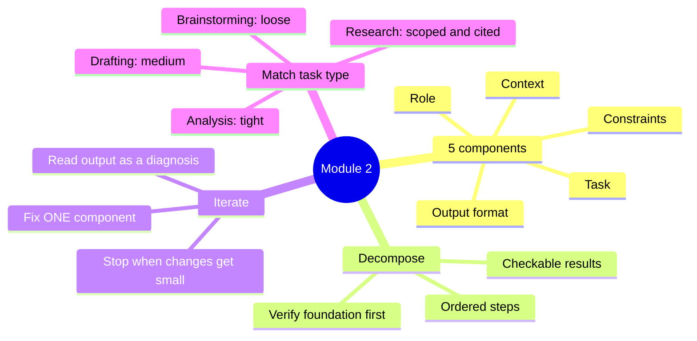
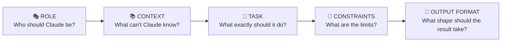
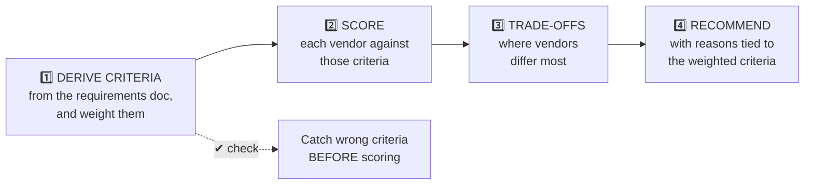
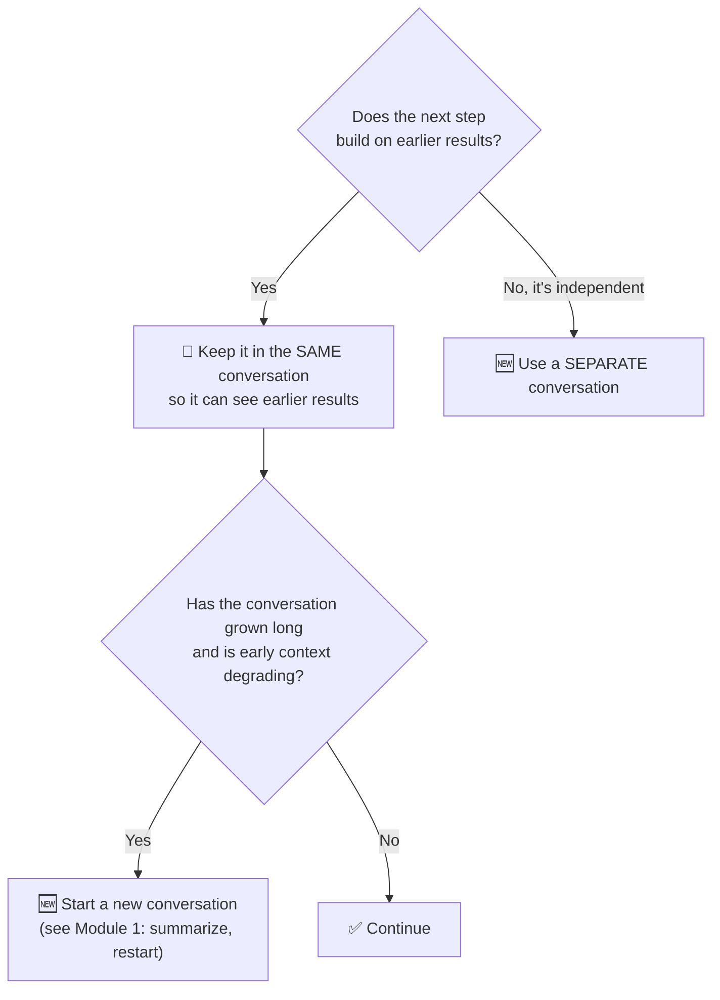
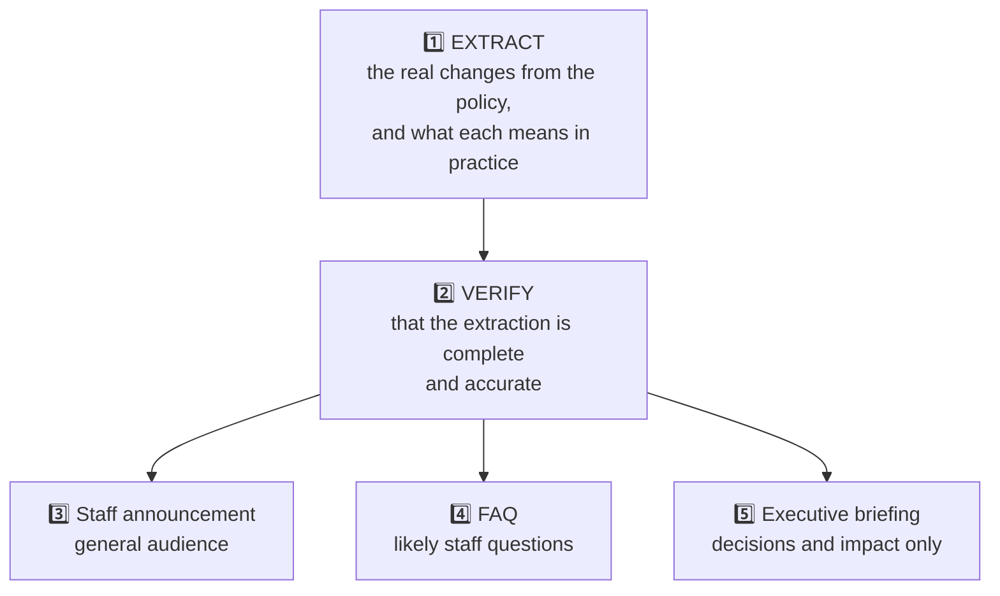
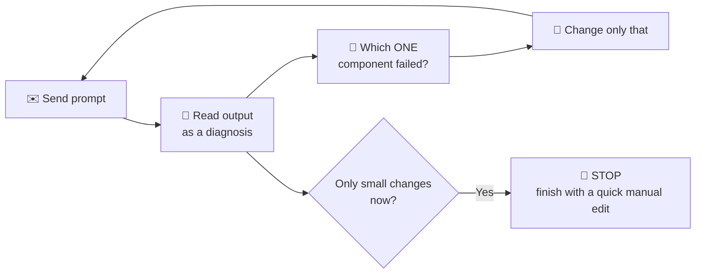
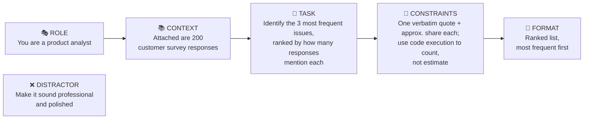

# 📗 Module 2: Prompting & Task Execution
### Quick revision notes for CCAO-F (Claude Certified Associate – Foundations)

> **How to use this file**
> 1. Read the **1-minute summary** first.
> 2. Skim the diagrams in each section. They hold most of the module.
> 3. Do the **15 practice questions** at the end. Answers are hidden. Click **"Show answer"** to reveal them.
>
> *Based on the official Module 2 course material. The course says product details change often and should be checked on Anthropic's site.*

---

## 📑 Contents
- [⚡ The 1-minute summary](#-the-1-minute-summary)
- [0. The big idea: the prompt got smarter, not the model](#0-the-big-idea)
- [1. Anatomy of an effective prompt: the 5 components](#1-anatomy-of-an-effective-prompt)
- [2. Task decomposition for complex requests](#2-task-decomposition)
- [3. Iterating prompts to improve output](#3-iterating-prompts)
- [4. Adapting strategy by task type](#4-adapting-strategy-by-task-type)
- [5. Course checkpoint: diagnose the prompts](#5-course-checkpoint-diagnose-the-prompts)
- [6. Course exercise: repair the weak prompt](#6-course-exercise-repair-the-weak-prompt)
- [7. Course quiz recap](#7-course-quiz-recap)
- [8. Cheat sheet and memory hooks](#8-cheat-sheet-and-memory-hooks)
- [9. Common exam traps](#9-common-exam-traps)
- [10. 15 practice questions](#10-15-practice-questions)
- [11. Answer key](#11-answer-key)

---

## ⚡ The 1-minute summary



**The five rules to remember**
1. **Structure drives quality, not cleverness.** Check the five components before sending anything that matters.
2. **Context is the component you'll forget.** Claude can't see what's only in your head.
3. **Break complex work into ordered steps.** Each step should give a result you can check. Build the high-stakes foundation first.
4. **Fix the component that failed.** Read the output as a diagnosis, change one thing, and stop when rounds stop improving it.
5. **Match the strategy to the task type.** Analysis needs tight constraints. Brainstorming needs freedom.

> 🎯 The course says these **four skills (components, decomposition, iteration, task-type strategy) cover the whole Prompting section of the exam.**

---

## 0. The big idea

> Ask "write something about our Q3 results" → a generic paragraph.
> Specify the audience, the 3 results that matter, the format and the length → a draft you can almost send.
>
> **The model didn't get smarter between those two requests. The prompt did.**

- Prompting is a **communication skill with a learnable structure**, not a talent some people are born with.
- The **AI Fluency Framework** calls this skill **Description**: **telling Claude precisely what you want.**
- It's the foundation that the rest of the course builds on.

🍰 **Simple analogy: ordering a custom cake**

| You say… | You get… |
|---|---|
| "Make me a cake." | Some cake. Maybe vanilla, maybe the wrong size. |
| "Chocolate cake for 20 people, a child's 8th birthday, dinosaur theme, no nuts, ready Saturday 2pm." | Exactly the cake you wanted. |

The baker's skill didn't change. **Your order did.**

---

## 1. Anatomy of an effective prompt

### The 5 components



| Component | What it controls | Example phrase | Simple way to think of it |
|---|---|---|---|
| 🎭 **Role** | The vocabulary, depth and assumptions Claude brings | "You are a financial analyst…" | Which expert you're hiring |
| 📚 **Context** | Background Claude **can't know** unless you say: audience, situation, earlier decisions, source material | "This is for our regional director, who cares about cost, not process detail." | The briefing you'd give a new colleague |
| 🎯 **Task** | The specific action, with **one main verb**, stated clearly | "Summarize…", "Compare…", "Draft…", "Identify…" | The actual job |
| 🚧 **Constraints** | Limits: length, tone, what to include or leave out, what to avoid | "Under 120 words. Only metrics that moved more than 10%." | Fences around the job |
| 📐 **Output format** | The shape of the result | "A headline plus 3 one-sentence bullets", "a 3-row table" | The container it goes in |

> 🧠 **Memory hook: R-C-T-C-F, "Really Clear Tasks Cut Fixes"**

⚠️ **Context is the component professionals most often leave out.**

### Not every prompt needs all five

```
Quick question          ██░░░░░░░░   Task (+ maybe a constraint)
Everyday draft          ██████░░░░   Task + Context + Constraints
Client deliverable      ██████████   ALL FIVE
```

**The skill is noticing which components a task needs.**

### "Description" in practice: context gaps
- Description means **making each component explicit** instead of assuming Claude will work it out.
- Without a **Connector**, Claude **can't see** your inbox, your org chart or last week's meeting. Even with one, it sees **only what you've allowed it to access**.
- Anything that exists **only in your head** is a **context gap**. Context gaps are **the most common reason a prompt underperforms** for new users.

### 🔍 The components double as a diagnostic checklist

| Missing or weak component | What the output looks like |
|---|---|
| Context | **Generic**, could be about any company |
| Task (vague verb) | **Does the wrong thing** |
| Constraints | **Wrong length or tone** |
| Output format | **Wrong shape** (an essay when you wanted a table) |

### 🛠️ Course worked example: weak prompt vs. strong prompt

❌ **Weak:** *"Write a summary of our quarterly operations."*
→ Three plausible paragraphs that could describe almost any company. **Not wrong, just unusable.**

✅ **Strong:**
> "**You are an operations analyst** *(role)*. **I'm preparing a one-page update for our regional director, who cares about throughput and cost, not process detail** *(context and audience)*. **Summarize the attached Q3 operations data** *(task)*, **covering only the three metrics that moved more than 10 percent against target** *(constraint)*. **Format as a short headline followed by three bullet points, each one sentence** *(output format)*."

→ Same model, same data. The result takes **2 minutes to refine instead of being rebuilt from scratch.**

### ⏱️ The habit to build
Before sending any prompt that matters, take **30 seconds** to check: *Have I given the role, the context Claude can't work out, a clear task, the constraints and the format?* Those 30 seconds **save several rounds of correction.**

> 🏠 **Real-world example: asking for a team-dinner plan**
> ❌ "Suggest a restaurant."
> ✅ "You're a local events planner *(role)*. I'm organizing a team dinner for 12 people in downtown Austin next Friday; two are vegetarian and one is gluten-free *(context)*. Recommend restaurants *(task)* under $50 per person, within walking distance of 6th Street, that take group bookings *(constraints)*. Give me a table of 3 options with name, price range, dietary options and why it fits *(format)*."

---

## 2. Task decomposition

> Some requests are **too big for a single instruction**. Squeezing several stages into one prompt gives **shallow work at every stage**.

**Decomposition** means splitting a multi-part problem into **separate, ordered steps** and running them **one after another**.

### Course example: choosing a vendor ("four tasks in one sentence")

❌ *"Evaluate these three vendors and tell me which to pick."*
→ Claude has to invent criteria, apply them, weigh the trade-offs and recommend **all in one go**. It does all four shallowly, and **you can't see its reasoning**.

✅ **Decomposed:**



**Why it works**
- ✅ Each step gives a **result you can check**. Wrong criteria get caught **before** scoring, not after the recommendation.
- ✅ The work can be **audited**, which matters when someone asks *"how did we reach this decision?"*

### One conversation or several?



### Course example: one source, three documents

**Scenario:** a communications manager turns a **dense 20-page policy change** into ① a staff announcement, ② a staff FAQ and ③ an executive briefing.



**Why this order?** Steps 1 and 2 build a **checked foundation** that all three documents rely on. Draft too early and **one misreading spreads into all three**.
👉 **Do the shared, high-stakes extraction first. The three drafts can follow from it.**

> 🏠 **Real-world example: planning a wedding budget**
> Don't ask "plan my wedding budget". Do it step by step: ① list every category, ② estimate each, ③ compare to the total and find the gaps, ④ recommend where to cut. You'll see where step ② went wrong before it ruins step ④.

---

## 3. Iterating prompts

> A first draft rarely lands perfectly. The skill **isn't rewriting the whole prompt**. It's **reading the output to see which component fell short**, and fixing **just that one**.

### The output tells you what to fix

| 🩺 Symptom | Likely cause | 💊 Fix |
|---|---|---|
| Generic or off-target | **Thin context** | Add the background Claude couldn't work out |
| Answered the **wrong question** | **Unclear task verb** | Make the instruction more precise |
| Wrong **length, tone or shape** | **Missing constraint or format** | Add it |
| Close, but **one section misses** | — | **Revise only that section.** Don't throw away a mostly-right draft. |

### The diagnose-and-fix loop



**Why not rewrite the whole thing?**
1. You **lose the parts that worked**.
2. You **can't tell which change fixed the problem**.

### Course example: the delayed-deliverable email (3 rounds)

| Round | Prompt | Output | Diagnosis |
|---|---|---|---|
| **1** | "Write a follow-up email to the client about the delayed deliverable." | Generic, slightly defensive, **no reason and no new date** | **Thin context** + **no tone constraint** |
| **2** | "…about the **two-day delay** on the analytics deliverable. **Cause: a data-quality issue, now fixed. New delivery: Thursday.** Tone: **accountable, not over-apologetic.** **Under 120 words.**" | Short and accountable, with cause, date and a confident close | Strong. **Only the subject line is missing.** |
| **3** | "Good. **Add a subject line that signals resolution, not just delay.**" | Done | Only a small improvement, **so stop** ✋ |

Each round **changed exactly what the last output showed was wrong**, and **no working text was thrown away**.

### 🛑 Knowing when to stop
- Iteration is **done** when each new round brings **only small changes** rather than real improvement.
- At that point a **quick manual edit** is faster than more prompting.
- 🎯 **The goal is a usable result, not a perfect prompt.**

> 🏠 **Real-world example:** you ask for a birthday speech and it comes back too long. **Don't** rewrite the whole request. Just say *"Keep everything, cut it to 90 seconds."*

---

## 4. Adapting strategy by task type

> The 5 components apply **every time**, but **how much control vs. freedom you give** changes with the task.

### The control ↔ freedom dial

```
 MORE CONTROL ◄────────────────────────────────────► MORE FREEDOM
   🔬 Analysis      🔎 Research      ✍️ Drafting      💡 Brainstorming
   tight criteria   scope + sources  shape fixed,     goal + guardrails,
   and standards    + citations      words open       ask for volume
```

| Task type | 🔒 Tighten | 🔓 Loosen | Simple rule |
|---|---|---|---|
| 🔬 **Analysis** | Criteria, standards, scope | Phrasing | *Say what to measure, against what standard, and how to handle unclear cases* |
| 🔎 **Research** | Question, sources, citations | How it combines the findings | *Define the question and its limits; ask for citations* |
| ✍️ **Drafting** | Audience, tone, format | Word choice | *You set the shape, Claude fills it* |
| 💡 **Brainstorming** | Goal and guardrails only | Quantity and direction | *Get lots of ideas first, filter later* |

### The course's four examples

| Type | Example prompt | Why it works |
|---|---|---|
| 🔬 Analysis | "Compare these two vendor contracts on **payment terms, termination rights and liability caps**. For each, say which is more favorable to us and why, in a **three-row table**." | Tight criteria, a set output, no room to wander |
| 🔎 Research | "Using **current sources**, summarize how three named competitors positioned their Q2 launches. **Cite each source. Flag anything you can't verify.**" | Scope and citation rules up front. Research (or web search for lighter needs) supplies current information. |
| ✍️ Drafting | "Draft a **150-word LinkedIn post** announcing our new reporting feature, aimed at **operations managers**, in a **confident but not salesy** voice." | Audience, length and tone set. The wording is left to Claude. |
| 💡 Brainstorming | "Give me **20 angles** for a campaign around faster month-end close. **Range widely; don't self-edit yet.**" | Only the goal and one guardrail. Constraints come later. |

### 🔎 Research: two tools
- A **quick current fact** → turn on **web search in chat**.
- A **deep investigation across many sources** → **Research** (paid plans).
- ⚠️ **Citations:** citations are checkable when they come from **web search or Research results**. Citations from **training memory alone** can look just as confident, so **verify them independently**.

> 🏠 **Real-world example: holiday planning**
> - 🔬 Analysis: "Compare these 3 hotels on price, distance to the beach and cancellation policy, in a table."
> - 🔎 Research: "Using current sources, what are the entry requirements for Japan this month? Cite the official sites."
> - ✍️ Drafting: "Write a 100-word message to my family sharing the itinerary, warm and excited."
> - 💡 Brainstorming: "Give me 25 unusual things to do in Kyoto. Go wide; don't filter yet."

---

## 5. Course checkpoint: diagnose the prompts

Each prompt has **one main weakness**.

| Prompt | ❌ Weak component | ✅ Single best change |
|---|---|---|
| "Make this better." *(pasted with a draft email)* | 🎯 **Task** | The task is ambiguous. Say what "better" means: **shorter? more formal? a clearer request?** Name the thing to improve. |
| "Give me everything you know about supply chain risk." | 🚧 **Constraints** | No scope. Say **which industry, which risks, what decision it informs, what length**. |
| "Write a professional document about the project." | 📚 **Context** | Missing context, audience and format. Give **the audience, the purpose and the shape of the output**. |
| "Brainstorm names, but each must be one word, under eight letters, avoid these twelve terms, and match our exact brand voice guidelines." | 🎯 **Task** (wrong strategy) | Brainstorming needs freedom, and heavy constraints kill the range. **Loosen first, filter after.** |

---

## 6. Course exercise: repair the weak prompt

**Weak prompt:** *"Summarize the customer feedback and tell me what to do."*
**What it produced:** five generic themes ("customers want faster support") and vague advice. **Nothing tied to the data, no priorities, nothing actionable.**
**The real goal:** a product manager has **200 survey responses** and needs the **top 3 issues by frequency**, each with a **representative quote**, **ranked**, to decide what to fix **this quarter**.

### Stage 1: find the gaps → ALL FIVE were missing
Role ✔ · Context ✔ · Task (specificity) ✔ · Constraints ✔ · Output format ✔
💡 **Role and context are the easiest to miss** because they're in the author's head but never make it into the prompt.

### Stage 2: match each fix to its component



⚠️ **"Make it sound professional and polished" doesn't belong.** It sounds useful but **fills no gap**.

### Stage 3: the repaired prompt
> "You are a **product analyst**. Attached are **200 customer survey responses**. **Identify the three most frequently raised issues, ranked by how many responses mention each**, and for each issue include **one representative verbatim quote** and **the approximate share of responses** it appears in. **Use code execution to count accurately rather than estimating.** Format as a **ranked list, most frequent first**."

**What improved**
- ✅ Role and context: the analysis is based on the actual responses
- ✅ A specific, ranked task you can count, instead of a vague one
- ✅ Constraints (quote, share of responses) make it **actionable**
- ✅ **Code execution** means the counts are **checked by running a calculation, not guessed** *(connects to Module 1)*
- ✅ The output format means it's **ready for a decision**

---

## 7. Course quiz recap

| # | Scenario | ✅ Answer | Why |
|---|---|---|---|
| 1 | "Write a post about our new feature" gives generic copy | **Add context** (audience, channel, key benefit) **and the output format** | Generic = context gap. A better model doesn't fix a vague prompt. |
| 2 | Evaluate 5 suppliers against requirements and recommend one | **Decompose:** criteria → score → trade-offs → recommend | Steps you can check. Recommending first reverses the reasoning, and separate per-supplier chats lose shared criteria. |
| 3 | Memo is accurate but too long and too formal | **Adjust the constraint and format components** (length and tone) and resend | The output shows what failed. Don't rewrite everything or switch models. |
| 4 | The team wants the widest range of campaign ideas | **Give the goal and a few guardrails, ask for volume and range**, filter later | Brainstorming needs freedom |
| 5 | "Calculate the average deal size and summarize the trend": the average looks off | **Add a constraint to use code execution** | A doubtful calculation is a checking problem. Code gives a calculated result, not a likely-sounding one. |

---

## 8. Cheat sheet and memory hooks

| If you see… | Think… |
|---|---|
| Output is **generic** or could be about anyone | 📚 Add **context** |
| Output **did the wrong thing** | 🎯 Sharpen the **task verb** |
| Wrong **length or tone** | 🚧 Add **constraints** |
| Wrong **shape** (paragraphs instead of a table) | 📐 Add the **output format** |
| "Make this better", "improve this" | 🎯 The task is ambiguous. **Better in what way?** |
| "Tell me everything about…" | 🚧 No scope. **Add constraints.** |
| A big request with several stages | 🪜 **Decompose** into ordered, checkable steps |
| One source feeding several outputs | 1️⃣ **Extract and verify first**, then draft each |
| Mostly right, one section weak | ✂️ **Revise that section only** |
| Rounds now bring tiny changes | 🛑 **Stop.** Edit by hand. |
| Numbers or counts in the output | 🧮 Add a constraint: **use code execution** |
| Analysis | 🔒 Tight criteria and standards |
| Research | 🔎 Scope + sources + **citations** |
| Drafting | ✍️ Set audience, tone and format; leave the wording open |
| Brainstorming | 💡 **Loosen first, filter after** |

**🧠 Short phrases to remember**
- **"R-C-T-C-F: Really Clear Tasks Cut Fixes"**: Role, Context, Task, Constraints, Format.
- **"The model didn't get smarter. The prompt did."**
- **"Claude can't read your mind, so context is the gap."**
- **"Four tasks wearing one sentence"**: decompose it.
- **"Verify the foundation, then build."**
- **"Fix one thing, resend, compare."**
- **"Usable, not perfect."**
- **"Analysis tight, brainstorm loose."**

---

## 9. Common exam traps

| ❌ Tempting answer | ✅ Why it's wrong |
|---|---|
| "Switch to a more capable model" to fix generic output | A better model **doesn't fix a vague prompt**. Add context. |
| "Ask Claude to try harder or be more creative" | Too vague. It names no missing component. |
| "Run the prompt several times and pick the best" | Doesn't fix the missing component |
| "Rewrite the whole prompt from scratch" | You lose what worked and can't tell which change helped |
| "Throw away the draft and start over" when one section is weak | Revise **that section only** |
| "Do everything in one prompt to save time" | It gives shallow work on every stage. Decompose. |
| "Recommend first, then justify" | Reverses the reasoning. Derive the criteria first. |
| "One separate chat per vendor or supplier" | They lose **shared criteria** |
| "Draft all three documents straight from the source" | Extract and **verify** first, or one misreading spreads into all three |
| "Apply tight constraints up front" when brainstorming | That kills the range. Loosen first. |
| "Make it sound professional and polished" as the fix | Fills no specification gap |
| "Ask Claude to recompute the number three times" | Still a guess. **Use code execution.** |
| "Trust citations Claude gave from memory" | Verify them. Grounded citations come from **web search or Research**. |
| "Keep iterating until the prompt is perfect" | Stop when changes get small. **Usable, not perfect.** |

---

## 10. 15 practice questions

> Each question is tagged with its topic. Try it **before** clicking "Show answer".

### 🅰️ Topic: The 5 components

**Q1.** According to the module, which component do professionals **most often leave out**?

- A. Role
- B. Output format
- C. Context
- D. Task

<details><summary>Show answer</summary>

**✅ C. Context.** It's the background Claude can't know unless you provide it: audience, situation, earlier decisions, source material. Context gaps are the most common reason a prompt underperforms.
</details>

---

**Q2.** A paralegal pastes a supplier contract and writes: *"Review this."* Claude returns a general overview of the contract, when she actually needed clauses that differ from the company's standard terms. Which component is the **main** problem?

- A. Task: the verb is ambiguous; say exactly what to identify
- B. Role: Claude needs to be told it's a lawyer
- C. Output format: she should ask for a table
- D. None; she should switch to a more capable model

<details><summary>Show answer</summary>

**✅ A. Task.** "Review" could mean many things, so Claude **did the wrong action**. A sharper instruction such as *"Identify every clause that differs from our standard terms"* fixes it. A role might help a little, but it's not the main gap. A better model doesn't fix a vague prompt.
</details>

---

**Q3.** In this prompt, which fragment is the **Output format**?
> *"You are an HR advisor. Our 40-person startup is introducing hybrid work next month. Draft a policy summary for staff. Keep it under 300 words and avoid legal jargon. Present it as a one-paragraph intro followed by 5 bullet points."*

- A. "You are an HR advisor"
- B. "Keep it under 300 words and avoid legal jargon"
- C. "Our 40-person startup is introducing hybrid work next month"
- D. "Present it as a one-paragraph intro followed by 5 bullet points"

<details><summary>Show answer</summary>

**✅ D.** Format is the **shape** of the result. A = role, B = constraints (length, what to avoid), C = context. The task is "Draft a policy summary for staff".
</details>

---

**Q4.** Which statement best matches the module's guidance on the five components?

- A. Every prompt must contain all five components, or the output will fail
- B. Only role and task matter; the rest are optional extras
- C. Include the components a task actually needs: a quick question may need only a task, a client deliverable needs all five
- D. Output format should always be left to Claude

<details><summary>Show answer</summary>

**✅ C.** *"Not every prompt needs all five… The skill is noticing which components a given task requires."*
</details>

---

### 🅱️ Topic: Task decomposition

**Q5.** A hiring manager types: *"Here are 40 CVs and the job description. Tell me who to interview."* The shortlist comes back with no clear reasoning. What's the best approach?

- A. Ask the same prompt again with "be thorough" added
- B. Decompose: derive weighted criteria from the job description → score each CV → highlight trade-offs → recommend a shortlist tied to the criteria
- C. Open 40 separate conversations, one per CV
- D. Ask for the shortlist first, then ask Claude to justify it

<details><summary>Show answer</summary>

**✅ B.** This is "**several tasks wearing one sentence**". Ordered steps give results you can check (you can fix the criteria before scoring) and make the reasoning auditable. C loses shared criteria. D reverses the reasoning.
</details>

---

**Q6.** A company must turn a **product-recall notice** into a press release, a customer email and a call-center script. What should the **first** step be?

- A. Draft the press release, since it's the most visible
- B. Draft all three at once in one prompt to keep them consistent
- C. Extract the key facts (what's recalled, why, what customers should do) and verify them before drafting anything
- D. Brainstorm 20 headline ideas

<details><summary>Show answer</summary>

**✅ C.** **Do the shared, high-stakes extraction first.** If the facts are misread, the error would spread into all three documents. Once the foundation is checked, the drafts can follow.
</details>

---

**Q7.** *(Select TWO.)* When should a step of a decomposed task move to a **separate conversation**?

- A. When the step builds directly on the previous step's results
- B. When the step is genuinely independent of the others
- C. After every step, as a rule
- D. When the conversation has grown long and early context is degrading
- E. When you want Claude to be more creative

<details><summary>Show answer</summary>

**✅ B and D.** Keep steps that **build on each other** in one conversation so each can see the earlier results (which is why A is wrong). Move when a step is **independent**, or when **context is degrading** (linking to Module 1's context management).
</details>

---

### 🅲 Topic: Iterating prompts

**Q8.** You asked Claude to *"compare our two pricing plans"*, but it wrote a sales pitch for one of them. What's the most likely cause, and the fix?

- A. Thin context → add the company background
- B. Ambiguous task → sharpen the instruction (e.g., "Compare the plans side by side on price, features and limits; don't recommend one")
- C. Missing format → ask for bullet points
- D. Wrong model → switch to Opus

<details><summary>Show answer</summary>

**✅ B.** "Answered the wrong question" points to an **ambiguous task verb**, so **sharpen the instruction**.
</details>

---

**Q9.** A 6-section quarterly report draft is strong, except that **Section 4 (risks) is too shallow**. What's the best next step?

- A. Rewrite the whole prompt with more detail everywhere
- B. Start a new chat and regenerate the full report
- C. Iterate on Section 4 only, adding what it's missing, and keep the rest
- D. Accept it as is; iteration rarely helps

<details><summary>Show answer</summary>

**✅ C.** *"Iterate on that section only; don't discard a draft that is mostly right."*
</details>

---

**Q10.** *(Select TWO.)* Why does the module advise **against rewriting the entire prompt** when the output disappoints?

- A. You lose the parts that worked
- B. Claude can't read long prompts
- C. You can't tell which change fixed the problem
- D. Rewriting uses up the usage limit immediately
- E. Claude penalizes edited prompts

<details><summary>Show answer</summary>

**✅ A and C.** Targeted revision keeps what works and shows you **which change made the difference**: change one component, resend, compare.
</details>

---

**Q11.** You're on round 5 of refining a newsletter intro. Each round now changes only a word or two. What should you do?

- A. Keep iterating until the prompt is perfect
- B. Stop. The iteration has run its course, so finish with a quick manual edit.
- C. Switch models and restart from round 1
- D. Add more constraints to force bigger changes

<details><summary>Show answer</summary>

**✅ B.** When rounds bring **only small changes**, more prompting gives less than a quick edit. **The goal is a usable result, not a perfect prompt.**
</details>

---

### 🅳 Topic: Strategy by task type

**Q12.** A small-business owner wants to **compare three insurance quotes**. Which prompt follows the module's analysis strategy best?

- A. "Tell me about these insurance quotes."
- B. "Give me lots of creative ways to think about insurance."
- C. "Compare these 3 quotes on annual premium, deductible, coverage limits and exclusions. For each criterion, say which quote is best for us and why, in a 4-row table."
- D. "Write a friendly email to my accountant about insurance."

<details><summary>Show answer</summary>

**✅ C.** Analysis needs **tight criteria, explicit standards and a set output**: low freedom, high specification.
</details>

---

**Q13.** With web search **turned off**, a manager asks Claude for the **latest changes to EU data rules, with sources**. Claude replies with confident-looking citations. What's correct?

- A. The citations are reliable because Claude gave them confidently
- B. Citations from training memory alone can look just as confident and should be independently verified; turn on web search (quick need) or Research (deep need) for grounded, checkable citations
- C. Citations are only possible in Artifacts
- D. Research and web search give the same depth, so either is fine

<details><summary>Show answer</summary>

**✅ B.** Citations are checkable when they come from **grounded sources** (web search or Research results). From memory alone they can look equally confident, so verify them. Web search is for quick current information; Research is for deep investigation across many sources.
</details>

---

**Q14.** For a **drafting** task, what does the module say to **tighten**, and what should be **left to Claude**?

- A. Tighten: word choice. Leave open: audience and tone.
- B. Tighten: audience, tone and format. Leave open: word choice.
- C. Tighten: nothing. Drafting needs full freedom.
- D. Tighten: everything, including exact wording.

<details><summary>Show answer</summary>

**✅ B.** Drafting is **medium freedom**: *you control the shape, Claude fills it.*
</details>

---

**Q15.** *(Select TWO.)* A café owner wants **name ideas for a new seasonal drink**. Which approaches fit the module's brainstorming strategy?

- A. "Give me 5 names, one word each, under 8 letters, avoid these 15 words, exactly matching our brand guide."
- B. "Give me 30 name ideas for a cozy autumn drink. Go wide (playful, elegant, local references) and don't self-edit yet."
- C. Ask for the single best name to save time
- D. After getting a wide list, apply the constraints (length, brand fit) to narrow it down
- E. Specify the exact creative direction so Claude stays on message

<details><summary>Show answer</summary>

**✅ B and D.** Brainstorming needs **loose constraints and lots of freedom**: give the goal and guardrails, ask for **volume and range**, then **filter afterwards**. A and E over-specify (the course's own checkpoint example). C kills the range.
</details>

---

## 11. Answer key

| Q | Answer | Topic | Q | Answer | Topic |
|---|---|---|---|---|---|
| 1 | C | Components (context) | 9 | C | Iteration (one section) |
| 2 | A | Components (task) | 10 | A, C | Iteration (why targeted) |
| 3 | D | Components (format) | 11 | B | Iteration (when to stop) |
| 4 | C | Components (use what's needed) | 12 | C | Strategy: analysis |
| 5 | B | Decomposition | 13 | B | Strategy: research and citations |
| 6 | C | Decomposition (foundation first) | 14 | B | Strategy: drafting |
| 7 | B, D | Decomposition (when to split) | 15 | B, D | Strategy: brainstorming |
| 8 | B | Iteration (diagnose) | | | |

**🎯 Scoring guide:** 13–15 ✅ ready · 10–12 🔁 re-read the sections you missed · below 10 📖 go back through sections 1–4

---

<sub>Personal study notes based on the Anthropic Associate course, Module 2. Course disclaimer: the content is educational, product behavior changes over time, and you should check details against Anthropic's current documentation. The practice questions are original and are not official exam items.</sub>
