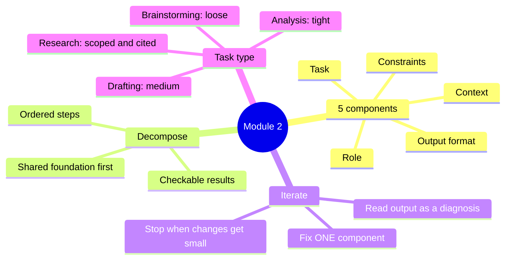
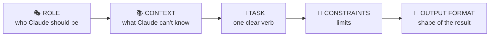
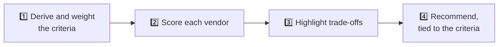
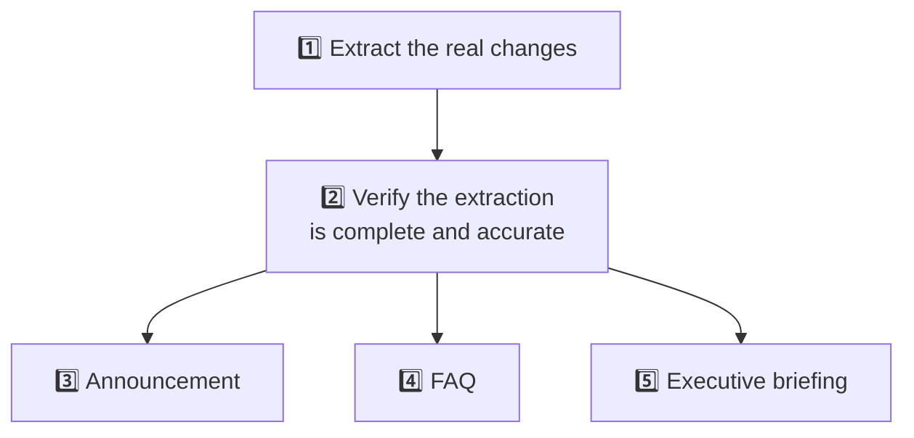
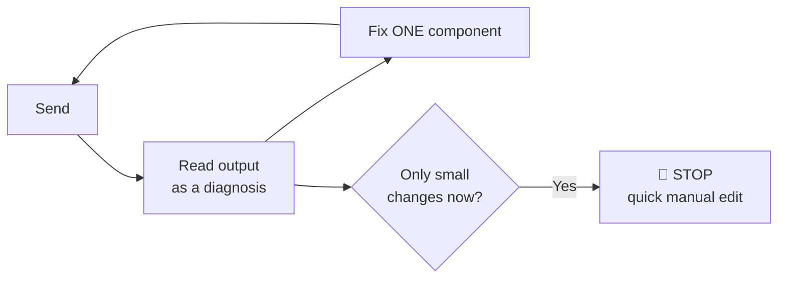

# 📗 Module 2: Prompting & Task Execution
### Last-minute revision notes for CCAO-F

> ⭐ **The big idea:** the same request phrased two ways gives two levels of quality. **The model doesn't get smarter between them. The prompt does.** Consistent quality comes from **prompt structure, not cleverness or luck**.

<!-- NOTES-START -->

## ⚡ 60-second recap



**The AI Fluency Framework competency here is *Description*:** telling Claude **precisely what you want**.
The course says **four skills cover the whole Prompting section of the exam**: the five components, decomposition, iteration, and matching strategy to task type.

---

## 1. Anatomy of an effective prompt



| Component | Controls | Example |
|---|---|---|
| **Role** | The vocabulary, depth and assumptions Claude brings | "You are an operations analyst" |
| **Context** | Background Claude **can't know**: audience, situation, earlier decisions, source material | "For our regional director, who cares about throughput and cost" |
| **Task** | The specific action, with **one main verb** | Summarize / compare / draft / identify |
| **Constraints** | Length, tone, what to include, leave out or avoid | "Only metrics that moved more than 10% against target" |
| **Output format** | The shape: table, bullets, memo, email | "Headline + three one-sentence bullets" |

⚠️ **Context is the component professionals most often leave out.**

**Not every prompt needs all five.** A quick question needs a **task (and maybe a constraint)**. A **client deliverable needs all five**. The skill is noticing which ones the task needs.

**Context gaps:** unless a **Connector** links a source, Claude can't see your inbox, org chart or last week's meeting. Even with one, it sees **only what you've allowed**. Anything that exists only in your head is a context gap, and gaps are **the most common reason a prompt underperforms**.

### The components double as a diagnostic checklist
| Missing | What you'll see |
|---|---|
| Context | **Generic** output |
| Clear task verb | **The wrong action** |
| Constraints | **Wrong length or tone** |

### Course worked example
❌ *"Write a summary of our quarterly operations."* → three plausible paragraphs that could describe any company. **Not wrong, just unusable.**
✅ *"You are an operations analyst (**role**). I'm preparing a one-page update for our regional director, who cares about throughput and cost, not process detail (**context**). Summarize the attached Q3 operations data (**task**), covering only the three metrics that moved more than 10 percent against target (**constraint**). Format as a short headline followed by three bullet points, each one sentence (**format**)."*
→ Same model, same data: **2 minutes to refine instead of being rebuilt.**

⏱️ **The habit:** before any prompt that matters, take **30 seconds** to check all five components. It saves several rounds of correction.

---

## 2. Task decomposition

> Packing a multi-stage task into one prompt gives **shallow work at every stage**.

**Course example:** *"Evaluate these three vendors and tell me which to pick"* is **four tasks wearing one sentence**. Claude invents criteria, applies them, weighs them and recommends all in one go, and **you can't see its reasoning**.



✅ Each step gives a **result you can check**: wrong criteria get caught **before** scoring. ✅ The work can be **audited**.

**One conversation or several?**
- Steps that **build on each other** → **the same conversation**, so each step sees the earlier results.
- A **genuinely independent** step, or a conversation **long enough that early context is degrading** → **a separate conversation** (links to Module 1).

### One source, three documents
A 20-page policy change has to become a **staff announcement + FAQ + executive briefing**.



👉 **Do the shared, high-stakes extraction first.** Drafting before it's confirmed **spreads one misreading into all three documents**.

---

## 3. Iterating prompts

> Don't rewrite the whole prompt. **Read the output to see which component fell short, and fix that one.**

| Symptom | Likely cause | Fix |
|---|---|---|
| Generic or off-target | Thin **context** | Add the background |
| Answered the wrong question | Ambiguous **task verb** | Make the instruction more precise |
| Wrong length, tone or shape | Missing **constraint or format** | Add it |
| Close, but one section misses | — | **Revise that section only** |

**Why not rewrite everything?** You **lose what worked** and **can't tell which change fixed it**. Change one component, resend, compare.



### Course example: the delayed-deliverable email
| Round | Change | Result |
|---|---|---|
| 1 | "Write a follow-up email to the client about the delayed deliverable." | Generic, defensive, no reason and no date → **thin context + no tone constraint** |
| 2 | Added: a two-day delay, a data-quality issue now fixed, new date Thursday, **accountable, not over-apologetic**, **under 120 words** | Strong. Only the subject line is missing. |
| 3 | "Add a subject line that signals resolution, not just delay." | Only a small gain → **stop** |

🎯 **The goal is a usable result, not a perfect prompt.** Once rounds bring only small changes, a quick manual edit beats more prompting.

---

## 4. Adapting strategy by task type

```
 MORE CONTROL ◄────────────────────────────────► MORE FREEDOM
   Analysis        Research        Drafting        Brainstorming
```

| Task type | Tighten | Loosen | Course example |
|---|---|---|---|
| **Analysis** | Criteria, standards, scope | Phrasing | Compare two contracts on payment terms, termination rights and liability caps, **in a three-row table** |
| **Research** | Question, sources, **citations** | How it combines the findings | Using current sources, summarize three competitors' Q2 launches. **Cite each source and flag anything unverifiable.** |
| **Drafting** | Audience, tone, format | Word choice | **150-word** LinkedIn post for **operations managers**, **confident but not salesy** |
| **Brainstorming** | Goal + guardrails only | Quantity and direction | **20 angles** for a month-end-close campaign. **Range widely; don't self-edit.** |

- **Research tools:** a quick current fact → **web search in chat**. A deep investigation across many sources → **Research** (paid plans).
- ⚠️ Citations are checkable when they come from **web search or Research results**. Citations from **training memory alone** look just as confident, so **verify them independently**.
- **The underlying move:** decide where you need **control** and where you need **range**, then set the constraints to match.

---

## 5. Course checkpoint and exercise

| Weak prompt | Weak component | Fix |
|---|---|---|
| "Make this better." (with a draft email) | **Task** | Say what "better" means: shorter? more formal? a clearer request? |
| "Give me everything you know about supply chain risk." | **Constraints** | Scope it: industry, risks, the decision it informs, length |
| "Write a professional document about the project." | **Context** | Give the audience, purpose and output shape |
| "Brainstorm names… one word, under eight letters, avoid twelve terms, exact brand voice." | **Task** (wrong strategy) | **Loosen first, filter after** |

**Repair exercise:** *"Summarize the customer feedback and tell me what to do"* was missing **all five** components (role and context are the easiest to miss).
**Repaired prompt:** *"You are a product analyst. Attached are 200 customer survey responses. Identify the three most frequently raised issues, ranked by how many responses mention each, and for each include one representative verbatim quote and the approximate share of responses it appears in. **Use code execution to count accurately rather than estimating.** Format as a ranked list, most frequent first."*
❌ **Trick fragment:** *"Make the summary sound professional and polished."* It sounds useful but **fills no gap**.

---

## 🎯 Key takeaways (read these last)

1. **Structure drives quality, not cleverness.** Check role, context, task, constraints and format before anything that matters.
2. **Context is the component you'll forget.** Generic output usually means a **context gap**, not a model limit.
3. **Break complex work into ordered steps** with results you can check. **Build the high-stakes foundation first.**
4. **Fix the component that failed.** Change one thing, compare, and **stop when rounds stop improving it**.
5. **Match the strategy to the task type.** Analysis needs constraints. Brainstorming needs freedom.

<!-- NOTES-END -->

---

# 📝 Question bank: 20 practice questions

> Answer all 20 first, then check the **answer key** at the end. *(Select TWO)* questions need both answers to count as correct.

**Q1.** According to the module, what mainly explains the quality gap between *"write something about our Q3 results"* and a fully specified request?
- A. The model became smarter
- B. The prompt's specification
- C. The time of day
- D. The model tier alone

**Q2.** Which AI Fluency Framework competency is the backbone of this module?
- A. Discernment
- B. Diligence
- C. Description
- D. Delegation

**Q3.** Which component do professionals **most often leave out**?
- A. Role
- B. Task
- C. Output format
- D. Context

**Q4.** In the prompt *"…Keep it under 200 words and don't mention pricing…"*, which component is this?
- A. Role
- B. Constraints
- C. Output format
- D. Context

**Q5.** Which statement about the five components is correct?
- A. Every prompt must include all five
- B. A quick question may need only a task (and maybe a constraint); a client deliverable needs all five
- C. Role is always the most important component
- D. Output format should be left to Claude

**Q6.** Claude can't see your org chart because no source is connected. In the module's terms, this is a:
- A. Constraint failure
- B. Context gap
- C. Format error
- D. Capability layer

**Q7.** *(Select TWO.)* Match each symptom to its likely cause correctly:
- A. Generic output → thin context
- B. Wrong length or tone → ambiguous task verb
- C. Answered the wrong question → ambiguous task verb
- D. Generic output → missing format
- E. Wrong action → missing role

**Q8.** *"Evaluate these three vendors and tell me which to pick"* underperforms mainly because:
- A. It's too short to read
- B. It packs several tasks (criteria, scoring, trade-offs, recommendation) into one prompt, giving shallow work and hidden reasoning
- C. It doesn't name a model
- D. Vendors can't be evaluated by Claude

**Q9.** What's the correct order for a decomposed vendor evaluation?
- A. Recommend → score → derive criteria → trade-offs
- B. Derive criteria → score → trade-offs → recommend
- C. Score → recommend → derive criteria → trade-offs
- D. Trade-offs → recommend → score → derive criteria

**Q10.** *(Select TWO.)* What are the benefits of decomposition?
- A. Each step gives a result you can check
- B. It removes the need for any review
- C. The work becomes auditable
- D. It always uses fewer messages
- E. It guarantees a perfect recommendation

**Q11.** A 20-page policy must become an announcement, an FAQ and an executive briefing. What's the first step?
- A. Draft the executive briefing
- B. Draft all three in one prompt
- C. Extract the real changes and verify them before drafting
- D. Brainstorm headlines

**Q12.** When should the next step of a decomposed task stay in the **same** conversation?
- A. When it builds on the previous step's results
- B. When it's genuinely independent
- C. When early context is degrading
- D. Never; always start fresh

**Q13.** A draft memo is accurate but far too long and too formal. What's the most efficient next step?
- A. Rewrite the whole prompt from scratch
- B. Switch models
- C. Adjust the constraint and format components (length and tone) and resend
- D. Abandon the prompt

**Q14.** A five-section report is strong except for Section 2. What should you do?
- A. Regenerate the whole report
- B. Iterate on Section 2 only
- C. Switch to a more capable model
- D. Accept it as is

**Q15.** When has iteration run its course?
- A. After exactly three rounds
- B. When each extra round brings only small changes rather than real improvement
- C. When the prompt is perfect
- D. When Claude says it's finished

**Q16.** Which task type needs **tight criteria, explicit standards and low creative freedom**?
- A. Brainstorming
- B. Drafting
- C. Analysis
- D. None of them

**Q17.** For **drafting**, what do you control and what do you leave to Claude?
- A. Control word choice; leave audience open
- B. Control audience, tone and format; leave word choice open
- C. Control nothing
- D. Control everything, including exact phrasing

**Q18.** With web search off, Claude gives confident citations for a recent regulation. What should you do?
- A. Trust them, since they look specific
- B. Treat citations from training memory as needing independent checking; use web search or Research for grounded citations
- C. Ask Claude to make them more formal
- D. Convert them into a table

**Q19.** *(Select TWO.)* Which prompts fit the module's **brainstorming** strategy?
- A. "Give me 20 angles for this campaign. Range widely; don't self-edit yet."
- B. "One-word names, under eight letters, avoid these twelve terms, exactly matching our brand voice."
- C. "Here's the goal and two guardrails. Give me 30 ideas; we'll apply the detailed constraints afterwards."
- D. "Give me the single best idea."
- E. "Specify one exact creative direction and stick to it."

**Q20.** In the repair exercise, why does *"Make the summary sound professional and polished"* **not belong**?
- A. It's too long
- B. It closes no specification gap, even though it sounds useful
- C. Claude can't follow tone instructions
- D. It should be in the role component

---

# ✅ Answer key

| Q | Answer | Why (from the module) |
|---|---|---|
| 1 | **B** | "The model did not get smarter… The prompt did." |
| 2 | **C** | Description = telling Claude precisely what you want |
| 3 | **D** | Context is the component professionals most often leave out |
| 4 | **B** | Length and what to avoid are constraints |
| 5 | **B** | Use the components the task needs |
| 6 | **B** | Anything not shared or connected is a context gap |
| 7 | **A, C** | Generic → context. Wrong question/action → task verb. Wrong length or tone → constraints. |
| 8 | **B** | "Four tasks wearing one sentence" |
| 9 | **B** | Criteria → score → trade-offs → recommend |
| 10 | **A, C** | Checkable intermediate results and an auditable process |
| 11 | **C** | The shared, high-stakes extraction comes first, or one misreading spreads into all three |
| 12 | **A** | Steps that build on each other stay together. Move independent steps or degrading context elsewhere. |
| 13 | **C** | Course quiz: fix the component the output points to |
| 14 | **B** | Don't throw away a draft that's mostly right |
| 15 | **B** | Usable, not perfect |
| 16 | **C** | Analysis: high specification, low freedom |
| 17 | **B** | You control the shape, Claude fills it |
| 18 | **B** | Grounded citations come from web search or Research |
| 19 | **A, C** | Goal + guardrails, volume first, filter after |
| 20 | **B** | The trick fragment fills no gap |

**🎯 Score guide:** 18–20 ready · 14–17 re-read the sections you missed · below 14 go back through sections 1–4
