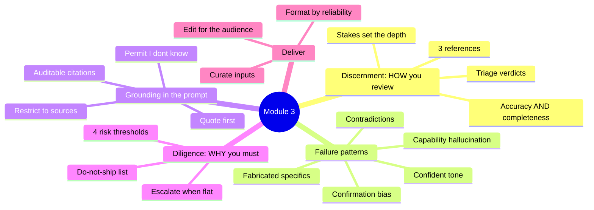
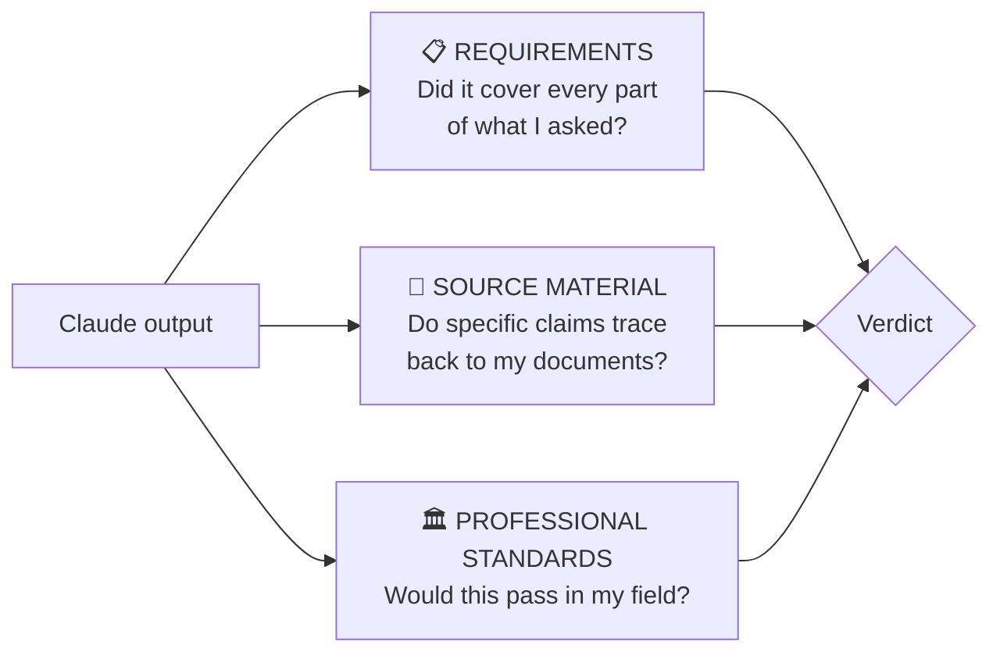
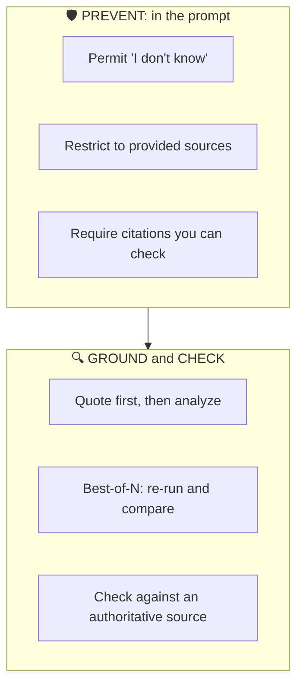
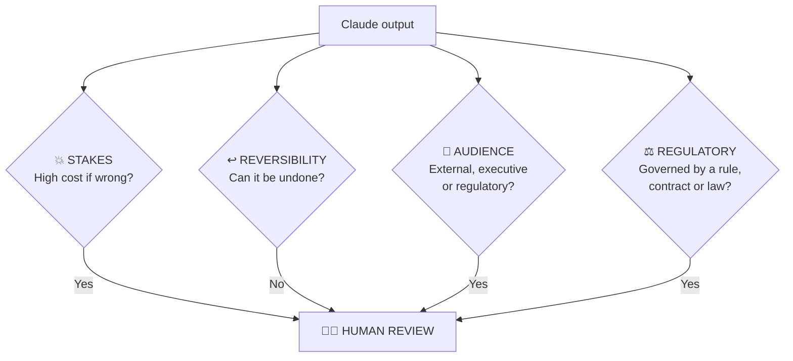
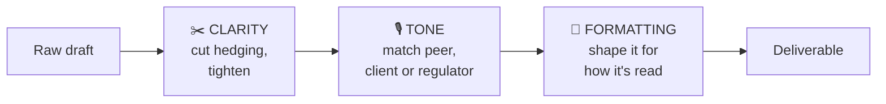
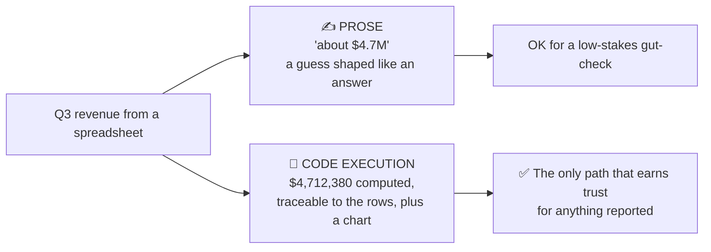

# 📙 Module 3: Evaluating & Validating Claude's Output
### Last-minute revision notes for CCAO-F

> ⭐ **The largest section of the exam.** The reason is **accountability**: when your name is on a deliverable, **you own every claim in it**, whether you wrote it or Claude did.

<!-- NOTES-START -->

## ⚡ 60-second recap

**The core imbalance:** time saved is **small and visible**. An unchecked error costs **a lot, and later**. *(Course case: one made-up growth rate in a client deck, caught by the client's analyst, cost a week of rebuilding trust.)*

**Two AI Fluency competencies anchor this module:**
| Competency | Meaning | Short version |
|---|---|---|
| **Discernment** | Critically evaluating output against requirements, sources and standards | **How** you review |
| **Diligence** | Deciding when verification is needed, and owning the result | **Why** you must |

---

## 1. Discernment: the evaluation protocol

Evaluation is **not a feeling** that the output looks good. It's a check against **three fixed references, done the same way every time**.

*Failing professional standards looks like:* a number with no units, a recommendation with no reasoning, or a citation you can't find.

### Stakes decide how deep to review
- **Zero-tolerance work** (legal analysis, financial figures, compliance): accuracy beats speed, so **check every claim**.
- **Low-stakes internal brainstorming**: a lighter review is fine.
- ⚠️ The risk is giving **both the same casual review**. **Decide the stakes first, then the depth.**

### Triage: three possible verdicts (write down your reasoning)

| Verdict | When it applies |
|---|---|
| ✅ **Ready to use** | Meets requirements, matches sources, passes professional standards. Ship it. |
| 🔁 **Needs revision** | Close, but a specific gap remains. Note it and refine. |
| 🧑‍⚖️ **Needs human override** | The stakes, the errors or the uncertainty mean it can't go out on Claude's draft alone. Escalate to a person. |

### Accuracy ≠ completeness
- **Accuracy** asks: is what's **there** correct?
- **Completeness** asks: is anything **missing**?
- They fail **independently**, so **check both**. Missing items are harder to spot because **nothing on the screen draws your eye to them**.

### The course's three examples: same protocol, three verdicts

| Output | What the check found | Verdict |
|---|---|---|
| Competitor-pricing summary from uploaded PDFs | The source said "$40/user, **minimum 10 seats**", but the summary dropped the minimum | 🔁 Needs revision → **re-prompt restricted to the sources**, not a rewrite |
| Three options to reduce invoice-processing time (internal) | Requirements met, no sources to check, low stakes | ✅ Ready to use. **Over-checking wastes the time saved.** |
| Compliance-gap analysis **without the regulation uploaded** | Worked from training memory of a rule that may have changed, and the stakes are regulatory | 🧑‍⚖️ Human override. A **prompt for an expert, not a substitute for one**. |

👉 What decides the verdict is never **how polished it looks**. It's what the **three references and the stakes** show.

---

## 2. Hallucinations, inconsistencies and bias

> **"Plausible" is not "verified."** Claude writes just as fluently when it's wrong, so tone can't warn you.

| Pattern | What it looks like | The giveaway |
|---|---|---|
| **Plausible but unsupported** | A reasonable-sounding claim with no basis | Nothing looks wrong. This is **the most dangerous kind.** |
| **Made-up specifics** | Invented statistics, dates, names, quotes, citations | **The precision is the giveaway.** A specific figure with no source is a "number-shaped guess." |
| **Confident tone hiding uncertainty** | A guess said in the same voice as a fact | "Is this clause enforceable in our state?" answered with full confidence. **Confidence is not evidence.** |
| **Internal contradictions** | Page 2 says a **$2B** market, page 8 builds on **$2.6B** | Long outputs need a **consistency pass**, not just a paragraph-by-paragraph read |
| **Confirmation bias** | Your prompt hints at an answer, and Claude leans toward it | It **agrees with you a bit too easily** on an open question |
| **Capability hallucination** | "I've emailed your team" or "I've saved the file" | Claude only acts through tools it was given. **Treat any claimed action as unverified until you confirm it.** |

**Completeness failure:** a multi-document comparison looked thorough but **missed the most important file**. These failures **cluster where attention is lowest**.

> 🔑 None of these *look* broken. Catch them by **knowing the patterns and checking sources**.

---

## 3. Fact-checking and grounding techniques

> **The strongest checking is built into the prompt, before the output exists.**

| Technique | Why it works | Course wording to use |
|---|---|---|
| **Permit "I don't know"** | Without permission, Claude is more likely to fill gaps with invented content | *"If the answer is not supported by the documents I provided, say so explicitly rather than estimating."* |
| **Restrict to sources** | Turns open-ended writing into **bounded retrieval** | *"Answer using only the attached contract… list anything not addressed under 'Not covered by this document.'"* |
| **Citations you can check** | **A citation you can't trace isn't a citation** | *"For every claim, cite the section and clause number… so I can verify it."* |
| **Quote first** | Makes both the reasoning and the errors visible | *"Extract the exact sentences… then base your analysis only on those quotes."* |
| **Best-of-N** | Where runs agree, confidence goes up. **Where they differ, you've found the weak spots.** | — |
| **Authoritative source** | Check claims that matter against a **trusted external reference, not another Claude answer** | Claude for Excel can give **cell-level citations** |

✅ **Checklist before relying on an output:** Did I allow uncertainty? Restrict to sources? Require citations I can check? Check high-stakes claims against an authoritative source?

---

## 4. Diligence: when human review is required

Know the thresholds **in advance**, so escalating is **decided by policy, not in the moment**.

### 🚫 Never ship without review (fixed list)
1. Final client deliverables
2. Audit-critical or financially material calculations
3. Anything with regulated, confidential or highly sensitive data
4. Public or legal communications where a misstatement has lasting consequences

### Iterate or escalate?
When rounds **stop improving** the output, the next step is **a human expert, not another prompt**. More prompting can't create judgment.

### Three escalation examples from the course
| Scenario | Thresholds | Action |
|---|---|---|
| **The quick "yes":** an internal meeting agenda | None tripped | Ship it quickly |
| **The misleading "looks fine":** board-deck financial summary | Stakes + executive audience + partly irreversible | Human reviewer, and **recompute the figures with code execution** |
| **The slow creep:** a client proposal, rounds 3–5 changed almost nothing | Diminishing returns + high-stakes external | Stop prompting and get a colleague to read it fresh. **The flat improvement is the signal**, not a visible error. |

> 🔒 **Accountability doesn't pass to the tool.** Once you ship it, it's your work, held to the same standard as if you'd done it alone.

---

## 5. Editing for your audience

**Claude drafts; you deliver.** An accurate draft still isn't finished.

**Different audiences:** same facts, but **what you include, how much detail, and the tone** all change.

| Version | Leads with |
|---|---|
| **Executive** | The decision and its impact *("Q3 processing time rose 18 percent… Recommend standardized onboarding docs.")* |
| **Working team** | Detail, method and actions, with an owner and timeline |
| **External** | Controlled disclosure and framing |

**Compare before you edit:** when quality matters, produce **more than one draft** (from several runs or models) and edit the **strongest one**. Comparing is cheaper than rescuing a weak draft.

---

## 6. Choosing output formats: a reliability decision

| Format | Use it for |
|---|---|
| **Inline** | Chat replies you'll act on straight away |
| **Artifacts** | Documents and code you'll refine and reuse |
| **Structured** (tables, defined fields) | Data that downstream tools or readers use directly |
| **Code execution** | **Numbers that must be right** |

⚠️ **The fine print:** the *calculation* is consistent, but Claude writes the code, so **the logic can still have a bug**. What you're guaranteed is that you can **read, check and re-run** it, **not** that it's automatically correct.

### Curate the inputs
Organized inputs give organized outputs. **Noise in → noise out.**
1. **Remove duplicates.** Don't make Claude reconcile near-identical copies.
2. **Label and structure.** For example: "this is the approved policy; these are the draft responses."
3. **Remove** anything that isn't relevant.

---

## 7. Course triage exercise: answers

| Output | Verdict | Why |
|---|---|---|
| Internal brainstorm, labeled as a starting point, a few weak entries | ✅ Ready to use (light edit) | Low stakes, internal |
| Financial summary whose total ≠ the sum of its line items | 🔁 Needs revision | Internal contradiction. Recompute with code execution. |
| Market overview with three statistics, no sources you can check | 🔁 Needs revision | Unchecked claims. Require citations or check against an authoritative source. |
| Regulatory filing summary, accurate where spot-checked | 🧑‍⚖️ Human override | High stakes, irreversible, regulator audience |

---

## 🎯 Key takeaways (read these last)

1. **Accountability stays with you.** You own every claim you ship.
2. **Check against three references:** requirements, sources, professional standards. **Match the depth to the stakes.**
3. **Plausible ≠ verified.** Made-up specifics, confident guesses and missing items all *look* competent.
4. **Build checking into the prompt:** permit "I don't know", restrict to sources, require citations you can check. **Preventing errors is cheaper than repairing trust.**
5. **Know the four thresholds in advance:** stakes, reversibility, audience, regulatory exposure.
6. **Choose the format by how reliable it must be.** Numbers that matter → **code execution**.
<!-- NOTES-END -->

---

# 📝 Question bank: 20 practice questions

> Answer all 20 first, then check the **answer key** at the end. *(Select TWO)* questions need both answers to count as correct.

**Q1.** Which pair correctly matches the two AI Fluency competencies in this module?
- A. Discernment = deciding when checking is needed; Diligence = reviewing output against sources
- B. Discernment = critically evaluating output against requirements, sources and standards; Diligence = deciding when checking is needed and owning the result
- C. Discernment = writing better prompts; Diligence = choosing the model
- D. Both mean the same thing: proofreading

**Q2.** What are the three references in the Discernment protocol?
- A. Tone, length, format
- B. Requirements, source material, professional standards
- C. Model tier, context window, usage limits
- D. Speed, cost, quality

**Q3.** A Claude report has every figure correct, but it leaves out a cost factor that would change the decision. Which statement is true?
- A. The report passes, because accuracy is the only test
- B. Accuracy and completeness fail independently, so a separate completeness check is needed
- C. Asking Claude "did you miss anything?" and trusting its reply is enough
- D. Switching to a more capable model will fix it

**Q4.** Claude summarizes vendor pricing from uploaded PDFs. One price reads "$25/user", but the PDF says "$25/user, annual contract only." What's the verdict and the fix?
- A. Ready to use; the price itself is correct
- B. Needs human override; send it to legal
- C. Needs revision; re-prompt restricted to the sources so the condition is included
- D. Needs revision; rewrite the whole summary manually

**Q5.** A team asks Claude for five ideas for the theme of an internal offsite. The ideas are sensible and nothing is sourced. A colleague wants to fact-check every line. What does the module suggest?
- A. Fact-check every line; all output must be fully verified
- B. Mark it ready to use; low stakes and internal, so over-checking wastes the time saved
- C. Escalate to a human expert
- D. Run it through Best-of-N five times

**Q6.** Claude flags four confident gaps between your policy and a regulation, but **the regulation was never uploaded**. What's the correct verdict?
- A. Ready to use; the gaps sound plausible
- B. Needs revision; ask Claude to rephrase
- C. Needs human override; Claude worked from training memory of a rule that may have changed, and the stakes are regulatory
- D. Ready to use if it's formatted as an Artifact

**Q7.** Claude states: *"71 percent of logistics firms cut costs with AI in 2025."* No source is given. Which failure pattern is this?
- A. Capability hallucination
- B. Confirmation bias
- C. A made-up specific; the precision with no source is the giveaway
- D. A formatting error

**Q8.** In a 12-page report, page 3 says headcount is **450**, and page 10 calculates costs using **520** employees. What's the issue, and the right check?
- A. Confident tone; ask Claude to hedge more
- B. Internal contradiction; long outputs need a consistency check across the whole document
- C. Capability hallucination; confirm the action happened
- D. No issue; both numbers may be correct

**Q9.** Claude ends a reply with: *"I've sent the summary to your manager."* No email tool was connected. What should you do?
- A. Assume it was sent, since Claude said so
- B. Treat it as a capability hallucination: unverified until you confirm it actually happened
- C. Ask Claude to send it again
- D. Switch models

**Q10.** Your prompt reads: *"Explain why moving to vendor X is clearly the best option."* Claude agrees enthusiastically. What risk should you watch for?
- A. Made-up specifics
- B. Confirmation bias in the framing; your prompt implied the answer you wanted
- C. Capability hallucination
- D. A completeness failure only

**Q11.** *(Select TWO.)* Which prompt habits **prevent** hallucinations before the output exists?
- A. Give explicit permission to say "I don't know"
- B. Ask Claude to sound more confident
- C. Restrict answers to the provided sources and flag anything they don't cover
- D. Ask for longer answers
- E. Remove all constraints so Claude has more freedom

**Q12.** For a long document, which technique makes both the reasoning and the errors visible?
- A. Ask for a one-line summary
- B. Quote first: pull the supporting sentences, then analyze only from them
- C. Ask the question with no document attached
- D. Use incognito mode

**Q13.** You run the same analysis three times. Two runs agree on the main findings, but they disagree on one forecast figure. What does this tell you?
- A. All three runs are unreliable; discard them
- B. Where runs agree, confidence goes up; where they differ, you've found a weak spot that needs a human look
- C. Average the three forecast figures
- D. The model is broken

**Q14.** For a high-stakes figure, what's the best check?
- A. Ask Claude a second time and compare
- B. Check it against a trusted external, authoritative source
- C. Trust it if it's in a table
- D. Ask Claude how confident it is

**Q15.** *(Select TWO.)* Which of these are among the module's **four risk thresholds** for required human review?
- A. Reversibility
- B. Word count
- C. Regulatory exposure
- D. Which model tier was used
- E. Whether the output used an Artifact

**Q16.** Which item is **NOT** on the module's "do-not-ship-without-review" list?
- A. Final client deliverables
- B. Audit-critical or financially material calculations
- C. Public or legal communications with lasting consequences
- D. A first-draft agenda for an internal team meeting

**Q17.** You've refined a client contract summary six times. Rounds 4–6 changed almost nothing, and the deliverable is external and high-stakes. What's the right move?
- A. Keep prompting with stronger wording
- B. Switch models and start again
- C. Stop prompting and escalate to a human expert; flat improvement is the signal
- D. Send it, since it hasn't changed much

**Q18.** One analysis must go to the CFO and to the operations team. Which approach fits the module?
- A. Send the raw Claude draft to both
- B. Executive version leading with the decision and impact; working-team version keeping detail, method and actions
- C. Send the operations version to the CFO, since it's more detailed
- D. Ask Claude which audience matters more

**Q19.** You need total annual revenue from a spreadsheet for a board slide. Which statement about code execution is correct?
- A. Code execution is always correct, so no review is needed
- B. A prose answer is just as reliable for reported figures
- C. Code execution computes a result you can trace and re-run, but Claude writes the code, so the logic can still contain a bug
- D. Code execution should only be used for charts

**Q20.** *(Select TWO.)* A user pastes five overlapping files, including three near-duplicate drafts of one policy, and gets a muddled summary. What will most improve the output?
- A. Switch to a higher model tier using the same files
- B. Remove duplicates and prune to the approved version
- C. Ask for a longer summary
- D. Label each remaining input's role (e.g., "this is the approved policy")
- E. Paste all five files again in a new chat

---

# ✅ Answer key

| Q | Answer | Why (from the module) |
|---|---|---|
| 1 | **B** | Discernment = how you review. Diligence = why you must (deciding when to check and owning the result). |
| 2 | **B** | Requirements, source material, professional standards |
| 3 | **B** | Completeness is a separate review. Missing items are harder to spot than wrong ones. |
| 4 | **C** | Course example ($40/user, minimum 10 seats): needs revision, re-prompt restricted to the sources, not a rewrite |
| 5 | **B** | Course example (invoice options): low stakes and internal, so over-checking wastes the time saved |
| 6 | **C** | Course compliance-gap example: a useful prompt *for* an expert, not a substitute for one |
| 7 | **C** | A specific figure with no source is a "number-shaped guess" |
| 8 | **B** | The $2B / $2.6B example: long outputs need a consistency check |
| 9 | **B** | Claude acts only through tools it was given. Claimed actions are unverified until confirmed. |
| 10 | **B** | If the prompt implies a preferred answer, Claude may lean toward it |
| 11 | **A, C** | Prevention in the prompt (citations you can check are the third habit) |
| 12 | **B** | Quote first, then analyze |
| 13 | **B** | Best-of-N: agreement raises confidence, differences point to the weak spots |
| 14 | **B** | Check against an authoritative source, **not** a second Claude response |
| 15 | **A, C** | The four thresholds: stakes, reversibility, audience, regulatory exposure |
| 16 | **D** | An internal agenda is the "quick yes" case. A, B and C are on the fixed list (as is regulated, confidential or sensitive data). |
| 17 | **C** | The "slow creep": diminishing returns + high-stakes external → escalate |
| 18 | **B** | Same facts, different selection, depth and tone |
| 19 | **C** | The calculation is consistent, but the logic can have a bug. You can read, check and re-run it. |
| 20 | **B, D** | Curate inputs: remove duplicates, prune and label. A bigger model still has to reconcile contradictory inputs. |

**🎯 Score guide:** 18–20 ready · 14–17 re-read the sections you missed · below 14 go back through sections 1–4
