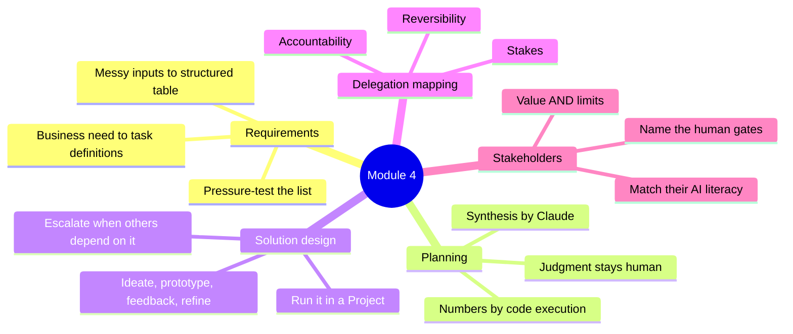
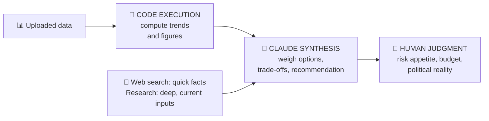
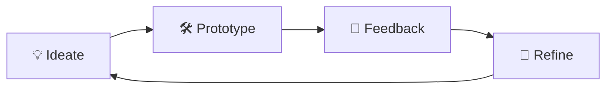
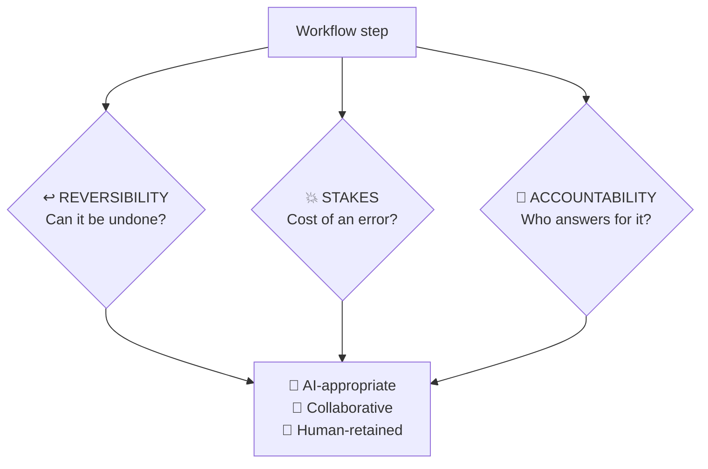

# 📒 Module 4: Workflow Integration & Solution Design
### Last-minute revision notes for CCAO-F

> ⭐ **The big idea:** "I use Claude" is a personal habit. "**Our workflow uses Claude**" is a repeatable team process where Claude does specific steps every time. **Workflow value comes from choosing which steps to delegate, not from automating everything.**

<!-- NOTES-START -->

## ⚡ 60-second recap

**The course's opening case: two teams, same tool, same contract-review process**
| Team | What they delegated | Result |
|---|---|---|
| ✅ Team 1 | Claude **drafted the redline**, a **lawyer owned every final decision** | Review time **halved**, quality held |
| ❌ Team 2 | Claude **approved low-risk clauses unsupervised** | An approved clause created an **obligation no one caught**, and the tool was **pulled** |

👉 The only difference was **which steps they delegated**.

**AI Fluency competency: *Delegation*.** For each step, decide whether it's **AI-appropriate, human-retained or collaborative**.

---

## 1. Analyzing requirements and use cases

Claude turns **messy inputs** (long documents, email threads, verbal requests) into **structured, testable requirements**. Ask for a **structured analysis, not a narrative summary**.

**From business need to task definition:** "We need better reporting" isn't actionable. Turn it into **which report, for whom, how often, from what data, in what format**. Each one becomes a requirement you can build against and check off.

### Course example: RFP response workflow
- **Inputs:** a 40-page RFP + a scattered internal email thread.
- **Prompt:** extract every requirement → a **short label, the exact RFP section, whether the thread already answers it, and any ambiguity** → **as a table**.
- **Output:** a table the team can work from, each row **traced to its section**, marked **answered or open**, with ambiguities flagged for clarifying questions.
- **Setup:** a **Project, not a one-off Chat**. Past winning proposals in the **knowledge base**, formatting in **Skills** (account-level), the extraction format in **standing instructions**. **No technical build needed.**

### Pressure-test the list
> *"Which requirements are ambiguous? Which could be read two ways? Which are implied only indirectly?"*

This uncovers **hidden requirements** (buried in a sub-clause or implied by an evaluation criterion) that **lose bids when missed**. **Extraction + pressure-test** is much stronger than either alone. It's **Discernment (Module 3) applied to requirements**.

---

## 2. Research, planning and process optimization

- **Synthesis** is where Claude **excels**, and also where **unchecked claims can creep in**, so Module 3's checking habits apply.
- **Calculation must be verified:** when a plan depends on numbers, **compute them with code execution**. *"A staffing plan built on a guessed utilization rate is a guess. One built on code-executed analysis of real timesheets is a plan."*

### Course example: capacity plan
Upload **four quarters of ticket data** → **code execution** calculates growth and tickets per analyst → Claude **recommends headcount** from those **verified figures and shows its assumptions**. The plan can be **defended line by line**.
- ✅ **Claude's value:** turning the data into a defensible recommendation.
- 👤 **Human:** **the decision to hire**, against budget and hiring-freeze realities Claude can't see.

👉 **Look at a workflow for its synthesis-heavy steps (apply Claude) and its judgment steps (keep them human).**

---

## 3. Solution design, development and iteration

> Claude is a **design partner, not a vending machine**.

Run the loop **inside a Project**, so the context, constraints and earlier decisions **stay stable** and each round builds on the last.

### Course example: an internal dashboard tool (no code written)
| Cycle | Request |
|---|---|
| 1 · Build | Dashboard **artifact** showing five metrics, a chart for each |
| 2 · Filter and totals | Add a **region filter** and a **totals row** |
| 3 · Color and print | **Color-code** month-over-month changes (green = improvement), and make it **print cleanly** |

The team improved it by **describing changes, not coding them**.

### 🚨 When to escalate
When a solution becomes a **system others depend on**, with **uptime, security or integration requirements**, it has **outgrown Associate scope** and belongs with **Developer or Architect** expertise. **Other people relying on it is the signal.**

---

## 4. Delegation mapping ⭐ (the core skill)

Map the workflow **step by step**, then classify each step using **three criteria**:

- **Reversible** steps can be delegated more. **Irreversible** ones need a human.
- **High-cost** steps stay **human-owned or human-reviewed**.
- **Accountability doesn't delegate**, even when the drafting does.

**Building the redesign:** put the right feature at each AI step: a **Skill for repeatable procedures**, **code execution for data steps**. *Consistency from a configured Skill beats heroic prompting.* Human steps become **explicit review gates**.

### Two course maps: same criteria, same pattern

| Contract review | Owner | | Onboarding documents | Owner |
|---|---|---|---|---|
| Extract clauses | 🤖 AI | | Pull new-hire details from the HRIS export | 🤖 AI (code execution) |
| Flag departures from the playbook | 🤖 AI (Skill) | | Draft the offer letter from the template | 🤖 AI (Skill) |
| Draft the redline and rationale | 🤝 Collaborative | | Personalize the welcome note | 🤝 Collaborative |
| Approve or reject each change | 👤 Human | | Confirm pay matches the approved requisition | 👤 Human |
| Calculate penalty-clause exposure | 🤖 AI (code execution) | | Send the signed offer | 👤 Human |
| Sign and send | 👤 Human | | | |

👉 **Mechanical and drafting steps get delegated. Figure-confirmation and irreversible actions stay human.** The AI does **real work** (the redline itself), and **the human owns the decisions**.

### ❌ Over-delegation and common mapping mistakes
- **Over-delegation:** giving AI more than the risk justifies, such as **approving or sending because it drafted well**. *Good drafting isn't permission to delegate the decision.* (This is what went wrong for Team 2.)
- **Halo delegation:** a step goes to AI **because the previous step went well**. Judge each step on its own.
- **Collapsing "collaborative" into "automated":** "AI drafts, human reviews" quietly becomes "AI drafts" when **no one actually does the review**. *A collaborative step with no reviewer is an automated step.*
- **Mapping the tool instead of the work:** building around a favorite feature. **Map the work first, then choose the features.**

---

## 5. Communicating value and limitations

> **Overstating what Claude can do is how teams lose trust at the first visible mistake.** State the **limits as clearly as the value**.

| ❌ Overstated | ✅ Accurate |
|---|---|
| "Our new AI system reviews contracts automatically." | "Claude drafts the redline and flags playbook departures; **our legal lead reviews and approves every change** before anything is sent. Review time is down about half, with the same approval standard." |
| "Claude handles contract review." | "Claude drafts the first-pass redline, **which a lawyer reviews**." |

🚩 **Phrases that quietly overstate:** *"fully automated"* · *"Claude handles X"* · *"basically as good as a person at Y."*
**The fix every time:** **say what the tool does, then name the human checkpoint.**

**Match the message to the audience's AI literacy:**
- **Technical, high-literacy audience** (e.g., a legal lead): feature detail **plus known failure modes** (*"it can miss obligations implied indirectly"*).
- **Executive:** the **outcome, the oversight in place, and the risk posture**.
- Same workflow, same human gate. Only **the level of detail** changes. *(This is Module 2's Description skill, aimed at people.)*

**Write down the human oversight:** *"Every output destined for a client passes human review."* Stakeholders trust an AI workflow **more** when the checkpoints are explicit.

---

## 6. Course exercise: expense-report redesign (answers)

| Step | Owner | Feature | Why |
|---|---|---|---|
| 1. Extract line items from receipts | 🤖 Automate | **Skill** | Reversible, low stakes, mechanical |
| 2. Check expenses against travel policy | 🤝 Collaborative | **Skill** | AI flags, a human confirms edge cases. The Skill holds the policy rules. |
| 3. Total the report and calculate over/under limits | 🤖 Automate | **Code execution** | Numbers must be computed, not estimated |
| 4. Draft a note explaining flagged items | 🤝 Collaborative | Neither | AI drafts, the approver adjusts |
| 5. Approve or reject | 👤 Human | — | Accountability doesn't delegate |
| 6. Submit to finance for payment | 👤 Human | — | Irreversible, financially material |

---

## 🎯 Key takeaways (read these last)

1. **Delegate deliberately, don't automate everything.** Value comes from choosing *which* steps Claude does.
2. **Claude is a requirements-analysis partner:** messy inputs in, structured, traceable, testable requirements out (then pressure-test them).
3. **Build plans on verified numbers:** Claude synthesizes, **code execution computes**, humans make the judgment calls.
4. **Map every step against reversibility, stakes and accountability** to decide AI-appropriate, collaborative or human-retained.
5. **Communicate limits as clearly as value**, and name the human review gates.

<!-- NOTES-END -->

---

# 📝 Question bank: 20 practice questions

> Answer all 20 first, then check the **answer key** at the end. *(Select TWO)* questions need both answers to count as correct.

**Q1.** Which AI Fluency competency anchors this module?
- A. Description
- B. Discernment
- C. Delegation
- D. Diligence

**Q2.** Two teams used Claude for the same contract-review process. One halved review time; the other pulled the tool after an approved clause created an unnoticed obligation. What was the key difference?
- A. The model tier they used
- B. Which steps they chose to delegate
- C. The length of their prompts
- D. Whether they used Artifacts

**Q3.** A manager says, "We need better reporting." What's the best first move with Claude?
- A. Ask Claude to build a dashboard immediately
- B. Turn the need into specific task definitions: which report, for whom, how often, from what data, in what format
- C. Ask Claude to write a narrative summary of the problem
- D. Use Research to find industry reporting trends

**Q4.** When analyzing a long RFP with Claude, what should you ask for?
- A. A narrative summary of the RFP
- B. A structured table of requirements, each traced to its RFP section, marked answered or open, with ambiguities flagged
- C. A list of the client's competitors
- D. A draft of the whole proposal in one pass

**Q5.** Which requirement is most ambiguous as written?
- A. "Invoices must be generated in PDF format."
- B. "The app should load quickly for users."
- C. "Users must reset passwords through the existing identity provider."
- D. "Order confirmations must be emailed within two minutes."

**Q6.** After Claude extracts a requirements list, what does the module recommend next?
- A. Send it to the client immediately
- B. Pressure-test it: ask which items are ambiguous, could be read two ways, or are implied only indirectly
- C. Switch to a bigger model and extract again
- D. Convert it into an Artifact

**Q7.** The RFP workflow recurs for every new bid. Where should it live?
- A. A new Chat each time
- B. A Project, with past proposals in the knowledge base, the extraction format in standing instructions, and formatting handled by Skills
- C. Incognito mode
- D. A Research session

**Q8.** A staffing plan depends on ticket-growth and throughput figures from an uploaded dataset. How should the figures be produced?
- A. Claude estimates them in prose
- B. Use code execution to compute them, then have Claude synthesize the plan from the verified numbers
- C. Use typical industry averages from training data
- D. Ask the team to guess

**Q9.** In the capacity-planning example, which step stays with the human?
- A. Calculating quarterly volume growth
- B. Computing tickets per analyst
- C. The decision to hire, weighed against budget and hiring-freeze realities
- D. Drafting the recommendation from verified figures

**Q10.** What's the correct order of the solution-design loop?
- A. Prototype → ideate → refine → feedback
- B. Ideate → prototype → feedback → refine
- C. Feedback → ideate → refine → prototype
- D. Refine → prototype → ideate → feedback

**Q11.** Why run the design loop inside a Project?
- A. Projects make Claude write code faster
- B. The context, constraints and earlier decisions stay stable, so each iteration builds on the last
- C. Projects remove the need for feedback
- D. Projects automatically deploy the artifact

**Q12.** A dashboard artifact built for one analyst is now used daily by four departments for official reporting. What does this signal?
- A. Keep iterating by prompt as usual
- B. It has become a system others depend on; escalate toward Developer or Architect expertise
- C. Switch to Opus
- D. Move it to Incognito

**Q13.** *(Select TWO.)* Which are among the three delegation-mapping criteria?
- A. Reversibility
- B. Prompt length
- C. Accountability
- D. Model tier
- E. Popularity of the feature

**Q14.** In a contract-review redesign, which step should be **human-retained**?
- A. Extracting clauses
- B. Flagging playbook departures
- C. Approving or rejecting each change
- D. Calculating the penalty-clause exposure

**Q15.** In the onboarding-documents map, how should "confirm compensation figures match the approved requisition" be classified?
- A. AI-appropriate
- B. Collaborative
- C. Human-retained
- D. AI-appropriate with code execution

**Q16.** Claude drafted three contracts perfectly, so the team lets it also send the fourth contract to the client. Which mistake is this?
- A. Mapping the tool instead of the work
- B. Halo delegation (and over-delegation)
- C. Collapsing collaborative into automated
- D. No mistake

**Q17.** A workflow says "AI drafts, human reviews", but the reviewer role was never staffed. What has happened?
- A. The step is still collaborative
- B. It has quietly collapsed into an automated step
- C. The step is human-retained
- D. Nothing; the drafting is good enough

**Q18.** *(Select TWO.)* When building a redesigned workflow, which feature should go at which step?
- A. A Skill for repeatable procedure steps
- B. Memory for numeric totals
- C. Code execution for data steps
- D. Research for approval decisions
- E. Incognito for drafting

**Q19.** Which stakeholder message builds the most trust?
- A. "Our AI reviews contracts automatically."
- B. "Claude handles all our contract work now."
- C. "Claude drafts the redline and flags playbook departures; our legal lead reviews and approves every change before anything is sent."
- D. "It's basically as good as a lawyer."

**Q20.** *(Select TWO.)* When presenting the same workflow to an **executive** rather than a technical lead, what should change?
- A. Lead with the outcome, the oversight in place, and the risk posture
- B. Remove any mention of human review to keep it short
- C. Keep the same human gate, but adjust the level of detail
- D. Say the system is fully automated
- E. Hide the known failure modes from everyone

---

# ✅ Answer key

| Q | Answer | Why (from the module) |
|---|---|---|
| 1 | **C** | Delegation: AI-appropriate, human-retained or collaborative for each step |
| 2 | **B** | "Same product, same process. The difference was which steps each team chose to delegate." |
| 3 | **B** | Turn business needs into task definitions you can build against and check |
| 4 | **B** | A structured, traceable analysis, not a narrative summary |
| 5 | **B** | "Quickly" isn't quantified, so two engineers would build different things |
| 6 | **B** | The pressure-test uncovers hidden requirements (Discernment applied to requirements) |
| 7 | **B** | A recurring workflow → Project. Skills are account-level. No technical build needed. |
| 8 | **B** | Plans rest on computed numbers. Synthesis comes after verification. |
| 9 | **C** | Judgment steps stay human |
| 10 | **B** | Ideate → prototype → feedback → refine, then repeat |
| 11 | **B** | Stable context, so each round builds on the last |
| 12 | **B** | Other people relying on it is the escalation signal |
| 13 | **A, C** | The three criteria: reversibility, stakes, accountability |
| 14 | **C** | High stakes, and accountability doesn't delegate |
| 15 | **C** | High stakes, and accountability doesn't delegate |
| 16 | **B** | Judging a step by earlier success (halo), and giving an irreversible step to AI (over-delegation) |
| 17 | **B** | "A collaborative step with no real reviewer is an automated step" |
| 18 | **A, C** | A Skill for procedures, code execution for data |
| 19 | **C** | Value plus limits, with the human gate named |
| 20 | **A, C** | Match the audience's AI literacy, but the same oversight still applies |

**🎯 Score guide:** 18–20 ready · 14–17 re-read the sections you missed · below 14 go back through sections 1–5
